# Dependency report — dev-digest

> Generated 2026-11-19 by the `dependencies-checker` skill · commit `8a9b586` on `lesson-6-hw` (3 uncommitted file(s)) · mode **online** · 6 packages.
> Sizes are apparent bytes of installed packages in each `node_modules`, not browser-bundle sizes. **Exclusive** = what removing that one dependency would free; **closure** = it plus everything it pulls in.

## 1. Summary

- **Health:** 6 packages, **1.38 GB** installed in **1 082** packages (`client` 575 MB, `evals` 448 MB). No broken installs, no phantom imports, no range mismatches; 2 of 150 findings were false positives (F78, F150).
- **Security (online, the main risk):** 23 default-P0 advisories; after triage **6 stay P0**, all on network paths of the two apps — `next` 15.5.19 (14 advisories, 3 critical RCE, F03), `fastify` 5.8.5 + `fast-uri` (F18, F19) on an API bound to `0.0.0.0`, and `simple-git` 3.36 running on cloned, untrusted repositories (F16, F22). Three upgrades close them; two are patch/minor.
- **zod 3 has no fix** for the memory-exhaustion advisory (needs ≥ 4.6.6, F23/F15/F07): the zod 3 → 4 migration of `server`, `reviewer-core`, both vendored `@devdigest/shared` copies and `client` becomes a planned security item (L). `mcp` is already on zod 4 (drift F77).
- **Most dev-tool advisories collapse into one wave:** `vitest` 2 → 5 in four packages (mcp is already on 5) closes ~30 findings (vite, tinypool, esbuild, `@vitest/mocker`) and the esbuild 0.21 duplicates in three packages.
- **Size:** the big numbers are intrinsic (Next's SWC + sharp 304 MB, Claude Agent SDK 361 MB, mermaid 113 MB — already lazy-loaded). Real cleanups are small: `@fastify/autoload` (unused, runtime, F24) and `tsx` in `reviewer-core` (unused, 11.5 MB, F73).

## 2. Component map

Solid arrows: source imports through tsconfig path aliases (label = alias · files importing it). Dashed: runtime calls found as `localhost:<port>` references. Double-dashed: vendored copies of the same module.

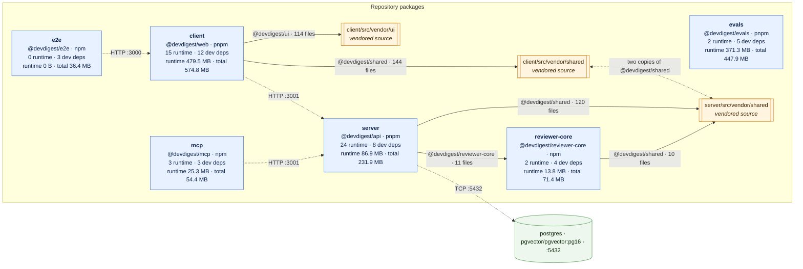

## 3. Packages at a glance

| Package | Manager | Direct (runtime / dev) | Installed packages | Runtime footprint | Total footprint | Heaviest direct dependency | Findings P0 · P1 · P2 · P3 |
|---|---|---|---|---|---|---|---|
| **client** `@devdigest/web` | pnpm | 15 / 12 | 436 | 479.5 MB | 574.8 MB | next (306.9 MB) | 7 · 8 · 19 · 7 |
| **e2e** `@devdigest/e2e` | npm | 0 / 3 | 6 | 0 B | 36.4 MB | typescript (22.5 MB) | 0 · 0 · 1 · 3 |
| **evals** `@devdigest/evals` | pnpm | 2 / 5 | 97 | 371.3 MB | 447.9 MB | @anthropic-ai/claude-agent-sdk (360.9 MB) | 6 · 11 · 8 · 6 |
| **mcp** `@devdigest/mcp` | npm | 3 / 3 | 32 | 25.3 MB | 54.4 MB | typescript (22.5 MB) | 0 · 0 · 2 · 3 |
| **reviewer-core** `@devdigest/reviewer-core` | npm | 2 / 4 | 87 | 13.8 MB | 71.4 MB | vitest (23.6 MB) | 2 · 7 · 8 · 4 |
| **server** `@devdigest/api` | pnpm | 24 / 8 | 424 | 86.9 MB | 231.9 MB | drizzle-kit (46.5 MB) | 8 · 16 · 23 · 8 |

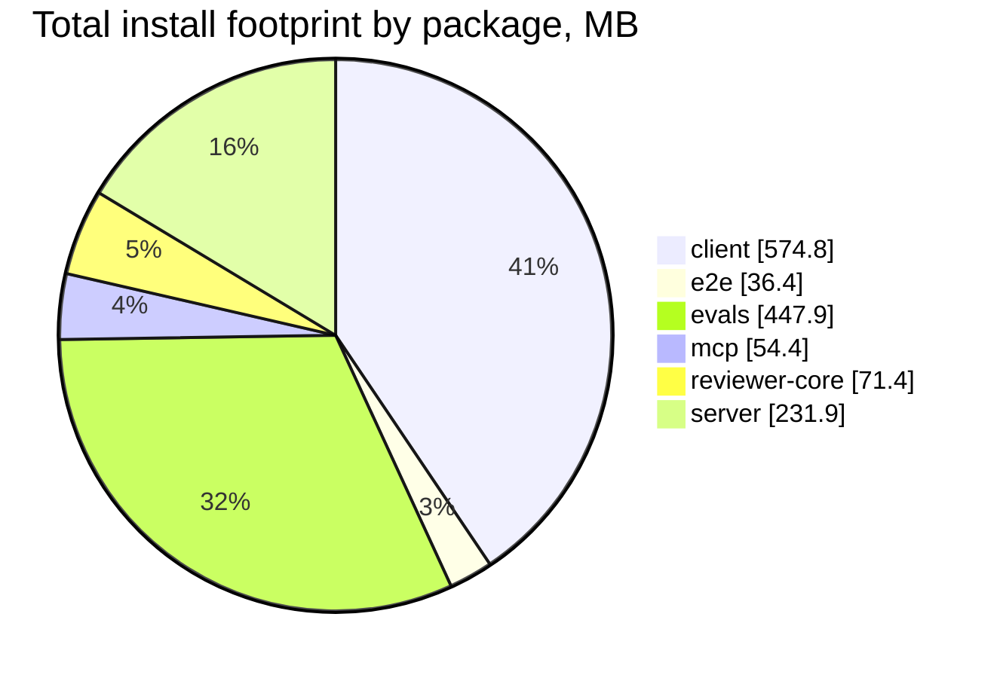

## 4. Package details

### 4.1 `client` — @devdigest/web

**15** runtime + **12** dev direct dependencies → **436** installed packages, **574.8 MB** (runtime tree 274 packages, 479.5 MB). Lockfile: `pnpm-lock.yaml`.

```mermaid
flowchart LR
  pkg_client(["<b>client</b><br/>@devdigest/web"])
  subgraph pkg_client_prod["Runtime — dependencies · 15"]
    direction TB
    pkg_client_prod_next["next<br/>15.5.19 · 306.9 MB"]
    pkg_client_prod_mermaid["mermaid<br/>11.15.0 · 115.2 MB"]
    pkg_client_prod_lucide_react["lucide-react<br/>0.469.0 · 27.3 MB"]
    pkg_client_prod_recharts["recharts<br/>2.15.4 · 10.5 MB"]
    pkg_client_prod_react_dom["react-dom<br/>19.2.7 · 7.1 MB"]
    pkg_client_prod_zod["zod<br/>3.25.76 · 3.4 MB"]
    pkg_client_prod__tanstack_react_query["@tanstack/react-query<br/>5.101.0 · 3.0 MB"]
    pkg_client_prod_react_markdown["react-markdown<br/>9.1.0 · 2.7 MB"]
    pkg_client_prod_next_intl["next-intl<br/>3.26.5 · 2.3 MB"]
    pkg_client_prod_remark_gfm["remark-gfm<br/>4.0.1 · 2.3 MB"]
    pkg_client_prod__dnd_kit_core["@dnd-kit/core<br/>6.3.1 · 1.2 MB"]
    pkg_client_prod_diff["diff<br/>9.0.0 · 601 KB"]
    pkg_client_prod_more["+3 more<br/>396 KB exclusive"]
  end
  pkg_client --> pkg_client_prod
  subgraph pkg_client_dev["Dev — devDependencies · 12"]
    direction TB
    pkg_client_dev_vitest["vitest<br/>2.1.9 · 30.9 MB"]
    pkg_client_dev_typescript["typescript<br/>5.9.3 · 22.5 MB"]
    pkg_client_dev__tailwindcss_postcss["@tailwindcss/postcss<br/>4.3.0 · 17.3 MB"]
    pkg_client_dev_jsdom["jsdom<br/>25.0.1 · 13.2 MB"]
    pkg_client_dev__vitejs_plugin_react["@vitejs/plugin-react<br/>4.7.0 · 11.9 MB"]
    pkg_client_dev__types_node["@types/node<br/>22.19.19 · 2.4 MB"]
    pkg_client_dev__types_react["@types/react<br/>19.2.16 · 1.6 MB"]
    pkg_client_dev__testing_library_jest_dom["@testing-library/jest-dom<br/>6.9.1 · 1021 KB"]
    pkg_client_dev_tailwindcss["tailwindcss<br/>4.3.0 · 737 KB"]
    pkg_client_dev__testing_library_react["@testing-library/react<br/>16.3.2 · 571 KB"]
    pkg_client_dev_postcss["postcss<br/>8.5.15 · 376 KB"]
    pkg_client_dev__types_react_dom["@types/react-dom<br/>19.2.3 · 29 KB"]
  end
  pkg_client --> pkg_client_dev
  classDef unused fill:#fde8e8,stroke:#c43c3c,stroke-dasharray:4 3,color:#3d0b0b
  classDef heavy fill:#fff1db,stroke:#d08a1e,color:#3d2600
  classDef drift fill:#f1e8ff,stroke:#7a4fd0,color:#21094d
  classDef warn fill:#fffbe0,stroke:#b9a21c,color:#332b00
  class pkg_client_dev_postcss unused
  class pkg_client_prod_next,pkg_client_prod_mermaid,pkg_client_prod_lucide_react heavy
  class pkg_client_prod_zod,pkg_client_dev_vitest drift
  class pkg_client_prod_recharts,pkg_client_prod_react_markdown,pkg_client_prod_next_intl,pkg_client_dev_typescript,pkg_client_dev_jsdom,pkg_client_dev__vitejs_plugin_react,pkg_client_dev__types_node,pkg_client_dev__testing_library_jest_dom warn
```

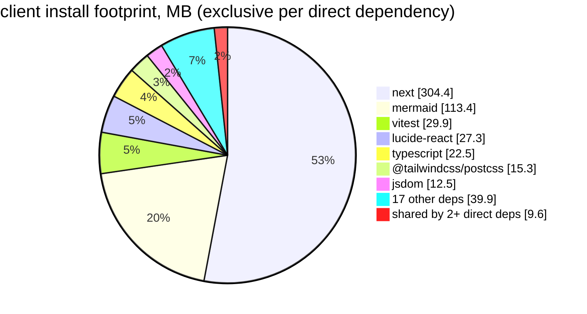

| Dependency | Section · category | Declared → installed | Purpose | Used by (files) | Own | Closure | Exclusive | License | Flags |
|---|---|---|---|---|---|---|---|---|---|
| `next` | prod · library | ^15.1.3 → 15.5.19 | The React Framework | src 37 · config 2 · bin next→dev/build/start · peer of next-intl | 133.0 MB | 306.9 MB (20) | 304.4 MB | MIT | `vuln` `heavy` `outdated` `browser` `native` |
| `mermaid` | prod · library | ^11.15.0 → 11.15.0 | Markdown-ish syntax for generating flowcharts, mindmaps, sequence dia… | src 1 | 72.8 MB | 115.2 MB (111) | 113.4 MB | MIT | `vuln` `heavy` `outdated` `browser` |
| `lucide-react` | prod · library | ^0.469.0 → 0.469.0 | A Lucide icon library package for React applications | src 1 | 27.3 MB | 27.3 MB (1) | 27.3 MB | ISC | `heavy` `outdated` |
| `recharts` | prod · library | ^2.15.0 → 2.15.4 | React charts | src 2 | 4.4 MB | 10.5 MB (41) | 7.7 MB | MIT | `outdated` |
| `react-dom` | prod · library | ^19.0.0 → 19.2.7 | React package for working with the DOM. | src 2 · peer of @dnd-kit/core, next, recharts | 7.0 MB | 7.1 MB (2) | 7.1 MB | MIT | `browser` |
| `zod` | prod · library | ^3.24.1 → 3.25.76 | TypeScript-first schema declaration and validation library with stati… | src 12 | 3.4 MB | 3.4 MB (1) | 3.4 MB | MIT | `vuln` `drift` `outdated` |
| `@tanstack/react-query` | prod · library | ^5.62.8 → 5.101.0 | Hooks for managing, caching and syncing asynchronous and remote data … | src 18 · test 18 | 839 KB | 3.0 MB (2) | 3.0 MB | MIT | `browser` |
| `react-markdown` | prod · library | ^9.0.3 → 9.1.0 | React component to render markdown | src 1 | 51 KB | 2.7 MB (82) | 902 KB | MIT | `outdated` |
| `next-intl` | prod · library | ^3.26.0 → 3.26.5 | Internationalization (i18n) for Next.js | src 107 · test 62 · config 1 | 356 KB | 2.3 MB (12) | 2.0 MB | MIT | `vuln` `outdated` `browser` |
| `remark-gfm` | prod · library | ^4.0.0 → 4.0.1 | remark plugin to support GFM (autolink literals, footnotes, strikethr… | src 1 | 21 KB | 2.3 MB (68) | 538 KB | MIT |  |
| `@dnd-kit/core` | prod · library | ^6.3.1 → 6.3.1 | dnd kit – a lightweight React library for building performant and acc… | src 2 · peer of @dnd-kit/sortable | 1.0 MB | 1.2 MB (4) | 1.0 MB | MIT | `browser` |
| `diff` | prod · library | ^9.0.0 → 9.0.0 | A JavaScript text diff implementation. | src 1 | 601 KB | 601 KB (1) | 601 KB | BSD-3-Clause |  |
| `@dnd-kit/sortable` | prod · library | ^10.0.0 → 10.0.0 | Official sortable preset and sensors for dnd kit | src 4 | 229 KB | 403 KB (3) | 229 KB | MIT | `browser` |
| `@dnd-kit/utilities` | prod · library | ^3.2.2 → 3.2.2 | Internal utilities to bee shared between `@dnd-kit` packages | src 2 | 86 KB | 175 KB (2) | 0 B | MIT | `browser` |
| `react` | prod · library | ^19.0.0 → 19.2.7 | React is a JavaScript library for building user interfaces. | src 247 · test 26 · peer of @dnd-kit/core, @dnd-kit/sortable, @dnd-kit/utilities | 168 KB | 168 KB (1) | 168 KB | MIT | `browser` |
| `vitest` | dev · test | ^2.1.8 → 2.1.9 | Next generation testing framework powered by Vite | test 91 · config 1 · bin vitest→test | 1.6 MB | 30.9 MB (43) | 29.9 MB | MIT | `vuln` `outdated` `drift` `native` |
| `typescript` | dev · tooling | ^5.7.2 → 5.9.3 | TypeScript is a language for application scale JavaScript development | bin tsc→typecheck | 22.5 MB | 22.5 MB (1) | 22.5 MB | Apache-2.0 | `outdated` |
| `@tailwindcss/postcss` | dev · tooling | ^4.0.0 → 4.3.0 | PostCSS plugin for Tailwind CSS, a utility-first CSS framework for ra… | config 1 | 97 KB | 17.3 MB (23) | 15.3 MB | MIT | `native` |
| `jsdom` | dev · test | ^25.0.1 → 25.0.1 | A JavaScript implementation of many web standards | config 1 · peer of vitest | 3.0 MB | 13.2 MB (60) | 12.5 MB | MIT | `outdated` |
| `@vitejs/plugin-react` | dev · tooling | ^4.3.4 → 4.7.0 | The default Vite plugin for React projects | config 1 | 59 KB | 11.9 MB (49) | 9.2 MB | MIT | `outdated` |
| `@types/node` | dev · types | ^22.10.0 → 22.19.19 | TypeScript definitions for node | peer of vitest · types for node | 2.3 MB | 2.4 MB (2) | 2.4 MB | MIT | `outdated` |
| `@types/react` | dev · types | ^19.0.2 → 19.2.16 | TypeScript definitions for react | peer of react-markdown, @testing-library/react, @types/react-dom · types for react | 398 KB | 1.6 MB (2) | 398 KB | MIT |  |
| `@testing-library/jest-dom` | dev · test | ^6.6.3 → 6.9.1 | Custom jest matchers to test the state of the DOM | test 1 | 294 KB | 1021 KB (10) | 1014 KB | MIT | `outdated` |
| `tailwindcss` | dev · tooling | ^4.0.0 → 4.3.0 | A utility-first CSS framework for rapidly building custom user interf… | style 1 | 737 KB | 737 KB (1) | 0 B | MIT |  |
| `@testing-library/react` | dev · test | ^16.1.0 → 16.3.2 | Simple and complete React DOM testing utilities that encourage good t… | test 70 | 329 KB | 571 KB (2) | 329 KB | MIT |  |
| `postcss` | dev · tooling | ^8.4.49 → 8.5.15 | Tool for transforming styles with JS plugins | **unused** | 201 KB | 376 KB (4) | 0 B | MIT | `vuln` `unused` |
| `@types/react-dom` | dev · types | ^19.0.2 → 19.2.3 | TypeScript definitions for react-dom | peer of @testing-library/react · types for react-dom | 29 KB | 29 KB (1) | 29 KB | MIT |  |

**Licenses (whole tree):** MIT 356 · ISC 45 · BSD-3-Clause 11 · Apache-2.0 11 · LGPL-3.0-or-later 2 · MPL-2.0 2 · BSD-2-Clause 2 · 0BSD 1 · (MPL-2.0 OR Apache-2.0) 1 · UNKNOWN 1 · Unlicense 1 · CC-BY-4.0 1 · MIT AND ISC 1 · MIT-0 1  
**In 2+ versions:** @formatjs/intl-localematcher (0.5.10, 0.6.2), layout-base (2.0.1, 1.0.2), d3-shape (3.2.0, 1.3.7), postcss (8.5.15, 8.4.31), commander (8.3.0, 7.2.0), d3-array (3.2.4, 2.12.1), +9 more  
**Native code / install scripts:** @img/sharp-linux-x64@0.34.5, @img/sharp-linuxmusl-x64@0.34.5, @next/swc-linux-x64-gnu@15.5.19, @rollup/rollup-linux-x64-gnu@4.61.0, @tailwindcss/oxide-linux-x64-gnu@4.3.0, esbuild@0.21.5, lightningcss-linux-x64-gnu@1.32.0, sharp@0.34.5

### 4.2 `e2e` — @devdigest/e2e

Deterministic browser e2e for the DevDigest web app, driven by Vercel agent-browser (CDP, no LLM).  
**0** runtime + **3** dev direct dependencies → **6** installed packages, **36.4 MB** (runtime tree 0 packages, 0 B). Lockfile: `package-lock.json`.

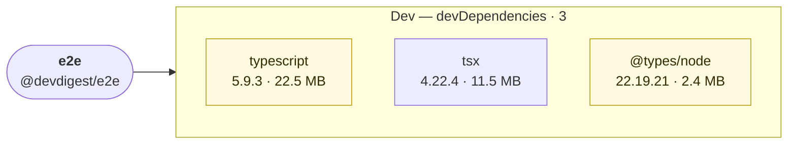

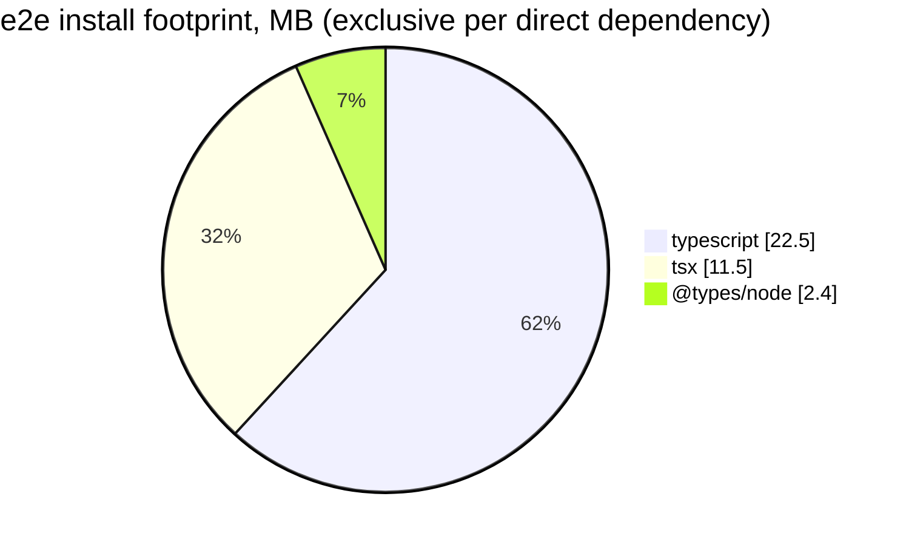

| Dependency | Section · category | Declared → installed | Purpose | Used by (files) | Own | Closure | Exclusive | License | Flags |
|---|---|---|---|---|---|---|---|---|---|
| `typescript` | dev · tooling | ^5.7.2 → 5.9.3 | TypeScript is a language for application scale JavaScript development | bin tsc→typecheck | 22.5 MB | 22.5 MB (1) | 22.5 MB | Apache-2.0 | `outdated` |
| `tsx` | dev · tooling | ^4.19.2 → 4.22.4 | TypeScript Execute (tsx): Node.js enhanced with esbuild to run TypeSc… | bin tsx→test | 506 KB | 11.5 MB (3) | 11.5 MB | MIT | `native` |
| `@types/node` | dev · types | ^22.10.0 → 22.19.21 | TypeScript definitions for node | types for node | 2.3 MB | 2.4 MB (2) | 2.4 MB | MIT | `outdated` |

**Licenses (whole tree):** MIT 5 · Apache-2.0 1  
**In 2+ versions:** none  
**Native code / install scripts:** esbuild@0.28.0

### 4.3 `evals` — @devdigest/evals

Evals for the DevDigest Claude Code harness (skills + subagents + workflow). vitest + Claude Agent SDK, on the Claude Code subscription — no API token, no external services.  
**2** runtime + **5** dev direct dependencies → **97** installed packages, **447.9 MB** (runtime tree 41 packages, 371.3 MB). Lockfile: `pnpm-lock.yaml`.

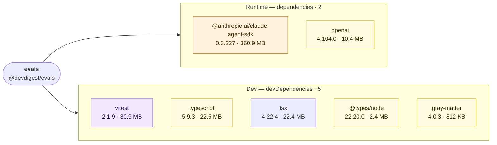

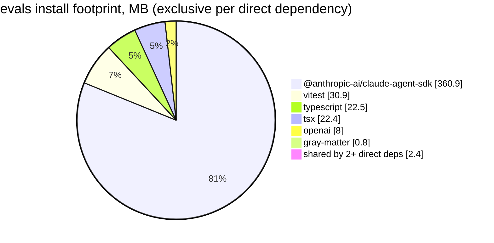

| Dependency | Section · category | Declared → installed | Purpose | Used by (files) | Own | Closure | Exclusive | License | Flags |
|---|---|---|---|---|---|---|---|---|---|
| `@anthropic-ai/claude-agent-sdk` | prod · library | ^0.3.327 → 0.3.327 | SDK for building AI agents with Claude Code's capabilities. Programma… | src 1 | 5.3 MB | 360.9 MB (2) | 360.9 MB | SEE LICENSE IN README.md | `heavy` |
| `openai` | prod · library | ^4.77.0 → 4.104.0 | The official TypeScript library for the OpenAI API | src 1 | 4.0 MB | 10.4 MB (39) | 8.0 MB | Apache-2.0 | `outdated` |
| `vitest` | dev · test | ^2.1.0 → 2.1.9 | Next generation testing framework powered by Vite | src 3 · test 1 · config 1 · bin vitest→eval/eval:workflow | 1.6 MB | 30.9 MB (43) | 30.9 MB | MIT | `vuln` `outdated` `dev-in-prod` `drift` `native` |
| `typescript` | dev · tooling | ^5.6.0 → 5.9.3 | TypeScript is a language for application scale JavaScript development | bin tsc→typecheck | 22.5 MB | 22.5 MB (1) | 22.5 MB | Apache-2.0 | `outdated` |
| `tsx` | dev · tooling | ^4.19.0 → 4.22.4 | TypeScript Execute (tsx): Node.js enhanced with esbuild to run TypeSc… | bin tsx→eval:quality/eval:compare/eval:repeat/eval:delta/eval:benchmark/eval:scaffold | 506 KB | 22.4 MB (3) | 22.4 MB | MIT | `native` |
| `@types/node` | dev · types | ^22.0.0 → 22.20.0 | TypeScript definitions for node | peer of vitest · types for node | 2.3 MB | 2.4 MB (2) | 0 B | MIT | `outdated` |
| `gray-matter` | dev · tooling | ^4.0.3 → 4.0.3 | Parse front-matter from a string or file. Fast, reliable and easy to … | src 1 | 38 KB | 812 KB (10) | 812 KB | MIT | `dev-in-prod` |

**Licenses (whole tree):** MIT 86 · Apache-2.0 3 · BSD-2-Clause 2 · BSD-3-Clause 2 · ISC 2 · SEE LICENSE IN README.md 1 · SEE LICENSE IN LICENSE.md 1  
**In 2+ versions:** esbuild (0.28.1, 0.21.5), @esbuild/linux-x64 (0.28.1, 0.21.5), @types/node (22.20.0, 18.19.130), undici-types (6.21.0, 5.26.5)  
**Native code / install scripts:** @rollup/rollup-linux-x64-gnu@4.62.2, esbuild@0.28.1, esbuild@0.21.5

### 4.4 `mcp` — @devdigest/mcp

DevDigest MCP server (stdio) — a thin client of the running DevDigest HTTP API. Tools: list_agents, run_agent_on_pr, get_findings, get_conventions, get_blast_radius.  
**3** runtime + **3** dev direct dependencies → **32** installed packages, **54.4 MB** (runtime tree 6 packages, 25.3 MB). Lockfile: `package-lock.json`.

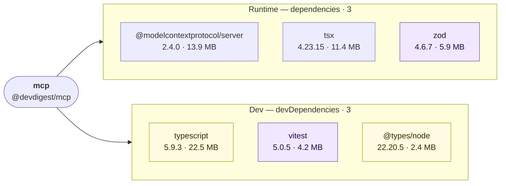

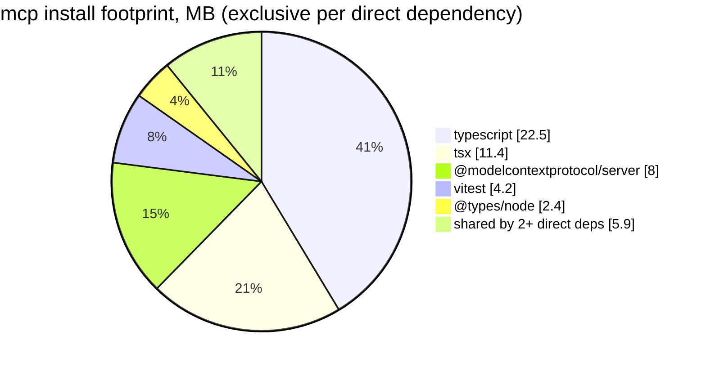

| Dependency | Section · category | Declared → installed | Purpose | Used by (files) | Own | Closure | Exclusive | License | Flags |
|---|---|---|---|---|---|---|---|---|---|
| `@modelcontextprotocol/server` | prod · library | 2.4.0 → 2.4.0 | Model Context Protocol implementation for TypeScript - Server package | src 7 · test 1 | 6.7 MB | 13.9 MB (3) | 8.0 MB | Apache-2.0 |  |
| `tsx` | prod · tooling | ^4.23.15 → 4.23.15 | TypeScript Execute (tsx): Node.js enhanced with esbuild to run TypeSc… | bin tsx→start | 388 KB | 11.4 MB (3) | 11.4 MB | MIT | `native` |
| `zod` | prod · library | ^4.6.7 → 4.6.7 | TypeScript-first schema declaration and validation library with stati… | src 8 | 5.9 MB | 5.9 MB (1) | 0 B | MIT | `drift` |
| `typescript` | dev · tooling | ^5.9.3 → 5.9.3 | TypeScript is a language for application scale JavaScript development | bin tsc→typecheck | 22.5 MB | 22.5 MB (1) | 22.5 MB | Apache-2.0 | `outdated` |
| `vitest` | dev · test | ^5.0.5 → 5.0.5 | Next generation testing framework powered by Vite | test 5 · config 1 · bin vitest→test | 2.7 MB | 4.2 MB (23) | 4.2 MB | MIT | `drift` |
| `@types/node` | dev · types | ^22.20.5 → 22.20.5 | TypeScript definitions for node | peer of vitest · types for node | 2.3 MB | 2.4 MB (2) | 2.4 MB | MIT | `outdated` |

**Licenses (whole tree):** MIT 28 · Apache-2.0 4  
**In 2+ versions:** none  
**Native code / install scripts:** esbuild@0.28.2

### 4.5 `reviewer-core` — @devdigest/reviewer-core

DevDigest review engine — pure logic (prompt assembly, citation grounding, structured output, reduce, reviewPullRequest). No DB/GitHub/FS; the only side effect is an injected LLMProvider. Consumed by server (local reviews) and agent-runner (CI) as source via tsconfig path alias.  
**2** runtime + **4** dev direct dependencies → **87** installed packages, **71.4 MB** (runtime tree 40 packages, 13.8 MB). Lockfile: `package-lock.json`.

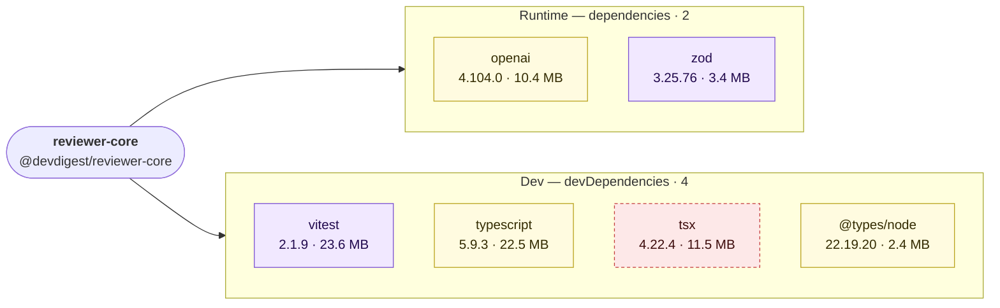

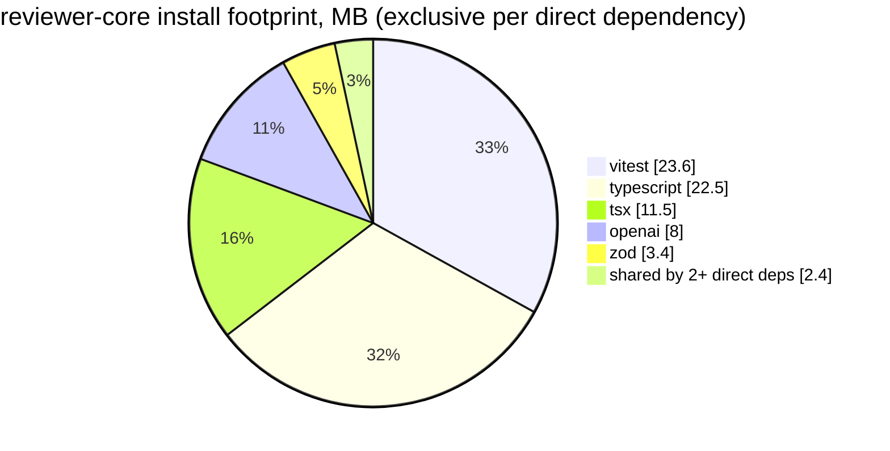

| Dependency | Section · category | Declared → installed | Purpose | Used by (files) | Own | Closure | Exclusive | License | Flags |
|---|---|---|---|---|---|---|---|---|---|
| `openai` | prod · library | ^4.77.0 → 4.104.0 | The official TypeScript library for the OpenAI API | src 2 | 4.0 MB | 10.4 MB (39) | 8.0 MB | Apache-2.0 | `outdated` |
| `zod` | prod · library | ^3.24.1 → 3.25.76 | TypeScript-first schema declaration and validation library with stati… | src 1 · peer of openai | 3.4 MB | 3.4 MB (1) | 3.4 MB | MIT | `vuln` `drift` `outdated` |
| `vitest` | dev · test | ^2.1.8 → 2.1.9 | Next generation testing framework powered by Vite | test 4 · config 1 · bin vitest→test | 1.6 MB | 23.6 MB (44) | 23.6 MB | MIT | `vuln` `outdated` `drift` `native` |
| `typescript` | dev · tooling | ^5.7.2 → 5.9.3 | TypeScript is a language for application scale JavaScript development | bin tsc→typecheck/build | 22.5 MB | 22.5 MB (1) | 22.5 MB | Apache-2.0 | `outdated` |
| `tsx` | dev · tooling | ^4.19.2 → 4.22.4 | TypeScript Execute (tsx): Node.js enhanced with esbuild to run TypeSc… | **unused** | 506 KB | 11.5 MB (3) | 11.5 MB | MIT | `unused` `native` |
| `@types/node` | dev · types | ^22.10.0 → 22.19.20 | TypeScript definitions for node | peer of vitest · types for node | 2.3 MB | 2.4 MB (2) | 0 B | MIT | `outdated` |

**Licenses (whole tree):** MIT 80 · Apache-2.0 3 · ISC 2 · BSD-2-Clause 1 · BSD-3-Clause 1  
**In 2+ versions:** @esbuild/linux-x64 (0.28.0, 0.21.5), @types/node (22.19.20, 18.19.130), esbuild (0.28.0, 0.21.5), undici-types (6.21.0, 5.26.5)  
**Native code / install scripts:** @rollup/rollup-linux-x64-gnu@4.61.1, @rollup/rollup-linux-x64-musl@4.61.1, esbuild@0.28.0, esbuild@0.21.5

### 4.6 `server` — @devdigest/api

**24** runtime + **8** dev direct dependencies → **424** installed packages, **231.9 MB** (runtime tree 215 packages, 86.9 MB). Lockfile: `pnpm-lock.yaml`.

```mermaid
flowchart LR
  pkg_server(["<b>server</b><br/>@devdigest/api"])
  subgraph pkg_server_prod["Runtime — dependencies · 24"]
    direction TB
    pkg_server_prod_js_tiktoken["js-tiktoken<br/>1.0.21 · 21.4 MB"]
    pkg_server_prod_octokit["octokit<br/>4.1.4 · 10.6 MB"]
    pkg_server_prod_openai["openai<br/>4.104.0 · 10.4 MB"]
    pkg_server_prod_drizzle_orm["drizzle-orm<br/>0.38.4 · 7.8 MB"]
    pkg_server_prod__ast_grep_napi["@ast-grep/napi<br/>0.43.0 · 7.8 MB"]
    pkg_server_prod__anthropic_ai_sdk["@anthropic-ai/sdk<br/>0.33.1 · 7.4 MB"]
    pkg_server_prod_fastify["fastify<br/>5.8.5 · 6.9 MB"]
    pkg_server_prod__vscode_ripgrep["@vscode/ripgrep<br/>1.18.0 · 5.5 MB"]
    pkg_server_prod_dependency_cruiser["dependency-cruiser<br/>17.4.3 · 4.3 MB"]
    pkg_server_prod_zod["zod<br/>3.25.76 · 3.4 MB"]
    pkg_server_prod_graphology["graphology<br/>0.26.0 · 2.7 MB"]
    pkg_server_prod_simple_git["simple-git<br/>3.36.0 · 1.1 MB"]
    pkg_server_prod_more["+12 more<br/>3.9 MB exclusive"]
  end
  pkg_server --> pkg_server_prod
  subgraph pkg_server_dev["Dev — devDependencies · 8"]
    direction TB
    pkg_server_dev_drizzle_kit["drizzle-kit<br/>0.30.6 · 46.5 MB"]
    pkg_server_dev_vitest["vitest<br/>2.1.9 · 30.9 MB"]
    pkg_server_dev__testcontainers_postgresql["@testcontainers/postgresql<br/>10.28.0 · 27.7 MB"]
    pkg_server_dev_testcontainers["testcontainers<br/>10.28.0 · 27.7 MB"]
    pkg_server_dev_typescript["typescript<br/>5.9.3 · 22.5 MB"]
    pkg_server_dev_tsx["tsx<br/>4.22.4 · 22.3 MB"]
    pkg_server_dev__types_node["@types/node<br/>22.19.19 · 2.4 MB"]
    pkg_server_dev_pino_pretty["pino-pretty<br/>13.1.3 · 788 KB"]
  end
  pkg_server --> pkg_server_dev
  classDef unused fill:#fde8e8,stroke:#c43c3c,stroke-dasharray:4 3,color:#3d0b0b
  classDef heavy fill:#fff1db,stroke:#d08a1e,color:#3d2600
  classDef drift fill:#f1e8ff,stroke:#7a4fd0,color:#21094d
  classDef warn fill:#fffbe0,stroke:#b9a21c,color:#332b00
  class pkg_server_dev_testcontainers unused
  class pkg_server_prod_js_tiktoken heavy
  class pkg_server_prod_zod,pkg_server_dev_vitest drift
  class pkg_server_prod_octokit,pkg_server_prod_openai,pkg_server_prod_drizzle_orm,pkg_server_prod__ast_grep_napi,pkg_server_prod__anthropic_ai_sdk,pkg_server_prod_fastify,pkg_server_prod_dependency_cruiser,pkg_server_prod_simple_git,pkg_server_dev_drizzle_kit,pkg_server_dev__testcontainers_postgresql,pkg_server_dev_typescript,pkg_server_dev__types_node,pkg_server_dev_pino_pretty warn
```

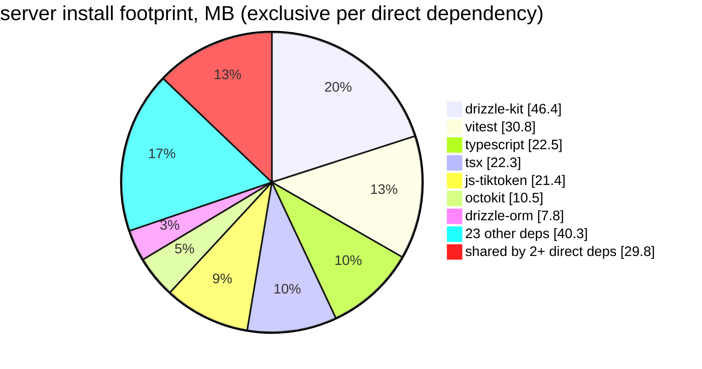

| Dependency | Section · category | Declared → installed | Purpose | Used by (files) | Own | Closure | Exclusive | License | Flags |
|---|---|---|---|---|---|---|---|---|---|
| `js-tiktoken` | prod · library | ^1.0.21 → 1.0.21 | JavaScript port of tiktoken | src 1 | 21.4 MB | 21.4 MB (2) | 21.4 MB | MIT | `heavy` |
| `octokit` | prod · library | ^4.0.3 → 4.1.4 | The all-batteries-included GitHub SDK for Browsers, Node.js, and Deno | src 1 | 50 KB | 10.6 MB (33) | 10.5 MB | MIT | `outdated` |
| `openai` | prod · library | ^4.77.0 → 4.104.0 | The official TypeScript library for the OpenAI API | src 1 | 4.0 MB | 10.4 MB (39) | 4.0 MB | Apache-2.0 | `outdated` |
| `drizzle-orm` | prod · library | ^0.38.3 → 0.38.4 | Drizzle ORM package for SQL databases | src 40 · test 10 | 7.8 MB | 7.8 MB (1) | 7.8 MB | Apache-2.0 | `vuln` `outdated` |
| `@ast-grep/napi` | prod · library | 0.43.0 → 0.43.0 | Search and Rewrite code at large scale using precise AST pattern | src 1 | 352 KB | 7.8 MB (2) | 7.8 MB | MIT | `outdated` `native` |
| `@anthropic-ai/sdk` | prod · library | ^0.33.1 → 0.33.1 | The official TypeScript library for the Anthropic API | src 1 · test 1 (types) | 1.0 MB | 7.4 MB (39) | 1.0 MB | MIT | `outdated` |
| `fastify` | prod · library | ^5.2.0 → 5.8.5 | Fast and low overhead web framework, for Node.js | src 19 · test 1 (types) · peer of fastify-sse-v2, fastify-type-provider-zod | 2.6 MB | 6.9 MB (48) | 6.5 MB | MIT | `vuln` |
| `@vscode/ripgrep` | prod · library | ^1.15.9 → 1.18.0 | A module for using ripgrep in a Node project | src 1 | 4 KB | 5.5 MB (2) | 5.5 MB | MIT |  |
| `dependency-cruiser` | prod · tooling | ^17.4.3 → 17.4.3 | Validate and visualize dependencies. With your rules. JavaScript, Typ… | src 1 | 963 KB | 4.3 MB (43) | 4.0 MB | MIT | `outdated` |
| `zod` | prod · library | ^3.24.1 → 3.25.76 | TypeScript-first schema declaration and validation library with stati… | src 20 · test 2 · peer of fastify-type-provider-zod, openai | 3.4 MB | 3.4 MB (1) | 3.4 MB | MIT | `vuln` `drift` `outdated` |
| `graphology` | prod · library | ^0.26.0 → 0.26.0 | A robust and multipurpose Graph object for JavaScript. | src 1 | 2.6 MB | 2.7 MB (2) | 2.6 MB | MIT |  |
| `simple-git` | prod · library | ^3.27.0 → 3.36.0 | Simple GIT interface for node.js | src 1 | 929 KB | 1.1 MB (7) | 1.0 MB | MIT | `vuln` `outdated` |
| `fflate` | prod · library | ^0.8.3 → 0.8.3 | High performance (de)compression in an 8kB package | src 1 · test 1 | 778 KB | 778 KB (1) | 778 KB | MIT |  |
| `graphology-metrics` | prod · library | ^2.4.0 → 2.4.0 | Miscellaneous graph metrics for graphology. | src 1 | 123 KB | 756 KB (8) | 717 KB | MIT |  |
| `yaml` | prod · library | ^2.9.1 → 2.9.1 | JavaScript parser and stringifier for YAML | src 1 | 670 KB | 670 KB (1) | 670 KB | ISC |  |
| `@fastify/cors` | prod · library | ^10.0.2 → 10.1.0 | Fastify CORS | src 1 | 113 KB | 567 KB (4) | 487 KB | MIT | `outdated` |
| `fastify-sse-v2` | prod · library | ^4.2.1 → 4.2.2 | Fastify plugin for sending server side events. | src 1 | 21 KB | 393 KB (16) | 108 KB | MIT |  |
| `@fastify/rate-limit` | prod · library | ^11.0.0 → 11.0.0 | A low overhead rate limiter for your routes | src 1 | 203 KB | 302 KB (4) | 212 KB | MIT |  |
| `postgres` | prod · library | ^3.4.5 → 3.4.9 | Fastest full featured PostgreSQL client for Node.js | src 2 · peer of drizzle-orm | 293 KB | 293 KB (1) | 293 KB | Unlicense | `outdated` |
| `fastify-type-provider-zod` | prod · library | ^4.0.2 → 4.0.2 | Zod Type Provider for Fastify@5 | src 16 | 25 KB | 275 KB (3) | 239 KB | MIT | `outdated` |
| `@fastify/helmet` | prod · library | ^13.0.2 → 13.0.2 | Important security headers for Fastify | src 1 | 68 KB | 211 KB (3) | 169 KB | MIT |  |
| `@fastify/autoload` | prod · library | ^6.0.3 → 6.3.1 | Require all plugins in a directory | **unused** | 171 KB | 171 KB (1) | 171 KB | MIT | `unused` |
| `p-queue` | prod · library | ^8.0.1 → 8.1.1 | Promise queue with concurrency control | src 2 | 40 KB | 126 KB (3) | 126 KB | MIT | `outdated` |
| `dotenv` | prod · library | ^16.4.7 → 16.6.1 | Loads environment variables from .env file | src 3 · config 1 | 75 KB | 75 KB (1) | 75 KB | BSD-2-Clause | `outdated` |
| `drizzle-kit` | dev · tooling | ^0.30.1 → 0.30.6 | — | config 1 · bin drizzle-kit→db:generate | 7.4 MB | 46.5 MB (23) | 46.4 MB | MIT | `outdated` `native` |
| `vitest` | dev · test | ^2.1.8 → 2.1.9 | Next generation testing framework powered by Vite | test 49 · config 1 · bin vitest→test | 1.6 MB | 30.9 MB (43) | 30.8 MB | MIT | `vuln` `outdated` `drift` `native` |
| `@testcontainers/postgresql` | dev · test | ^10.16.0 → 10.28.0 | PostgreSQL module for Testcontainers | test 1 | 18 KB | 27.7 MB (158) | 18 KB | MIT | `outdated` `native` |
| `testcontainers` | dev · test | ^10.16.0 → 10.28.0 | Testcontainers is a NodeJS library that supports tests, providing lig… | **unused** | 379 KB | 27.7 MB (157) | 0 B | MIT | `outdated` `unused` `native` |
| `typescript` | dev · tooling | ^5.7.2 → 5.9.3 | TypeScript is a language for application scale JavaScript development | bin tsc→build/typecheck | 22.5 MB | 22.5 MB (1) | 22.5 MB | Apache-2.0 | `outdated` |
| `tsx` | dev · tooling | ^4.19.2 → 4.22.4 | TypeScript Execute (tsx): Node.js enhanced with esbuild to run TypeSc… | bin tsx→dev/db:migrate/db:seed | 506 KB | 22.3 MB (3) | 22.3 MB | MIT | `native` |
| `@types/node` | dev · types | ^22.10.0 → 22.19.19 | TypeScript definitions for node | peer of vitest · types for node | 2.3 MB | 2.4 MB (2) | 0 B | MIT | `outdated` |
| `pino-pretty` | dev · tooling | ^13.0.0 → 13.1.3 | Prettifier for Pino log lines | string ref ×1 | 240 KB | 788 KB (19) | 508 KB | MIT | `weak-use` |

**Licenses (whole tree):** MIT 341 · ISC 31 · Apache-2.0 25 · BSD-3-Clause 18 · BlueOak-1.0.0 5 · BSD-2-Clause 2 · Unlicense 2  
**In 2+ versions:** esbuild (0.28.0, 0.21.5, 0.19.12, 0.18.20), @esbuild/linux-x64 (0.28.0, 0.21.5, 0.19.12, 0.18.20), @types/node (22.19.19, 18.19.130), yaml (2.9.1, 2.9.0), mnemonist (0.40.0, 0.39.8), readable-stream (4.7.0, 3.6.2, 2.3.8), +21 more  
**Native code / install scripts:** @ast-grep/napi-linux-x64-gnu@0.43.0, @rollup/rollup-linux-x64-gnu@4.61.0, cpu-features@0.0.10, esbuild@0.19.12, esbuild@0.18.20, esbuild@0.28.0, esbuild@0.21.5, protobufjs@7.6.2, ssh2@1.17.0

## 5. Cross-package versions

Dependencies declared by 2+ packages. ⚠ = packages are on different compatibility lines (major, or minor for 0.x).

| Dependency | client | e2e | evals | mcp | reviewer-core | server |
|---|---|---|---|---|---|---|
| `@types/node` | 22.19.19 (dev) | 22.19.21 (dev) | 22.20.0 (dev) | 22.20.5 (dev) | 22.19.20 (dev) | 22.19.19 (dev) |
| `typescript` | 5.9.3 (dev) | 5.9.3 (dev) | 5.9.3 (dev) | 5.9.3 (dev) | 5.9.3 (dev) | 5.9.3 (dev) |
| `tsx` |  | 4.22.4 (dev) | 4.22.4 (dev) | 4.23.15 | 4.22.4 (dev) | 4.22.4 (dev) |
| ⚠ `vitest` | 2.1.9 (dev) |  | 2.1.9 (dev) | 5.0.5 (dev) | 2.1.9 (dev) | 2.1.9 (dev) |
| ⚠ `zod` | 3.25.76 |  |  | 4.6.7 | 3.25.76 | 3.25.76 |
| `openai` |  |  | 4.104.0 |  | 4.104.0 | 4.104.0 |

## 6. Findings

**150** findings: P0 **23** · P1 **42** · P2 **58** · P3 **27**. Priorities are the rule defaults; the *Triage* column records the reviewer's check (confirmed / false positive / re-prioritised, with the reason).

### Hotspots

Dependencies that collect findings in several packages or under several rules — usually one fix closes all of them.

| Dependency | Worst | Findings | Rules | Packages |
|---|---|---|---|---|
| `zod` | P0 | F07, F13, F15, F23, F77, F90, F97, F109 | DC-VULN, DC-DRIFT, DC-OUTDATED | client, evals, reviewer-core, server, mcp |
| `postcss` | P0 | F04, F43, F50, F59, F147 | DC-VULN, DC-UNUSED | client, evals, reviewer-core, server |
| `nanoid` | P0 | F02, F42, F49, F58 | DC-VULN | client, evals, reviewer-core, server |
| `source-map-js` | P0 | F06, F45, F51, F61 | DC-VULN | client, evals, reviewer-core, server |
| `form-data` | P0 | F14, F21, F33 | DC-VULN | reviewer-core, server, client |
| `next` | P0 | F03, F67, F84 | DC-VULN, DC-HEAVY, DC-OUTDATED | client |
| `drizzle-orm` | P0 | F17, F102 | DC-VULN, DC-OUTDATED | server |
| `fast-uri` | P0 | F10, F18 | DC-VULN | evals, server |
| `simple-git` | P0 | F22, F105 | DC-VULN, DC-OUTDATED | server |
| `vitest` | P1 | F38, F48, F54, F65, F89, F93, F96, F108, F129, F130 | DC-VULN, DC-OUTDATED, DC-DEV-IN-PROD, DC-DRIFT | client, evals, reviewer-core, server, mcp |
| `tinypool` | P1 | F36, F46, F52, F62 | DC-VULN | client, evals, reviewer-core, server |
| `vite` | P1 | F37, F47, F53, F64 | DC-VULN | client, evals, reviewer-core, server |
| `mermaid` | P1 | F34, F68, F83 | DC-VULN, DC-HEAVY, DC-OUTDATED | client |
| `openai` | P1 | F25, F26, F29 | DC-OUTDATED | evals, reviewer-core, server |
| `next-intl` | P1 | F35, F85 | DC-VULN, DC-OUTDATED | client |

### All findings

| ID | P | Rule | Package | Dependency | Evidence | Suggested fix | Triage |
|---|---|---|---|---|---|---|---|
| F01 | P0 | DC-VULN — Known vulnerability (npm advisory) | client | `browserslist` | 2 advisories, worst high, production tree, transitive: Browserslist: Unbounded memory growth (no cache eviction) via distinct query results, leading to eventual OOM; Browserslist: Uncaught crash / prototype write via untrusted browserslist-stats.json custom stats (normalizeStats) — https://github.com/advisories/GHSA-c83g-rgw3-j3cx | Upgrade browserslist to >=4.28.7 | ↓P2 — build-time toolchain inside Next/PostCSS; inputs are our own files, nothing attacker-controlled at runtime |
| F02 | P0 | DC-VULN — Known vulnerability (npm advisory) | client | `nanoid` | 2 advisories, worst high, production tree, transitive: nanoid: non-secure generators can loop indefinitely with negative size; nanoid: custom generators can loop indefinitely when size is zero — https://github.com/advisories/GHSA-28wg-ghj8-5hjv | Upgrade nanoid to >=3.3.18 | ↓P2 — build-time toolchain inside Next/PostCSS; inputs are our own files, nothing attacker-controlled at runtime |
| F03 | P0 | DC-VULN — Known vulnerability (npm advisory) | client | `next` | 14 advisories, worst critical, production tree, direct dependency: Next.js: Denial of Service in App Router using Server Actions; Next.js: Server-Side Request Forgery in Server Actions on custom servers; Next.js: Cache confusion of response bodies for requests with bodies; … — https://github.com/advisories/GHSA-p293-qw3h-jr36 | Upgrade next to >=15.5.28 | ✅ confirmed — `next start` serves the image optimizer by default even without `next/image`; patch 15.5.28 closes all 14 advisories (3 critical) |
| F04 | P0 | DC-VULN — Known vulnerability (npm advisory) | client | `postcss` | 4 advisories, worst high, production tree, direct dependency: PostCSS has XSS via Unescaped </style> in its CSS Stringify Output; PostCSS: Arbitrary file read and information disclosure via attacker-controlled sourceMappingURL in CSS comments; PostCSS: incomplete fix of GHSA-6g55-p6wh-862q — attacker-controlled sourceMappingURL reads arbitrary .map files when `from` is unset; … — https://github.com/advisories/GHSA-6g55-p6wh-862q | Upgrade postcss to >=8.5.18 | ↓P2 — build-time toolchain inside Next/PostCSS; inputs are our own files, nothing attacker-controlled at runtime |
| F05 | P0 | DC-VULN — Known vulnerability (npm advisory) | client | `sharp` | 3 advisories, worst high, production tree, transitive: sharp inherited vulnerabilities in libvips: CVE-2026-33327, CVE-2026-33328, CVE-2026-35590, CVE-2026-35591; sharp: Vulnerabilities in libheif: GHSA-g89c-p67h-r497 and GHSA-2jg2-4ch7-h545; sharp : Vulnerability in librsvg dependency CVE-2026-96889 — https://github.com/advisories/GHSA-f88m-g3jw-g9cj | Upgrade sharp to >=0.35.5 | ✅ confirmed — runtime dependency of Next's image optimizer; re-check after the F03 upgrade, else override `sharp` ≥ 0.35.5 |
| F06 | P0 | DC-VULN — Known vulnerability (npm advisory) | client | `source-map-js` | 1 advisory, worst high, production tree, transitive: source-map-js allows event-loop denial of service through indexed source-map section offsets — https://github.com/advisories/GHSA-68fv-2mgg-jv7q | Upgrade source-map-js to >=1.2.2 | ↓P2 — build-time toolchain inside Next/PostCSS; inputs are our own files, nothing attacker-controlled at runtime |
| F07 | P0 | DC-VULN — Known vulnerability (npm advisory) | client | `zod` | 1 advisory, worst high, production tree, direct dependency: Zod can exhaust memory while validating oversized constrained collections — https://github.com/advisories/GHSA-mrhx-c7xc-m3w5 | Upgrade zod to >=4.6.6 | ↓P2 — browser-side validation of our own API responses; fix needs zod 4 (see F23) |
| F08 | P0 | DC-VULN — Known vulnerability (npm advisory) | evals | `@modelcontextprotocol/sdk` | 6 advisories, worst high, production tree, transitive: MCP TypeScript SDK: OAuth client could send credentials to an authorization server chosen by the MCP server; MCP TypeScript SDK: Experimental tasks were not tied to the session that created them; MCP TypeScript SDK: One HTTP request within the default size limit could exhaust server memory during validation; … — https://github.com/advisories/GHSA-6qxp-vccf-f47h | Upgrade @modelcontextprotocol/sdk to >=1.30.1 | ↓P2 — pulled in by `@anthropic-ai/claude-agent-sdk` in the local eval harness; evals runs no HTTP server; closes with an SDK upgrade |
| F09 | P0 | DC-VULN — Known vulnerability (npm advisory) | evals | `body-parser` | 1 advisory, worst high, production tree, transitive: body-parser vulnerable to Denial of Service via trailing bytes after a compressed request body — https://github.com/advisories/GHSA-27r3-jxmh-p828 | Upgrade body-parser to >=2.4.0 | ↓P2 — pulled in by `@anthropic-ai/claude-agent-sdk` in the local eval harness; evals runs no HTTP server; closes with an SDK upgrade |
| F10 | P0 | DC-VULN — Known vulnerability (npm advisory) | evals | `fast-uri` | 12 advisories, worst high, production tree, transitive: fast-uri vulnerable to host confusion via literal backslash authority delimiter; fast-uri vulnerable to host confusion via backslash authority introducer; fast-uri vulnerable to host confusion via skipped IDN canonicalization on scheme-relative references; … — https://github.com/advisories/GHSA-v2hh-gcrm-f6hx | Upgrade fast-uri to >=3.1.9 | ↓P2 — pulled in by `@anthropic-ai/claude-agent-sdk` in the local eval harness; evals runs no HTTP server; closes with an SDK upgrade |
| F11 | P0 | DC-VULN — Known vulnerability (npm advisory) | evals | `ip-address` | 8 advisories, worst high, production tree, transitive: ip-address: Address4 decodes leading-zero octets as decimal while resolvers decode them as octal, allowing SSRF and trust-boundary bypass; ip-address: a CIDR suffix on the parsed address suppresses special-use classification and can bypass SSRF and trust-boundary checks; ip-address: misclassification of IPv4-mapped/NAT64 IPv6 addresses can bypass SSRF and trust-boundary checks; … — https://github.com/advisories/GHSA-mwp4-54f8-5fhr | Upgrade ip-address to >=10.7.4 | ↓P2 — pulled in by `@anthropic-ai/claude-agent-sdk` in the local eval harness; evals runs no HTTP server; closes with an SDK upgrade |
| F12 | P0 | DC-VULN — Known vulnerability (npm advisory) | evals | `proxy-addr` | 1 advisory, worst critical, production tree, transitive: proxy-addr vulnerable to IP spoofing via IPv4-mapped IPv6 trust subnet — https://github.com/advisories/GHSA-jqcg-44mw-7w3h | Upgrade proxy-addr to >=2.0.8 | ↓P2 — pulled in by `@anthropic-ai/claude-agent-sdk` in the local eval harness; evals runs no HTTP server; closes with an SDK upgrade |
| F13 | P0 | DC-VULN — Known vulnerability (npm advisory) | evals | `zod` | 1 advisory, worst high, production tree, transitive: Zod can exhaust memory while validating oversized constrained collections — https://github.com/advisories/GHSA-mrhx-c7xc-m3w5 | Upgrade zod to >=4.6.6 | ↓P2 — pulled in by `@anthropic-ai/claude-agent-sdk` in the local eval harness; evals runs no HTTP server; closes with an SDK upgrade |
| F14 | P0 | DC-VULN — Known vulnerability (npm advisory) | reviewer-core | `form-data` | 1 advisory, worst high, production tree, transitive: form-data: CRLF injection in form-data via unescaped multipart field names and filenames — https://github.com/advisories/GHSA-hmw2-7cc7-3qxx | Upgrade the parent that pulls it in, or pin a patched version with `overrides` | ↓P2 — multipart field names are set by the openai SDK, not by users |
| F15 | P0 | DC-VULN — Known vulnerability (npm advisory) | reviewer-core | `zod` | 1 advisory, worst high, production tree, direct dependency: Zod can exhaust memory while validating oversized constrained collections — https://github.com/advisories/GHSA-mrhx-c7xc-m3w5 | Upgrade zod to 4.6.7 (major) | ↓P1 — same root cause as F23 (zod 3 gets no fix); reviewer-core is compiled by server |
| F16 | P0 | DC-VULN — Known vulnerability (npm advisory) | server | `@simple-git/argv-parser` | 1 advisory, worst critical, production tree, transitive: simple-git: `VISUAL` editor environment variable is omitted from unsafe editor detection — https://github.com/advisories/GHSA-v5rq-49vh-5v5c | Upgrade @simple-git/argv-parser to >=2.0.1 | ✅ confirmed — server runs git on cloned, untrusted repositories (`server/src/adapters/git/simple-git.ts`); closes with F22 |
| F17 | P0 | DC-VULN — Known vulnerability (npm advisory) | server | `drizzle-orm` | 1 advisory, worst high, production tree, direct dependency: Drizzle ORM has SQL injection via improperly escaped SQL identifiers — https://github.com/advisories/GHSA-gpj5-g38j-94v9 | Upgrade drizzle-orm to >=0.45.2 | ↓P1 — needs dynamic identifiers; no `sql.identifier` / `sql.raw` in `server/src`. Still upgrade (see F102) |
| F18 | P0 | DC-VULN — Known vulnerability (npm advisory) | server | `fast-uri` | 11 advisories, worst high, production tree, transitive: fast-uri vulnerable to host confusion via literal backslash authority delimiter; fast-uri vulnerable to host confusion via backslash authority introducer; fast-uri vulnerable to server-side request forgery via malformed IPv6 normalization; … — https://github.com/advisories/GHSA-v2hh-gcrm-f6hx | Upgrade fast-uri to >=3.1.9 | ✅ confirmed — used by Fastify's validator on every request; the API binds `0.0.0.0` (`server/src/server.ts:29`) |
| F19 | P0 | DC-VULN — Known vulnerability (npm advisory) | server | `fastify` | 7 advisories, worst high, production tree, direct dependency: fastify vulnerable to schema validation bypass via root primitive coercion mismatch; fastify vulnerable to X-Forwarded-* spoofing under trustProxy hop-count; fastify vulnerable to Denial of Service via unhandled exception on HTTP/2 trailer responses; … — https://github.com/advisories/GHSA-667r-xxjv-c9mm | Upgrade fastify to >=5.12.2 | ✅ confirmed — validation / auth bypasses on the request path; API binds `0.0.0.0`; 5.8.5 → ≥ 5.12.5 is a minor |
| F20 | P0 | DC-VULN — Known vulnerability (npm advisory) | server | `find-my-way` | 1 advisory, worst high, production tree, transitive: find-my-way: DDoS with HTTP2 — https://github.com/advisories/GHSA-c96f-x56v-gq3h | Upgrade find-my-way to >=9.7.0 | ↓P2 — HTTP/2 DDoS; the server does not enable `http2` |
| F21 | P0 | DC-VULN — Known vulnerability (npm advisory) | server | `form-data` | 1 advisory, worst high, production tree, transitive: form-data: CRLF injection in form-data via unescaped multipart field names and filenames — https://github.com/advisories/GHSA-hmw2-7cc7-3qxx | Upgrade form-data to >=4.0.6 | ↓P2 — multipart field names come from SDKs (openai, octokit), not from users |
| F22 | P0 | DC-VULN — Known vulnerability (npm advisory) | server | `simple-git` | 3 advisories, worst critical, production tree, direct dependency: simple-git unsafe-operation guard does not block trailer command configuration; simple-git allows command execution through unblocked Git configuration includes; simple-git: unsafe-operations plugin bypass via git long-option abbreviation (--receive-p/--exe) -> command execution (residual of CVE-2026-28291) — https://github.com/advisories/GHSA-x6jw-m9v5-85vh | Upgrade simple-git to >=4.0.0 | ✅ confirmed — command execution through git config of cloned repos; 3.36 → ≥ 4.0.1 (major: read the changelog for the adapter) |
| F23 | P0 | DC-VULN — Known vulnerability (npm advisory) | server | `zod` | 1 advisory, worst high, production tree, direct dependency: Zod can exhaust memory while validating oversized constrained collections — https://github.com/advisories/GHSA-mrhx-c7xc-m3w5 | Upgrade zod to >=4.6.6 | ↓P1 — memory-exhaustion DoS on request validation; zod 3 gets no fix (needs ≥ 4.6.6) → zod 4 migration (L), planned in P1 |
| F24 | P1 | DC-UNUSED — Declared but never used | server | `@fastify/autoload` | no import, bin, config string, peer or @types use found in server (prod, exclusive 0.2 MB) | cd server && pnpm remove @fastify/autoload | ✅ confirmed — modules are registered explicitly (`server/src/modules/index.ts:25`) |
| F25 | P1 | DC-OUTDATED — Major version(s) behind latest | evals | `openai` | installed 4.104.0, latest 7.60.0 (3 breaking releases behind) | Read the changelog, then `pnpm add openai@^7.60.0` | ✅ confirmed — one upgrade wave for server + reviewer-core (shared source) + evals |
| F26 | P1 | DC-OUTDATED — Major version(s) behind latest | reviewer-core | `openai` | installed 4.104.0, latest 7.60.0 (3 breaking releases behind) | Read the changelog, then `npm add openai@^7.60.0` | ✅ confirmed — one upgrade wave for server + reviewer-core (shared source) + evals |
| F27 | P1 | DC-OUTDATED — Major version(s) behind latest | server | `dotenv` | installed 16.6.1, latest 18.0.10 (2 breaking releases behind) | Read the changelog, then `pnpm add dotenv@^18.0.10` | ✅ confirmed |
| F28 | P1 | DC-OUTDATED — Major version(s) behind latest | server | `fastify-type-provider-zod` | installed 4.0.2, latest 7.0.0 (3 breaking releases behind) | Read the changelog, then `pnpm add fastify-type-provider-zod@^7.0.0` | ✅ confirmed — moves together with the zod 4 migration (F23) |
| F29 | P1 | DC-OUTDATED — Major version(s) behind latest | server | `openai` | installed 4.104.0, latest 7.60.0 (3 breaking releases behind) | Read the changelog, then `pnpm add openai@^7.60.0` | ✅ confirmed — one upgrade wave for server + reviewer-core (shared source) + evals |
| F30 | P1 | DC-OUTDATED — Major version(s) behind latest | server | `p-queue` | installed 8.1.1, latest 10.0.0 (2 breaking releases behind) | Read the changelog, then `pnpm add p-queue@^10.0.0` | ✅ confirmed |
| F31 | P1 | DC-VULN — Known vulnerability (npm advisory) | client | `baseline-browser-mapping` | 1 advisory, worst moderate, production tree, transitive: baseline-browser-mapping process termination on invalid input causes denial of service — https://github.com/advisories/GHSA-w5vr-8v7q-w6rv | Upgrade baseline-browser-mapping to >=2.11.0 | ↓P2 — build-time toolchain inside Next/PostCSS; inputs are our own files, nothing attacker-controlled at runtime |
| F32 | P1 | DC-VULN — Known vulnerability (npm advisory) | client | `dompurify` | 8 advisories, worst moderate, production tree, transitive: DOMPurify: Permanent `ALLOWED_ATTR` pollution via `setConfig()` bypassing the hook clone-guard (incomplete fix of the 3.4.7 hook-pollution patch); DOMPurify: Trusted Types policy survives `clearConfig()` and can poison later `RETURN_TRUSTED_TYPE` output; DOMPurify: IN_PLACE hook removal leaves a detached subtree executable, causing XSS; … — https://github.com/advisories/GHSA-cmwh-pvxp-8882 | Upgrade dompurify to >=3.4.17 | ✅ confirmed — via mermaid, which renders diagram text that can come from PR / LLM content; closes with the mermaid upgrade (F34) |
| F33 | P1 | DC-VULN — Known vulnerability (npm advisory) | client | `form-data` | 1 advisory, worst high, dev-only tree, transitive: form-data: CRLF injection in form-data via unescaped multipart field names and filenames — https://github.com/advisories/GHSA-hmw2-7cc7-3qxx | Upgrade form-data to >=4.0.6 | ↓P2 — dev-only (jsdom) |
| F34 | P1 | DC-VULN — Known vulnerability (npm advisory) | client | `mermaid` | 5 advisories, worst moderate, production tree, direct dependency: Mermaid configuration APIs allow prototype pollution; Mermaid allows CSS injection applying to sibling elements of the diagram; Mermaid Architecture diagrams are vulnerable to prototype pollution; … — https://github.com/advisories/GHSA-6x64-9x62-f2gx | Upgrade mermaid to >=11.16.1 | ✅ confirmed — diagram source can come from PR / LLM output; upgrade within 11.x |
| F35 | P1 | DC-VULN — Known vulnerability (npm advisory) | client | `next-intl` | 2 advisories, worst moderate, production tree, direct dependency: next-intl has an open redirect vulnerability; next-intl has prototype pollution with `experimental.messages.precompile` via attacker-controlled translation catalog keys — https://github.com/advisories/GHSA-8f24-v5vv-gm5j | Upgrade next-intl to >=4.9.2 | ✅ confirmed — open redirect on the request path |
| F36 | P1 | DC-VULN — Known vulnerability (npm advisory) | client | `tinypool` | 2 advisories, worst critical, dev-only tree, transitive: Tinypool: Prototype Pollution gadget in worker options leads to Remote Code Execution; Tinypool: Prototype Pollution Gadget to RCE in run() options — https://github.com/advisories/GHSA-5gmw-xhrv-c9v3 | Upgrade tinypool to >=2.1.2 | ↓P2 — local test tooling, vitest UI / dev server never exposed (`vitest run`); closes with the vitest upgrade wave |
| F37 | P1 | DC-VULN — Known vulnerability (npm advisory) | client | `vite` | 8 advisories, worst high, dev-only tree, transitive: Vite Vulnerable to Path Traversal in Optimized Deps `.map` Handling; launch-editor: NTLMv2 hash disclosure via UNC path handling on Windows; launch-editor: escapeCmdArgs() omits % escaping on Windows; … — https://github.com/advisories/GHSA-587h-7wmj-h5pm | Upgrade vite to >=6.4.4 | ↓P2 — local test tooling, vitest UI / dev server never exposed (`vitest run`); closes with the vitest upgrade wave |
| F38 | P1 | DC-VULN — Known vulnerability (npm advisory) | client | `vitest` | 2 advisories, worst critical, dev-only tree, direct dependency: When Vitest UI server is listening, arbitrary file can be read and executed; Vitest: Path Traversal / Arbitrary File Read via @vitest/mocker Redirect Mock — https://github.com/advisories/GHSA-5xrq-8626-4rwp | Upgrade vitest to >=4.1.11 | ↓P2 — local test tooling, vitest UI / dev server never exposed (`vitest run`); closes with the vitest upgrade wave |
| F39 | P1 | DC-VULN — Known vulnerability (npm advisory) | evals | `@hono/node-server` | 3 advisories, worst moderate, production tree, transitive: Node.js Adapter for Hono: Path traversal in `serve-static` on Windows via encoded backslash (`%5C`); @hono/node-server: `serveStatic` decodes the request path a second time, leading to bypass of middleware on static paths; @hono/node-server: Backslash in the request path is parsed as a path separator, bypassing path-based access control at a reverse proxy — https://github.com/advisories/GHSA-frvp-7c67-39w9 | Upgrade @hono/node-server to >=1.19.18 | ↓P2 — pulled in by `@anthropic-ai/claude-agent-sdk` in the local eval harness; evals runs no HTTP server; closes with an SDK upgrade |
| F40 | P1 | DC-VULN — Known vulnerability (npm advisory) | evals | `hono` | 14 advisories, worst moderate, production tree, transitive: Hono: ReDoS in CORS middleware via Access-Control-Request-Headers; Hono: `memo()` retains SSR output across requests, leading to cross-user data disclosure; Hono: Proxy Helper does not remove response headers listed in the `Connection` header; … — https://github.com/advisories/GHSA-8j4g-w8fx-2239 | Upgrade hono to >=4.13.16 | ↓P2 — pulled in by `@anthropic-ai/claude-agent-sdk` in the local eval harness; evals runs no HTTP server; closes with an SDK upgrade |
| F41 | P1 | DC-VULN — Known vulnerability (npm advisory) | evals | `js-yaml` | 2 advisories, worst high, dev-only tree, transitive: JS-YAML: Quadratic CPU consumption in !!omap resolution (3.x and 4.x) — CVE-2026-59870 fix not backported; js-yaml: maxTotalMergeKeys does not limit CPU use for empty merge sources — https://github.com/advisories/GHSA-5p4m-2wfm-xmqj | Upgrade js-yaml to >=3.15.2 | ↓P2 — gray-matter parses our own SKILL.md files |
| F42 | P1 | DC-VULN — Known vulnerability (npm advisory) | evals | `nanoid` | 2 advisories, worst high, dev-only tree, transitive: nanoid: non-secure generators can loop indefinitely with negative size; nanoid: custom generators can loop indefinitely when size is zero — https://github.com/advisories/GHSA-28wg-ghj8-5hjv | Upgrade nanoid to >=3.3.18 | ↓P2 — dev-only |
| F43 | P1 | DC-VULN — Known vulnerability (npm advisory) | evals | `postcss` | 2 advisories, worst high, dev-only tree, transitive: PostCSS: incomplete fix of GHSA-6g55-p6wh-862q — attacker-controlled sourceMappingURL reads arbitrary .map files when `from` is unset; PostCSS: Path Traversal in Previous Source Map Auto-Loading (sourceMappingURL) leads to Arbitrary .map File Disclosure — https://github.com/advisories/GHSA-r28c-9q8g-f849 | Upgrade postcss to >=8.5.18 | ↓P2 — dev-only (vite) |
| F44 | P1 | DC-VULN — Known vulnerability (npm advisory) | evals | `qs` | 3 advisories, worst moderate, production tree, transitive: qs array-limit bypass via bracket-key comma parsing; qs: Denial of Service via Attacker Controlled isBuffer; qs : qs.stringify with arrayFormat 'comma' throws an uncaught TypeError on array elements carrying a non-callable own toString (DoS) — https://github.com/advisories/GHSA-x5fp-wj9c-mxmx | Upgrade qs to >=6.16.1 | ↓P2 — pulled in by `@anthropic-ai/claude-agent-sdk` in the local eval harness; evals runs no HTTP server; closes with an SDK upgrade |
| F45 | P1 | DC-VULN — Known vulnerability (npm advisory) | evals | `source-map-js` | 1 advisory, worst high, dev-only tree, transitive: source-map-js allows event-loop denial of service through indexed source-map section offsets — https://github.com/advisories/GHSA-68fv-2mgg-jv7q | Upgrade source-map-js to >=1.2.2 | ↓P2 — local test tooling, vitest UI / dev server never exposed (`vitest run`); closes with the vitest upgrade wave |
| F46 | P1 | DC-VULN — Known vulnerability (npm advisory) | evals | `tinypool` | 2 advisories, worst critical, dev-only tree, transitive: Tinypool: Prototype Pollution gadget in worker options leads to Remote Code Execution; Tinypool: Prototype Pollution Gadget to RCE in run() options — https://github.com/advisories/GHSA-5gmw-xhrv-c9v3 | Upgrade tinypool to >=2.1.2 | ↓P2 — local test tooling, vitest UI / dev server never exposed (`vitest run`); closes with the vitest upgrade wave |
| F47 | P1 | DC-VULN — Known vulnerability (npm advisory) | evals | `vite` | 8 advisories, worst high, dev-only tree, transitive: Vite Vulnerable to Path Traversal in Optimized Deps `.map` Handling; launch-editor: NTLMv2 hash disclosure via UNC path handling on Windows; launch-editor: escapeCmdArgs() omits % escaping on Windows; … — https://github.com/advisories/GHSA-587h-7wmj-h5pm | Upgrade vite to >=6.4.4 | ↓P2 — local test tooling, vitest UI / dev server never exposed (`vitest run`); closes with the vitest upgrade wave |
| F48 | P1 | DC-VULN — Known vulnerability (npm advisory) | evals | `vitest` | 2 advisories, worst critical, dev-only tree, direct dependency: When Vitest UI server is listening, arbitrary file can be read and executed; Vitest: Path Traversal / Arbitrary File Read via @vitest/mocker Redirect Mock — https://github.com/advisories/GHSA-5xrq-8626-4rwp | Upgrade vitest to >=4.1.11 | ↓P2 — local test tooling, vitest UI / dev server never exposed (`vitest run`); closes with the vitest upgrade wave |
| F49 | P1 | DC-VULN — Known vulnerability (npm advisory) | reviewer-core | `nanoid` | 1 advisory, worst high, dev-only tree, transitive: nanoid: non-secure generators can loop indefinitely with negative size; nanoid: custom generators can loop indefinitely when size is zero — https://github.com/advisories/GHSA-28wg-ghj8-5hjv | Upgrade the parent that pulls it in, or pin a patched version with `overrides` | ↓P2 — local test tooling, vitest UI / dev server never exposed (`vitest run`); closes with the vitest upgrade wave |
| F50 | P1 | DC-VULN — Known vulnerability (npm advisory) | reviewer-core | `postcss` | 1 advisory, worst high, dev-only tree, transitive: PostCSS: incomplete fix of GHSA-6g55-p6wh-862q — attacker-controlled sourceMappingURL reads arbitrary .map files when `from` is unset; PostCSS: Path Traversal in Previous Source Map Auto-Loading (sourceMappingURL) leads to Arbitrary .map File Disclosure — https://github.com/advisories/GHSA-fxqj-rqcc-2cmp | Upgrade the parent that pulls it in, or pin a patched version with `overrides` | ↓P2 — local test tooling, vitest UI / dev server never exposed (`vitest run`); closes with the vitest upgrade wave |
| F51 | P1 | DC-VULN — Known vulnerability (npm advisory) | reviewer-core | `source-map-js` | 1 advisory, worst high, dev-only tree, transitive: source-map-js allows event-loop denial of service through indexed source-map section offsets — https://github.com/advisories/GHSA-68fv-2mgg-jv7q | Upgrade the parent that pulls it in, or pin a patched version with `overrides` | ↓P2 — local test tooling, vitest UI / dev server never exposed (`vitest run`); closes with the vitest upgrade wave |
| F52 | P1 | DC-VULN — Known vulnerability (npm advisory) | reviewer-core | `tinypool` | 1 advisory, worst critical, dev-only tree, transitive: Tinypool: Prototype Pollution gadget in worker options leads to Remote Code Execution; Tinypool: Prototype Pollution Gadget to RCE in run() options — https://github.com/advisories/GHSA-5gmw-xhrv-c9v3 | Upgrade vitest to 5.1.1 (major) | ↓P2 — local test tooling, vitest UI / dev server never exposed (`vitest run`); closes with the vitest upgrade wave |
| F53 | P1 | DC-VULN — Known vulnerability (npm advisory) | reviewer-core | `vite` | 1 advisory, worst high, dev-only tree, transitive: Vite Vulnerable to Path Traversal in Optimized Deps `.map` Handling; launch-editor: NTLMv2 hash disclosure via UNC path handling on Windows; launch-editor: escapeCmdArgs() omits % escaping on Windows; launch-editor: Editor CLI flag misinterpretation causing arbitrary command execution for some editors; launch-editor: `fs.existsSync()` existence check can be bypassed on Windows; Vite: Cross origin script execution through Vite custom middleware; Vite: Files outside `server.fs.allow` could be served when project paths match system paths on non-Windows machine; vite: `server.fs.deny` bypass on Windows alternate paths — https://github.com/advisories/GHSA-4w7w-66w2-5vf9 | Upgrade vitest to 5.1.1 (major) | ↓P2 — local test tooling, vitest UI / dev server never exposed (`vitest run`); closes with the vitest upgrade wave |
| F54 | P1 | DC-VULN — Known vulnerability (npm advisory) | reviewer-core | `vitest` | 1 advisory, worst critical, dev-only tree, direct dependency: When Vitest UI server is listening, arbitrary file can be read and executed; Vitest: Path Traversal / Arbitrary File Read via @vitest/mocker Redirect Mock — https://github.com/advisories/GHSA-5xrq-8626-4rwp | Upgrade vitest to 5.1.1 (major) | ↓P2 — local test tooling, vitest UI / dev server never exposed (`vitest run`); closes with the vitest upgrade wave |
| F55 | P1 | DC-VULN — Known vulnerability (npm advisory) | server | `@fastify/busboy` | 2 advisories, worst high, dev-only tree, transitive: @fastify/busboy vulnerable to Denial of Service via prototype-named multipart part header; @fastify/busboy vulnerable to CRLF injection via multipart Content-Disposition filename and name — https://github.com/advisories/GHSA-x8mw-p69m-v3mx | Upgrade @fastify/busboy to >=3.2.2 | ↓P2 — testcontainers' Docker client, tests only; closes with testcontainers 12 (F101, F106) |
| F56 | P1 | DC-VULN — Known vulnerability (npm advisory) | server | `@grpc/grpc-js` | 2 advisories, worst high, dev-only tree, transitive: @grpc/grpc-js: In certain configurations, getAuthContext can return unauthorized certificates as though they were authorized; @grpc/grpc-js: The server transmits some error messages thrown by method handlers to the client in status messages — https://github.com/advisories/GHSA-m9gg-hp2v-232j | Upgrade @grpc/grpc-js to >=1.14.5 | ↓P2 — testcontainers' Docker client, tests only; closes with testcontainers 12 (F101, F106) |
| F57 | P1 | DC-VULN — Known vulnerability (npm advisory) | server | `brace-expansion` | 6 advisories, worst high, dev-only tree, transitive: brace-expansion: DoS via exponential-time expansion of consecutive non-expanding {} groups; brace-expansion: DoS via unbounded expansion length causing an out-of-memory process crash; brace-expansion: DoS via unbounded intermediate arrays, bypassing the CVE-2026-14257 mitigation; … — https://github.com/advisories/GHSA-3jxr-9vmj-r5cp | Upgrade brace-expansion to >=2.1.5 | ↓P2 — dev-only tooling chain (drizzle-kit / vite / testcontainers), no user input |
| F58 | P1 | DC-VULN — Known vulnerability (npm advisory) | server | `nanoid` | 2 advisories, worst high, dev-only tree, transitive: nanoid: non-secure generators can loop indefinitely with negative size; nanoid: custom generators can loop indefinitely when size is zero — https://github.com/advisories/GHSA-28wg-ghj8-5hjv | Upgrade nanoid to >=3.3.18 | ↓P2 — dev-only tooling chain (drizzle-kit / vite / testcontainers), no user input |
| F59 | P1 | DC-VULN — Known vulnerability (npm advisory) | server | `postcss` | 2 advisories, worst high, dev-only tree, transitive: PostCSS: incomplete fix of GHSA-6g55-p6wh-862q — attacker-controlled sourceMappingURL reads arbitrary .map files when `from` is unset; PostCSS: Path Traversal in Previous Source Map Auto-Loading (sourceMappingURL) leads to Arbitrary .map File Disclosure — https://github.com/advisories/GHSA-r28c-9q8g-f849 | Upgrade postcss to >=8.5.18 | ↓P2 — dev-only tooling chain (drizzle-kit / vite / testcontainers), no user input |
| F60 | P1 | DC-VULN — Known vulnerability (npm advisory) | server | `shell-quote` | 2 advisories, worst critical, dev-only tree, transitive: shell-quote: Quadratic-complexity Denial of Service in `parse()` (CWE-407); shell-quote: `quote()` command injection via a line terminator in a token after a `{ comment }` token — https://github.com/advisories/GHSA-pqg4-j6r4-53mv | Upgrade shell-quote to >=1.11.0 | ↓P2 — dev-only tooling chain (drizzle-kit / vite / testcontainers), no user input |
| F61 | P1 | DC-VULN — Known vulnerability (npm advisory) | server | `source-map-js` | 1 advisory, worst high, dev-only tree, transitive: source-map-js allows event-loop denial of service through indexed source-map section offsets — https://github.com/advisories/GHSA-68fv-2mgg-jv7q | Upgrade source-map-js to >=1.2.2 | ↓P2 — dev-only tooling chain (drizzle-kit / vite / testcontainers), no user input |
| F62 | P1 | DC-VULN — Known vulnerability (npm advisory) | server | `tinypool` | 2 advisories, worst critical, dev-only tree, transitive: Tinypool: Prototype Pollution gadget in worker options leads to Remote Code Execution; Tinypool: Prototype Pollution Gadget to RCE in run() options — https://github.com/advisories/GHSA-5gmw-xhrv-c9v3 | Upgrade tinypool to >=2.1.2 | ↓P2 — local test tooling, vitest UI / dev server never exposed (`vitest run`); closes with the vitest upgrade wave |
| F63 | P1 | DC-VULN — Known vulnerability (npm advisory) | server | `undici` | 16 advisories, worst high, dev-only tree, transitive: Undici has an unbounded decompression chain in HTTP responses on Node.js Fetch API via Content-Encoding leads to resource exhaustion; Undici has an HTTP Request/Response Smuggling issue; Undici has Unbounded Memory Consumption in WebSocket permessage-deflate Decompression; … — https://github.com/advisories/GHSA-vrm6-8vpv-qv8q | Upgrade undici to >=6.29.1 | ↓P2 — testcontainers' Docker client, tests only; closes with testcontainers 12 (F101, F106) |
| F64 | P1 | DC-VULN — Known vulnerability (npm advisory) | server | `vite` | 8 advisories, worst high, dev-only tree, transitive: Vite Vulnerable to Path Traversal in Optimized Deps `.map` Handling; launch-editor: NTLMv2 hash disclosure via UNC path handling on Windows; launch-editor: escapeCmdArgs() omits % escaping on Windows; … — https://github.com/advisories/GHSA-587h-7wmj-h5pm | Upgrade vite to >=6.4.4 | ↓P2 — local test tooling, vitest UI / dev server never exposed (`vitest run`); closes with the vitest upgrade wave |
| F65 | P1 | DC-VULN — Known vulnerability (npm advisory) | server | `vitest` | 2 advisories, worst critical, dev-only tree, direct dependency: When Vitest UI server is listening, arbitrary file can be read and executed; Vitest: Path Traversal / Arbitrary File Read via @vitest/mocker Redirect Mock — https://github.com/advisories/GHSA-5xrq-8626-4rwp | Upgrade vitest to >=4.1.11 | ↓P2 — local test tooling, vitest UI / dev server never exposed (`vitest run`); closes with the vitest upgrade wave |
| F66 | P2 | DC-HEAVY — Heavy dependency (large exclusive footprint) | evals | `@anthropic-ai/claude-agent-sdk` | exclusive 360.9 MB (2 packages only it pulls in), closure 360.9 MB | Check whether a lighter alternative, a sub-path import or lazy loading (dynamic import) covers the use | ↓P3 — ships the Claude Code binary by design; used only by the local eval harness |
| F67 | P2 | DC-HEAVY — Heavy dependency (large exclusive footprint) | client | `next` | exclusive 304.4 MB (14 packages only it pulls in), closure 306.9 MB; imported by 25 'use client' file(s) → browser bundle | Check whether a lighter alternative, a sub-path import or lazy loading (dynamic import) covers the use | ↓P3 — framework cost (SWC binary + sharp); no alternative inside the stack |
| F68 | P2 | DC-HEAVY — Heavy dependency (large exclusive footprint) | client | `mermaid` | exclusive 113.4 MB (88 packages only it pulls in), closure 115.2 MB; imported by 1 'use client' file(s) → browser bundle | Check whether a lighter alternative, a sub-path import or lazy loading (dynamic import) covers the use | ↓P3 — already lazy-loaded (`await import("mermaid")`, `MermaidDiagram.tsx:36`); install size only |
| F69 | P2 | DC-DUPLICATE — Same package installed in several versions | server | `esbuild` | 0.28.0, 0.21.5, 0.19.12, 0.18.20 installed; +27.7 MB for the extra copies | See who pulls each copy (`pnpm why esbuild`); align ranges or add an override | ✅ confirmed — 4 esbuild copies from drizzle-kit (0.18 / 0.19), vitest 2 (0.21), tsx (0.28); closes with drizzle-kit + vitest upgrades |
| F70 | P2 | DC-DUPLICATE — Same package installed in several versions | server | `@esbuild/linux-x64` | 0.28.0, 0.21.5, 0.19.12, 0.18.20 installed; +27.3 MB for the extra copies | See who pulls each copy (`pnpm why @esbuild/linux-x64`); align ranges or add an override | ✅ confirmed — 4 esbuild copies from drizzle-kit (0.18 / 0.19), vitest 2 (0.21), tsx (0.28); closes with drizzle-kit + vitest upgrades |
| F71 | P2 | DC-HEAVY — Heavy dependency (large exclusive footprint) | client | `lucide-react` | exclusive 27.3 MB (1 packages only it pulls in), closure 27.3 MB | Check whether a lighter alternative, a sub-path import or lazy loading (dynamic import) covers the use | ↓P3 — named imports in `vendor/ui/icons.tsx` tree-shake; install size only |
| F72 | P2 | DC-HEAVY — Heavy dependency (large exclusive footprint) | server | `js-tiktoken` | exclusive 21.4 MB (1 packages only it pulls in), closure 21.4 MB | Check whether a lighter alternative, a sub-path import or lazy loading (dynamic import) covers the use | ↓P3 — server is not bundled; the rank tables are the point of the package |
| F73 | P2 | DC-UNUSED — Declared but never used | reviewer-core | `tsx` | no import, bin, config string, peer or @types use found in reviewer-core (dev, exclusive 11.5 MB) | cd reviewer-core && npm remove tsx | ✅ confirmed — no reviewer-core script uses tsx; its source is run by server's tsx |
| F74 | P2 | DC-DUPLICATE — Same package installed in several versions | evals | `esbuild` | 0.28.1, 0.21.5 installed; +9.4 MB for the extra copies | See who pulls each copy (`pnpm why esbuild`); align ranges or add an override | ✅ confirmed — vitest 2 → vite 5 → esbuild 0.21; closes with the vitest upgrade |
| F75 | P2 | DC-DUPLICATE — Same package installed in several versions | evals | `@esbuild/linux-x64` | 0.28.1, 0.21.5 installed; +9.3 MB for the extra copies | See who pulls each copy (`pnpm why @esbuild/linux-x64`); align ranges or add an override | ✅ confirmed — vitest 2 → vite 5 → esbuild 0.21; closes with the vitest upgrade |
| F76 | P2 | DC-DUPLICATE — Same package installed in several versions | reviewer-core | `@esbuild/linux-x64` | 0.28.0, 0.21.5 installed; +9.3 MB for the extra copies | See who pulls each copy (`npm explain @esbuild/linux-x64`); align ranges or add an override | ✅ confirmed — vitest 2 → vite 5 → esbuild 0.21; closes with the vitest upgrade |
| F77 | P2 | DC-DRIFT — Different versions of one dependency across packages | client, mcp, reviewer-core, server | `zod` | client: 3.25.76 · mcp: 4.6.7 · reviewer-core: 3.25.76 · server: 3.25.76 | Align ranges when you next touch these packages (one upgrade, one test pass) | ✅ confirmed — mcp on zod 4, the rest on 3; resolved by the zod 4 migration (F23) |
| F78 | P2 | DC-LICENSE — License needs a look | client | — | unknown in the production tree: khroma@2.1.0 (UNKNOWN) | Read the package LICENSE file; record the result | ❌ false positive — `node_modules/khroma/license` is MIT; the manifest just lacks the field |
| F79 | P2 | DC-LICENSE — License needs a look | evals | — | unknown in the production tree: @anthropic-ai/claude-agent-sdk@0.3.327 (SEE LICENSE IN README.md), @anthropic-ai/claude-agent-sdk-linux-x64@0.3.327 (SEE LICENSE IN LICENSE.md) | Read the package LICENSE file; record the result | ↓P3 — Anthropic commercial terms; used only by the local eval harness |
| F80 | P2 | DC-OUTDATED — Major version(s) behind latest | client | `@vitejs/plugin-react` | installed 4.7.0, latest 6.3.0 (2 breaking releases behind) | Read the changelog, then `pnpm add -D @vitejs/plugin-react@^6.3.0` | ✅ confirmed |
| F81 | P2 | DC-OUTDATED — Major version(s) behind latest | client | `jsdom` | installed 25.0.1, latest 31.0.1 (6 breaking releases behind) | Read the changelog, then `pnpm add -D jsdom@^31.0.1` | ✅ confirmed |
| F82 | P2 | DC-OUTDATED — Major version(s) behind latest | client | `lucide-react` | installed 0.469.0, latest 1.75.0 (1 breaking release behind) | Read the changelog, then `pnpm add lucide-react@^1.75.0` | ✅ confirmed |
| F83 | P2 | DC-OUTDATED — Major version(s) behind latest | client | `mermaid` | installed 11.15.0, latest 12.3.0 (1 breaking release behind) | Read the changelog, then `pnpm add mermaid@^12.3.0` | ✅ confirmed |
| F84 | P2 | DC-OUTDATED — Major version(s) behind latest | client | `next` | installed 15.5.19, latest 16.4.6 (1 breaking release behind) | Read the changelog, then `pnpm add next@^16.4.6` | ✅ confirmed — 16.x is a separate migration; first take the 15.5 patch (F03) |
| F85 | P2 | DC-OUTDATED — Major version(s) behind latest | client | `next-intl` | installed 3.26.5, latest 4.15.1 (1 breaking release behind) | Read the changelog, then `pnpm add next-intl@^4.15.1` | ✅ confirmed |
| F86 | P2 | DC-OUTDATED — Major version(s) behind latest | client | `react-markdown` | installed 9.1.0, latest 10.1.0 (1 breaking release behind) | Read the changelog, then `pnpm add react-markdown@^10.1.0` | ✅ confirmed |
| F87 | P2 | DC-OUTDATED — Major version(s) behind latest | client | `recharts` | installed 2.15.4, latest 3.11.0 (1 breaking release behind) | Read the changelog, then `pnpm add recharts@^3.11.0` | ✅ confirmed |
| F88 | P2 | DC-OUTDATED — Major version(s) behind latest | client | `typescript` | installed 5.9.3, latest 7.0.2 (2 breaking releases behind) | Read the changelog, then `pnpm add -D typescript@^7.0.2` | ✅ confirmed — TypeScript 7 (native compiler): evaluate once, upgrade all packages together |
| F89 | P2 | DC-OUTDATED — Major version(s) behind latest | client | `vitest` | installed 2.1.9, latest 5.1.1 (3 breaking releases behind) | Read the changelog, then `pnpm add -D vitest@^5.1.1` | ✅ confirmed — vitest upgrade wave (see F38) |
| F90 | P2 | DC-OUTDATED — Major version(s) behind latest | client | `zod` | installed 3.25.76, latest 4.6.7 (1 breaking release behind) | Read the changelog, then `pnpm add zod@^4.6.7` | ✅ confirmed — zod 4 migration (see F23) |
| F91 | P2 | DC-OUTDATED — Major version(s) behind latest | e2e | `typescript` | installed 5.9.3, latest 7.0.2 (2 breaking releases behind) | Read the changelog, then `npm add -D typescript@^7.0.2` | ✅ confirmed — TypeScript 7 (native compiler): evaluate once, upgrade all packages together |
| F92 | P2 | DC-OUTDATED — Major version(s) behind latest | evals | `typescript` | installed 5.9.3, latest 7.0.2 (2 breaking releases behind) | Read the changelog, then `pnpm add -D typescript@^7.0.2` | ✅ confirmed — TypeScript 7 (native compiler): evaluate once, upgrade all packages together |
| F93 | P2 | DC-OUTDATED — Major version(s) behind latest | evals | `vitest` | installed 2.1.9, latest 5.1.1 (3 breaking releases behind) | Read the changelog, then `pnpm add -D vitest@^5.1.1` | ✅ confirmed — vitest upgrade wave (see F38) |
| F94 | P2 | DC-OUTDATED — Major version(s) behind latest | mcp | `typescript` | installed 5.9.3, latest 7.0.2 (2 breaking releases behind) | Read the changelog, then `npm add -D typescript@^7.0.2` | ✅ confirmed — TypeScript 7 (native compiler): evaluate once, upgrade all packages together |
| F95 | P2 | DC-OUTDATED — Major version(s) behind latest | reviewer-core | `typescript` | installed 5.9.3, latest 7.0.2 (2 breaking releases behind) | Read the changelog, then `npm add -D typescript@^7.0.2` | ✅ confirmed — TypeScript 7 (native compiler): evaluate once, upgrade all packages together |
| F96 | P2 | DC-OUTDATED — Major version(s) behind latest | reviewer-core | `vitest` | installed 2.1.9, latest 5.1.1 (3 breaking releases behind) | Read the changelog, then `npm add -D vitest@^5.1.1` | ✅ confirmed — vitest upgrade wave (see F38) |
| F97 | P2 | DC-OUTDATED — Major version(s) behind latest | reviewer-core | `zod` | installed 3.25.76, latest 4.6.7 (1 breaking release behind) | Read the changelog, then `npm add zod@^4.6.7` | ✅ confirmed — zod 4 migration (see F23) |
| F98 | P2 | DC-OUTDATED — Major version(s) behind latest | server | `@anthropic-ai/sdk` | installed 0.33.1, latest 1.10.0 (1 breaking release behind) | Read the changelog, then `pnpm add @anthropic-ai/sdk@^1.10.0` | ✅ confirmed |
| F99 | P2 | DC-OUTDATED — Major version(s) behind latest | server | `@ast-grep/napi` | installed 0.43.0, latest 0.51.3 (1 breaking release behind) | Read the changelog, then `pnpm add @ast-grep/napi@^0.51.3` | ✅ confirmed |
| F100 | P2 | DC-OUTDATED — Major version(s) behind latest | server | `@fastify/cors` | installed 10.1.0, latest 11.4.3 (1 breaking release behind) | Read the changelog, then `pnpm add @fastify/cors@^11.4.3` | ✅ confirmed |
| F101 | P2 | DC-OUTDATED — Major version(s) behind latest | server | `@testcontainers/postgresql` | installed 10.28.0, latest 12.2.1 (2 breaking releases behind) | Read the changelog, then `pnpm add -D @testcontainers/postgresql@^12.2.1` | ✅ confirmed — upgrade together (pinned pair) |
| F102 | P2 | DC-OUTDATED — Major version(s) behind latest | server | `drizzle-orm` | installed 0.38.4, latest 0.45.4 (1 breaking release behind) | Read the changelog, then `pnpm add drizzle-orm@^0.45.4` | ✅ confirmed — includes the SQL-identifier fix (F17) |
| F103 | P2 | DC-OUTDATED — Major version(s) behind latest | server | `octokit` | installed 4.1.4, latest 5.0.5 (1 breaking release behind) | Read the changelog, then `pnpm add octokit@^5.0.5` | ✅ confirmed |
| F104 | P2 | DC-OUTDATED — Major version(s) behind latest | server | `postgres` | installed 3.4.9, latest 4.1.1 (1 breaking release behind) | Read the changelog, then `pnpm add postgres@^4.1.1` | ✅ confirmed |
| F105 | P2 | DC-OUTDATED — Major version(s) behind latest | server | `simple-git` | installed 3.36.0, latest 4.1.0 (1 breaking release behind) | Read the changelog, then `pnpm add simple-git@^4.1.0` | ✅ confirmed |
| F106 | P2 | DC-OUTDATED — Major version(s) behind latest | server | `testcontainers` | installed 10.28.0, latest 12.2.1 (2 breaking releases behind) | Read the changelog, then `pnpm add -D testcontainers@^12.2.1` | ✅ confirmed — upgrade together (pinned pair) |
| F107 | P2 | DC-OUTDATED — Major version(s) behind latest | server | `typescript` | installed 5.9.3, latest 7.0.2 (2 breaking releases behind) | Read the changelog, then `pnpm add -D typescript@^7.0.2` | ✅ confirmed — TypeScript 7 (native compiler): evaluate once, upgrade all packages together |
| F108 | P2 | DC-OUTDATED — Major version(s) behind latest | server | `vitest` | installed 2.1.9, latest 5.1.1 (3 breaking releases behind) | Read the changelog, then `pnpm add -D vitest@^5.1.1` | ✅ confirmed — vitest upgrade wave (see F38) |
| F109 | P2 | DC-OUTDATED — Major version(s) behind latest | server | `zod` | installed 3.25.76, latest 4.6.7 (1 breaking release behind) | Read the changelog, then `pnpm add zod@^4.6.7` | ✅ confirmed — zod 4 migration (see F23) |
| F110 | P2 | DC-VULN — Known vulnerability (npm advisory) | client | `@vitest/mocker` | 2 advisories, worst moderate, dev-only tree, transitive: Vitest: Path Traversal / Arbitrary File Read via @vitest/mocker Redirect Mock; Vitest: Code injection via unauthenticated manual mock registration — https://github.com/advisories/GHSA-82fw-gwwq-j7x9 | Upgrade @vitest/mocker to >=4.1.12 | ✅ confirmed — dev-only; closes with the vitest / testcontainers / drizzle-kit upgrades |
| F111 | P2 | DC-VULN — Known vulnerability (npm advisory) | client | `esbuild` | 1 advisory, worst moderate, dev-only tree, transitive: esbuild enables any website to send any requests to the development server and read the response — https://github.com/advisories/GHSA-67mh-4wv8-2f99 | Upgrade esbuild to >=0.25.0 | ✅ confirmed — dev-only; closes with the vitest / testcontainers / drizzle-kit upgrades |
| F112 | P2 | DC-VULN — Known vulnerability (npm advisory) | client | `katex` | 1 advisory, worst low, production tree, transitive: KaTeX: Existing prototype pollution can bypass trust restrictions — https://github.com/advisories/GHSA-238p-pmpm-9mq7 | Upgrade katex to >=0.18.2 | ✅ confirmed — via mermaid; closes with the mermaid upgrade (F34) |
| F113 | P2 | DC-VULN — Known vulnerability (npm advisory) | evals | `@vitest/mocker` | 2 advisories, worst moderate, dev-only tree, transitive: Vitest: Path Traversal / Arbitrary File Read via @vitest/mocker Redirect Mock; Vitest: Code injection via unauthenticated manual mock registration — https://github.com/advisories/GHSA-82fw-gwwq-j7x9 | Upgrade @vitest/mocker to >=4.1.12 | ✅ confirmed — dev-only; closes with the vitest / testcontainers / drizzle-kit upgrades |
| F114 | P2 | DC-VULN — Known vulnerability (npm advisory) | evals | `esbuild` | 1 advisory, worst moderate, dev-only tree, transitive: esbuild enables any website to send any requests to the development server and read the response — https://github.com/advisories/GHSA-67mh-4wv8-2f99 | Upgrade esbuild to >=0.25.0 | ✅ confirmed — dev-only; closes with the vitest / testcontainers / drizzle-kit upgrades |
| F115 | P2 | DC-VULN — Known vulnerability (npm advisory) | reviewer-core | `@vitest/mocker` | 1 advisory, worst moderate, dev-only tree, transitive: Vitest: Path Traversal / Arbitrary File Read via @vitest/mocker Redirect Mock; Vitest: Code injection via unauthenticated manual mock registration — https://github.com/advisories/GHSA-82fw-gwwq-j7x9 | Upgrade vitest to 5.1.1 (major) | ✅ confirmed — dev-only; closes with the vitest / testcontainers / drizzle-kit upgrades |
| F116 | P2 | DC-VULN — Known vulnerability (npm advisory) | reviewer-core | `esbuild` | 1 advisory, worst moderate, dev-only tree, transitive: esbuild enables any website to send any requests to the development server and read the response; esbuild allows arbitrary file read when running the development server on Windows — https://github.com/advisories/GHSA-67mh-4wv8-2f99 | Upgrade vitest to 5.1.1 (major) | ✅ confirmed — dev-only; closes with the vitest / testcontainers / drizzle-kit upgrades |
| F117 | P2 | DC-VULN — Known vulnerability (npm advisory) | server | `@vitest/mocker` | 2 advisories, worst moderate, dev-only tree, transitive: Vitest: Path Traversal / Arbitrary File Read via @vitest/mocker Redirect Mock; Vitest: Code injection via unauthenticated manual mock registration — https://github.com/advisories/GHSA-82fw-gwwq-j7x9 | Upgrade @vitest/mocker to >=4.1.12 | ✅ confirmed — dev-only; closes with the vitest / testcontainers / drizzle-kit upgrades |
| F118 | P2 | DC-VULN — Known vulnerability (npm advisory) | server | `esbuild` | 2 advisories, worst moderate, dev-only tree, transitive: esbuild enables any website to send any requests to the development server and read the response; esbuild allows arbitrary file read when running the development server on Windows — https://github.com/advisories/GHSA-67mh-4wv8-2f99 | Upgrade esbuild to >=0.28.1 | ✅ confirmed — dev-only; closes with the vitest / testcontainers / drizzle-kit upgrades |
| F119 | P2 | DC-VULN — Known vulnerability (npm advisory) | server | `fast-copy` | 1 advisory, worst moderate, dev-only tree, transitive: fast-copy: Stack exhaustion in fast-copy when copying deeply-nested values — https://github.com/advisories/GHSA-jggr-w7fw-pc2j | Upgrade fast-copy to >=4.1.0 | ✅ confirmed — dev-only; closes with the vitest / testcontainers / drizzle-kit upgrades |
| F120 | P2 | DC-VULN — Known vulnerability (npm advisory) | server | `glob` | 1 advisory, worst moderate, dev-only tree, transitive: Glob: AbortSignal cancellation bypass allows post-timeout filesystem traversal — https://github.com/advisories/GHSA-3g3m-2fjr-6pw4 | Upgrade glob to >=14.0.2 | ✅ confirmed — dev-only; closes with the vitest / testcontainers / drizzle-kit upgrades |
| F121 | P2 | DC-VULN — Known vulnerability (npm advisory) | server | `minimatch` | 1 advisory, worst moderate, dev-only tree, transitive: minimatch has potential denial of service via globparts amplification — https://github.com/advisories/GHSA-g3hv-75wg-m249 | Upgrade minimatch to >=11.0.1 | ✅ confirmed — dev-only; closes with the vitest / testcontainers / drizzle-kit upgrades |
| F122 | P2 | DC-VULN — Known vulnerability (npm advisory) | server | `protobufjs` | 2 advisories, worst moderate, dev-only tree, transitive: protobufjs : Schema-derived names can shadow runtime-significant properties; protobufjs: Denial of Service via infinite loop in .proto option parsing — https://github.com/advisories/GHSA-f38q-mgvj-vph7 | Upgrade protobufjs to >=7.6.5 | ✅ confirmed — dev-only; closes with the vitest / testcontainers / drizzle-kit upgrades |
| F123 | P2 | DC-VULN — Known vulnerability (npm advisory) | server | `uuid` | 1 advisory, worst moderate, dev-only tree, transitive: uuid: Missing buffer bounds check in v3/v5/v6 when buf is provided — https://github.com/advisories/GHSA-w5hq-g745-h8pq | Upgrade uuid to >=11.1.1 | ✅ confirmed — dev-only; closes with the vitest / testcontainers / drizzle-kit upgrades |
| F124 | P3 | DC-DUPLICATE — Same package installed in several versions | server | — | 25 more package(s) in 2+ versions, +3.8 MB total: @types/node (22.19.19, 18.19.130); yaml (2.9.1, 2.9.0); mnemonist (0.40.0, 0.39.8); readable-stream (4.7.0, 3.6.2, 2.3.8); @grpc/proto-loader (0.8.1, 0.7.15); … | `pnpm dedupe` and re-check |  |
| F125 | P3 | DC-DUPLICATE — Same package installed in several versions | reviewer-core | — | 3 more package(s) in 2+ versions, +2.2 MB total: @types/node (22.19.20, 18.19.130); esbuild (0.28.0, 0.21.5); undici-types (6.21.0, 5.26.5) | `npm dedupe` and re-check |  |
| F126 | P3 | DC-DUPLICATE — Same package installed in several versions | evals | — | 2 more package(s) in 2+ versions, +2.1 MB total: @types/node (22.20.0, 18.19.130); undici-types (6.21.0, 5.26.5) | `pnpm dedupe` and re-check |  |
| F127 | P3 | DC-DUPLICATE — Same package installed in several versions | client | — | 15 more package(s) in 2+ versions, +1.7 MB total: @formatjs/intl-localematcher (0.5.10, 0.6.2); layout-base (2.0.1, 1.0.2); d3-shape (3.2.0, 1.3.7); postcss (8.5.15, 8.4.31); commander (8.3.0, 7.2.0); … | `pnpm dedupe` and re-check |  |
| F128 | P3 | DC-DEV-IN-PROD — devDependency imported by production code | evals | `gray-matter` | 1 production file(s) import it at runtime, e.g. evals/src/skill-quality.ts | Move to dependencies: cd evals && pnpm add gray-matter | ✅ confirmed — cosmetic: evals has no production install |
| F129 | P3 | DC-DEV-IN-PROD — devDependency imported by production code | evals | `vitest` | 3 production file(s) import it at runtime, e.g. evals/src/dsl/case.ts | Move to dependencies: cd evals && pnpm add vitest | ✅ confirmed — cosmetic: evals has no production install |
| F130 | P3 | DC-DRIFT — Different versions of one dependency across packages | client, evals, mcp, reviewer-core, server | `vitest` | client: 2.1.9 · evals: 2.1.9 · mcp: 5.0.5 · reviewer-core: 2.1.9 · server: 2.1.9 | Align ranges when you next touch these packages (one upgrade, one test pass) |  |
| F131 | P3 | DC-LICENSE — License needs a look | client | — | weak-copyleft in the production tree: @img/sharp-libvips-linux-x64@1.2.4 (LGPL-3.0-or-later), @img/sharp-libvips-linuxmusl-x64@1.2.4 (LGPL-3.0-or-later) | Check that the license fits how the code is distributed (legal sign-off for copyleft in shipped code) |  |
| F132 | P3 | DC-NATIVE — Native binaries or install scripts in the tree | client | — | @img/sharp-linux-x64@0.34.5 [native], @img/sharp-linuxmusl-x64@0.34.5 [native], @next/swc-linux-x64-gnu@15.5.19 [native], @rollup/rollup-linux-x64-gnu@4.61.0 [native], @tailwindcss/oxide-linux-x64-gnu@4.3.0 [native], esbuild@0.21.5 [postinstall], lightningcss-linux-x64-gnu@1.32.0 [native], sharp@0.34.5 [install] | Keep the allowBuilds / onlyBuiltDependencies list in pnpm-workspace.yaml explicit; platform-specific packages need CI on the same OS/arch |  |
| F133 | P3 | DC-NATIVE — Native binaries or install scripts in the tree | e2e | — | esbuild@0.28.0 [postinstall] | Review install scripts (`npm query ":attr(scripts, [postinstall])"`); consider `ignore-scripts=true` with an allowlist |  |
| F134 | P3 | DC-NATIVE — Native binaries or install scripts in the tree | evals | — | @rollup/rollup-linux-x64-gnu@4.62.2 [native], esbuild@0.28.1 [postinstall], esbuild@0.21.5 [postinstall] | Keep the allowBuilds / onlyBuiltDependencies list in pnpm-workspace.yaml explicit; platform-specific packages need CI on the same OS/arch |  |
| F135 | P3 | DC-NATIVE — Native binaries or install scripts in the tree | mcp | — | esbuild@0.28.2 [postinstall] | Review install scripts (`npm query ":attr(scripts, [postinstall])"`); consider `ignore-scripts=true` with an allowlist |  |
| F136 | P3 | DC-NATIVE — Native binaries or install scripts in the tree | reviewer-core | — | @rollup/rollup-linux-x64-gnu@4.61.1 [native], @rollup/rollup-linux-x64-musl@4.61.1 [native], esbuild@0.28.0 [postinstall], esbuild@0.21.5 [postinstall] | Review install scripts (`npm query ":attr(scripts, [postinstall])"`); consider `ignore-scripts=true` with an allowlist |  |
| F137 | P3 | DC-NATIVE — Native binaries or install scripts in the tree | server | — | @ast-grep/napi-linux-x64-gnu@0.43.0 [native], @rollup/rollup-linux-x64-gnu@4.61.0 [native], cpu-features@0.0.10 [install] [native], esbuild@0.19.12 [postinstall], esbuild@0.18.20 [postinstall], esbuild@0.28.0 [postinstall], esbuild@0.21.5 [postinstall], protobufjs@7.6.2 [postinstall], +1 more | Keep the allowBuilds / onlyBuiltDependencies list in pnpm-workspace.yaml explicit; platform-specific packages need CI on the same OS/arch |  |
| F138 | P3 | DC-OUTDATED — Major version(s) behind latest | client | `@testing-library/jest-dom` | installed 6.9.1, latest 7.0.1 (1 breaking release behind) | Read the changelog, then `pnpm add -D @testing-library/jest-dom@^7.0.1` |  |
| F139 | P3 | DC-OUTDATED — Major version(s) behind latest | client | `@types/node` | installed 22.19.19, latest 26.6.6 (4 breaking releases behind) — @types/node should follow the Node major you run, not npm latest | Keep on the major of the Node runtime (engines / .nvmrc); bump together with Node |  |
| F140 | P3 | DC-OUTDATED — Major version(s) behind latest | e2e | `@types/node` | installed 22.19.21, latest 26.6.6 (4 breaking releases behind) — @types/node should follow the Node major you run, not npm latest | Keep on the major of the Node runtime (engines / .nvmrc); bump together with Node |  |
| F141 | P3 | DC-OUTDATED — Major version(s) behind latest | evals | `@types/node` | installed 22.20.0, latest 26.6.6 (4 breaking releases behind) — @types/node should follow the Node major you run, not npm latest | Keep on the major of the Node runtime (engines / .nvmrc); bump together with Node |  |
| F142 | P3 | DC-OUTDATED — Major version(s) behind latest | mcp | `@types/node` | installed 22.20.5, latest 26.6.6 (4 breaking releases behind) — @types/node should follow the Node major you run, not npm latest | Keep on the major of the Node runtime (engines / .nvmrc); bump together with Node |  |
| F143 | P3 | DC-OUTDATED — Major version(s) behind latest | reviewer-core | `@types/node` | installed 22.19.20, latest 26.6.6 (4 breaking releases behind) — @types/node should follow the Node major you run, not npm latest | Keep on the major of the Node runtime (engines / .nvmrc); bump together with Node |  |
| F144 | P3 | DC-OUTDATED — Major version(s) behind latest | server | `@types/node` | installed 22.19.19, latest 26.6.6 (4 breaking releases behind) — @types/node should follow the Node major you run, not npm latest | Keep on the major of the Node runtime (engines / .nvmrc); bump together with Node |  |
| F145 | P3 | DC-OUTDATED — Major version(s) behind latest | server | `dependency-cruiser` | installed 17.4.3, latest 18.8.0 (1 breaking release behind) | Read the changelog, then `pnpm add dependency-cruiser@^18.8.0` |  |
| F146 | P3 | DC-OUTDATED — Major version(s) behind latest | server | `drizzle-kit` | installed 0.30.6, latest 0.31.11 (1 breaking release behind) | Read the changelog, then `pnpm add -D drizzle-kit@^0.31.11` |  |
| F147 | P3 | DC-UNUSED — Declared but never used | client | `postcss` | no import, bin, config string, peer or @types use found in client (dev, exclusive 0.0 MB); also installed as a dependency of @tailwindcss/postcss, vitest — removing it frees nothing, it only pins the version | Remove unless the explicit pin is intended (then say so in a comment/README): cd client && pnpm remove postcss | ✅ confirmed — pin only (also pulled by @tailwindcss/postcss); harmless |
| F148 | P3 | DC-UNUSED — Declared but never used | server | `testcontainers` | no import, bin, config string, peer or @types use found in server (dev, exclusive 0.0 MB); also installed as a dependency of @testcontainers/postgresql — removing it frees nothing, it only pins the version | Remove unless the explicit pin is intended (then say so in a comment/README): cd server && pnpm remove testcontainers | ✅ confirmed — pin only (pulled by @testcontainers/postgresql); upgrade the pair together |
| F149 | P3 | DC-VULN — Known vulnerability (npm advisory) | e2e | `esbuild` | 1 advisory, worst low, dev-only tree, transitive: esbuild allows arbitrary file read when running the development server on Windows — https://github.com/advisories/GHSA-g7r4-m6w7-qqqr | Upgrade the parent that pulls it in, or pin a patched version with `overrides` |  |
| F150 | P3 | DC-WEAK-USE — Only referenced as a string — verify | server | `pino-pretty` | only a string literal 'pino-pretty' in 1 file(s) — plugin/transport/environment name? | Confirm the string loads the package (config plugin, transport, test environment); remove the dependency if not | ❌ false positive — pino transport target in `server/src/app.ts:57` |

## 7. Prioritised plan

### P0 — now

| # | Action | Closes | Packages | Effort | Gain | First step |
|---|---|---|---|---|---|---|
| 1 | Upgrade `next` to ≥ 15.5.28 (same minor line); re-check `sharp` afterwards | F03, F05 | client | S | 14 advisories (3 critical RCE) closed; sharp's 3 if Next pulls ≥ 0.35.5 | `cd client && pnpm add next@^15.5.28` → `pnpm typecheck && pnpm test` → e2e |
| 2 | Upgrade `fastify` to ≥ 5.12.5 and refresh its tree (`fast-uri`, `find-my-way`) | F19, F18, F20 | server | S | 7 + 11 + 1 advisories on the request path closed | `cd server && pnpm add fastify@^5.12.5 && pnpm update fast-uri find-my-way` → `pnpm test` |
| 3 | Upgrade `simple-git` to ≥ 4.0.1 | F22, F16, F105 | server | M | 4 advisories (2 critical, command execution on cloned repos) closed | Read the 4.0 changelog; adapt `server/src/adapters/git/simple-git.ts`; run the git adapter + integration tests |

### P1 — this sprint

| # | Action | Closes | Packages | Effort | Gain | First step |
|---|---|---|---|---|---|---|
| 4 | Migrate `zod` 3 → 4 (≥ 4.6.6) with `fastify-type-provider-zod` 4 → 7, both vendored `@devdigest/shared` copies in one change | F23, F15, F07, F13, F77, F28, F90, F97, F109 | server, reviewer-core, client (+ evals transitive) | L | DoS advisory closed in 4 packages; one zod line across the repo | Spec it (contracts change in both vendored copies); start in `reviewer-core` + `server/src/vendor/shared` |
| 5 | Upgrade `drizzle-orm` to ≥ 0.45.2 with `drizzle-kit` 0.31 | F17, F102, F146 (+ part of F69/F70) | server | M | SQL-identifier advisory closed; 2 of 4 esbuild copies gone | `pnpm add drizzle-orm@^0.45.2 && pnpm add -D drizzle-kit@^0.31` → `db:generate` must produce no diff → integration tests |
| 6 | Upgrade `mermaid` within 11.x and `next-intl` within 3.x (or plan 4.x) | F34, F32, F112, F35 | client | S | 5 + 8 + 1 + 2 advisories in browser code that renders PR / LLM text | `pnpm update mermaid next-intl` → diagram + i18n tests |
| 7 | Remove `@fastify/autoload` | F24 | server | S | one unused runtime dependency gone (0.2 MB) | `cd server && pnpm remove @fastify/autoload` |
| 8 | `openai` 4 → 7 wave in server + reviewer-core + evals | F25, F26, F29 | server, reviewer-core, evals | L | 3 majors of API drift removed from the LLM layer | Read the v5–v7 migration guides; start in `reviewer-core` (pure engine, unit tests) |
| 9 | `dotenv` 16 → 18, `p-queue` 8 → 10 | F27, F30 | server | S | 2 runtime majors caught up | One PR, `pnpm test` |

### P2 — backlog

| # | Action | Closes | Packages | Effort | Gain | First step |
|---|---|---|---|---|---|---|
| 10 | `vitest` 2 → 5 wave (align with `mcp`) | F36–F38, F45–F54, F62, F64, F65, F74–F76, F89, F93, F96, F108, F110, F111, F113–F118, F130 | client, evals, reviewer-core, server | M | ~30 dev-tool advisories, 3 esbuild duplicates (+ 9.3 MB × 3), one vitest line | Upgrade `reviewer-core` first (smallest suite), then server / client configs |
| 11 | `testcontainers` + `@testcontainers/postgresql` 10 → 12 | F101, F106, F55, F56, F63 | server | M | undici / grpc / busboy advisories in the test stack closed | Upgrade the pair together; run `*.it.test.ts` |
| 12 | Upgrade `@anthropic-ai/claude-agent-sdk` in evals | F08–F13, F39, F40, F44 | evals | S | 9 transitive advisory groups closed | `cd evals && pnpm update @anthropic-ai/claude-agent-sdk` → one eval run |
| 13 | Remove `tsx` from `reviewer-core` | F73 | reviewer-core | S | 11.5 MB, one unused dev dependency | `cd reviewer-core && npm remove tsx` → `npm test` |
| 14 | Remaining majors case by case: `@anthropic-ai/sdk` 1.x, `octokit` 5, `postgres` 4, `@fastify/cors` 11, `@ast-grep/napi` 0.51, `react-markdown` 10, `recharts` 3, `lucide-react` 1, `@vitejs/plugin-react` 6, `jsdom` 31 | F80–F83, F85–F87, F98–F100, F103, F104 | client, server | M each | majors caught up before they pile up | One dependency per PR, changelog first |
| 15 | Evaluate TypeScript 7 (native compiler) once, then upgrade all packages together | F88, F91, F92, F94, F95, F107 | all | L | one compiler line; faster typecheck | Try `tsc --noEmit` with TS 7 in `reviewer-core` |

### P3 — watch

- Native code / install scripts in every package (F132–F137): keep `allowBuilds` in `pnpm-workspace.yaml` explicit; review new entries.
- Explicit pins `postcss` (client, F147) and `testcontainers` (server, F148): keep, upgrade with their parents.
- `@types/node` stays on 22 — follow the Node runtime, not npm latest (F139–F144).
- Small duplicates (F124–F127) — run `dedupe` after the upgrade waves above.

## 8. Recommendations

1. **Run the online check on a schedule, the offline one in CI.** *Why:* 23 default-P0 advisories accumulated unnoticed; the offline collector takes ~1 s. *How:* a weekly workflow runs `collect.mjs --online` and opens an issue with the P0/P1 rows; per-package CI runs `collect.mjs --packages <changed>` and fails on new `DC-UNDECLARED` / runtime `DC-UNUSED`.
2. **Bind the API to localhost by default.** *Why:* DevDigest is local-first, but `server/src/server.ts:29` listens on `0.0.0.0`, which makes every request-path advisory (F18, F19, F23) reachable from the LAN. *How:* default `host` to `127.0.0.1`, make `0.0.0.0` an explicit env opt-in for Docker / CI.
3. **One version line per shared library.** *Why:* `zod` (3 vs 4, F77) and `vitest` (2 vs 5, F130) drift while `server` compiles `reviewer-core` and the vendored contracts. *How:* list the shared libraries (`zod`, `vitest`, `typescript`, `openai`, `@types/node`) in root `AGENTS.md`; upgrade them in one PR across all packages, as waves (plan items 4, 8, 10, 15).
4. **Group upgrades by root cause, not by package.** *Why:* one `vitest` upgrade closes ~30 findings in four packages; one `next` patch closes 14 advisories. *How:* a Renovate / Dependabot config with groups per library across package directories and auto-merge for security patches inside the current major.
5. **Treat repo content and LLM output as untrusted input for dependency choices.** *Why:* the highest-impact advisories hit code that processes cloned repositories (`simple-git`, F22) and renders PR / LLM text (`mermaid` + `dompurify`, F34/F32). *How:* tag these dependencies as "untrusted-input" in the server / client `AGENTS.md`, and treat any advisory on them as P0 regardless of the default.
6. **Keep `evals/` optional to install.** *Why:* it is 448 MB (Claude Agent SDK 361 MB) and brings its own HTTP stack and advisories (F08–F13). *How:* keep it out of `scripts/dev.sh`'s default install path and say so in `evals/README.md`.

## 9. Method and limits

- Packages: every tracked `package.json` outside `.claude/`, `server/clones/`, fixtures and `node_modules` (`client`, `e2e`, `evals`, `mcp`, `reviewer-core`, `server`).
- Graph: resolved from the installed `node_modules` the way Node resolves (pnpm store and npm hoisting both), following `dependencies` and installed `optionalDependencies`; peers are not followed.
- Usage: regex scan of tracked + untracked (not ignored) source, config and style files for imports, `require`, dynamic `import()`, CSS `@import`/`@plugin`, bins used in npm scripts, string literals equal to a package name, peers of other direct deps and `@types/*` targets. Generated, vendored or re-exported usage may be missed — triage `DC-UNUSED` before removing anything.
- Online: `audit` and `outdated` of each package manager against the npm registry.
- Thresholds: heavy runtime dependency ≥ 20.0 MB exclusive, heavy dev dependency ≥ 50.0 MB, notable duplicate ≥ 5.0 MB extra.
- Reproduce: `node .claude/skills/dependencies-checker/scripts/collect.mjs --online --json <tmp>/deps.json --md <tmp>/deps.md`

