# Dependency report — dev-digest

> Generated 2026-11-19 by the `dependencies-checker` skill · commit `8a9b586` on `lesson-6-hw` (4 uncommitted file(s)) · mode **offline** · 6 packages.
> Sizes are apparent bytes of installed packages in each `node_modules`, not browser-bundle sizes. **Exclusive** = what removing that one dependency would free; **closure** = it plus everything it pulls in.

## 1. Summary

- **Health:** 6 packages, **1.38 GB** installed in **1 082** packages (`client` 574.8 MB, `evals` 447.9 MB, `server` 231.9 MB). No broken installs, no phantom imports, no version-range mismatches; 2 of 32 findings are false positives (F14 — a missing license field, F32 — a pino transport name).
- **Real cleanups are small:** one unused runtime dependency (`@fastify/autoload`, F01) and one unused dev dependency (`tsx` in `reviewer-core`, 11.5 MB, F09).
- **The big sizes are intrinsic:** Claude Agent SDK 360.9 MB (evals only, F02), Next's SWC binary + sharp 304.4 MB (F03), mermaid 113.4 MB (already lazy-loaded, F04). None is a cheap win.
- **Duplicates come from old toolchains:** four `esbuild` copies in `server` (+27.7 MB, F05/F06) from `drizzle-kit` 0.30 and `vitest` 2; `vitest` 2 also duplicates esbuild in `evals` and `reviewer-core` (F10–F12).
- **Version drift:** `mcp` runs `zod` 4 and `vitest` 5 while the other packages run `zod` 3 and `vitest` 2 (F13, F22). Not checked this run: vulnerabilities and outdated versions (offline) — the online report of the same day (`2026-11-19-dependencies-online.md`) covers them.

## 2. Component map

Solid arrows: source imports through tsconfig path aliases (label = alias · files importing it). Dashed: runtime calls found as `localhost:<port>` references. Double-dashed: vendored copies of the same module.

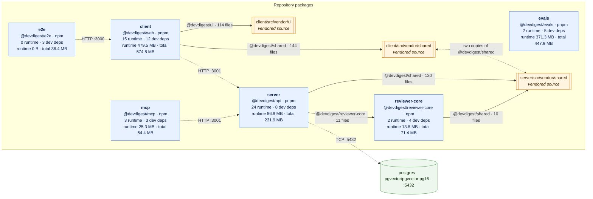

## 3. Packages at a glance

| Package | Manager | Direct (runtime / dev) | Installed packages | Runtime footprint | Total footprint | Heaviest direct dependency | Findings P0 · P1 · P2 · P3 |
|---|---|---|---|---|---|---|---|
| **client** `@devdigest/web` | pnpm | 15 / 12 | 436 | 479.5 MB | 574.8 MB | next (306.9 MB) | 0 · 0 · 5 · 5 |
| **e2e** `@devdigest/e2e` | npm | 0 / 3 | 6 | 0 B | 36.4 MB | typescript (22.5 MB) | 0 · 0 · 0 · 1 |
| **evals** `@devdigest/evals` | pnpm | 2 / 5 | 97 | 371.3 MB | 447.9 MB | @anthropic-ai/claude-agent-sdk (360.9 MB) | 0 · 0 · 4 · 5 |
| **mcp** `@devdigest/mcp` | npm | 3 / 3 | 32 | 25.3 MB | 54.4 MB | typescript (22.5 MB) | 0 · 0 · 1 · 2 |
| **reviewer-core** `@devdigest/reviewer-core` | npm | 2 / 4 | 87 | 13.8 MB | 71.4 MB | vitest (23.6 MB) | 0 · 0 · 3 · 3 |
| **server** `@devdigest/api` | pnpm | 24 / 8 | 424 | 86.9 MB | 231.9 MB | drizzle-kit (46.5 MB) | 0 · 1 · 4 · 5 |

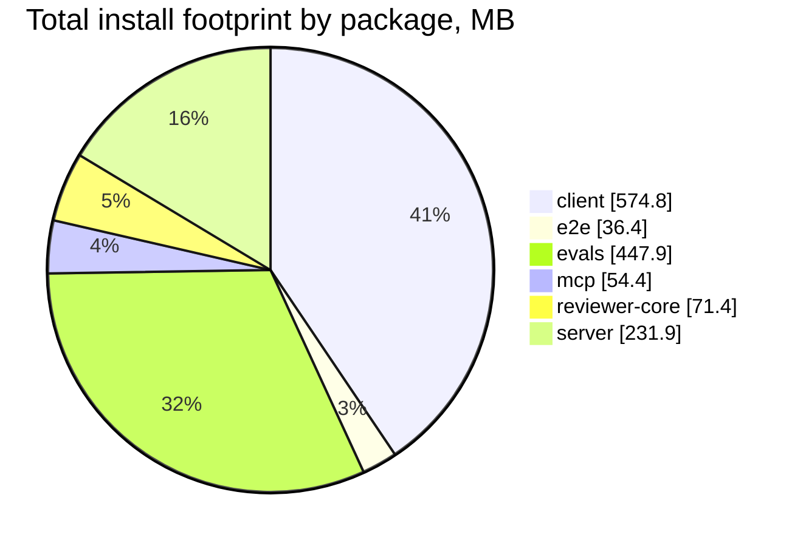

## 4. Package details

### 4.1 `client` — @devdigest/web

**15** runtime + **12** dev direct dependencies → **436** installed packages, **574.8 MB** (runtime tree 274 packages, 479.5 MB). Lockfile: `pnpm-lock.yaml`.

```mermaid
flowchart LR
  pkg_client(["<b>client</b><br/>@devdigest/web"])
  subgraph pkg_client_prod["Runtime — dependencies · 15"]
    direction TB
    pkg_client_prod_next["next<br/>15.5.19 · 306.9 MB"]
    pkg_client_prod_mermaid["mermaid<br/>11.15.0 · 115.2 MB"]
    pkg_client_prod_lucide_react["lucide-react<br/>0.469.0 · 27.3 MB"]
    pkg_client_prod_recharts["recharts<br/>2.15.4 · 10.5 MB"]
    pkg_client_prod_react_dom["react-dom<br/>19.2.7 · 7.1 MB"]
    pkg_client_prod_zod["zod<br/>3.25.76 · 3.4 MB"]
    pkg_client_prod__tanstack_react_query["@tanstack/react-query<br/>5.101.0 · 3.0 MB"]
    pkg_client_prod_react_markdown["react-markdown<br/>9.1.0 · 2.7 MB"]
    pkg_client_prod_next_intl["next-intl<br/>3.26.5 · 2.3 MB"]
    pkg_client_prod_remark_gfm["remark-gfm<br/>4.0.1 · 2.3 MB"]
    pkg_client_prod__dnd_kit_core["@dnd-kit/core<br/>6.3.1 · 1.2 MB"]
    pkg_client_prod_diff["diff<br/>9.0.0 · 601 KB"]
    pkg_client_prod_more["+3 more<br/>396 KB exclusive"]
  end
  pkg_client --> pkg_client_prod
  subgraph pkg_client_dev["Dev — devDependencies · 12"]
    direction TB
    pkg_client_dev_vitest["vitest<br/>2.1.9 · 30.9 MB"]
    pkg_client_dev_typescript["typescript<br/>5.9.3 · 22.5 MB"]
    pkg_client_dev__tailwindcss_postcss["@tailwindcss/postcss<br/>4.3.0 · 17.3 MB"]
    pkg_client_dev_jsdom["jsdom<br/>25.0.1 · 13.2 MB"]
    pkg_client_dev__vitejs_plugin_react["@vitejs/plugin-react<br/>4.7.0 · 11.9 MB"]
    pkg_client_dev__types_node["@types/node<br/>22.19.19 · 2.4 MB"]
    pkg_client_dev__types_react["@types/react<br/>19.2.16 · 1.6 MB"]
    pkg_client_dev__testing_library_jest_dom["@testing-library/jest-dom<br/>6.9.1 · 1021 KB"]
    pkg_client_dev_tailwindcss["tailwindcss<br/>4.3.0 · 737 KB"]
    pkg_client_dev__testing_library_react["@testing-library/react<br/>16.3.2 · 571 KB"]
    pkg_client_dev_postcss["postcss<br/>8.5.15 · 376 KB"]
    pkg_client_dev__types_react_dom["@types/react-dom<br/>19.2.3 · 29 KB"]
  end
  pkg_client --> pkg_client_dev
  classDef unused fill:#fde8e8,stroke:#c43c3c,stroke-dasharray:4 3,color:#3d0b0b
  classDef heavy fill:#fff1db,stroke:#d08a1e,color:#3d2600
  classDef drift fill:#f1e8ff,stroke:#7a4fd0,color:#21094d
  classDef warn fill:#fffbe0,stroke:#b9a21c,color:#332b00
  class pkg_client_dev_postcss unused
  class pkg_client_prod_next,pkg_client_prod_mermaid,pkg_client_prod_lucide_react heavy
  class pkg_client_prod_zod,pkg_client_dev_vitest drift
```

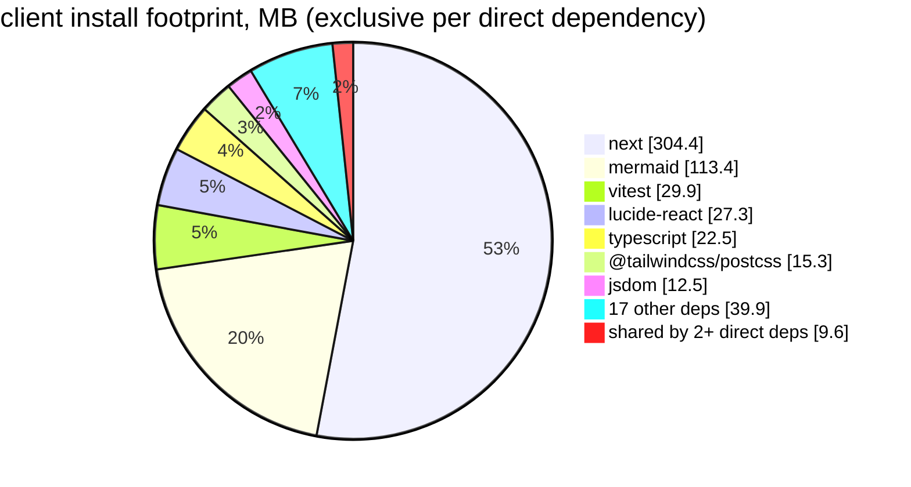

| Dependency | Section · category | Declared → installed | Purpose | Used by (files) | Own | Closure | Exclusive | License | Flags |
|---|---|---|---|---|---|---|---|---|---|
| `next` | prod · library | ^15.1.3 → 15.5.19 | The React Framework | src 37 · config 2 · bin next→dev/build/start · peer of next-intl | 133.0 MB | 306.9 MB (20) | 304.4 MB | MIT | `heavy` `browser` `native` |
| `mermaid` | prod · library | ^11.15.0 → 11.15.0 | Markdown-ish syntax for generating flowcharts, mindmaps, sequence dia… | src 1 | 72.8 MB | 115.2 MB (111) | 113.4 MB | MIT | `heavy` `browser` |
| `lucide-react` | prod · library | ^0.469.0 → 0.469.0 | A Lucide icon library package for React applications | src 1 | 27.3 MB | 27.3 MB (1) | 27.3 MB | ISC | `heavy` |
| `recharts` | prod · library | ^2.15.0 → 2.15.4 | React charts | src 2 | 4.4 MB | 10.5 MB (41) | 7.7 MB | MIT |  |
| `react-dom` | prod · library | ^19.0.0 → 19.2.7 | React package for working with the DOM. | src 2 · peer of @dnd-kit/core, next, recharts | 7.0 MB | 7.1 MB (2) | 7.1 MB | MIT | `browser` |
| `zod` | prod · library | ^3.24.1 → 3.25.76 | TypeScript-first schema declaration and validation library with stati… | src 12 | 3.4 MB | 3.4 MB (1) | 3.4 MB | MIT | `drift` |
| `@tanstack/react-query` | prod · library | ^5.62.8 → 5.101.0 | Hooks for managing, caching and syncing asynchronous and remote data … | src 18 · test 18 | 839 KB | 3.0 MB (2) | 3.0 MB | MIT | `browser` |
| `react-markdown` | prod · library | ^9.0.3 → 9.1.0 | React component to render markdown | src 1 | 51 KB | 2.7 MB (82) | 902 KB | MIT |  |
| `next-intl` | prod · library | ^3.26.0 → 3.26.5 | Internationalization (i18n) for Next.js | src 107 · test 62 · config 1 | 356 KB | 2.3 MB (12) | 2.0 MB | MIT | `browser` |
| `remark-gfm` | prod · library | ^4.0.0 → 4.0.1 | remark plugin to support GFM (autolink literals, footnotes, strikethr… | src 1 | 21 KB | 2.3 MB (68) | 538 KB | MIT |  |
| `@dnd-kit/core` | prod · library | ^6.3.1 → 6.3.1 | dnd kit – a lightweight React library for building performant and acc… | src 2 · peer of @dnd-kit/sortable | 1.0 MB | 1.2 MB (4) | 1.0 MB | MIT | `browser` |
| `diff` | prod · library | ^9.0.0 → 9.0.0 | A JavaScript text diff implementation. | src 1 | 601 KB | 601 KB (1) | 601 KB | BSD-3-Clause |  |
| `@dnd-kit/sortable` | prod · library | ^10.0.0 → 10.0.0 | Official sortable preset and sensors for dnd kit | src 4 | 229 KB | 403 KB (3) | 229 KB | MIT | `browser` |
| `@dnd-kit/utilities` | prod · library | ^3.2.2 → 3.2.2 | Internal utilities to bee shared between `@dnd-kit` packages | src 2 | 86 KB | 175 KB (2) | 0 B | MIT | `browser` |
| `react` | prod · library | ^19.0.0 → 19.2.7 | React is a JavaScript library for building user interfaces. | src 247 · test 26 · peer of @dnd-kit/core, @dnd-kit/sortable, @dnd-kit/utilities | 168 KB | 168 KB (1) | 168 KB | MIT | `browser` |
| `vitest` | dev · test | ^2.1.8 → 2.1.9 | Next generation testing framework powered by Vite | test 91 · config 1 · bin vitest→test | 1.6 MB | 30.9 MB (43) | 29.9 MB | MIT | `drift` `native` |
| `typescript` | dev · tooling | ^5.7.2 → 5.9.3 | TypeScript is a language for application scale JavaScript development | bin tsc→typecheck | 22.5 MB | 22.5 MB (1) | 22.5 MB | Apache-2.0 |  |
| `@tailwindcss/postcss` | dev · tooling | ^4.0.0 → 4.3.0 | PostCSS plugin for Tailwind CSS, a utility-first CSS framework for ra… | config 1 | 97 KB | 17.3 MB (23) | 15.3 MB | MIT | `native` |
| `jsdom` | dev · test | ^25.0.1 → 25.0.1 | A JavaScript implementation of many web standards | config 1 · peer of vitest | 3.0 MB | 13.2 MB (60) | 12.5 MB | MIT |  |
| `@vitejs/plugin-react` | dev · tooling | ^4.3.4 → 4.7.0 | The default Vite plugin for React projects | config 1 | 59 KB | 11.9 MB (49) | 9.2 MB | MIT |  |
| `@types/node` | dev · types | ^22.10.0 → 22.19.19 | TypeScript definitions for node | peer of vitest · types for node | 2.3 MB | 2.4 MB (2) | 2.4 MB | MIT |  |
| `@types/react` | dev · types | ^19.0.2 → 19.2.16 | TypeScript definitions for react | peer of react-markdown, @testing-library/react, @types/react-dom · types for react | 398 KB | 1.6 MB (2) | 398 KB | MIT |  |
| `@testing-library/jest-dom` | dev · test | ^6.6.3 → 6.9.1 | Custom jest matchers to test the state of the DOM | test 1 | 294 KB | 1021 KB (10) | 1014 KB | MIT |  |
| `tailwindcss` | dev · tooling | ^4.0.0 → 4.3.0 | A utility-first CSS framework for rapidly building custom user interf… | style 1 | 737 KB | 737 KB (1) | 0 B | MIT |  |
| `@testing-library/react` | dev · test | ^16.1.0 → 16.3.2 | Simple and complete React DOM testing utilities that encourage good t… | test 70 | 329 KB | 571 KB (2) | 329 KB | MIT |  |
| `postcss` | dev · tooling | ^8.4.49 → 8.5.15 | Tool for transforming styles with JS plugins | **unused** | 201 KB | 376 KB (4) | 0 B | MIT | `unused` |
| `@types/react-dom` | dev · types | ^19.0.2 → 19.2.3 | TypeScript definitions for react-dom | peer of @testing-library/react · types for react-dom | 29 KB | 29 KB (1) | 29 KB | MIT |  |

**Licenses (whole tree):** MIT 356 · ISC 45 · BSD-3-Clause 11 · Apache-2.0 11 · LGPL-3.0-or-later 2 · MPL-2.0 2 · BSD-2-Clause 2 · 0BSD 1 · (MPL-2.0 OR Apache-2.0) 1 · UNKNOWN 1 · Unlicense 1 · CC-BY-4.0 1 · MIT AND ISC 1 · MIT-0 1  
**In 2+ versions:** @formatjs/intl-localematcher (0.5.10, 0.6.2), layout-base (2.0.1, 1.0.2), d3-shape (3.2.0, 1.3.7), postcss (8.5.15, 8.4.31), commander (8.3.0, 7.2.0), d3-array (3.2.4, 2.12.1), +9 more  
**Native code / install scripts:** @img/sharp-linux-x64@0.34.5, @img/sharp-linuxmusl-x64@0.34.5, @next/swc-linux-x64-gnu@15.5.19, @rollup/rollup-linux-x64-gnu@4.61.0, @tailwindcss/oxide-linux-x64-gnu@4.3.0, esbuild@0.21.5, lightningcss-linux-x64-gnu@1.32.0, sharp@0.34.5

### 4.2 `e2e` — @devdigest/e2e

Deterministic browser e2e for the DevDigest web app, driven by Vercel agent-browser (CDP, no LLM).  
**0** runtime + **3** dev direct dependencies → **6** installed packages, **36.4 MB** (runtime tree 0 packages, 0 B). Lockfile: `package-lock.json`.

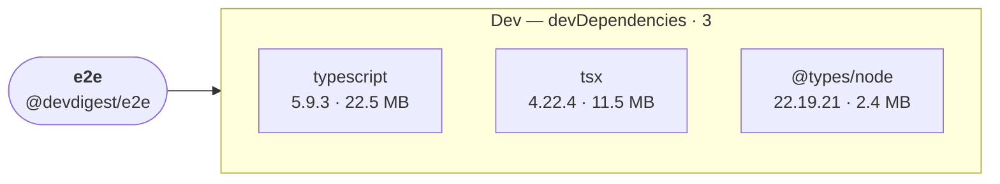

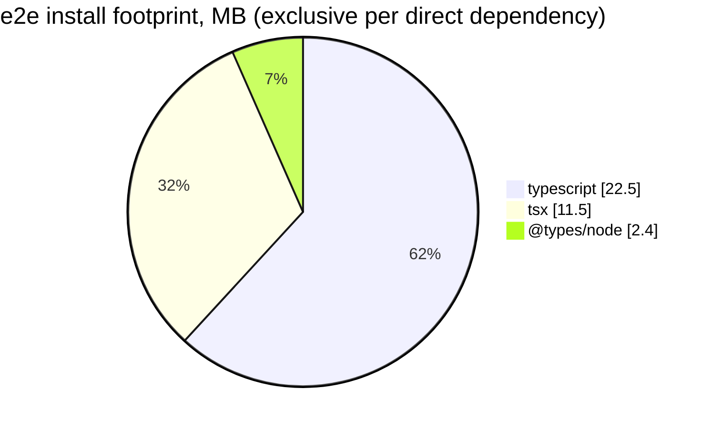

| Dependency | Section · category | Declared → installed | Purpose | Used by (files) | Own | Closure | Exclusive | License | Flags |
|---|---|---|---|---|---|---|---|---|---|
| `typescript` | dev · tooling | ^5.7.2 → 5.9.3 | TypeScript is a language for application scale JavaScript development | bin tsc→typecheck | 22.5 MB | 22.5 MB (1) | 22.5 MB | Apache-2.0 |  |
| `tsx` | dev · tooling | ^4.19.2 → 4.22.4 | TypeScript Execute (tsx): Node.js enhanced with esbuild to run TypeSc… | bin tsx→test | 506 KB | 11.5 MB (3) | 11.5 MB | MIT | `native` |
| `@types/node` | dev · types | ^22.10.0 → 22.19.21 | TypeScript definitions for node | types for node | 2.3 MB | 2.4 MB (2) | 2.4 MB | MIT |  |

**Licenses (whole tree):** MIT 5 · Apache-2.0 1  
**In 2+ versions:** none  
**Native code / install scripts:** esbuild@0.28.0

### 4.3 `evals` — @devdigest/evals

Evals for the DevDigest Claude Code harness (skills + subagents + workflow). vitest + Claude Agent SDK, on the Claude Code subscription — no API token, no external services.  
**2** runtime + **5** dev direct dependencies → **97** installed packages, **447.9 MB** (runtime tree 41 packages, 371.3 MB). Lockfile: `pnpm-lock.yaml`.

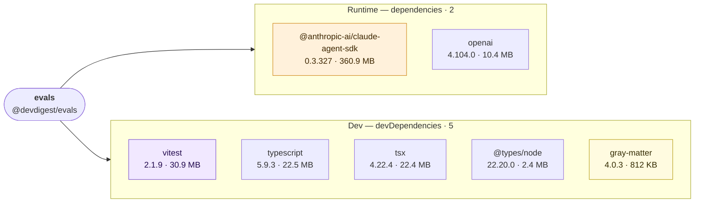

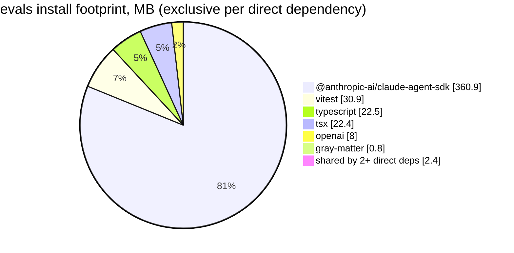

| Dependency | Section · category | Declared → installed | Purpose | Used by (files) | Own | Closure | Exclusive | License | Flags |
|---|---|---|---|---|---|---|---|---|---|
| `@anthropic-ai/claude-agent-sdk` | prod · library | ^0.3.327 → 0.3.327 | SDK for building AI agents with Claude Code's capabilities. Programma… | src 1 | 5.3 MB | 360.9 MB (2) | 360.9 MB | SEE LICENSE IN README.md | `heavy` |
| `openai` | prod · library | ^4.77.0 → 4.104.0 | The official TypeScript library for the OpenAI API | src 1 | 4.0 MB | 10.4 MB (39) | 8.0 MB | Apache-2.0 |  |
| `vitest` | dev · test | ^2.1.0 → 2.1.9 | Next generation testing framework powered by Vite | src 3 · test 1 · config 1 · bin vitest→eval/eval:workflow | 1.6 MB | 30.9 MB (43) | 30.9 MB | MIT | `dev-in-prod` `drift` `native` |
| `typescript` | dev · tooling | ^5.6.0 → 5.9.3 | TypeScript is a language for application scale JavaScript development | bin tsc→typecheck | 22.5 MB | 22.5 MB (1) | 22.5 MB | Apache-2.0 |  |
| `tsx` | dev · tooling | ^4.19.0 → 4.22.4 | TypeScript Execute (tsx): Node.js enhanced with esbuild to run TypeSc… | bin tsx→eval:quality/eval:compare/eval:repeat/eval:delta/eval:benchmark/eval:scaffold | 506 KB | 22.4 MB (3) | 22.4 MB | MIT | `native` |
| `@types/node` | dev · types | ^22.0.0 → 22.20.0 | TypeScript definitions for node | peer of vitest · types for node | 2.3 MB | 2.4 MB (2) | 0 B | MIT |  |
| `gray-matter` | dev · tooling | ^4.0.3 → 4.0.3 | Parse front-matter from a string or file. Fast, reliable and easy to … | src 1 | 38 KB | 812 KB (10) | 812 KB | MIT | `dev-in-prod` |

**Licenses (whole tree):** MIT 86 · Apache-2.0 3 · BSD-2-Clause 2 · BSD-3-Clause 2 · ISC 2 · SEE LICENSE IN README.md 1 · SEE LICENSE IN LICENSE.md 1  
**In 2+ versions:** esbuild (0.28.1, 0.21.5), @esbuild/linux-x64 (0.28.1, 0.21.5), @types/node (22.20.0, 18.19.130), undici-types (6.21.0, 5.26.5)  
**Native code / install scripts:** @rollup/rollup-linux-x64-gnu@4.62.2, esbuild@0.28.1, esbuild@0.21.5

### 4.4 `mcp` — @devdigest/mcp

DevDigest MCP server (stdio) — a thin client of the running DevDigest HTTP API. Tools: list_agents, run_agent_on_pr, get_findings, get_conventions, get_blast_radius.  
**3** runtime + **3** dev direct dependencies → **32** installed packages, **54.4 MB** (runtime tree 6 packages, 25.3 MB). Lockfile: `package-lock.json`.

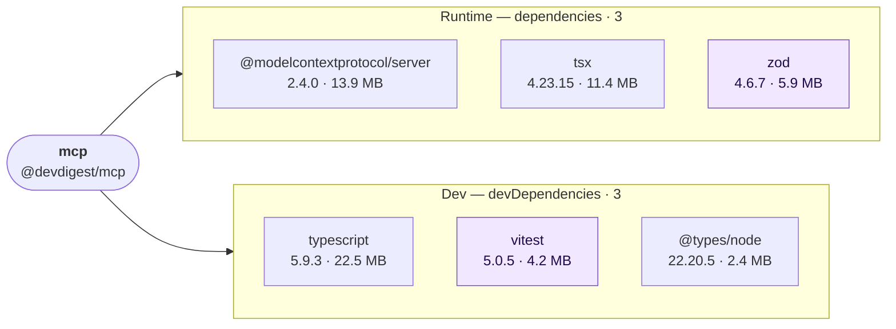

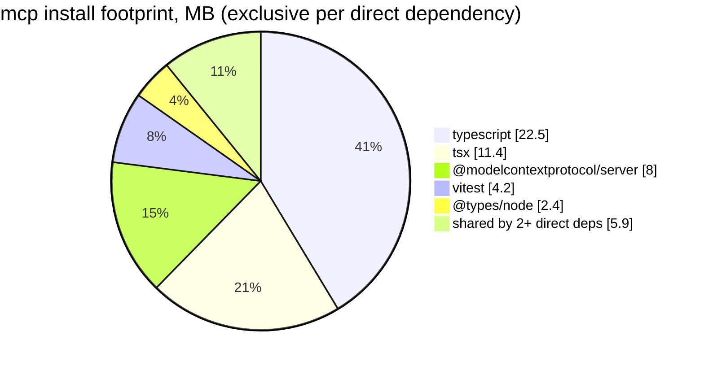

| Dependency | Section · category | Declared → installed | Purpose | Used by (files) | Own | Closure | Exclusive | License | Flags |
|---|---|---|---|---|---|---|---|---|---|
| `@modelcontextprotocol/server` | prod · library | 2.4.0 → 2.4.0 | Model Context Protocol implementation for TypeScript - Server package | src 7 · test 1 | 6.7 MB | 13.9 MB (3) | 8.0 MB | Apache-2.0 |  |
| `tsx` | prod · tooling | ^4.23.15 → 4.23.15 | TypeScript Execute (tsx): Node.js enhanced with esbuild to run TypeSc… | bin tsx→start | 388 KB | 11.4 MB (3) | 11.4 MB | MIT | `native` |
| `zod` | prod · library | ^4.6.7 → 4.6.7 | TypeScript-first schema declaration and validation library with stati… | src 8 | 5.9 MB | 5.9 MB (1) | 0 B | MIT | `drift` |
| `typescript` | dev · tooling | ^5.9.3 → 5.9.3 | TypeScript is a language for application scale JavaScript development | bin tsc→typecheck | 22.5 MB | 22.5 MB (1) | 22.5 MB | Apache-2.0 |  |
| `vitest` | dev · test | ^5.0.5 → 5.0.5 | Next generation testing framework powered by Vite | test 5 · config 1 · bin vitest→test | 2.7 MB | 4.2 MB (23) | 4.2 MB | MIT | `drift` |
| `@types/node` | dev · types | ^22.20.5 → 22.20.5 | TypeScript definitions for node | peer of vitest · types for node | 2.3 MB | 2.4 MB (2) | 2.4 MB | MIT |  |

**Licenses (whole tree):** MIT 28 · Apache-2.0 4  
**In 2+ versions:** none  
**Native code / install scripts:** esbuild@0.28.2

### 4.5 `reviewer-core` — @devdigest/reviewer-core

DevDigest review engine — pure logic (prompt assembly, citation grounding, structured output, reduce, reviewPullRequest). No DB/GitHub/FS; the only side effect is an injected LLMProvider. Consumed by server (local reviews) and agent-runner (CI) as source via tsconfig path alias.  
**2** runtime + **4** dev direct dependencies → **87** installed packages, **71.4 MB** (runtime tree 40 packages, 13.8 MB). Lockfile: `package-lock.json`.

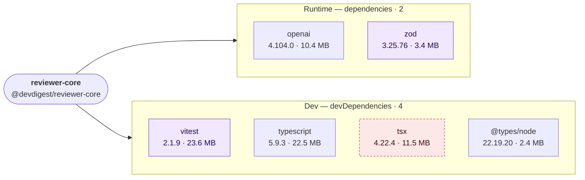

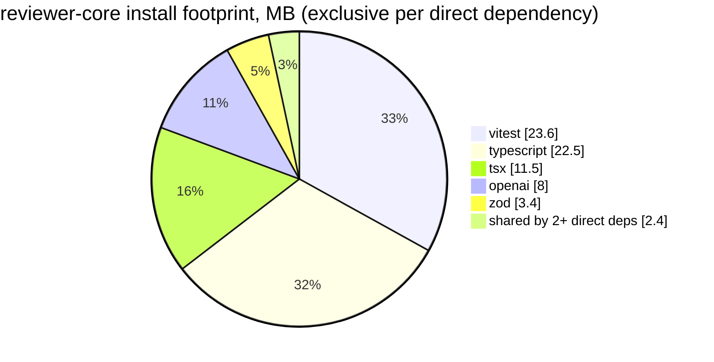

| Dependency | Section · category | Declared → installed | Purpose | Used by (files) | Own | Closure | Exclusive | License | Flags |
|---|---|---|---|---|---|---|---|---|---|
| `openai` | prod · library | ^4.77.0 → 4.104.0 | The official TypeScript library for the OpenAI API | src 2 | 4.0 MB | 10.4 MB (39) | 8.0 MB | Apache-2.0 |  |
| `zod` | prod · library | ^3.24.1 → 3.25.76 | TypeScript-first schema declaration and validation library with stati… | src 1 · peer of openai | 3.4 MB | 3.4 MB (1) | 3.4 MB | MIT | `drift` |
| `vitest` | dev · test | ^2.1.8 → 2.1.9 | Next generation testing framework powered by Vite | test 4 · config 1 · bin vitest→test | 1.6 MB | 23.6 MB (44) | 23.6 MB | MIT | `drift` `native` |
| `typescript` | dev · tooling | ^5.7.2 → 5.9.3 | TypeScript is a language for application scale JavaScript development | bin tsc→typecheck/build | 22.5 MB | 22.5 MB (1) | 22.5 MB | Apache-2.0 |  |
| `tsx` | dev · tooling | ^4.19.2 → 4.22.4 | TypeScript Execute (tsx): Node.js enhanced with esbuild to run TypeSc… | **unused** | 506 KB | 11.5 MB (3) | 11.5 MB | MIT | `unused` `native` |
| `@types/node` | dev · types | ^22.10.0 → 22.19.20 | TypeScript definitions for node | peer of vitest · types for node | 2.3 MB | 2.4 MB (2) | 0 B | MIT |  |

**Licenses (whole tree):** MIT 80 · Apache-2.0 3 · ISC 2 · BSD-2-Clause 1 · BSD-3-Clause 1  
**In 2+ versions:** @esbuild/linux-x64 (0.28.0, 0.21.5), @types/node (22.19.20, 18.19.130), esbuild (0.28.0, 0.21.5), undici-types (6.21.0, 5.26.5)  
**Native code / install scripts:** @rollup/rollup-linux-x64-gnu@4.61.1, @rollup/rollup-linux-x64-musl@4.61.1, esbuild@0.28.0, esbuild@0.21.5

### 4.6 `server` — @devdigest/api

**24** runtime + **8** dev direct dependencies → **424** installed packages, **231.9 MB** (runtime tree 215 packages, 86.9 MB). Lockfile: `pnpm-lock.yaml`.

```mermaid
flowchart LR
  pkg_server(["<b>server</b><br/>@devdigest/api"])
  subgraph pkg_server_prod["Runtime — dependencies · 24"]
    direction TB
    pkg_server_prod_js_tiktoken["js-tiktoken<br/>1.0.21 · 21.4 MB"]
    pkg_server_prod_octokit["octokit<br/>4.1.4 · 10.6 MB"]
    pkg_server_prod_openai["openai<br/>4.104.0 · 10.4 MB"]
    pkg_server_prod_drizzle_orm["drizzle-orm<br/>0.38.4 · 7.8 MB"]
    pkg_server_prod__ast_grep_napi["@ast-grep/napi<br/>0.43.0 · 7.8 MB"]
    pkg_server_prod__anthropic_ai_sdk["@anthropic-ai/sdk<br/>0.33.1 · 7.4 MB"]
    pkg_server_prod_fastify["fastify<br/>5.8.5 · 6.9 MB"]
    pkg_server_prod__vscode_ripgrep["@vscode/ripgrep<br/>1.18.0 · 5.5 MB"]
    pkg_server_prod_dependency_cruiser["dependency-cruiser<br/>17.4.3 · 4.3 MB"]
    pkg_server_prod_zod["zod<br/>3.25.76 · 3.4 MB"]
    pkg_server_prod_graphology["graphology<br/>0.26.0 · 2.7 MB"]
    pkg_server_prod_simple_git["simple-git<br/>3.36.0 · 1.1 MB"]
    pkg_server_prod_more["+12 more<br/>3.9 MB exclusive"]
  end
  pkg_server --> pkg_server_prod
  subgraph pkg_server_dev["Dev — devDependencies · 8"]
    direction TB
    pkg_server_dev_drizzle_kit["drizzle-kit<br/>0.30.6 · 46.5 MB"]
    pkg_server_dev_vitest["vitest<br/>2.1.9 · 30.9 MB"]
    pkg_server_dev__testcontainers_postgresql["@testcontainers/postgresql<br/>10.28.0 · 27.7 MB"]
    pkg_server_dev_testcontainers["testcontainers<br/>10.28.0 · 27.7 MB"]
    pkg_server_dev_typescript["typescript<br/>5.9.3 · 22.5 MB"]
    pkg_server_dev_tsx["tsx<br/>4.22.4 · 22.3 MB"]
    pkg_server_dev__types_node["@types/node<br/>22.19.19 · 2.4 MB"]
    pkg_server_dev_pino_pretty["pino-pretty<br/>13.1.3 · 788 KB"]
  end
  pkg_server --> pkg_server_dev
  classDef unused fill:#fde8e8,stroke:#c43c3c,stroke-dasharray:4 3,color:#3d0b0b
  classDef heavy fill:#fff1db,stroke:#d08a1e,color:#3d2600
  classDef drift fill:#f1e8ff,stroke:#7a4fd0,color:#21094d
  classDef warn fill:#fffbe0,stroke:#b9a21c,color:#332b00
  class pkg_server_dev_testcontainers unused
  class pkg_server_prod_js_tiktoken heavy
  class pkg_server_prod_zod,pkg_server_dev_vitest drift
  class pkg_server_dev_pino_pretty warn
```

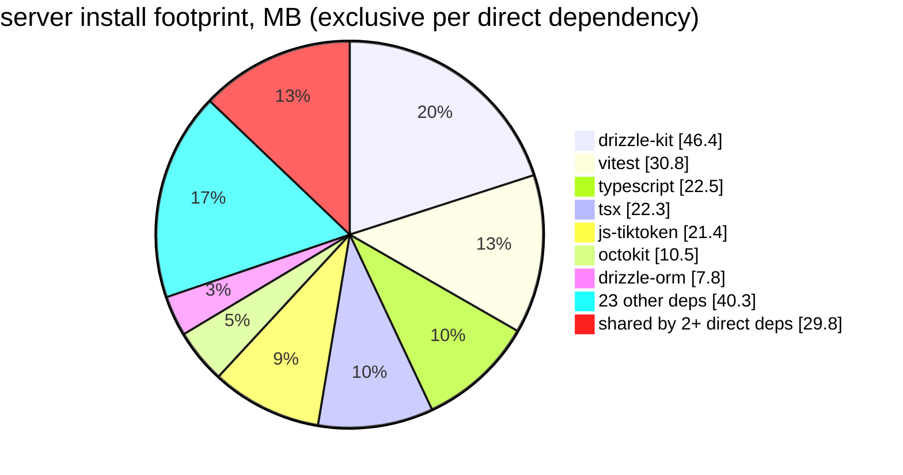

| Dependency | Section · category | Declared → installed | Purpose | Used by (files) | Own | Closure | Exclusive | License | Flags |
|---|---|---|---|---|---|---|---|---|---|
| `js-tiktoken` | prod · library | ^1.0.21 → 1.0.21 | JavaScript port of tiktoken | src 1 | 21.4 MB | 21.4 MB (2) | 21.4 MB | MIT | `heavy` |
| `octokit` | prod · library | ^4.0.3 → 4.1.4 | The all-batteries-included GitHub SDK for Browsers, Node.js, and Deno | src 1 | 50 KB | 10.6 MB (33) | 10.5 MB | MIT |  |
| `openai` | prod · library | ^4.77.0 → 4.104.0 | The official TypeScript library for the OpenAI API | src 1 | 4.0 MB | 10.4 MB (39) | 4.0 MB | Apache-2.0 |  |
| `drizzle-orm` | prod · library | ^0.38.3 → 0.38.4 | Drizzle ORM package for SQL databases | src 40 · test 10 | 7.8 MB | 7.8 MB (1) | 7.8 MB | Apache-2.0 |  |
| `@ast-grep/napi` | prod · library | 0.43.0 → 0.43.0 | Search and Rewrite code at large scale using precise AST pattern | src 1 | 352 KB | 7.8 MB (2) | 7.8 MB | MIT | `native` |
| `@anthropic-ai/sdk` | prod · library | ^0.33.1 → 0.33.1 | The official TypeScript library for the Anthropic API | src 1 · test 1 (types) | 1.0 MB | 7.4 MB (39) | 1.0 MB | MIT |  |
| `fastify` | prod · library | ^5.2.0 → 5.8.5 | Fast and low overhead web framework, for Node.js | src 19 · test 1 (types) · peer of fastify-sse-v2, fastify-type-provider-zod | 2.6 MB | 6.9 MB (48) | 6.5 MB | MIT |  |
| `@vscode/ripgrep` | prod · library | ^1.15.9 → 1.18.0 | A module for using ripgrep in a Node project | src 1 | 4 KB | 5.5 MB (2) | 5.5 MB | MIT |  |
| `dependency-cruiser` | prod · tooling | ^17.4.3 → 17.4.3 | Validate and visualize dependencies. With your rules. JavaScript, Typ… | src 1 | 963 KB | 4.3 MB (43) | 4.0 MB | MIT |  |
| `zod` | prod · library | ^3.24.1 → 3.25.76 | TypeScript-first schema declaration and validation library with stati… | src 20 · test 2 · peer of fastify-type-provider-zod, openai | 3.4 MB | 3.4 MB (1) | 3.4 MB | MIT | `drift` |
| `graphology` | prod · library | ^0.26.0 → 0.26.0 | A robust and multipurpose Graph object for JavaScript. | src 1 | 2.6 MB | 2.7 MB (2) | 2.6 MB | MIT |  |
| `simple-git` | prod · library | ^3.27.0 → 3.36.0 | Simple GIT interface for node.js | src 1 | 929 KB | 1.1 MB (7) | 1.0 MB | MIT |  |
| `fflate` | prod · library | ^0.8.3 → 0.8.3 | High performance (de)compression in an 8kB package | src 1 · test 1 | 778 KB | 778 KB (1) | 778 KB | MIT |  |
| `graphology-metrics` | prod · library | ^2.4.0 → 2.4.0 | Miscellaneous graph metrics for graphology. | src 1 | 123 KB | 756 KB (8) | 717 KB | MIT |  |
| `yaml` | prod · library | ^2.9.1 → 2.9.1 | JavaScript parser and stringifier for YAML | src 1 | 670 KB | 670 KB (1) | 670 KB | ISC |  |
| `@fastify/cors` | prod · library | ^10.0.2 → 10.1.0 | Fastify CORS | src 1 | 113 KB | 567 KB (4) | 487 KB | MIT |  |
| `fastify-sse-v2` | prod · library | ^4.2.1 → 4.2.2 | Fastify plugin for sending server side events. | src 1 | 21 KB | 393 KB (16) | 108 KB | MIT |  |
| `@fastify/rate-limit` | prod · library | ^11.0.0 → 11.0.0 | A low overhead rate limiter for your routes | src 1 | 203 KB | 302 KB (4) | 212 KB | MIT |  |
| `postgres` | prod · library | ^3.4.5 → 3.4.9 | Fastest full featured PostgreSQL client for Node.js | src 2 · peer of drizzle-orm | 293 KB | 293 KB (1) | 293 KB | Unlicense |  |
| `fastify-type-provider-zod` | prod · library | ^4.0.2 → 4.0.2 | Zod Type Provider for Fastify@5 | src 16 | 25 KB | 275 KB (3) | 239 KB | MIT |  |
| `@fastify/helmet` | prod · library | ^13.0.2 → 13.0.2 | Important security headers for Fastify | src 1 | 68 KB | 211 KB (3) | 169 KB | MIT |  |
| `@fastify/autoload` | prod · library | ^6.0.3 → 6.3.1 | Require all plugins in a directory | **unused** | 171 KB | 171 KB (1) | 171 KB | MIT | `unused` |
| `p-queue` | prod · library | ^8.0.1 → 8.1.1 | Promise queue with concurrency control | src 2 | 40 KB | 126 KB (3) | 126 KB | MIT |  |
| `dotenv` | prod · library | ^16.4.7 → 16.6.1 | Loads environment variables from .env file | src 3 · config 1 | 75 KB | 75 KB (1) | 75 KB | BSD-2-Clause |  |
| `drizzle-kit` | dev · tooling | ^0.30.1 → 0.30.6 | — | config 1 · bin drizzle-kit→db:generate | 7.4 MB | 46.5 MB (23) | 46.4 MB | MIT | `native` |
| `vitest` | dev · test | ^2.1.8 → 2.1.9 | Next generation testing framework powered by Vite | test 49 · config 1 · bin vitest→test | 1.6 MB | 30.9 MB (43) | 30.8 MB | MIT | `drift` `native` |
| `@testcontainers/postgresql` | dev · test | ^10.16.0 → 10.28.0 | PostgreSQL module for Testcontainers | test 1 | 18 KB | 27.7 MB (158) | 18 KB | MIT | `native` |
| `testcontainers` | dev · test | ^10.16.0 → 10.28.0 | Testcontainers is a NodeJS library that supports tests, providing lig… | **unused** | 379 KB | 27.7 MB (157) | 0 B | MIT | `unused` `native` |
| `typescript` | dev · tooling | ^5.7.2 → 5.9.3 | TypeScript is a language for application scale JavaScript development | bin tsc→build/typecheck | 22.5 MB | 22.5 MB (1) | 22.5 MB | Apache-2.0 |  |
| `tsx` | dev · tooling | ^4.19.2 → 4.22.4 | TypeScript Execute (tsx): Node.js enhanced with esbuild to run TypeSc… | bin tsx→dev/db:migrate/db:seed | 506 KB | 22.3 MB (3) | 22.3 MB | MIT | `native` |
| `@types/node` | dev · types | ^22.10.0 → 22.19.19 | TypeScript definitions for node | peer of vitest · types for node | 2.3 MB | 2.4 MB (2) | 0 B | MIT |  |
| `pino-pretty` | dev · tooling | ^13.0.0 → 13.1.3 | Prettifier for Pino log lines | string ref ×1 | 240 KB | 788 KB (19) | 508 KB | MIT | `weak-use` |

**Licenses (whole tree):** MIT 341 · ISC 31 · Apache-2.0 25 · BSD-3-Clause 18 · BlueOak-1.0.0 5 · BSD-2-Clause 2 · Unlicense 2  
**In 2+ versions:** esbuild (0.28.0, 0.21.5, 0.19.12, 0.18.20), @esbuild/linux-x64 (0.28.0, 0.21.5, 0.19.12, 0.18.20), @types/node (22.19.19, 18.19.130), yaml (2.9.1, 2.9.0), mnemonist (0.40.0, 0.39.8), readable-stream (4.7.0, 3.6.2, 2.3.8), +21 more  
**Native code / install scripts:** @ast-grep/napi-linux-x64-gnu@0.43.0, @rollup/rollup-linux-x64-gnu@4.61.0, cpu-features@0.0.10, esbuild@0.19.12, esbuild@0.18.20, esbuild@0.28.0, esbuild@0.21.5, protobufjs@7.6.2, ssh2@1.17.0

## 5. Cross-package versions

Dependencies declared by 2+ packages. ⚠ = packages are on different compatibility lines (major, or minor for 0.x).

| Dependency | client | e2e | evals | mcp | reviewer-core | server |
|---|---|---|---|---|---|---|
| `@types/node` | 22.19.19 (dev) | 22.19.21 (dev) | 22.20.0 (dev) | 22.20.5 (dev) | 22.19.20 (dev) | 22.19.19 (dev) |
| `typescript` | 5.9.3 (dev) | 5.9.3 (dev) | 5.9.3 (dev) | 5.9.3 (dev) | 5.9.3 (dev) | 5.9.3 (dev) |
| `tsx` |  | 4.22.4 (dev) | 4.22.4 (dev) | 4.23.15 | 4.22.4 (dev) | 4.22.4 (dev) |
| ⚠ `vitest` | 2.1.9 (dev) |  | 2.1.9 (dev) | 5.0.5 (dev) | 2.1.9 (dev) | 2.1.9 (dev) |
| ⚠ `zod` | 3.25.76 |  |  | 4.6.7 | 3.25.76 | 3.25.76 |
| `openai` |  |  | 4.104.0 |  | 4.104.0 | 4.104.0 |

## 6. Findings

**32** findings: P0 **0** · P1 **1** · P2 **14** · P3 **17**. Priorities are the rule defaults; the *Triage* column records the reviewer's check (confirmed / false positive / re-prioritised, with the reason).

### Hotspots

Dependencies that collect findings in several packages or under several rules — usually one fix closes all of them.

| Dependency | Worst | Findings | Rules | Packages |
|---|---|---|---|---|
| `@esbuild/linux-x64` | P2 | F06, F11, F12 | DC-DUPLICATE | server, evals, reviewer-core |
| `esbuild` | P2 | F05, F10 | DC-DUPLICATE | server, evals |
| `zod` | P2 | F13 | DC-DRIFT | client, mcp, reviewer-core, server |
| `vitest` | P3 | F21, F22 | DC-DEV-IN-PROD, DC-DRIFT | evals, client, mcp, reviewer-core, server |

### All findings

| ID | P | Rule | Package | Dependency | Evidence | Suggested fix | Triage |
|---|---|---|---|---|---|---|---|
| F01 | P1 | DC-UNUSED — Declared but never used | server | `@fastify/autoload` | no import, bin, config string, peer or @types use found in server (prod, exclusive 0.2 MB) | cd server && pnpm remove @fastify/autoload | ✅ confirmed — modules are registered explicitly (`server/src/modules/index.ts:25`); only skill docs mention autoload |
| F02 | P2 | DC-HEAVY — Heavy dependency (large exclusive footprint) | evals | `@anthropic-ai/claude-agent-sdk` | exclusive 360.9 MB (2 packages only it pulls in), closure 360.9 MB | Check whether a lighter alternative, a sub-path import or lazy loading (dynamic import) covers the use | ↓P3 — the SDK ships the Claude Code binary by design; used only by the local eval harness |
| F03 | P2 | DC-HEAVY — Heavy dependency (large exclusive footprint) | client | `next` | exclusive 304.4 MB (14 packages only it pulls in), closure 306.9 MB; imported by 25 'use client' file(s) → browser bundle | Check whether a lighter alternative, a sub-path import or lazy loading (dynamic import) covers the use | ↓P3 — framework cost (SWC binary + sharp); no alternative inside the stack |
| F04 | P2 | DC-HEAVY — Heavy dependency (large exclusive footprint) | client | `mermaid` | exclusive 113.4 MB (88 packages only it pulls in), closure 115.2 MB; imported by 1 'use client' file(s) → browser bundle | Check whether a lighter alternative, a sub-path import or lazy loading (dynamic import) covers the use | ↓P3 — already lazy-loaded (`await import("mermaid")`, `client/src/components/mermaid-diagram/MermaidDiagram.tsx:36`); install size only |
| F05 | P2 | DC-DUPLICATE — Same package installed in several versions | server | `esbuild` | 0.28.0, 0.21.5, 0.19.12, 0.18.20 installed; +27.7 MB for the extra copies | See who pulls each copy (`pnpm why esbuild`); align ranges or add an override | ✅ confirmed — copies from drizzle-kit (0.18 / 0.19), vitest 2 (0.21) and tsx (0.28); closes with the drizzle-kit and vitest upgrades |
| F06 | P2 | DC-DUPLICATE — Same package installed in several versions | server | `@esbuild/linux-x64` | 0.28.0, 0.21.5, 0.19.12, 0.18.20 installed; +27.3 MB for the extra copies | See who pulls each copy (`pnpm why @esbuild/linux-x64`); align ranges or add an override | ✅ confirmed — platform binary of F05; same fix |
| F07 | P2 | DC-HEAVY — Heavy dependency (large exclusive footprint) | client | `lucide-react` | exclusive 27.3 MB (1 packages only it pulls in), closure 27.3 MB | Check whether a lighter alternative, a sub-path import or lazy loading (dynamic import) covers the use | ↓P3 — named imports in `client/src/vendor/ui/icons.tsx` tree-shake; install size only |
| F08 | P2 | DC-HEAVY — Heavy dependency (large exclusive footprint) | server | `js-tiktoken` | exclusive 21.4 MB (1 packages only it pulls in), closure 21.4 MB | Check whether a lighter alternative, a sub-path import or lazy loading (dynamic import) covers the use | ↓P3 — server is not bundled; the rank tables are the point of the package |
| F09 | P2 | DC-UNUSED — Declared but never used | reviewer-core | `tsx` | no import, bin, config string, peer or @types use found in reviewer-core (dev, exclusive 11.5 MB) | cd reviewer-core && npm remove tsx | ✅ confirmed — no reviewer-core script uses tsx; its source runs under server's tsx (`reviewer-core/AGENTS.md:51`, CI `e2e-web.yml:88`) |
| F10 | P2 | DC-DUPLICATE — Same package installed in several versions | evals | `esbuild` | 0.28.1, 0.21.5 installed; +9.4 MB for the extra copies | See who pulls each copy (`pnpm why esbuild`); align ranges or add an override | ✅ confirmed — vitest 2 → vite 5 → esbuild 0.21; closes with the vitest upgrade |
| F11 | P2 | DC-DUPLICATE — Same package installed in several versions | evals | `@esbuild/linux-x64` | 0.28.1, 0.21.5 installed; +9.3 MB for the extra copies | See who pulls each copy (`pnpm why @esbuild/linux-x64`); align ranges or add an override | ✅ confirmed — platform binary of F10; same fix |
| F12 | P2 | DC-DUPLICATE — Same package installed in several versions | reviewer-core | `@esbuild/linux-x64` | 0.28.0, 0.21.5 installed; +9.3 MB for the extra copies | See who pulls each copy (`npm explain @esbuild/linux-x64`); align ranges or add an override | ✅ confirmed — vitest 2 → vite 5 → esbuild 0.21; closes with the vitest upgrade |
| F13 | P2 | DC-DRIFT — Different versions of one dependency across packages | client, mcp, reviewer-core, server | `zod` | client: 3.25.76 · mcp: 4.6.7 · reviewer-core: 3.25.76 · server: 3.25.76 | Align ranges when you next touch these packages (one upgrade, one test pass) | ✅ confirmed — mcp shares no source with the others, so P2 holds; the zod 3 packages include both vendored contract copies |
| F14 | P2 | DC-LICENSE — License needs a look | client | — | unknown in the production tree: khroma@2.1.0 (UNKNOWN) | Read the package LICENSE file; record the result | ❌ false positive — `node_modules/khroma/license` is MIT; the manifest just lacks the field |
| F15 | P2 | DC-LICENSE — License needs a look | evals | — | unknown in the production tree: @anthropic-ai/claude-agent-sdk@0.3.327 (SEE LICENSE IN README.md), @anthropic-ai/claude-agent-sdk-linux-x64@0.3.327 (SEE LICENSE IN LICENSE.md) | Read the package LICENSE file; record the result | ↓P3 — Anthropic commercial terms; used only by the local eval harness |
| F16 | P3 | DC-DUPLICATE — Same package installed in several versions | server | — | 25 more package(s) in 2+ versions, +3.8 MB total: @types/node (22.19.19, 18.19.130); yaml (2.9.1, 2.9.0); mnemonist (0.40.0, 0.39.8); readable-stream (4.7.0, 3.6.2, 2.3.8); @grpc/proto-loader (0.8.1, 0.7.15); … | `pnpm dedupe` and re-check |  |
| F17 | P3 | DC-DUPLICATE — Same package installed in several versions | reviewer-core | — | 3 more package(s) in 2+ versions, +2.2 MB total: @types/node (22.19.20, 18.19.130); esbuild (0.28.0, 0.21.5); undici-types (6.21.0, 5.26.5) | `npm dedupe` and re-check |  |
| F18 | P3 | DC-DUPLICATE — Same package installed in several versions | evals | — | 2 more package(s) in 2+ versions, +2.1 MB total: @types/node (22.20.0, 18.19.130); undici-types (6.21.0, 5.26.5) | `pnpm dedupe` and re-check |  |
| F19 | P3 | DC-DUPLICATE — Same package installed in several versions | client | — | 15 more package(s) in 2+ versions, +1.7 MB total: @formatjs/intl-localematcher (0.5.10, 0.6.2); layout-base (2.0.1, 1.0.2); d3-shape (3.2.0, 1.3.7); postcss (8.5.15, 8.4.31); commander (8.3.0, 7.2.0); … | `pnpm dedupe` and re-check |  |
| F20 | P3 | DC-DEV-IN-PROD — devDependency imported by production code | evals | `gray-matter` | 1 production file(s) import it at runtime, e.g. evals/src/skill-quality.ts | Move to dependencies: cd evals && pnpm add gray-matter | ✅ confirmed — cosmetic: evals has no production install |
| F21 | P3 | DC-DEV-IN-PROD — devDependency imported by production code | evals | `vitest` | 3 production file(s) import it at runtime, e.g. evals/src/dsl/case.ts | Move to dependencies: cd evals && pnpm add vitest | ✅ confirmed — cosmetic: evals has no production install |
| F22 | P3 | DC-DRIFT — Different versions of one dependency across packages | client, evals, mcp, reviewer-core, server | `vitest` | client: 2.1.9 · evals: 2.1.9 · mcp: 5.0.5 · reviewer-core: 2.1.9 · server: 2.1.9 | Align ranges when you next touch these packages (one upgrade, one test pass) |  |
| F23 | P3 | DC-LICENSE — License needs a look | client | — | weak-copyleft in the production tree: @img/sharp-libvips-linux-x64@1.2.4 (LGPL-3.0-or-later), @img/sharp-libvips-linuxmusl-x64@1.2.4 (LGPL-3.0-or-later) | Check that the license fits how the code is distributed (legal sign-off for copyleft in shipped code) |  |
| F24 | P3 | DC-NATIVE — Native binaries or install scripts in the tree | client | — | @img/sharp-linux-x64@0.34.5 [native], @img/sharp-linuxmusl-x64@0.34.5 [native], @next/swc-linux-x64-gnu@15.5.19 [native], @rollup/rollup-linux-x64-gnu@4.61.0 [native], @tailwindcss/oxide-linux-x64-gnu@4.3.0 [native], esbuild@0.21.5 [postinstall], lightningcss-linux-x64-gnu@1.32.0 [native], sharp@0.34.5 [install] | Keep the allowBuilds / onlyBuiltDependencies list in pnpm-workspace.yaml explicit; platform-specific packages need CI on the same OS/arch |  |
| F25 | P3 | DC-NATIVE — Native binaries or install scripts in the tree | e2e | — | esbuild@0.28.0 [postinstall] | Review install scripts (`npm query ":attr(scripts, [postinstall])"`); consider `ignore-scripts=true` with an allowlist |  |
| F26 | P3 | DC-NATIVE — Native binaries or install scripts in the tree | evals | — | @rollup/rollup-linux-x64-gnu@4.62.2 [native], esbuild@0.28.1 [postinstall], esbuild@0.21.5 [postinstall] | Keep the allowBuilds / onlyBuiltDependencies list in pnpm-workspace.yaml explicit; platform-specific packages need CI on the same OS/arch |  |
| F27 | P3 | DC-NATIVE — Native binaries or install scripts in the tree | mcp | — | esbuild@0.28.2 [postinstall] | Review install scripts (`npm query ":attr(scripts, [postinstall])"`); consider `ignore-scripts=true` with an allowlist |  |
| F28 | P3 | DC-NATIVE — Native binaries or install scripts in the tree | reviewer-core | — | @rollup/rollup-linux-x64-gnu@4.61.1 [native], @rollup/rollup-linux-x64-musl@4.61.1 [native], esbuild@0.28.0 [postinstall], esbuild@0.21.5 [postinstall] | Review install scripts (`npm query ":attr(scripts, [postinstall])"`); consider `ignore-scripts=true` with an allowlist |  |
| F29 | P3 | DC-NATIVE — Native binaries or install scripts in the tree | server | — | @ast-grep/napi-linux-x64-gnu@0.43.0 [native], @rollup/rollup-linux-x64-gnu@4.61.0 [native], cpu-features@0.0.10 [install] [native], esbuild@0.19.12 [postinstall], esbuild@0.18.20 [postinstall], esbuild@0.28.0 [postinstall], esbuild@0.21.5 [postinstall], protobufjs@7.6.2 [postinstall], +1 more | Keep the allowBuilds / onlyBuiltDependencies list in pnpm-workspace.yaml explicit; platform-specific packages need CI on the same OS/arch |  |
| F30 | P3 | DC-UNUSED — Declared but never used | client | `postcss` | no import, bin, config string, peer or @types use found in client (dev, exclusive 0.0 MB); also installed as a dependency of @tailwindcss/postcss, vitest — removing it frees nothing, it only pins the version | Remove unless the explicit pin is intended (then say so in a comment/README): cd client && pnpm remove postcss | ✅ confirmed — pin only (also pulled by @tailwindcss/postcss, vite); harmless |
| F31 | P3 | DC-UNUSED — Declared but never used | server | `testcontainers` | no import, bin, config string, peer or @types use found in server (dev, exclusive 0.0 MB); also installed as a dependency of @testcontainers/postgresql — removing it frees nothing, it only pins the version | Remove unless the explicit pin is intended (then say so in a comment/README): cd server && pnpm remove testcontainers | ✅ confirmed — pin only (pulled by @testcontainers/postgresql, present since the initial snapshot `587c46a`); upgrade the pair together |
| F32 | P3 | DC-WEAK-USE — Only referenced as a string — verify | server | `pino-pretty` | only a string literal 'pino-pretty' in 1 file(s) — plugin/transport/environment name? | Confirm the string loads the package (config plugin, transport, test environment); remove the dependency if not | ❌ false positive — pino transport target in `server/src/app.ts:57` |

## 7. Prioritised plan

### P1 — this sprint

| # | Action | Closes | Packages | Effort | Gain | First step |
|---|---|---|---|---|---|---|
| 1 | Remove `@fastify/autoload` | F01 | server | S | one unused runtime dependency out of production installs (0.2 MB) | `cd server && pnpm remove @fastify/autoload` → `pnpm typecheck && pnpm test` |

### P2 — backlog

| # | Action | Closes | Packages | Effort | Gain | First step |
|---|---|---|---|---|---|---|
| 2 | Remove `tsx` from `reviewer-core` | F09 | reviewer-core | S | 11.5 MB, one unused dev dependency | `cd reviewer-core && npm remove tsx` → `npm test` |
| 3 | `vitest` 2 → 5 in client, evals, reviewer-core, server (align with `mcp`) | F22, F10, F11, F12, part of F05/F06 | client, evals, reviewer-core, server | M | one vitest line; esbuild 0.21 duplicate gone in 3 packages (+9.3–9.4 MB each) | Upgrade `reviewer-core` first (smallest suite), then the server / client configs |
| 4 | Upgrade `drizzle-kit` (0.30 → current) | part of F05/F06 | server | S | drops the esbuild 0.18 / 0.19 copies (part of +27.7 MB) | `cd server && pnpm add -D drizzle-kit@latest` → `pnpm db:generate` must produce no diff |
| 5 | Decide the `zod` line: migrate server, reviewer-core, client and both vendored `@devdigest/shared` copies to zod 4 | F13 | client, reviewer-core, server | L | one zod line across the repo; `mcp` stops being the odd one out | Write a spec first (contract change in both vendored copies) |

### P3 — watch

- Intrinsic sizes accepted: Agent SDK (F02), Next (F03), mermaid (F04), lucide-react (F07), js-tiktoken (F08).
- Native code / install scripts (F24–F29): keep `allowBuilds` in `pnpm-workspace.yaml` explicit; review new entries.
- Explicit pins `postcss` (F30) and `testcontainers` (F31): keep; upgrade with their parents.
- Small duplicates (F16–F19): `dedupe` after items 3–4.
- License records: `khroma` is MIT by its LICENSE file (F14); Agent SDK commercial terms (F15) and LGPL `libvips` behind `sharp` (F23) are fine for this use.

## 8. Recommendations

1. **Run the offline check in CI per changed package.** *Why:* it takes ~1 s and catches exactly the classes found here (unused runtime deps like F01, phantom imports). *How:* in each package workflow, run `collect.mjs --packages <pkg> --json out.json` and fail on new `DC-UNDECLARED` or runtime `DC-UNUSED`.
2. **Run the online check on a schedule.** *Why:* this offline run cannot see vulnerabilities or outdated majors. *How:* a weekly workflow with `--online` that opens an issue with the P0/P1 rows.
3. **One version line per shared library.** *Why:* `zod` 3 vs 4 (F13) and `vitest` 2 vs 5 (F22) while `server` compiles `reviewer-core` and the vendored contracts. *How:* list `zod`, `vitest`, `typescript`, `openai`, `@types/node` in root `AGENTS.md` as shared; upgrade each in one PR across all packages.
4. **Document deliberate pins.** *Why:* `postcss` (F30) and `testcontainers` (F31) look unused and will be removed by the next cleanup. *How:* one line each in the package `INSIGHTS.md` / README saying why they are pinned — or drop them.
5. **Keep `evals/` an optional install.** *Why:* it is 447.9 MB, 360.9 MB of it the Agent SDK (F02). *How:* keep it out of the default `scripts/dev.sh` install and say so in `evals/README.md`.

## 9. Method and limits

- Packages: every tracked `package.json` outside `.claude/`, `server/clones/`, fixtures and `node_modules` (`client`, `e2e`, `evals`, `mcp`, `reviewer-core`, `server`).
- Graph: resolved from the installed `node_modules` the way Node resolves (pnpm store and npm hoisting both), following `dependencies` and installed `optionalDependencies`; peers are not followed.
- Usage: regex scan of tracked + untracked (not ignored) source, config and style files for imports, `require`, dynamic `import()`, CSS `@import`/`@plugin`, bins used in npm scripts, string literals equal to a package name, peers of other direct deps and `@types/*` targets. Generated, vendored or re-exported usage may be missed — triage `DC-UNUSED` before removing anything.
- Offline: vulnerabilities, outdated and deprecated versions were **not** checked. Re-run with `--online` to include them.
- Thresholds: heavy runtime dependency ≥ 20.0 MB exclusive, heavy dev dependency ≥ 50.0 MB, notable duplicate ≥ 5.0 MB extra.
- Reproduce: `node .claude/skills/dependencies-checker/scripts/collect.mjs --json <tmp>/deps.json --md <tmp>/deps.md`

