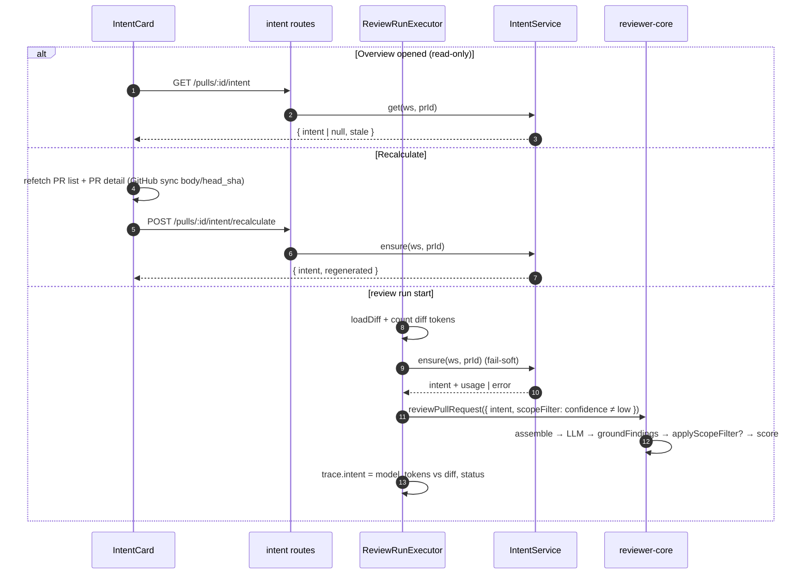
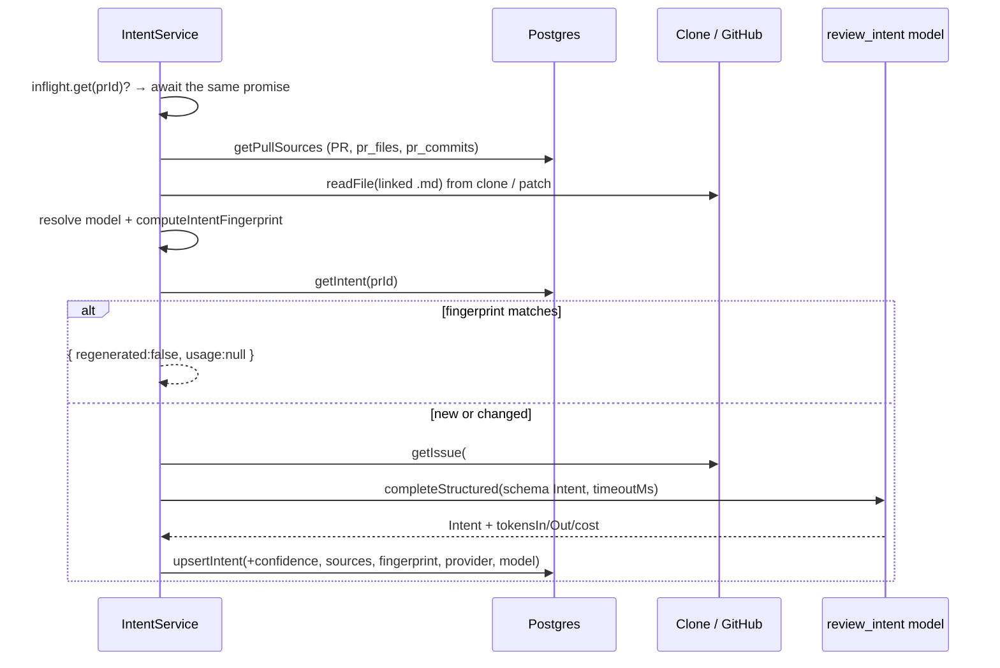

# Development Plan: Intent Layer — PR intent detection, intent block in the review prompt, out-of-scope filter, Intent card on Overview

Status: READY · Packages: server, reviewer-core, client, e2e

> **Correction to the request:** the feature model id in code is **`review_intent`**, not `intent`
> (`server/src/vendor/shared/contracts/platform.ts:52`, `client/src/lib/feature-models.ts:22`;
> label "PR Review · Intent", default `openai / gpt-4.1`). `review_intent` is used throughout.

## Approved decisions (user, 2026-10-28)

1. **No auto-generation on page open.** Opening PR → Overview only *reads* the stored intent
   (`GET` never calls a model). Intent is generated only (a) when a review run starts and
   (b) when the user clicks **Recalculate**.
2. **Recalculate respects the fingerprint**: it first refreshes PR data from GitHub, then regenerates
   only if the fingerprint changed; otherwise the card shows "No changes since the last detection".
3. **Out-of-scope classification** is done by the review model itself (an `in_scope` flag on each
   finding, in the same call — 0 extra calls).
4. **"Serious"** out-of-scope issue (keeps exactly one signal) = `severity === 'CRITICAL' || category === 'security'`.
5. **Provider + model are part of the fingerprint**: changing Settings → PR Review · Intent makes the
   stored intent stale.
6. **No scope filter at `low` confidence**: the intent still goes into the prompt as context, but
   `applyScopeFilter` is skipped.
7. **No risk areas** (Revision 3): `risk_areas` is removed from the whole feature — contract, intent
   LLM schema/prompt, review prompt, `pr_intent` column, seed and the Intent card.
8. **No Intent section in the run-trace drawer** (Revision 3): the Live Log line already carries the
   intent model, tokens vs diff, status and scope filter. The `trace.intent` JSON data stays.

## Revision 2 — review fixes (approved 2026-10-28)

Apply on top of the implemented S1–S11. S2 (scope-filter suppression) is accepted as is: serious
out-of-scope findings keep collapsing into one signal.

- **R1 (security S1, label delimiter injection).** `reviewer-core/src/prompt.ts` `wrapUntrusted`
  sanitizes `label`: every char outside `[\w.\/@#:-]` → `_`, so a label can never close the
  `source="…"` attribute or the `<untrusted>` tag. `server/src/modules/intent/domain.ts` `cleanDocPath`
  rejects (after `decodeURIComponent`) any path with chars outside `[\w.@\/ -]`. `INJECTION_GUARD`
  unchanged. Tests: `reviewer-core/test/prompt.test.ts` (label with `"></untrusted>` stays inside one
  block), `server/test/intent-domain.test.ts` (percent-encoded `%22%3E…` path rejected).
- **R2 (architecture A1).** No `this.container.tokenizer` read added in `ReviewRunExecutor`: diff tokens
  are counted through an explicit constructor dependency (`countTokens: (text: string) => number`)
  passed from `ReviewService`/wiring, like `intents`.
- **R3 (architecture A2).** `shouldApplyScopeFilter(confidence)` in `server/src/modules/intent/domain.ts`
  with a unit test; `IntentService.ensure` returns `scopeFilter: boolean` on `PrIntentOutcome`
  (`modules/intent/types.ts`); `run-executor.ts` reads only that flag for the prompt input, the log line
  and `trace.intent.scope_filter` — no `confidence === 'low'` checks left in `reviews`.
- Verify: same per-package commands as below (server typecheck + unit + `.it.test`, reviewer-core
  test + typecheck, client test + typecheck).

## Revision 3 — drop risk areas and the trace Intent section (approved 2026-10-28)

Apply on top of S1–S11 + Revision 2 (all already in the working tree, uncommitted). Steps S1, S2, S3,
S4, S7, S9, S10 below are already rewritten to the post-R3 state; this section lists the delta.

- **R4 — remove `risk_areas` everywhere.**
  - Contracts (both copies, `brief.ts`): delete `IntentRiskKind`, `IntentRiskArea` and `Intent.risk_areas`.
  - reviewer-core `prompt.ts`: `renderIntent` no longer renders a "Risk areas" list.
  - server intent module: drop `MAX_RISK_AREAS`, risk-area handling in `normalizeIntent` (`domain.ts`),
    the risk-area instructions in the intent system prompt (`prompt.ts`), `riskAreas` mapping in
    `helpers.ts` / `repository.ts`.
  - `run-executor.ts`, `seed.ts`: no `risk_areas`.
  - Schema: remove `riskAreas` from `prIntent` (`server/src/db/schema/reviews.ts`).
  - Migration (0015 is generated but **not committed**): regenerate it without the column instead of
    adding a drop migration. Discard the generated artifacts — `git checkout -- server/src/db/migrations/meta/_journal.json`,
    delete untracked `0015_pr_intent_fingerprint.sql` and `meta/0015_snapshot.json` — then
    `pnpm db:generate --name pr_intent_fingerprint`. Result: 6 `ADD COLUMN` statements. Nothing in the
    migration folder is hand-edited.
  - Local dev DB (already migrated with the old 0015; **confirm with the user before running**, it
    deletes locally generated intents' extra columns): drop the 7 added `pr_intent` columns and the
    0015 row in `drizzle.__drizzle_migrations`, then `pnpm db:migrate`.
  - Client: remove the "⚠ Risk areas" block, divider, `RISK_ICON` (`IntentCard/constants.ts`; delete the
    file if empty) and `brief.intent.riskAreas*` keys.
  - Tests: drop risk-area fixtures/assertions in `contracts.test.ts`, `intent-domain.test.ts`,
    `intent.it.test.ts`, `reviews.it.test.ts`, `reviewer-core/test/{prompt,run}.test.ts`,
    `IntentCard.test.tsx`; assert the card renders no "Risk areas".
- **R5 — remove the Intent section from the run-trace drawer (UI only).**
  - Delete `RunTraceDrawer/_components/IntentSection/*`; remove its use in `TraceBody.tsx`.
  - Delete `intentTokenRatio` from `RunTraceDrawer/helpers.ts` and its tests; revert the `"Target"`
    addition to the `TraceSection` icon union if nothing else uses it.
  - Remove `runs.trace.intent.*` i18n keys (keep `trace.prompt.intent` — the prompt-assembly block for the
    intent part of the prompt stays).
  - `RunTraceDrawer.test.tsx`: drop the Intent-section tests and the `currentTrace` mock change if
    no longer needed.
  - **Keep** `RunIntentTrace` / `RunTrace.intent` in the contracts and the executor writing `trace.intent`.
  - The Live Log line stays the record users read: `Intent <regenerated|reused> · provider/model ·
    <in>/<out> tokens in/out vs diff N tokens (x%) · confidence … · scope filter …`.
- Verify: server typecheck + unit + `.it.test`, reviewer-core test + typecheck, client test + typecheck;
  `grep -rn "risk_areas\|riskAreas\|IntentRisk\|IntentSection\|intentTokenRatio"` over
  `server/src server/test reviewer-core client/src client/messages` (excluding `migrations/meta`) → no hits.
- After R4/R5: re-run `pr-self-review` (the previous PASS is stale).

## Goal and non-goals

- **Goal:**
  - The server builds a structured PR intent `{ intent, in_scope[], out_of_scope[], confidence, sources[] }`
    when a review run starts or the user clicks Recalculate.
  - Intent is persisted in `pr_intent` and regenerated only when the PR fingerprint changed.
  - `GET` returns the stored intent plus a `stale` flag (fingerprint mismatch), never calling a model.
  - Intent enters the review prompt as an `<untrusted>` block.
  - After grounding, out-of-scope findings are dropped; serious ones collapse into exactly **one**
    signal; the score is recomputed (skipped at `low` confidence).
  - The run's Live Log records the intent model, tokens spent on intent, diff tokens and their ratio,
    regenerated/reused/failed, and whether the scope filter was applied; the same data is stored in
    `trace.intent`.
- **Non-goals:**
  - Risk areas (removed in Revision 3).
  - An Intent section in the run-trace drawer (removed in Revision 3).
  - Blast Radius card (only leave room for it in the layout).
  - A separate "out of scope" badge in `FindingCard`.
  - Fetching arbitrary URLs.
  - Job/SSE for intent.
  - Generating intent on page open.
  - A new spec file in `*/specs/`.

## What I reviewed

- server INSIGHTS:
  - **2026-10-18 — a module that needs another module's function → `types.ts` facade on the container.**
    Intent resolves its model via `container.featureModels.resolve(ws, 'review_intent')`. The `reviews`
    module gets intent only through the `PrIntents` facade (`modules/intent/types.ts`) as `container.prIntent`.
  - **2026-10-09 — persisted run traces are never re-parsed.** All new `RunTrace` / `PromptAssembly` /
    `PromptTokens` fields are `.nullish()`. The UI treats `undefined` as "no data".
  - 2026-10-18 "repository returns contract DTOs": the `IntentStore` port is written in contract types.
  - 2026-10-17 "trace written after done": intent and diff token counting run in pre-work, before `completeAgentRun`.
  - 2026-10-18 `MockGitClient.readFile` → `''`: an empty string means "no file".
- reviewer-core INSIGHTS:
  - **2026-10-18 — `INJECTION_GUARD` is exported.** The server intent prompt appends the guard and passes
    all content through `wrapUntrusted`, like `conventions/prompt.ts`.
  - 2026-10-07 (superseded): tests assert on `assemblePrompt` output, not the constant.
  - 2026-10-27 — the test typecheck compiles `server/src/adapters/mocks.ts`. `mocks.ts` is not changed:
    `structuredBySchema['Intent']` is already supported.
- client INSIGHTS:
  - **2026-10-09 — a child component's i18n namespace must be added to the parent's test provider.**
    OverviewTab/IntentCard tests include `brief`; RunTraceDrawer includes `runs`.
  - **2026-10-17 — every mutation error already shows a global toast.** `useRecalculatePrIntent` has no own `onError`.
  - **2026-10-15 — `isError` of a polled query with cached data.** The card shows the error state only when `data == null`.
    The Recalculate link is `inline-flex` (svg = block, 2026-10-18).
- Rules:
  - `e2e/AGENTS.md`: flows "never trigger a review/model call". The seed contains an intent row for PR #482.
  - `server/AGENTS.md`: migrations only via `pnpm db:generate --name`; route-level Zod schemas; `AppError`.
  - `reviewer-core/AGENTS.md`: "Do not touch" — grounding and `INJECTION_GUARD`; new untrusted input goes through `wrapUntrusted`.
  - onion: legacy `ReviewService`/`ReviewRunExecutor` get the new dependency as an explicit constructor argument, not via `this.container.x`.
- Spec: none.

## Data sources

| Source | How it is fetched | Limit |
|---|---|---|
| title, branch, head_sha, body | DB `pull_requests`. Freshness: Recalculate first refetches the PR list (syncs `title/headSha`) and detail (`GET /pulls/:id` syncs `body`) | body ≤ 4000 chars |
| commit messages | DB `pr_commits` (written by `GET /pulls/:id`) | ≤ 30, subject only |
| changed paths + diff stats | DB `pr_files` (path, additions, deletions). **No** diff content | ≤ 100 files |
| linked issue | Number parsed from body (`closes/fixes/resolves #N`, `#N`, same-repo `github.com/{o}/{r}/issues/N`). Fetched via `GitHubClient.getIssue` (`adapters.ts:164`), fail-soft: no token → skip | 1 issue, body ≤ 3000 |
| linked docs/specs | Body parsed for relative paths `*.md \| *.mdx \| *.txt` and same-repo `https://github.com/{owner}/{repo}/(blob\|tree)/{ref}/{path}`. **Nothing is fetched over HTTP:** a URL is reduced to a path. Read: (1) file added in this PR → content from the `+` lines of `pr_files.patch` (`@@ -0,0 …`); (2) otherwise `container.git.readFile` (clone, guarded against `..`/symlink); (3) otherwise `missing`. No recursion into links inside docs | ≤ 3 docs, ≤ 6000 chars each; text extensions only (no `.env` or configs) |

Confidence is computed by domain code, not the model:
- `high` — at least one doc or the issue was loaded;
- `medium` — only a body ≥ 80 chars;
- `low` — indirect data only: title, branch, commits, paths.

`sources[]` = `{ kind: title|description|issue|doc|branch|commits|files, ref? }`.

**Fingerprint:**
```
sha256(JSON[ INTENT_FINGERPRINT_VERSION, provider, model, title, body ?? '', head_sha,
            sorted docs.map(d => [path, sha256(content ?? 'missing')]) ])
```
- New commits change `head_sha`, so commits, paths and stats are covered.
- `provider` + `model` = the current `review_intent` choice → changing the model makes the intent stale.
- The issue text is **not** in the fingerprint (see risks).

## Architecture

- **New module `server/src/modules/intent/`** (not an extension of `reviews`: `modules/index.ts:23`
  lists "intent/smart-diff" as its own lesson module, and `reviews` is legacy).
  - `constants.ts`, `types.ts` (facade `PrIntents` + `PrIntentOutcome`), `domain.ts` (pure functions), `ports.ts`,
    `prompt.ts`, `helpers.ts` (row→DTO), `repository.ts` (`IntentRepository implements IntentStore`),
    `service.ts` (`IntentService`), `wiring.ts` (`buildIntentService(container)`), `routes.ts`.
- **`IntentService` has two use cases:**
  - `get(ws, prId): Promise<PrIntentView>` — **read-only**: loads the stored intent, computes the current
    fingerprint (DB + clone reads + resolved model, no LLM) and returns `{ intent | null, stale }`.
  - `ensure(ws, prId): Promise<PrIntentOutcome>` — regenerate if the fingerprint changed, else reuse.
    Single-flight: `inflight: Map<prId, Promise<PrIntentOutcome>>` (`finally delete`), so a concurrent
    Recalculate + run start wait on the same promise — no second LLM call.
- **Container:** `get prIntent(): PrIntents` caches **one** instance (`buildIntentService(this)`), otherwise
  single-flight would split across instances. `intent/routes.ts` and `reviews` both take it from here.
  The `PrIntents` facade exposes only `ensure` to `reviews`; routes use the service's `get` too
  (the facade type may include both; `reviews` calls only `ensure`).
- **reviewer-core (stays pure):**
  - `PromptParts.intent?: Intent` → section `## PR intent` inside `wrapUntrusted('pr-intent', …)` plus the
    trusted `in_scope` tagging rule. The section comes after `## PR description`.
  - New `review/scope.ts` with `applyScopeFilter(findings)`; called in `run.ts` **after** `groundFindings`,
    only when `input.intent` is set **and** `input.scopeFilter === true`.
  - Score = `scoreFromFindings(after scope)`. Grounding is unchanged.
- **Finding classification:** the review model (which sees the intent in the prompt) sets `in_scope: boolean`
  on each finding (`Finding.in_scope` nullish). Filter rules:
  - `in_scope` missing → finding kept (fail-open);
  - `kind ≠ 'finding'` (secret_leak, lethal_trifecta…) is never filtered;
  - serious = `severity === 'CRITICAL' || category === 'security'`;
  - out-of-scope non-serious → dropped;
  - out-of-scope serious → exactly **one** kept (highest severity, then confidence). Its `rationale` gets a
    trusted prefix "Outside this PR's stated scope" and "+N more collapsed (see run trace)";
  - every dropped/collapsed finding is emitted as an event into the trace log.
- **Server decides `scopeFilter`:** `scopeFilter = intent.confidence !== 'low'`.
- **Import direction:**
  - `intent/*` → `@devdigest/shared`, `@devdigest/reviewer-core` (`wrapUntrusted`, `INJECTION_GUARD`), `platform/errors`;
  - `wiring.ts` → `container` (type), `repository.ts`;
  - `container.ts` → `modules/intent/wiring.js` + `types.js`;
  - `reviews/*` → only `modules/intent/types.ts` (type `PrIntents`).
- **Unchanged:** grounding, `INJECTION_GUARD`, `GitHubClient`, `GitClient`, `mocks.ts`.

**Triggers:**


**Inside `ensure()`:**


## Skill contract

| File (create/modify) | Skills | Rules the step must satisfy |
|---|---|---|
| `server/src/vendor/shared/contracts/{brief,review-api,findings,trace}.ts` + the same 4 files in `client/src/vendor/shared/contracts/` (modify) | zod | PascalCase, schema and type share one name, no `Schema` suffix, output `<X>Result`. `z.enum` for fixed sets. New trace/assembly/tokens/finding fields `.nullish()`. `z.infer` instead of hand-written types. Both copies identical |
| `reviewer-core/src/prompt.ts`, `src/review/run.ts` (modify), `src/review/scope.ts` (create), `src/index.ts` (modify) | onion-architecture, zod | Pure engine: no DB/FS/env/network. Untrusted → `wrapUntrusted`. `INJECTION_GUARD` unchanged. New public API exported from `index.ts`. Grounding not weakened; score from surviving findings |
| `server/src/db/schema/reviews.ts`, `src/db/rows.ts` (modify), `src/db/migrations/0015_pr_intent_fingerprint.sql` (generated) | drizzle-orm-patterns, postgresql-table-design | `ADD COLUMN` only. `text`, not varchar. `timestamptz` (`withTimezone`). `NOT NULL` + DEFAULT where semantically required. jsonb for arrays. Never hand-write the migration. `PrIntentRow` in `rows.ts` |
| `server/src/modules/reviews/repository/pull.repo.ts`, `src/modules/reviews/repository.ts` (modify) | onion-architecture, drizzle-orm-patterns | Remove `upsertIntent/getIntent` (owner is now `intent`), leave no dead copies |
| `server/src/modules/intent/{constants,types,domain}.ts` (create) | onion-architecture, zod | Ring 1: no framework/ORM/env/container. SCREAMING_SNAKE constants (`MAX_*`, `DEFAULT_*`). Facade `PrIntents` in `types.ts` |
| `server/src/modules/intent/{ports,prompt,helpers,service}.ts` (create) | onion-architecture | Ports in contract types, no DB rows. Service receives narrow ports only, never the container. Errors are `AppError` subclasses. `helpers.ts` = pure row→DTO mappers |
| `server/src/modules/intent/repository.ts` (create) | drizzle-orm-patterns, onion-architecture | Implements `IntentStore`, returns DTOs via `helpers.ts`. Upsert via `onConflictDoUpdate` on PK `pr_id`. Workspace-scoped PR selection |
| `server/src/modules/intent/wiring.ts` (create) | onion-architecture | The only place that reads the container: `featureModels`, `llm`, `git`, `github()`, `db` |
| `server/src/modules/intent/routes.ts` (create) | fastify-best-practices, zod, onion-architecture | `withTypeProvider<ZodTypeProvider>()`. `schema.params: IdParams`, `response: {200: …}`. Body-less POST without `schema.body`. Handler = one service call. Per-route `rateLimit` |
| `server/src/modules/index.ts`, `src/platform/container.ts` (modify) | onion-architecture | One import + one entry. Only the cached `prIntent` facade in the container |
| `server/src/modules/reviews/{run-executor,service,routes,helpers}.ts`, `src/app.ts` (modify) | onion-architecture | Legacy: `PrIntents` passed as an explicit constructor argument, no new `this.container.x`. Intent is fail-soft. Slow work (tokenizer, intent) before `completeAgentRun` |
| `server/src/db/seed.ts` (modify) | drizzle-orm-patterns | Idempotent (`onConflictDoNothing`). Fingerprint computed by the same pure `computeIntentFingerprint` |
| `client/src/lib/hooks/{query-keys,reviews}.ts` (modify), `client/src/lib/hooks/intent.ts` (create) | frontend-architecture, react-best-practices | Data only through hooks → `api.ts`. Key `["pr-intent", prId]`. Mutation `use<Verb><Entity>`, no own `onError` |
| `OverviewTab/{OverviewTab.tsx,styles.ts}`, `PrDetailView/PrDetailView.tsx` (modify); `OverviewTab/_components/IntentCard/{IntentCard.tsx,index.ts,styles.ts,constants.ts}` (create) | frontend-architecture, react-best-practices, next-best-practices | `"use client"`. Thin parent. Early returns for loading/error/empty. No derived state in `useState`. Icons via a constant map. `@devdigest/ui` primitives. `aria-label`/text on the link. Styles in `styles.ts` (`s`) |
| `OverviewTab/_components/IntentCard/IntentCard.test.tsx` (create) | react-testing-library | `userEvent`, `screen`, `findBy*`, mocked `fetch`. 1–3 flow tests. `describe("IntentCard — …")` |
| `TraceBody.tsx`, `RunTraceDrawer/constants.ts` (modify) | frontend-architecture, react-best-practices | Only the prompt-assembly block for `pa.intent`; no Intent section (Revision 3). `undefined` = "no data" |
| `RunTraceDrawer/RunTraceDrawer.test.tsx` (modify) | react-testing-library | Behaviour: the intent prompt block renders; no Intent section |
| `client/messages/en/{brief,runs}.json` (modify) | frontend-architecture | All UI text in i18n, nested camelCase keys |
| `server/test/{contracts.test,intent-domain.test,reviews-helpers.test}.ts`, `server/test/{intent.it.test,reviews.it.test}.ts`; `reviewer-core/test/{prompt,scope,run}.test.ts` | onion-architecture (tests by ring), zod | A test touching Postgres is named `*.it.test.ts`. LLM/GitHub/git via `mocks.ts` |
| `e2e/specs/02-repo-pulls-detail.flow.json` (modify) | — (no skill; `e2e/AGENTS.md` rules) | Only `wait --text/--url`. No model call |

## Steps

### S1 — Contracts (both vendored copies)
- Files: 4 contracts × 2 copies. First `diff` server↔client for `trace.ts` (they have drifted).
- Change:
  - `brief.ts`:
    - `Intent` stays `{intent, in_scope, out_of_scope}` (no `risk_areas` — Revision 3);
    - `IntentConfidence = z.enum(['high','medium','low'])`;
    - `IntentSourceKind`, `IntentSource = {kind, ref: z.string().nullish()}`.
  - `review-api.ts`:
    - `PrIntentRecord = Intent.extend({pr_id, confidence, sources, provider: nullable, model: nullable, generated_at: z.string()})`;
    - `PrIntentView = {intent: PrIntentRecord.nullable(), stale: z.boolean()}` (GET);
    - `PrIntentResult = {intent: PrIntentRecord, regenerated: z.boolean()}` (POST recalculate).
  - `findings.ts`: `Finding.in_scope: z.boolean().nullish()`.
  - `trace.ts`:
    - `PromptAssembly.intent: z.string().nullish()`;
    - `PromptTokens.intent: z.number().int().nullish()`;
    - `RunIntentTrace = {status: z.enum(['regenerated','reused','failed']), provider, model, tokens_in, tokens_out, cost_usd, diff_tokens, confidence, scope_filter: z.enum(['applied','skipped_low_confidence']), filtered_out, out_of_scope_signal: boolean, error}` — all fields except `status` are `.nullish()`;
    - `RunTrace.intent: RunIntentTrace.nullish()`.
- Skills: zod · Depends on: —
- Done when: both copies have identical new symbols; `contracts.test.ts` parses `PrIntentRecord`, and an old `RunTrace` without `intent` still parses.
- Verify: `cd server && pnpm typecheck && pnpm exec vitest run test/contracts.test.ts` · `cd client && pnpm typecheck`

### S2 — reviewer-core: intent slot + scope filter
- Files: `src/prompt.ts`, `src/review/scope.ts` (create), `src/review/run.ts`, `src/index.ts`.
- Change:
  - `prompt.ts`:
    - `PromptParts.intent?: Intent`;
    - `renderIntent(intent): string` — Intent / In scope / Out of scope lists;
    - section `## PR intent\n${INTENT_SCOPE_RULE}\n${wrapUntrusted('pr-intent', renderIntent(…))}` after PR description;
    - `assembly.intent`;
    - `INTENT_SCOPE_RULE` (trusted text): "set `in_scope:false` only for issues unrelated to what this PR sets out to change; still report every real defect with its true severity".
  - `scope.ts`: `applyScopeFilter(findings: Finding[]): ScopeResult { kept; filtered: {finding, reason}[]; signal: Finding | null; collapsed: number }` per the rules in "Architecture".
  - `run.ts`:
    - `ReviewInput.intent?: Intent` passed into `promptParts`; `ReviewInput.scopeFilter?: boolean` (default `false`);
    - if `input.intent && input.scopeFilter`, after `groundFindings` → `applyScopeFilter(ground.kept)` → `findings = scope.kept`, `score = scoreFromFindings(scope.kept)`;
    - emit events for every filtered/collapsed finding;
    - `ReviewOutcome.scope: ScopeResult | null`.
  - `index.ts`: export `applyScopeFilter`, `renderIntent`, `type ScopeResult`.
- Skills: onion-architecture, zod · Depends on: S1
- Done when: without `intent` the prompt is byte-for-byte unchanged; with `intent` the block is wrapped and the guard is present; 2 CRITICAL out-of-scope → 1 finding with "+1 more"; `scopeFilter:false` → nothing filtered; a finding outside the diff is dropped by grounding before scope.
- Verify: `cd reviewer-core && npm test && npm run typecheck && cd ../server && pnpm typecheck`

### S3 — `pr_intent` schema + migration; remove old intent functions from reviews
- Files: `server/src/db/schema/reviews.ts`, `src/db/rows.ts`, `src/modules/reviews/repository/pull.repo.ts`, `src/modules/reviews/repository.ts`, generated `0015_pr_intent_fingerprint.sql`.
- Change: add to `prIntent`:
  - `confidence: text('confidence', {enum}).notNull().default('low')`;
  - `sources: jsonb('sources').notNull().default([])`;
  - `fingerprint: text('fingerprint').notNull().default('')` (`''` never matches → regeneration);
  - `provider: text`, `model: text` (nullable);
  - `generatedAt: timestamp('generated_at',{withTimezone:true}).notNull().defaultNow()`.

  Also: `PrIntentRow` in `rows.ts`; remove `upsertIntent/getIntent` from `pull.repo.ts` and `ReviewRepository` (no callers).
- Skills: drizzle-orm-patterns, postgresql-table-design · Depends on: S1
- Done when: `0015_pr_intent_fingerprint.sql` contains only `ALTER TABLE "pr_intent" ADD COLUMN …`, no `RENAME`/`DROP`.
- Verify: `cd server && pnpm db:generate --name pr_intent_fingerprint && pnpm typecheck`

### S4 — Intent module: pure core
- Files: `modules/intent/constants.ts`, `types.ts`, `domain.ts`, `ports.ts`, `prompt.ts`.
- Change:
  - `constants.ts`: `MAX_BODY_CHARS=4000`, `MAX_ISSUE_CHARS=3000`, `MAX_LINKED_DOCS=3`, `MAX_DOC_CHARS=6000`, `MAX_COMMITS=30`, `MAX_FILES=100`, `MAX_SCOPE_ITEMS=6`, `MIN_BODY_CHARS_MEDIUM=80`, `INTENT_TIMEOUT_MS=60_000`, `INTENT_FINGERPRINT_VERSION=1`, `DOC_EXTENSIONS=['.md','.mdx','.txt']`.
  - `domain.ts` (pure; `node:crypto` for sha256):
    - `extractDocRefs(body, repoFullName)`;
    - `extractIssueRef(body, repoFullName)`;
    - `contentFromAddedFilePatch(patch)`;
    - `computeIntentFingerprint({provider, model, title, body, headSha, docs})`;
    - `deriveConfidence(...)`;
    - `buildIntentSources(...)`;
    - `normalizeIntent(intent)` (trim, clamp counts).
  - `types.ts`:
    - `interface PrIntents { get(workspaceId, prId): Promise<PrIntentView>; ensure(workspaceId, prId): Promise<PrIntentOutcome> }`;
    - `PrIntentOutcome = { result: PrIntentResult; usage: {provider, model, tokensIn, tokensOut, costUsd} | null }`.
  - `ports.ts`:
    - `IntentStore { getPullSources(ws, prId): Promise<IntentPull | undefined>; getIntent(prId): Promise<StoredPrIntent | undefined>; upsertIntent(prId, rec: NewPrIntent) }`;
    - `RepoFiles.readFile → string | undefined`;
    - `IssueSource.getIssue(repo, n) → IssueMeta | undefined`;
    - `IntentModel.resolve(ws) → {provider, model}`; `IntentModel.derive(ws, messages) → { data: Intent; provider; model; tokensIn; tokensOut; costUsd }`.
  - `prompt.ts`: `buildIntentMessages(sources)`:
    - system — trusted, `+ INJECTION_GUARD`;
    - each source — `wrapUntrusted('pr-description' | 'issue-#N' | 'doc:<path>' | 'commits' | 'files', …)`;
    - title and branch are untrusted too.
- Skills: onion-architecture, zod · Depends on: S1
- Done when: `intent-domain.test.ts` is green.
- Verify: `cd server && pnpm typecheck && pnpm exec vitest run test/intent-domain.test.ts`

### S5 — Intent module: repository, service, wiring, routes, registration, facade
- Files: `modules/intent/{helpers,repository,service,wiring,routes}.ts`, `modules/index.ts`, `platform/container.ts`.
- Change:
  - `IntentRepository(db) implements IntentStore`: workspace-scoped PR + `pr_files` + `pr_commits` + repo; mapping via `helpers.toPrIntentRecord`.
  - `IntentService`:
    - `get(ws, prId)` — loads sources, resolves model, computes fingerprint, loads stored intent → `{ intent | null, stale: !!intent && intent.fingerprint !== current }`. **Never calls the LLM or GitHub.** PR not found → `NotFoundError`.
    - `ensure(ws, prId)` — the second diagram's flow, single-flight `Map<prId, Promise>` with `finally delete`. Model error → `ExternalServiceError`; `ConfigError` (no key) propagated as is.
  - `wiring.buildIntentService(container)`:
    - `model.resolve` → `container.featureModels.resolve(ws,'review_intent')`;
    - `model.derive` → `container.llm(provider).completeStructured({schema: Intent, schemaName:'Intent', timeoutMs: INTENT_TIMEOUT_MS})`;
    - `files.readFile` → `container.git.readFile`, with `''`/ENOENT/`PathEscapeError` → `undefined`;
    - `issues.getIssue` → `container.github()`, fail-soft.
  - `container.ts`: `get prIntent(): PrIntents { return (this._prIntent ??= buildIntentService(this)); }`.
  - `routes.ts`:
    - `GET /pulls/:id/intent` (rateLimit 30/min) → `app.container.prIntent.get(...)`, `response: {200: PrIntentView}`; no intent yet → 200 with `intent: null` (not 404, so no global error toast);
    - `POST /pulls/:id/intent/recalculate` (rateLimit 10/min) → `app.container.prIntent.ensure(...)`, `response: {200: PrIntentResult}`;
    - PR not found → `NotFoundError`.
  - `modules/index.ts`: `intent`.
- Skills: see contract · Depends on: S3, S4
- Done when: GET never calls the LLM (with or without a stored intent); two sequential `ensure` → 1 LLM call; two parallel `ensure` → 1 call; changing `head_sha`/body/model → GET `stale:true`, then `ensure` regenerates with `regenerated:true`.
- Verify: `cd server && pnpm typecheck && pnpm exec vitest run test/intent.it.test.ts`

### S6 — Integration into the review run + trace
- Files: `modules/reviews/{run-executor,service,routes,helpers}.ts`, `src/app.ts`.
- Change:
  - `ReviewService(container, { intents: PrIntents })` → `new ReviewRunExecutor(container, repo, agents, intents)`; `reviews/routes.ts` and `app.ts` pass `container.prIntent`.
  - `executeRuns`, after `loadDiff`:
    - `diffTokens = tokenizer.count(diff.raw)`;
    - `runLog.step('Resolving PR intent', () => intents.ensure(...))` in try/catch: error → `runLog.info('intent unavailable — reviewing without scope filter: …')` and `status:'failed'`;
    - log: "Intent reused/regenerated · provider/model · in/out tokens vs diff N tokens (x%) · scope filter applied/skipped (low confidence)".
  - `runOneAgent`:
    - `reviewPullRequest({…, ...(intent ? {intent, scopeFilter: intent.confidence !== 'low'} : {})})`;
    - `trace.intent = {…, scope_filter, filtered_out: outcome.scope?.filtered.length, out_of_scope_signal: !!outcome.scope?.signal}`.
  - `helpers.countPromptTokens` + `intent`.
- Skills: onion-architecture · Depends on: S2, S5
- Done when: the run trace has `intent.status`, `intent.scope_filter` and `prompt_assembly.intent`; an intent failure does not fail the run.
- Verify: `cd server && pnpm typecheck && pnpm exec vitest run --exclude '**/*.it.test.ts' && pnpm exec vitest run test/reviews.it.test.ts`

### S7 — Seed intent for PR #482
- Files: `server/src/db/seed.ts`.
- Change: inside the `if (!pr)` block — insert into `pr_intent` (intent about rate limiting, in/out scope, `confidence:'medium'`, sources description/title/commits/files, `provider:'openai'`, `model:'gpt-4.1'`). Fingerprint = `computeIntentFingerprint({provider:'openai', model:'gpt-4.1', title, body, headSha, docs: []})`; `onConflictDoNothing`. Purpose: the demo/e2e card has content without any model call.
- Skills: drizzle-orm-patterns · Depends on: S3, S4
- Done when: on a freshly seeded DB `GET /pulls/<482>/intent` → the seeded intent, `stale:false` (checked in `intent.it.test.ts`).
- Verify: `cd server && pnpm exec vitest run test/intent.it.test.ts`

### S8 — Client: data layer
- Files: `client/src/lib/hooks/query-keys.ts`, `hooks/intent.ts` (create), `hooks/reviews.ts`.
- Change:
  - `queryKeys.prIntent(prId) = ["pr-intent", prId]`.
  - `usePrIntent(prId)` → `api.get<PrIntentView>(`/pulls/${prId}/intent`)`, `enabled: !!prId`.
  - `useRecalculatePrIntent(prId, repoId)`: first `refetchQueries(queryKeys.pulls(repoId))` and `refetchQueries(queryKeys.pull(prId))`, then `api.post<PrIntentResult>` `/intent/recalculate`; `onSuccess` → `setQueryData(prIntent, { intent: result.intent, stale: false })`.
  - `useRefreshPrRuns` also invalidates `prIntent` (the card updates after a review run).
- Skills: frontend-architecture, react-best-practices · Depends on: S1, S5
- Done when: typecheck is green; hooks use only `api`.
- Verify: `cd client && pnpm typecheck`

### S9 — Client: IntentCard on Overview
- Files: `OverviewTab/{OverviewTab.tsx,styles.ts}`, `OverviewTab/_components/IntentCard/*`, `PrDetailView/PrDetailView.tsx`, `messages/en/brief.json`.
- Change:
  - `OverviewTab({ prId, repoId, prBody })`: grid row `s.briefRow` (one column for now, room for Blast Radius) with `<IntentCard>` **above** Description.
  - `IntentCard` (calls `usePrIntent`, never triggers generation on mount):
    - Header: `Target` + "Intent"; **top-right corner**: Recalculate link — `Button kind="ghost" icon="RefreshCw" loading={isPending}` + text "Recalculate";
    - italic quoted intent;
    - two columns "✓ In scope" (`var(--ok)`) and "✕ Out of scope" (muted);
    - confidence badge for `medium`/`low` (low-confidence hint), sources line, model + `generated_at`.
  - States:
    - loading → `Skeleton`;
    - error with `data == null` → `ErrorState` (message from `ApiError`, Retry);
    - `intent: null` → empty state "Intent not detected yet — it's detected when a review runs, or click Recalculate";
    - `stale: true` → badge "PR changed since detection", Recalculate highlighted;
    - `regenerated:false` after Recalculate → inline "No changes since the last detection";
    - Recalculate error → global toast (no own handler); hint about Settings → Models in the error state;
    - empty lists → `brief.intent.none`.
  - Keys `brief.intent.*` (inScope, outOfScope, recalculate, confidence.{high,medium,low}, lowConfidenceHint, sources.{…}, none, empty, stale, unchanged, error, modelHint).
- Skills: see contract · Depends on: S8
- Done when: `IntentCard.test.tsx` is green.
- Verify: `cd client && pnpm test && pnpm typecheck`

### S10 — Client: trace drawer
- Files: `TraceBody.tsx`, `RunTraceDrawer/constants.ts` (`PROMPT_COLORS.intent`), `messages/en/runs.json` (`trace.prompt.intent`).
- Change:
  - **No Intent section** (Revision 3): intent model/tokens/status/scope filter are read from the Live Log; `trace.intent` stays as stored data only.
  - `PromptBlock` for `pa.intent` with `tokens={pa.tokens?.intent}`.
- Skills: frontend-architecture, react-best-practices, react-testing-library · Depends on: S1
- Done when: an old trace without `intent` renders without the section; a new one shows the ratio.
- Verify: `cd client && pnpm test && pnpm typecheck`

### S11 — e2e
- Files: `e2e/specs/02-repo-pulls-detail.flow.json`.
- Change: after the title step add `{"cmd":["wait","--text","Recalculate"],"label":"intent card renders on overview"}` and a `wait --text` on the seeded intent sentence from S7.
- Depends on: S7, S9
- Done when: the flow passes on a freshly seeded stack without keys.
- Verify: `cd e2e && npm run e2e:hermetic`

## Cross-cutting changes

- **Contracts:** both copies of `vendor/shared/contracts/{brief,review-api,findings,trace}.ts`, same names: `Intent`, `IntentConfidence`, `IntentSourceKind`, `IntentSource`, `PrIntentRecord`, `PrIntentView`, `PrIntentResult`, `RunIntentTrace`.
- **DB / migrations:** `pr_intent` + 6 columns; `pnpm db:generate --name pr_intent_fingerprint` → `0015_pr_intent_fingerprint.sql`. `db:migrate` is not applied on boot — run it locally.
- **e2e flows:** `02` (new step). Existing flows don't wait on Overview text (checked by grep).
- **i18n:** `brief.json` (`intent.*`; namespace currently unread) and `runs.json` (`trace.prompt.intent`).
- **Dependencies:** none.

## Tests

| Test file (create/modify) | Type | What it proves |
|---|---|---|
| `reviewer-core/test/prompt.test.ts` (modify) | unit | intent section inside `<untrusted source="pr-intent">`, guard in system, prompt unchanged without intent |
| `reviewer-core/test/scope.test.ts` (create) | unit | non-serious out-of-scope dropped; 2 serious → exactly 1 signal with counter; missing `in_scope` or `kind≠finding` → kept |
| `reviewer-core/test/run.test.ts` (modify) | unit | grounding runs before scope; score recomputed from survivors; no filter without `intent` or with `scopeFilter:false` |
| `server/test/contracts.test.ts` (modify) | unit | `PrIntentRecord` parses; `RunTrace` without `intent` parses; `PrIntentView` with `intent:null` |
| `server/test/intent-domain.test.ts` (create) | unit | same-repo URL → path, foreign repo/host and `..` rejected, `.env` rejected; fingerprint changes with title/body/head/doc/model; confidence |
| `server/test/reviews-helpers.test.ts` (modify) | unit | `countPromptTokens` counts `intent` |
| `server/test/intent.it.test.ts` (create) | it | GET never calls the LLM (incl. no stored intent → `intent:null`); `stale` after `head_sha`/body/model change; recalculate without changes → `regenerated:false`, 0 model calls; single-flight on 2 parallel `ensure`; seed #482 → `stale:false`; 404 for another workspace's PR |
| `server/test/reviews.it.test.ts` (modify) | it | run trace has `intent.status`, `intent.scope_filter`, `prompt_assembly.intent`; intent failure (no `Intent` fixture) doesn't fail the run; adjust any `MockLLMProvider.calls` count assertions |
| `client/.../IntentCard/IntentCard.test.tsx` (create) | component | data → in/out/low badge, no "Risk areas"; empty state when `intent:null`; stale badge; Recalculate → POST; error state |
| `client/.../RunTraceDrawer/RunTraceDrawer.test.tsx` (modify) | component | a trace with `intent` renders no Intent section; the intent prompt block renders |
| `e2e/specs/02-repo-pulls-detail.flow.json` (modify) | e2e | Intent card renders from seed without a model call |

## Verification (per package)

- **server:** `pnpm typecheck` · `pnpm exec vitest run --exclude '**/*.it.test.ts'` · `pnpm exec vitest run .it.test`
- **reviewer-core:** `npm test` · `npm run typecheck` · `cd ../server && pnpm typecheck`
- **client:** `pnpm test` · `pnpm typecheck`
- **e2e:** `npm run e2e:hermetic`

## Handoff to reviewers

- **Architecture:**
  - `container.prIntent` (cached facade; `container.ts` imports `modules/intent/wiring.js`);
  - new constructor argument in legacy `ReviewService`/`ReviewRunExecutor`;
  - `seed.ts` imports `modules/intent/domain.ts` (db → domain; check depcruise);
  - single-flight `Map` in the service;
  - removal of `upsertIntent/getIntent` from `reviews`.
- **Security:**
  - PR body, issue, docs, commit messages, file paths, title, branch → all through `wrapUntrusted` + `INJECTION_GUARD`;
  - URLs in the description are never fetched (no SSRF): same-repo only, reduced to a clone path, `readFile` guarded against `..`/symlink, `.md/.mdx/.txt` only;
  - the scope filter is a new surface for suppressing findings via injection (fail-open, serious → 1 signal, skipped at low confidence, full list in the trace);
  - new LLM endpoint (recalculate) with rateLimit; keys only via `container.llm`.

## Risks

- **Wrong filtering hides real bugs.** Mitigated: fail-open, `kind≠finding` never filtered, serious ones collapse into a signal with a counter, no filter at low confidence, everything dropped is in the trace log.
- **Prompt injection via body/docs** ("auth is out of scope"). The model may tag a bug out of scope; the seriousness rule saves it. A second critical bug is visible only through the counter and the trace.
- **The model's verdict is not recomputed** after the filter (same as after grounding today), so `request_changes` may remain with filtered findings.
- **Empty card until first run/Recalculate** (no generation on page open).
- **`stale` costs file I/O on every GET** (≤ 3 linked docs read from the clone), but no LLM or GitHub calls.
- **Stale cache:**
  - changes to the issue text, or to a doc in the clone without a PR change, don't trigger regeneration;
  - a doc modified (not created) in the PR is read from the clone, i.e. the default branch;
  - no token / offline → freshness relies on the DB.
- **Cost:** at most one call per PR change (fingerprint + single-flight). Single-flight is per process, so several API instances could duplicate a call.
- **Contract drift:** diff the `trace.ts` copies before S1.
- **`reviews.it.test.ts`:** assertions on `MockLLMProvider.calls` counts change with the extra intent call (for non-seed PRs).
- **Seed fingerprint:** computed by the same function, so seed changes to PR #482 stay consistent; a mismatch would only show `stale:true`, never a model call.
- **Not verified:** exact props of `Chip`/`Badge`/`Card` in `@devdigest/ui` — the implementer checks `client/src/vendor/ui/primitives/*.tsx`.
