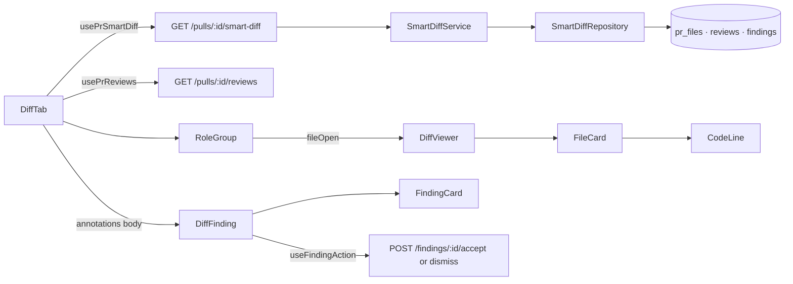

# Development Plan: L03 Smart Diff — PR files grouped by role, review findings inline in the diff
Status: READY (Revision 3, approved 2026-10-28) · Packages: server, client, e2e

## Changelog — Revision 3 (user request after implementation)
- **R3.1** The core group label is "Core" (`prReview.smartDiff.coreLabel`), not "Core logic". e2e flow 05 now waits
  for the core group hint ("The substance of the change") instead of the label.
- **R3.2** Supersedes R2.6: core/tests/wiring groups always start open when they have files, whatever their size;
  docs/boilerplate and empty groups start collapsed. Files inside a group still auto-expand by `FileCard`'s own
  `AUTO_EXPAND_MAX_LINES` rule. Later sections that mention "Core logic" or the Σ ≤ `AUTO_EXPAND_MAX_LINES`
  group rule describe Revision 2.

## Changelog — Revision 2 (user decisions + mockup 9)
- **R2.1** All 5 groups are always shown. An empty group shows "0 files", a dimmed chevron, cannot expand, has no ⇕. Removed "client hides empty groups" and the demo-PR risk.
- **R2.2** Group colours and hints from mockup 9. No purple token exists in `styles.css` → add `--violet` (user chose this over reusing `--sugg`).
- **R2.3** ⇕ button per group: expand/collapse all files in the group. `FileCard` becomes controllable (optional `open`/`onOpenChange`).
- **R2.4** Line "N files · +A −D" under the section header, from `pr.files` (ICU plural), in both modes.
- **R2.5** The only new control is the segmented "Smart order | Original order". **No "Hide findings" button.** Show/Hide comments stays as today (same label, shown only when GitHub `commentCount > 0`) but hides both comments and findings. Findings visible by default. Decision 4 and S7 rewritten.
- **R2.6** Group auto-expand: docs/boilerplate always collapsed; core/tests/wiring open iff the group's Σ(additions+deletions) ≤ `AUTO_EXPAND_MAX_LINES` (200).
- **R2.7** Non-goals add: "This PR is large" banner, "0 new tokens · built on N" line, header restyle.
- e2e changes were committed (HEAD `cdde905`); notes about preserving them removed.

> **Corrections to the requirements** (verified): `SEV` lives in `client/src/vendor/ui/primitives/tokens.ts:6`,
> not `Badge.tsx`; `FindingsTab` does not call `usePrReviews`/`useFindingAction` (they are in
> `PrDetailView.tsx:36` and `FindingsPanel`); `GET /pulls/:id/reviews` returns **all** reviews (summary+review,
> every agent); `FileCard` has only `{file, commenting?}` and an initial-only `open`; seed PR #482: 4 files, all
> core, `patch=null`; no segmented primitive; `smartDiff.filesCount` is not ICU plural and nothing reads it.

## Goal & non-goals
- **Goal:** Files changed defaults to **Smart order**: 5 groups core → tests → wiring → docs → boilerplate, each
  with colour, label, hint, "● N" (files in the group with findings), "N files" and ⇕; a "N files · +A −D" line
  above the groups; a dot next to the path of a file with findings; the finding line has a coloured bar and a
  blocker / warning / suggestion label, with a `FindingCard` (Accept/Dismiss) under it; findings without a line in
  the patch go in a block at the end of the file. **Original order** = `pr.files` order. Server:
  `GET /pulls/:id/smart-diff`, DB only, no model or GitHub call.
- **Non-goals:** `pseudocode_summary`; `split_suggestion` UI / "This PR is large" banner (`too_big: false`);
  "0 new tokens · built on N" line; restyle of the "FILES CHANGED · N FILES" header (existing `diff.title` stays);
  a "Hide findings (N)" button; card close X; Agent runs and seed changes; an L08 facade; P1 #7 (PR + video, done
  by the user).

## Decisions taken
1. **Which findings count:** the latest `kind='review'` review per agent (null agent = one group), the same rule as
   `pulls/routes.ts:119-152` and `latestReviewPerAgent`. Server (`finding_lines`) and client apply it identically.
   The UI takes everything from one source — `usePrReviews` — so card, dot and counter never diverge;
   `finding_lines` is a contract field for the API and L08, checked by the IT test, not read by the client.
   **Dismissed** findings are excluded from `finding_lines`, the dot, the counter and the line bar/label; the card
   stays, muted, with the "dismissed" tag. Accepted findings count.
2. **Server:** its own module `server/src/modules/smart-diff/`. `classifyFile(path)` is a pure function in
   `domain.ts`; `SMART_DIFF_CHECK_ORDER` (boilerplate → tests → wiring → docs; core is the fallback) and
   `SMART_DIFF_DISPLAY_ORDER` (core → tests → wiring → docs → boilerplate) in `constants.ts`. Data from the DB via
   the module's own repository behind a `SmartDiffStore` port typed in module types (precedent:
   `IntentRepository`); the service never imports the repository. In-group order: by `path` (code-unit compare) —
   `pr_files` has no order column. The response **always contains 5 groups** in display order; the client renders
   all of them (R2.1).
3. **Client data:** roles/order from `usePrSmartDiff(prId)` (`["pr-smart-diff", prId]`), patches from `pr.files`
   by `path`, findings from `usePrReviews(prId)`. Grouping works before the first review. Loading → `Skeleton`;
   error (`data == null`) → flat `DiffViewer` in `pr.files` order + a `smartDiff.loadError` note. Original order =
   exactly `pr.files`. Smart/Original is a local `useState` (deliberate deviation from the skill: the requirement is
   Smart by default, always).
4. **Findings on lines and visibility (rewritten in R2.5):** a generic annotation API in `diff-viewer`
   (`annotations.ts`): `DiffAnnotation {id, line, mark, body: ReactNode}`, key `lineKey("RIGHT", start_line)`;
   `FindingCard` is passed as a JSX slot (shared code does not import features). Line label: colour/icon from
   `SEV`, text from i18n (CRITICAL → `blocker`, WARNING → `warning`, SUGGESTION → `suggestion`). Card:
   `FindingCard` with `defaultExpanded` (title-click collapse = P3 for free). Accept/Dismiss:
   `useFindingAction().mutate({findingId, action, prId})` → invalidates `prReviews`.
   **Visibility state:** `commentsMode: 'default' | 'shown' | 'hidden'`, initially `'default'`.
   - GitHub threads are visible only when `'shown'` (as today: hidden by default).
   - Findings are visible in every mode except `'hidden'`, i.e. visible by default even when GitHub comments exist.
   - The button exists only when `commentCount > 0`, with the same `diff.showComments`/`hideComments` keys and the
     GitHub-only counter. Label: `mode === 'shown'` → "Hide", otherwise "Show". Click: `'shown'` → `'hidden'`,
     otherwise → `'shown'`. Posting a comment → `'shown'` (as `setShowComments(true)` does today).
   - Without GitHub comments there is no button and findings are always visible.
   - The line bar/label and the file dot are visible in every mode; only the cards are hidden.
5. **Expansion and ⇕ (R2.3, R2.6):**
   - Group: `defaultOpen = files.length > 0 && !COLLAPSED_ROLES.has(role) && Σ(add+del) ≤ AUTO_EXPAND_MAX_LINES`.
     An empty group: header button `disabled`, dimmed chevron, no ⇕.
   - **⇕ mechanism — a controllable `FileCard`:** optional `open?: boolean` + `onOpenChange?(open)`; without them it
     uses the internal `useState(isAutoExpanded(file))` as today. `DiffViewer` gets an optional
     `fileOpen?: {isOpen(path): boolean; onOpenChange(path, open): void}`. `RoleGroup` holds
     `overrides: Map<path, boolean>`, `isOpen = overrides.get(path) ?? isAutoExpanded(file)`. ⇕: if
     `groupOpen && all files open` → collapse all files; otherwise open the group and all files.
   - **Why not a signal or a `key` remount:** a signal needs a `useEffect` syncing state from props (a CRITICAL
     anti-pattern in `react-best-practices`); a remount loses the `InlineComposer` draft and does not know the
     current state for the `aria-label`. The controllable pattern gives an exact `aria-label`
     (`expandAll`/`collapseAll`) with no effects.
   - `<DiffViewer files />` in the smoke test is unchanged. Files inside a group follow `FileCard`'s own rule.
   - **e2e 05 check:** seed core = 84+0 + 31+6 + 4+0 + 7+2 = **134 ≤ 200** (`AUTO_EXPAND_MAX_LINES = 200`,
     `diff-viewer/constants.ts:4`) → the group is open; `src/config.ts` (4 lines) is open and visible.
   - Order toggle: a new `DiffTab/_components/DiffOrderToggle/` built from two `Button`s with `active` +
     `aria-pressed`.
6. **Group colours (R2.2), CSS tokens only:** core `--accent` (blue); tests `--violet` (**new**: no purple in
   `styles.css`; `#8b5cf6` is already used as a literal in `Avatar.tsx:10` and `AgentCard/constants.ts:7`); wiring
   `--warn` (orange); docs `--ok` (green, `styles.css:36`/`:76`); boilerplate `--info` (grey `#6b7280`). Hints:
   "The substance of the change — review closely" / "Test files and fixtures" / "Hooks the core into the app" /
   "Documentation and licensing" / "Generated / mechanical — skim".
7. **Seed unchanged.** Explicit fixtures in tests; the demo uses a real PR in the user's fork.

## Context consulted
- **INSIGHTS — server:** 2026-10-18 "repository returns contract DTOs" → `SmartDiffStore` port in `ports.ts`, the
  service does not know the repository, `wiring.ts` assembles it; 2026-10-17 "latest run per agent… duplicated in
  the client" → same rule in `latestReviewIdsPerAgent` / `latestReviewPerAgent`; 2026-10-12 "multi-row insert
  shares `created_at`" → explicit `createdAt`.
- **INSIGHTS — client:** 2026-10-28 "user-event is not installed" → `fireEvent` (wins over the skill); 2026-10-09
  "child namespace in test provider" → `{prReview, shell}`; 2026-10-17 "global mutation toast" → no own `onError`.
- **INSIGHTS — e2e:** 2026-10-28 "find does not wait" → only `wait --text` in flow 05.
- **Rules:** `server/AGENTS.md` (route Zod, `AppError`, `*.it.test.ts`, kebab-case); `client/AGENTS.md`
  (`_components/<Name>/` + test, hooks → `api.ts`, i18n, query keys); `e2e/AGENTS.md` (seed only, no model);
  `frontend-architecture` (tokens instead of scattered literals).
- **Spec:** none. Precedent: `docs/plans/002-intent-layer.md`.

## Architecture
- server `modules/smart-diff/`: `constants.ts`, `domain.ts` (ring 1) · `ports.ts`, `service.ts` (2) ·
  `repository.ts` (3) · `wiring.ts` · `routes.ts` (4). Registration: one `smartDiff` entry in `modules/index.ts`.
  Container, `reviews` and reviewer-core unchanged.
- Imports: `routes → wiring → {service, repository}`; `service → ports(type), domain, platform/errors`;
  `repository → drizzle, db/schema, ports(type)`; `domain → @devdigest/shared` (types only).
- client: `lib/hooks/smart-diff.ts → api.ts`; feature `DiffTab → {hooks/useDiffFindings,
  _components/RoleGroup|DiffOrderToggle|DiffFinding} → @/components/diff-viewer` (shared) and `../FindingCard`.
  Shared `diff-viewer` imports nothing from features.

## Skill contract
| File (create/modify) | Skills | Rules the step must satisfy |
|---|---|---|
| `server/src/vendor/shared/contracts/brief.ts`, `client/src/vendor/shared/contracts/brief.ts` (modify) | zod | `SmartDiffRole = z.enum(['core','tests','wiring','docs','boilerplate'])`; no new symbols; copies byte-identical |
| `server/test/contracts.test.ts` (modify) | zod | `tests`/`docs` parse; unknown role → throws |
| `server/src/modules/smart-diff/constants.ts`, `domain.ts` (create) | onion-architecture, zod | ring 1, no framework/ORM/env/container; SCREAMING_SNAKE; pure; `import type` from shared |
| `server/src/modules/smart-diff/ports.ts`, `service.ts` (create) | onion-architecture | port on module types, no DB rows; service gets only `SmartDiffStore`; not found → `NotFoundError` |
| `server/src/modules/smart-diff/repository.ts` (create) | drizzle-orm-patterns, onion-architecture | `implements SmartDiffStore`; PR select workspace-scoped; only needed columns; no business rules |
| `server/src/modules/smart-diff/wiring.ts` (create) | onion-architecture | `new SmartDiffService(new SmartDiffRepository(container.db))` |
| `server/src/modules/smart-diff/routes.ts` (create), `server/src/modules/index.ts` (modify) | fastify-best-practices, zod, onion-architecture | `withTypeProvider<ZodTypeProvider>()`; `schema {params: IdParams, response: {200: SmartDiffResponse}}`; one service call; `rateLimit 60/min`; one registry entry |
| `server/test/smart-diff-domain.test.ts` (create) | onion-architecture | unit, no DB; `it.each` table written **before** the implementation |
| `server/test/smart-diff.it.test.ts` (create) | onion-architecture, drizzle-orm-patterns | `*.it.test.ts`, `startPg`/`buildApp` + `MockLLMProvider`; explicit `createdAt` |
| `client/src/lib/hooks/query-keys.ts` (modify), `client/src/lib/hooks/smart-diff.ts` (create) | frontend-architecture, react-best-practices, zod | `prSmartDiff: ["pr-smart-diff", prId]`; `api.get<SmartDiffResponse>`, `enabled: !!prId` |
| `client/src/components/findings-severity/index.ts` (modify) | frontend-architecture | named export `latestReviewPerAgent` |
| `client/src/vendor/ui/styles.css` (modify) | frontend-architecture | one token `--violet` in `:root/[data-theme="dark"]` (`#8b5cf6`) and `[data-theme="light"]` (`#7c3aed`); nothing else |
| `client/src/components/diff-viewer/annotations.ts`, `UnplacedAnnotations/*` (create); `FileCard/FileCard.tsx`, `CodeLine/CodeLine.tsx`, `DiffViewer/DiffViewer.tsx`, `helpers.ts`, `index.ts`, `styles.ts`, `comments.styles.ts` (modify) | frontend-architecture, react-best-practices | no domain knowledge; `body` is a slot; all new props optional (smoke unaffected); controllable `open` without `useEffect`; no render functions; `key` = id; `count > 0 &&`; dot `role="img"` + `aria-label` |
| `client/src/components/diff-viewer/FileCard/FileCard.test.tsx` (create) | react-testing-library | `fireEvent`, `screen`, `{shell}` |
| `client/messages/en/shell.json`, `client/messages/en/prReview.json` (modify) | frontend-architecture | all text in i18n; ICU plural |
| `DiffTab/DiffTab.tsx` (modify); `DiffTab/{constants.ts,helpers.ts,hooks/useDiffFindings.ts}` (create) | frontend-architecture, react-best-practices, next-best-practices | `"use client"`; derived values not in `useState`; pure helpers; component ≤ 200 lines; exhaustive `Record<SmartDiffRole,…>` |
| `DiffTab/_components/{RoleGroup,DiffOrderToggle,DiffFinding}/{X.tsx,index.ts,styles.ts}`, `RoleGroup/hooks/useGroupFileOpen.ts` (create) | frontend-architecture, react-best-practices | `index.ts` re-export, `s` in `styles.ts`; `Button`/`Icon`/`Skeleton`; `aria-expanded`/`aria-pressed`/`aria-label`; ≤ 7 props; `DiffFinding` calls `useFindingAction` itself |
| `DiffTab/DiffTab.test.tsx`, `_components/{RoleGroup,DiffOrderToggle,DiffFinding}/*.test.tsx` (create) | react-testing-library | `fireEvent`, mocked `fetch`, `QueryClientProvider` (retry false) + `{prReview, shell}`, `describe("<Name> — <aspect>")` |
| `PrDetailView/PrDetailView.tsx` (modify), `PrDetailView/hooks/useRefreshOnRunsSettled.ts` + `.test.ts` (create) — P3 | react-best-practices, react-testing-library | the effect fires only on the >0 → 0 transition, `useRef`; `renderHook` + `rerender` |
| `e2e/specs/05-pr-diff.flow.json` (modify) | — (`e2e/AGENTS.md`) | only `wait --text`, no clicks, no model |

## Steps
### S1 — Contract: 5 roles in both copies
- **Files:** both `brief.ts`, `server/test/contracts.test.ts`.
- **Change:** first `diff` the two copies (empty); then the new `SmartDiffRole` in both; a test for `tests`/`docs`.
- **Skills:** zod · **Depends on:** —
- **Done when:** the copies are identical; the test is green.
- **Verify:** `diff server/src/vendor/shared/contracts/brief.ts client/src/vendor/shared/contracts/brief.ts && cd server && pnpm typecheck && pnpm exec vitest run test/contracts.test.ts && cd ../client && pnpm typecheck`

### S2 — "path → role" table before the implementation (red)
- **Files:** `server/test/smart-diff-domain.test.ts` (create).
- **Change:** `it.each` over `classifyFile`:

| Path | Role |
|---|---|
| `src/__tests__/__snapshots__/x.snap` | boilerplate |
| `.claude/skills/security/SKILL.md` | wiring |
| `e2e/README.md` | tests |
| `pnpm-lock.yaml`, `package-lock.json`, `yarn.lock`, `Cargo.lock`, `test/fixtures/package-lock.json` | boilerplate |
| `package.json`, `server/package.json` | boilerplate (mockup 3) |
| `dist/server.js`, `client/dist/a.js`, `src/api.generated.ts`, `public/app.min.js` | boilerplate |
| `src/index.ts`, `client/src/components/diff-viewer/index.ts`, `docs/index.ts` | wiring |
| `vite.config.ts`, `tsconfig.test.json`, `.eslintrc.cjs`, `.env.example`, `docker-compose.dev.yml`, `.github/workflows/ci.yml` | wiring |
| `src/config.ts` | core (not `*.config.*`) |
| `src/middleware/ratelimit.ts`, `src/contest.ts`, `src/latest/a.ts`, `src/builder.ts` | core |
| `src/a.test.ts`, `x.it.test.ts`, `Button.test.tsx`, `foo.spec.js`, `server/test/helpers/pg.ts`, `tests/a.ts`, `e2e/specs/05.flow.json` | tests |
| `README.md`, `readme.md`, `server/README.md`, `docs/guide.txt`, `CHANGELOG.md`, `LICENSE` | docs |

  Plus `describe` blocks for `buildSmartDiff` and `latestReviewIdsPerAgent`: 5 groups in display order including
  empty ones; sorted by path; `finding_lines` unique and sorted, from `start_line`; dismissed findings and files
  outside the PR ignored; `total_lines` = Σ, `too_big: false`, `proposed_splits: []`; `agentId: null` is one
  group, newest-first.
- **Skills:** onion-architecture · **Depends on:** S1
- **Done when:** fails only because `modules/smart-diff/domain.ts` is missing.
- **Verify:** `cd server && pnpm exec vitest run test/smart-diff-domain.test.ts` (expected red)

### S3 — Classifier and domain assembly (green)
- **Files:** `modules/smart-diff/constants.ts`, `domain.ts` (create).
- **Change:** `SMART_DIFF_DISPLAY_ORDER`, `SMART_DIFF_CHECK_ORDER = ['boilerplate','tests','wiring','docs'] as const`,
  `ROLE_PATTERNS: Record<Exclude<SmartDiffRole,'core'>, readonly RegExp[]>` (RegExp, no new dependency, the glob in a
  comment next to each; directories match as a segment at any depth `(^|/)name/`; README/CHANGELOG/LICENSE and
  `.md` case-insensitive). `domain.ts`: `classifyFile`, `latestReviewIdsPerAgent(heads)`,
  `buildSmartDiff(files, anchors): SmartDiff`.
- **Skills:** onion-architecture, zod · **Depends on:** S2
- **Done when:** S2 green with no test changes.
- **Verify:** `cd server && pnpm typecheck && pnpm exec vitest run test/smart-diff-domain.test.ts`

### S4 — Route `GET /pulls/:id/smart-diff`
- **Files:** `modules/smart-diff/{ports,repository,service,wiring,routes}.ts` (create), `modules/index.ts`, `server/test/smart-diff.it.test.ts` (create).
- **Change:** `ports.ts`: `SmartDiffSourceFile {path, additions, deletions}`, `ReviewHead {id, agentId: string|null}`,
  `FindingAnchor {file, startLine, dismissed}`, `SmartDiffStore { listFilesForPull(ws, prId):
  Promise<SmartDiffSourceFile[]|undefined>; listReviewsForPull(prId): Promise<ReviewHead[]> /* kind='review',
  created_at desc */; listFindingAnchorsForReviews(ids): Promise<FindingAnchor[]> }`.
  `SmartDiffService.get(ws, prId)`: undefined → `NotFoundError('Pull request not found')` →
  `latestReviewIdsPerAgent` → anchors (if non-empty) → `buildSmartDiff`. `buildSmartDiffService(container)`; route
  per the `intent/routes.ts` precedent.
- **Skills:** fastify-best-practices, zod, onion-architecture, drizzle-orm-patterns · **Depends on:** S3
- **Done when:** IT green; depcruise 0 new violations.
- **Verify:** `cd server && pnpm typecheck && pnpm exec vitest run test/smart-diff.it.test.ts` + depcruise (see Verification).

### S5 — Client data layer
- **Files:** `lib/hooks/query-keys.ts`, `lib/hooks/smart-diff.ts` (create), `components/findings-severity/index.ts`.
- **Change:** `queryKeys.prSmartDiff`, `usePrSmartDiff(prId)`, export `latestReviewPerAgent`.
- **Skills:** frontend-architecture, react-best-practices · **Depends on:** S1, S4
- **Done when:** typecheck green. **Verify:** `cd client && pnpm typecheck`

### S6 — Shared diff-viewer: annotations + controllable FileCard
- **Files:** `diff-viewer/annotations.ts`, `UnplacedAnnotations/*` (create); `FileCard.tsx`, `CodeLine.tsx`, `DiffViewer.tsx`, `helpers.ts`, `index.ts`, `styles.ts`, `comments.styles.ts` (modify); `shell.json` (`diffViewer.unplacedTitle`, ICU); `FileCard/FileCard.test.tsx` (create).
- **Change:**
  - Types: `DiffLineMark {color; icon: IconName; label}`; `DiffAnnotation {id; line: number|null; mark:
    DiffLineMark|null; body: ReactNode}`; `DiffAnnotationApi {forFile(path); show: boolean; flagLabel: string}`;
    `DiffFileOpenApi {isOpen(path): boolean; onOpenChange(path, open): void}`.
  - `partitionAnnotations(items, renderedKeys) → {byKey, unplaced}`.
  - `helpers.ts`: `isAutoExpanded(file) = additions + deletions <= AUTO_EXPAND_MAX_LINES`; `index.ts` exports it,
    `AUTO_EXPAND_MAX_LINES` and the types.
  - `FileCard({file, commenting?, annotations?, open?, onOpenChange?})`: `const isOpen = open ?? internalOpen`; a
    click calls `onOpenChange?.(!isOpen)`, and changes the internal state only when `open` is not given;
    `renderedKeys` computed once; the dot (`var(--crit)`) if any annotation has a `mark`; `CodeLine` gets `mark` +
    `annotationBodies`; `UnplacedAnnotations` when `show`.
  - `CodeLine`: bar `inset 3px 0 0 color`, label on the right; bodies only when `show`.
  - `DiffViewer` passes `annotations?` and `fileOpen?` through.
- **Skills:** frontend-architecture, react-best-practices, react-testing-library · **Depends on:** —
- **Done when:** FileCard test + smoke green. **Verify:** `cd client && pnpm test && pnpm typecheck`

### S7 — Smart order on Files changed (P1/P2 + R2.1–R2.6)
- **Files:** `DiffTab/DiffTab.tsx` (modify); `DiffTab/{constants.ts,helpers.ts,hooks/useDiffFindings.ts}`; `_components/RoleGroup/{RoleGroup.tsx,hooks/useGroupFileOpen.ts,…}`, `DiffOrderToggle/*`, `DiffFinding/*` + tests; `DiffTab.test.tsx`; `prReview.json`; `client/src/vendor/ui/styles.css` (`--violet`).
- **Change:**
  - `constants.ts`: `ROLE_META: Record<SmartDiffRole, {color, labelKey, hintKey}>` (colours from decision 6);
    `COLLAPSED_ROLES = new Set(['docs','boilerplate'])`; `LINE_LABEL: Record<Severity,'blocker'|'warning'|'suggestion'>`;
    `type DiffOrder`, `type CommentsMode = 'default'|'shown'|'hidden'`.
  - `helpers.ts` (pure): `collectDiffFindings(reviews) → {byFile, flaggedPaths, reviewed}`;
    `toRoleGroups(smartDiff, files) → {role, files: PrFile[]}[]` (all 5; patch by path, missing → `null`);
    `groupDefaultOpen(role, files)` (R2.6); `diffStats(files) → {count, additions, deletions}`;
    `toFindingAnnotation(f, label, body)` (`mark = null` if dismissed).
  - `useDiffFindings(prId)` = `usePrReviews` + `collectDiffFindings`.
  - `DiffTab`: state `order`, `commentsMode` (decision 4); `commenting.showComments = mode === 'shown'`;
    `annotations.show = mode !== 'hidden'`; the Show/Hide comments button as today (only when `commentCount > 0`,
    same counter), toggling `commentsMode`; `SectionLabel right` = `<DiffOrderToggle>` + that button; under the
    header the `diff.summary` line ("N files" ICU, `+A`/`−D` in `s.addText`/`s.delText` colours) in both modes.
    Smart: loading `Skeleton` / error → flat list + `smartDiff.loadError` / otherwise 5 × `RoleGroup`. Original:
    `<DiffViewer files commenting annotations/>`.
  - `RoleGroup({role, files, flaggedCount, commenting, annotations})`: `groupOpen = useState(groupDefaultOpen(role, files))`;
    header: a button with `aria-expanded` (`disabled` + dimmed chevron when there are 0 files), colour square,
    label, hint; on the right `● N` (only when N > 0, `aria-label` `filesWithFindings`), "N files", then ⇕
    (`Button kind="ghost" icon`, `aria-label` `expandAll`/`collapseAll`; absent with 0 files); body:
    `<DiffViewer … fileOpen={api}/>`.
  - `useGroupFileOpen(files)` → `{api, allOpen, setAll(open)}` on a `Map` of overrides (decision 5).
  - `DiffOrderToggle({value, onChange})`: `role="group"` + `aria-label`, 2 × `Button active aria-pressed`.
  - `DiffFinding({f, prId})`: `useFindingAction` → `<FindingCard f defaultExpanded pending onAction/>`.
  - i18n `prReview.smartDiff`: `coreLabel: "Core logic"`, `testsLabel`, `docsLabel`,
    `{core,tests,wiring,docs,boilerplate}Hint` (decision 6), `filesCount` →
    `{count, plural, one {# file} other {# files}}`, `filesWithFindings`, `expandAll`/`collapseAll`
    ("Expand all files in {group}" / "Collapse all files in {group}"), `smartOrder`, `originalOrder`,
    `orderLabel`, `lineLabel.{blocker,warning,suggestion}`, `fileHasFindings`, `loadError`; `prReview.diff.summary`
    (ICU plural).
- **Skills:** frontend-architecture, react-best-practices, next-best-practices, react-testing-library · **Depends on:** S5, S6
- **Done when:** this step's tests (Tests table) are green. **Verify:** `cd client && pnpm test && pnpm typecheck`

### S8 — [P3] Sticky group header
- **Files:** `RoleGroup/styles.ts`. **Change:** `position: sticky; top: 0; zIndex: 1; background: var(--bg-surface)`.
- **Depends on:** S7 · **Done when:** sticks while scrolling in headless Chrome. **Verify:** `cd client && pnpm typecheck` + manual check.

### S9 — [P3] A finding collapses to one line
- **Files:** `DiffFinding.test.tsx`. **Change:** no code (`FindingCard` already collapses); the test pins it: a click hides the rationale, the title stays.
- **Depends on:** S7 · **Verify:** `cd client && pnpm test`

### S10 — [P3] Empty state "review not run yet"
- **Files:** `DiffTab.tsx`, `prReview.json` (`smartDiff.notReviewedYet`), `DiffTab.test.tsx`.
- **Change:** when `!reviewed`, one muted line above the groups, no counters.
- **Depends on:** S7 · **Verify:** `cd client && pnpm test`

### S11 — [P3] Update after Run review without a reload
- **Files:** `PrDetailView/hooks/useRefreshOnRunsSettled.ts` + `.test.ts` (create), `PrDetailView.tsx`.
- **Change:** `useRefreshOnRunsSettled(liveRunIds.length, refreshRuns)` calls `refreshRuns` once on the >0 → 0
  transition (`usePrActiveRuns` already polls every 4 s; `RunStatus` is only mounted in FindingsTab).
- **Depends on:** S7 · **Verify:** `cd client && pnpm test && pnpm typecheck`

### S12 — [P3] All labels from `prReview.json`
- Done in S7. plan-verifier greps the new components for string literals.

### S13 — e2e
- **Files:** `e2e/specs/05-pr-diff.flow.json` (append after the last step).
- **Change:** `wait --text "Smart order"` ("smart order toggle renders"), `wait --text "Core logic"` ("seeded files
  grouped as core"), `wait --text "Hardcoded Stripe secret key in commit"` ("seeded finding renders in the diff":
  seed `patch=null` → unplaced block; core is open (134 ≤ 200), `config.ts` is open, findings are visible by default).
- **Depends on:** S7 · **Verify:** `cd e2e && npm run e2e:hermetic`

## Cross-cutting
- **Contracts:** `SmartDiffRole` in both `brief.ts`, identical; `SmartDiffResponse` already exists.
- **DB / migrations:** none.
- **e2e flows:** 05 (+3 steps); 04 untouched.
- **i18n keys:** `prReview.smartDiff.*`, `prReview.diff.summary`, `shell.diffViewer.unplacedTitle`.
- **Design token:** `--violet` in `styles.css`.
- **Dependencies:** none.

## Tests
| Test file (create/modify) | Kind | What it proves |
|---|---|---|
| `server/test/contracts.test.ts` (mod) | unit | 5 roles; an unknown role is rejected |
| `server/test/smart-diff-domain.test.ts` (new) | unit | "path → role" table incl. the 3 contested cases; 5 groups incl. empty; `finding_lines`; latest-per-agent; no dismissed |
| `server/test/smart-diff.it.test.ts` (new) | it | PR without reviews: 200, `SmartDiff.parse` passes, roles exactly `[core, tests, wiring, docs, boilerplate]`, sorted, empty `finding_lines`, `total_lines`. With reviews (agent A old/new, null agent, a summary review, a dismissed finding; explicit `createdAt`): only the latest review-kind reviews, no dismissed. Random uuid → 404. `llm.calls.length === 0` |
| `client/src/components/diff-viewer/FileCard/FileCard.test.tsx` (new) | component | dot; bar + label; body under the line; unplaced block; `show=false` hides bodies; controlled: `open={false}` + click → `onOpenChange(true)` while the body stays closed |
| `DiffTab/DiffTab.test.tsx` (new) | component | all 5 groups in response order; an empty group shows "0 files", disabled, no ⇕; docs/boilerplate collapsed; core with Σ > 200 collapsed, core with Σ ≤ 200 open; the counter counts files, not findings (2 findings in one file → "1"); the "N files · +A −D" line in both modes; a finding visible by default **and** when GitHub comments > 0; Show → both the GitHub thread and the finding visible; Hide → both hidden; no GitHub comments → no button, the finding is visible; Original order = `pr.files` order; smart-diff error → flat list + note; no reviews → hint (S10) |
| `RoleGroup/RoleGroup.test.tsx` (new) | component | ⇕ (`aria-label` "Expand all files in Core logic") opens the group and all files; a second click ("Collapse all…") closes all files; afterwards a manual click on a file opens only that file; `● N` only when N > 0 |
| `DiffOrderToggle.test.tsx` (new) | component | `aria-pressed` + `onChange` |
| `DiffFinding.test.tsx` (new) | component | Accept → `POST /findings/f1/accept`, Dismiss → `/dismiss`, then `/reviews` refetched; collapse (S9) |
| `PrDetailView/hooks/useRefreshOnRunsSettled.test.ts` (new) | unit | 1 → 0 calls refresh exactly once; 0 → 0 and 2 → 1 do not |
| `client/src/test/smoke.test.tsx` | component | unchanged, green |
| `e2e/specs/05-pr-diff.flow.json` (mod) | e2e | Smart order + the finding on seed data, no model |

## Verification (per package)
- **server:** `pnpm typecheck` · `pnpm exec vitest run --exclude '**/*.it.test.ts'` · `pnpm exec vitest run .it.test` · depcruise per `.claude/skills/onion-architecture/references/enforcement.md`:
  - baseline **before S4**: `pnpm exec depcruise src --config "$TMPDIR/onion.cjs" --output-type baseline --output-to "$TMPDIR/onion-known.json"`;
  - after: `pnpm exec depcruise src --config "$TMPDIR/onion.cjs" --ignore-known "$TMPDIR/onion-known.json" --output-type err` → 0 new.
- **contracts:** `diff server/src/vendor/shared/contracts/brief.ts client/src/vendor/shared/contracts/brief.ts` → empty.
- **client:** `pnpm test` · `pnpm typecheck`
- **e2e:** `npm run e2e:hermetic`

## Handoff to reviewers
- **architecture-reviewer:**
  - the module reads `reviews`/`findings`/`pr_files` with its own repository (precedent: `IntentRepository`);
  - the latest-per-agent rule now lives in 3 places;
  - a JSX slot in the shared `diff-viewer`;
  - a controllable `FileCard` (`open`/`onOpenChange`, falling back to internal state) and `fileOpen` in `DiffViewer`;
  - a 3-state `commentsMode`;
  - local `useState` for the order;
  - the effect in `useRefreshOnRunsSettled`;
  - the new `--violet` token.
- **plan-verifier:**
  - P1/P2 map to steps and tests;
  - P3 is covered by S8–S12;
  - R2.1–R2.6 have tests (DiffTab, RoleGroup, FileCard);
  - the two `brief.ts` copies are identical;
  - the route makes no LLM/GitHub calls;
  - the components have no inline strings;
  - there is no "Hide findings" button.
- **Security:** a read-only GET with workspace scope, `IdParams` uuid and a rate limit. Text renders as text / `Markdown`, as before. Secrets and prompts are untouched.

## Note for the PR description
**researcher** gathered facts with path:line evidence and the corrections to the requirements → **planner** produced
the plan (Revision 2 with the user's decisions and mockup 9) → **implementer** executed S1–S13 →
**architecture-reviewer ∥ plan-verifier**. The PR description records what plan-verifier checked (P1/P2/P3 and R2,
the `brief.ts` diff, no model calls) and how architecture-reviewer's comments were addressed.

## Risks & open questions
- **`pr_files` race:** online `GET /pulls/:id` deletes and re-inserts `pr_files` without a transaction (`pulls/routes.ts:247-258`). `DiffTab` mounts after the PR loads, so the first request comes after the write. A refetch could in theory cause a mismatch. Legacy route; recorded only.
- **Deliberate classifier choices:**
  - `package.json` → boilerplate (mockup 3);
  - `dist/` and `build/` at any depth (`src/build/x.ts` → boilerplate);
  - `index.*` anywhere → wiring.
- **⇕ state does not survive a Smart ↔ Original switch** (`RoleGroup` remounts). Acceptable.
- **L08:** `classifyFile` in `smart-diff/domain.ts` cannot be imported from another module (`no-cross-module-internals`). It will need a `types.ts` facade or a move to reviewer-core; a non-goal now.
- **`created_at` ties:** no tie-breaker, same as the existing code; the IT test sets `createdAt` explicitly.
- **Not verified:**
  - whether an ancestor of the tab has an `overflow` that breaks `sticky` (S8 is checked in a browser);
  - the exact `Skeleton` props (see `client/src/vendor/ui/primitives`).
