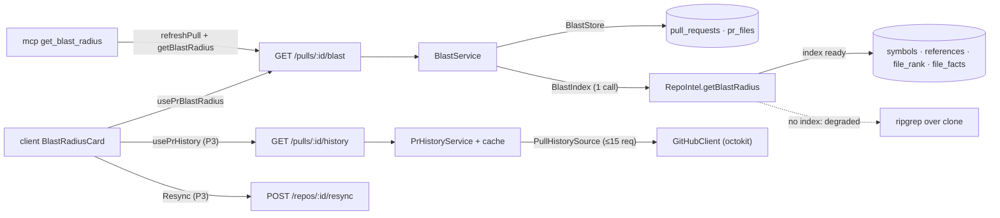

# Development Plan: L05 Blast Radius — PR impact map (symbols → callers → endpoints/crons) from the repo-intel index, on Overview and via MCP `get_blast_radius`, plus Prior PRs from GitHub
Status: READY (Revision 5) · Packages: server, client, mcp, e2e · reviewer-core — unchanged

## Changelog
### Revision 5 (user decision)
- **R5.1** No Tree/Graph toggle. The tree is always the card's body; a single **Graph** button
  (label `view.graph`, as in mockup 2) in the stat row opens the graph `Modal`. Closing the modal
  returns focus to the button. The existing `view.tree` key stays in `blast.json` unused (keys are
  not deleted). Deliberate deviation from the P3 wording "Tree / Graph switch" — mention it in the PR
  description. Affects S10 and the Tests table.

### Revision 4 (review of S7, user-approved)
- **R4.1** Resync is offered only where it can help: reasons `index_failed`, `index_partial`,
  `no_data`. For `flag_off` and `repo_too_large` the badge shows an explanatory hint instead
  (`degraded.hint.<reason>`), no button.
- **R4.2** After a resync the card refreshes itself: it polls `GET /repos/:id/index-state`
  (`useRepoIntelStatus(repoId, true)`) until `lastIndexedSha` / `updatedAt` advances past the
  value captured at click time, then invalidates `queryKeys.prBlast(prId)` and stops polling.
  Polling also stops after `RESYNC_POLL_TIMEOUT_MS` (client constant, 2 min) with a
  "still running" status. No "reopen in a minute" text.
- **R4.3** The resync route answers 202 even when the job was not enqueued
  (`{ status: 'accepted', degraded: true, reason: 'no_handler' }`,
  `server/src/modules/repo-intel/routes.ts:47-63`). The card checks `degraded` in the response and
  shows `degraded.resyncFailed` instead of the queued status, without starting the poll.
- **R4.4** `OverviewTab` already receives `repoId` (`PrDetailView.tsx:121`); S6 now passes it on to
  `BlastRadiusCard` (alongside `repoFullName`, `headSha`), which S7 needs for the resync call.

### Revision 3 (user decision)
- **R3.1** Prior PRs shows **at most 5 PRs**, and the GitHub request count is cut accordingly:
  `MAX_HISTORY_PRS=5`, `MAX_HISTORY_COMMITS_PER_FILE=5`, `MAX_HISTORY_SHAS=10`, and commit → PR
  lookups run in batches of `HISTORY_SHA_BATCH=5` with an **early stop** once 5 merged PRs are
  found. Worst case on a cache miss: 5 `listCommits` + 10 `listPullsForCommit` = **15 requests**
  (was 35); typical: 5 + 5 = 10. Affects D8, S11, S12, Tests, Risks.

### Revision 2 (user decisions)
- **R2.1** Facade fix (S2) — approved as planned.
- **R2.2** No wrapper: `BlastRadius` itself (`brief.ts`, both copies) gains
  `degraded: z.boolean().default(false)` and `reason: BlastDegradedReason.nullable().default(null)`.
  The route responds with `BlastRadius`; `PrBlastRadiusView` is dropped. The P3 `caller_facts` also
  lives on `BlastRadius` as `.default([])` (S10). See D1.
- **R2.3** Graph view (S10) — approved as the last optional step.
- **R2.4** Prior PRs **included** (P3), no LLM notes: new module `pr-history`,
  route `GET /pulls/:id/history`, data from GitHub via the existing `GitHubClient` port extended with
  2 methods, `PrHistory` with `notes` default `''` + `degraded`/`reason`; client collapsible block
  under the tree. New steps S11–S12; D8 rewritten.
- **R2.5** MCP primes the PR with `refreshPull` (D9 confirmed).

> **Corrections to the brief** (verified, path:line):
> 1. `MAX_CALLERS_PER_SYMBOL` is applied to the **whole result**, not per symbol: `tryPersistentBlast`
>    sorts all callers by rank and then `callers.slice(0, MAX_CALLERS_PER_SYMBOL)`
>    (`server/src/modules/repo-intel/service.ts:372,386`), while the constant's doc says
>    "per changed symbol" (`constants.ts:29`).
> 2. `BFS_DEPTH` is not used by blast — only by `getCriticalPaths` (`service.ts:661-686`). Blast
>    callers are direct references (1 hop).
> 3. `getBlastRadius` never returns `flag_off` / `index_partial` / `index_failed` / `repo_too_large`:
>    a `partial` index returns `degraded: false` (`service.ts:320,338,389`); every fallback returns
>    `'no_data'` (`service.ts:228-234,297-303`).
> 4. Declaring-file exclusion: the fallback excludes it explicitly (`service.ts:273`); the persistent
>    path does not filter and relies on `decl_file` resolved via import edges
>    (`repository.ts:406-424`). `viaSymbol` is a bare name → the blast mapper filters defensively.
> 5. `factsByFile` exists only on the persistent path (`types.ts:84`, `service.ts:376-382`); the
>    fallback has only a flat `impactedEndpoints` and no crons.
> 6. The fallback re-reads the clone with ripgrep (`adapters/codeindex/ripgrep.ts:99-126`); only the
>    persistent path is a pure index read. repo-intel logs nothing for blast.
> 7. `BlastRadius` has no `degraded` / `reason` / `rank`
>    (`server/src/vendor/shared/contracts/brief.ts:38-65`, client copy same). `ChangedSymbol` has no line.
> 8. `PrHistoryItem.notes` is a required string (`brief.ts:86-94`); `PrHistory` has no degraded state.
>    Both `BlastRadius` and `PrHistory` are embedded in `PrBrief` (`brief.ts:137-142`).
> 9. Users of `PrBrief` / `BlastRadius` / `PrHistory` (grep over server, client, reviewer-core, mcp,
>    e2e, excluding `clones/`, `node_modules`, `docs`): only `server/test/contracts.test.ts:89,108`
>    (parse without the new fields), the type re-export `client/src/lib/types.ts:35`, and barrel
>    comments. Nothing in seed, fixtures, reviewer-core or mcp builds them.
> 10. `GitHubClient` has no file-history method (`server/src/vendor/shared/adapters.ts:143-166`;
>     client copy `:122-137`, drifted). Implementations: `OctokitGitHubClient`
>     (`adapters/github/octokit.ts:29`) and `MockGitHubClient` (`adapters/mocks.ts:130`, options
>     pattern). `container.github()` throws `ConfigError('GITHUB_TOKEN is not configured')` without a
>     token (`platform/container.ts:171-178`).
> 11. `blast.json` gaps: no degraded / reason / resync / error / title / history keys; `callerCount`
>     is not an ICU plural; `stat.crons` is "cron/jobs". `brief.block.blast` already exists
>     (`brief.json:4`).
> 12. MCP stub (`mcp/src/tools/get-blast-radius.ts:7-21`) takes no service (`server.ts:38`) and its
>     text says "L04".
> 13. The Intent card is already on Overview, in a one-column grid with the comment "Blast Radius card
>     joins this row later" (`OverviewTab.tsx:19-22`, `styles.ts:4-9`).
> 14. Reusable: `useResyncRepoIntel`, `useRepoIntelStatus` (`client/src/lib/hooks/repo-intel.ts:32-50`);
>     `githubPrUrl`, `githubBlobUrl` (`client/src/lib/github-urls.ts:16,24`).
> 15. Seed repo has `clonePath: null` (`server/src/db/seed.ts:93`) → seeded PR #482 always comes back
>     degraded with empty arrays.

## Decisions taken
| # | Decision | Reason |
|---|---|---|
| D1 | **Extend `BlastRadius`** (both copies): `degraded: z.boolean().default(false)`, `reason: BlastDegradedReason.nullable().default(null)`; P3 (S10) `caller_facts: z.array(CallerFacts).default([])`. Route schema `response: { 200: BlastRadius }`. | User choice. `.default()` makes the fields optional in `z.input` (old producers/fixtures and stored `PrBrief` still parse, e.g. `contracts.test.ts:89`) and required in `z.infer` (client and MCP never handle `undefined`). Nothing constructs a typed literal today (correction 9) → no compile break. `.nullable()` keeps "no reason" an explicit `null` in JSON. |
| D2 | `BlastDegradedReason = z.enum(['flag_off','index_failed','index_partial','repo_too_large','no_data'])` in `brief.ts`. | Same values as `DegradedReason` (`repo-intel/types.ts:27-32`); exhaustive i18n map on the client. |
| D3 | Fix the facade (S2): per-symbol cap + honest reasons; `partial` index returns its data **and** `degraded: true, reason: 'index_partial'`. | The limit stays in `repo-intel/constants.ts`; `blast/` cannot import it (`no-cross-module-internals`, enforcement.md:172-179). |
| D4 | `downstream` = symbols with ≥1 caller, ordered by max caller rank desc → caller count desc → name. Callers: rank desc → `file` → `line`. `changed_symbols` = all symbols. | Rank is not in the contract, so the order carries it. |
| D5 | Per-symbol endpoints / crons = de-duplicated union of `factsByFile[file]` over that symbol's caller files, kept separate. Without `factsByFile` (fallback) → empty. | Attribution to the symbol whose callers live in that file. |
| D6 | `summary` built from numbers by a pure function. | No model. |
| D7 | Graph view (P3): CSS grid + SVG column layout from a pure helper, no library. | Client has only `mermaid`; the layout is a fixed 4 columns; mermaid would put untrusted labels into HTML. |
| D8 | **Prior PRs (P3), no LLM, at most 5 PRs.** Module `pr-history`, route `GET /pulls/:id/history` → `PrHistory`. GitHub: `repos.listCommits({sha: pr.base, path, per_page: 5})` for the top 5 changed files (5 requests), shas merged round-robin across files and de-duplicated, capped at 10; then `repos.listPullRequestsAssociatedWithCommit` per sha in batches of 5, **stopping as soon as 5 merged PRs are collected**. Merged only, current PR excluded, `files_overlap` = queried files that led to the PR, `notes: ''`. Worst case 15 requests, typical 10. In-memory cache per `prId:headSha`, 10 min. No token → `degraded: true, reason: 'no_token'`; GitHub error → `'github_error'`; never 500. | Separate module keeps blast index-only. Commits API is the only REST path from a file to its PRs (issue search does not index paths). Round-robin keeps every file represented under the small sha cap; early stop bounds the cost to what is shown. |
| D9 | MCP `get_blast_radius` = `refreshPull` → `GET /pulls/:id/blast`. | Map matches the UI; `readOnlyHint: true` stays (only refreshes the PR cache). |

## Goal & non-goals
- **Goal:**
  - `GET /pulls/:id/blast` returns `BlastRadius` (with `degraded` / `reason`) from **one**
    `repoIntel.getBlastRadius` call — no LLM, no GitHub, no reparse on an indexed repo.
  - Overview shows Intent and Blast Radius side by side. The Blast Radius card: stat row;
    collapsible symbols with "N callers"; `file:line` links to GitHub blob at the head sha; endpoint
    chips (blue globe) and cron chips (amber clock); empty state; degraded badge with reason and
    Resync (P3); Graph (P3); Prior PRs, max 5 (P3).
  - MCP `get_blast_radius(repo, pr)` returns the same map.
- **Non-goals:** re-analysis / new indexing logic; LLM notes for prior PRs; MCP tool for history;
  linking to the indexed sha; paging PR files past 100; changing the ripgrep fallback; the PR
  description and video (done by the user).

## Context consulted
- **INSIGHTS — server:**
  - 2026-10-18 "new module passes onion rules only if its repository returns contract DTOs" →
    `BlastStore` / `PrHistoryStore` ports in module types; repositories map rows; `wiring.ts` assembles.
  - 2026-10-18 "a module needing another module's function gets it via a `types.ts` facade on the
    container" → repo-intel only via `container.repoIntel` behind a narrow `BlastIndex` port; GitHub
    only via `container.github()`.
  - 2026-10-28 "types shared by `domain.ts` and `ports.ts` go in `types.ts`" → `BlastIndexRead`
    (structural mirror of `BlastResult`) and history input types in each module's `types.ts`.
  - Also: 2026-10-28 "PR file lists stop at 100" (Risks); 2026-10-14 "`buildApp()` reaps runs"
    (route tests are `*.it.test.ts` with an injected db).
- **INSIGHTS — client:** 2026-10-28 "user-event is not installed" → `fireEvent` (wins over the
  skill); 2026-10-09 "child namespace in test provider" → `{ blast, brief }`; 2026-10-15 "polled
  `isError` with cached data" → error state only when `data == null`. Also: 2026-10-17 "global
  mutation toast" (no own `onError`); 2026-10-17 "kit Modal not portalled" (S10); 2026-10-14
  "repo-intel hooks are lesson scaffolding" (reuse them).
- **INSIGHTS — mcp:** 2026-11-02 "every free-text field needs its own cap" → caps + worst-case size
  test; 2026-11-02 "shared response budget" → ≤ `RESPONSE_MAX`.
- **INSIGHTS — e2e:** 2026-10-28 "`find` does not wait" → only `wait --text`.
- **Rules:** `server/AGENTS.md` (route-level Zod, `AppError`, `*.it.test.ts`, facade-only repo-intel,
  external I/O only through container adapters + `mocks.ts`); `client/AGENTS.md`
  (`_components/<Name>/` with a test, hooks → `api.ts`, i18n, query keys); `mcp/AGENTS.md` (one
  service call per tool, forward-leading `ToolError`, stdout only JSON-RPC); `e2e/AGENTS.md` (seed
  data only); onion `enforcement.md` (depcruise baseline + compare).
- **Spec:** none. Precedents: `docs/plans/003-smart-diff.md`, `docs/plans/004-devdigest-mcp-server.md`.

## Architecture
- **server `modules/blast/` (new):** `types.ts`, `domain.ts` (ring 1) · `ports.ts`, `service.ts`
  (2) · `repository.ts` (3) · `wiring.ts`, `routes.ts` (4). Imports: `routes → wiring → {service,
  repository}`; `service → ports(type), domain, platform/errors`; `repository → drizzle, db/schema,
  ports(type)`. `wiring` passes `container.repoIntel` as `BlastIndex`; structural typing makes
  `pnpm typecheck` fail if `BlastResult` and `BlastIndexRead` drift.
- **server `modules/pr-history/` (new, P3):** same layout + `constants.ts`; `wiring` adapts
  `container.github()` into a `PullHistorySource` port; `GitHubClient` gets 2 methods in
  `vendor/shared/adapters.ts` (both copies), implemented in `adapters/github/octokit.ts` and
  `adapters/mocks.ts`. No container change.
- **repo-intel:** small fix inside `getBlastRadius` / `tryPersistentBlast` (S2); facade signature unchanged.
- **client:** `lib/hooks/{blast,pr-history}.ts → api.ts`;
  `OverviewTab → BlastRadiusCard → {BlastSymbolItem, PriorPrsBlock, BlastGraphModal(P3)}`; reuses
  `useResyncRepoIntel`, `githubBlobUrl` / `githubPrUrl`, `Badge`, `Button`, `Icon`, `Skeleton`,
  `ErrorState`, `Modal`, `MonoLink`.
- **mcp:** `tools/get-blast-radius.ts → service.getBlastRadius → DevDigestApi.getBlastRadius`
  (`adapters/http-api.ts`) + pure `format.toBlastRadiusResult`.

## Skill contract
| File (create/modify) | Skills | Rules the step must satisfy |
|---|---|---|
| `server/src/vendor/shared/contracts/brief.ts`, `client/src/vendor/shared/contracts/brief.ts` (modify) | zod | `BlastDegradedReason`; `BlastRadius` + `degraded` `.default(false)`, `reason` `.nullable().default(null)` (S1); `CallerFacts` + `caller_facts` `.default([])` (S10); `PrHistoryDegradedReason`, `PrHistoryItem.notes` `.default('')`, `PrHistory` + `degraded` / `reason` the same way (S11). Schema and type share one name, no `Schema` suffix. Copies byte-identical. |
| `server/test/contracts.test.ts` (modify) | zod | old payloads parse with defaults applied; unknown reason throws |
| `server/src/vendor/shared/adapters.ts`, `client/src/vendor/shared/adapters.ts` (modify, S11) | zod, onion-architecture | `GitHubClient` + `listCommitShasForPath`, `listPullsForCommit`; plain `AssociatedPullRef` interface; no vendor types; same new declarations in both copies (rest stays drifted) |
| `server/src/adapters/github/octokit.ts` (modify, S11) | onion-architecture | `withRetry(withTimeout(…, TIMEOUT))` like existing methods; maps to plain data; no business filtering |
| `server/src/adapters/mocks.ts` (modify, S11) | onion-architecture | `MockGitHubClient` options `commitShas?`, `pullsForCommit?`; default `[]`; records calls for request-count tests |
| `server/src/modules/repo-intel/service.ts` (modify) | onion-architecture | change only `getBlastRadius` / `tryPersistentBlast`; no new `this.container.x` reads; cap from `MAX_CALLERS_PER_SYMBOL` |
| `server/test/repo-intel-blast.test.ts` (create) | onion-architecture | unit; patch `svc.repo` as in `repo-intel-facade-degraded.test.ts:33-39` |
| `server/src/modules/blast/{types,domain}.ts` (create) | onion-architecture, zod | ring 1: no framework / ORM / env / container / other module; pure; `import type` from shared; no hard-coded limits |
| `server/src/modules/blast/{ports,service}.ts` (create) | onion-architecture | ports in module / contract types; `BlastService({store, index})`; `NotFoundError`; `index.getBlastRadius` called exactly once |
| `server/src/modules/blast/repository.ts` (create) | drizzle-orm-patterns, onion-architecture | `implements BlastStore`; workspace-scoped; selects only `repoId` and `path` |
| `server/src/modules/blast/{wiring,routes}.ts` (create), `server/src/modules/index.ts` (modify) | fastify-best-practices, zod, onion-architecture | `withTypeProvider<ZodTypeProvider>()`; `schema {params: IdParams, response: {200: BlastRadius}}`; `getContext` + one service call + one `req.log.info`; `rateLimit` 60/min; one registry entry per module |
| `server/src/modules/pr-history/{types,constants,domain}.ts` (create) | onion-architecture | ring 1, pure; `MAX_HISTORY_*` / `HISTORY_*` constants in SCREAMING_SNAKE |
| `server/src/modules/pr-history/{ports,service}.ts` (create) | onion-architecture | `PrHistoryService({store, source, now})`; batched lookup with early stop at `MAX_HISTORY_PRS`; `ConfigError` → `no_token`, other errors → `github_error`; never throws on GitHub failure; cache in the service instance; `NotFoundError` for an unknown PR |
| `server/src/modules/pr-history/repository.ts` (create) | drizzle-orm-patterns, onion-architecture | `implements PrHistoryStore`; workspace-scoped; repo owner/name, `number`, `base`, `headSha`, files |
| `server/src/modules/pr-history/{wiring,routes}.ts` (create) | fastify-best-practices, zod, onion-architecture | service built once per plugin; `response {200: PrHistory}`; `rateLimit` 20/min |
| `server/test/blast-domain.test.ts`, `server/test/pr-history-domain.test.ts`, `server/test/pr-history-service.test.ts` (create) | onion-architecture | unit, no DB; domain tables written before the code |
| `server/test/blast.it.test.ts`, `server/test/pr-history.it.test.ts` (create) | fastify-best-practices, drizzle-orm-patterns | `*.it.test.ts`; `startPg` + `buildApp({overrides})` + `app.inject` |
| `server/README.md` (modify) | — | API-map lines for `/pulls/:id/blast` and `/pulls/:id/history` |
| `client/src/lib/hooks/query-keys.ts` (modify), `lib/hooks/blast.ts`, `lib/hooks/pr-history.ts` (create) | frontend-architecture, react-best-practices, zod | `prBlast: ["pr-blast", prId]`, `prHistory: ["pr-history", prId]`; `api.get<BlastRadius>` / `api.get<PrHistory>`; `enabled: !!prId`; history `staleTime` 10 min |
| `OverviewTab/OverviewTab.tsx`, `OverviewTab/styles.ts`, `PrDetailView/PrDetailView.tsx` (modify) | frontend-architecture, next-best-practices | `"use client"` stays; thin composition; grid `repeat(auto-fit, minmax(420px, 1fr))`; new `OverviewTab` props `repoFullName`, `headSha`; `OverviewTab` passes `prId`, `repoId`, `repoFullName`, `headSha` to `BlastRadiusCard` |
| `BlastRadiusCard/{BlastRadiusCard.tsx,helpers.ts,styles.ts,index.ts}` (create) | frontend-architecture, react-best-practices | card calls the hook itself; loading / error (`data == null`) / empty / degraded via early returns; pure helpers; `count > 0 &&`; no render functions; ≤ 200 lines; CSS tokens only; text only from i18n |
| `BlastRadiusCard/_components/BlastSymbolItem/*` (create) | frontend-architecture, react-best-practices | local `useState(defaultOpen)`; `<button aria-expanded>`; `key` = `file:line`; link only when repo name and sha are known; ≤ 7 props |
| `BlastRadiusCard/_components/PriorPrsBlock/*` (create, S12) | frontend-architecture, react-best-practices | calls `usePrHistory` itself; collapsed by default; `aria-expanded`; `#N` links via `githubPrUrl`; text only from i18n |
| `BlastRadiusCard/_components/BlastGraphModal/*` + `graph-layout.ts` (create, S10) | frontend-architecture, react-best-practices | pure layout; SVG paths without DOM measurement; `Modal` with close; `aria-label` |
| All `*.test.tsx` above (create) | react-testing-library | `fireEvent`; mocked `fetch`; `QueryClientProvider` (retry false); `{blast, brief}` messages; `describe("<Name> — <aspect>")`; `screen` queries by role / text |
| `client/messages/en/blast.json` (modify) | frontend-architecture | ICU plurals; keys listed in S6, S7, S10, S12 |
| `mcp/src/{types,constants,format}.ts` (modify) | onion-architecture, zod | `ApiBlastRadius` wire schema; caps; `clip()`; ≤ `RESPONSE_MAX` |
| `mcp/src/{ports,service,server}.ts`, `adapters/http-api.ts`, `tools/get-blast-radius.ts` (modify) | onion-architecture, zod | `fetch` only in the adapter; tool = one service call + `toToolResult`; description ≤ 300 chars; `readOnlyHint: true`; args from `args.ts` |
| `mcp/test/{format,server,http-client}.test.ts`, `mcp/test/fake-api.ts`, `mcp/README.md` (modify) | — (TESTING.md) | API mocked; worst-case size test |
| `e2e/specs/02-repo-pulls-detail.flow.json` (modify) | — (`e2e/AGENTS.md`) | appended `wait --text` steps; seed data only |

## Steps
### S1: Contract — extend `BlastRadius` [P1/P2]
- **Files:** both `contracts/brief.ts`; `server/test/contracts.test.ts`.
- **Change:** `BlastDegradedReason` enum (D2); `BlastRadius` + `degraded: z.boolean().default(false)`,
  `reason: BlastDegradedReason.nullable().default(null)` (D1).
- **Test:** existing payload (`contracts.test.ts:89`) parses to `degraded: false, reason: null`;
  `reason: 'index_partial'` parses; `reason: 'bogus'` throws; `PrBrief` without the new fields parses.
- **Depends on:** — · **Done when:** copies identical, test green.
- **Verify:** `diff server/src/vendor/shared/contracts/brief.ts client/src/vendor/shared/contracts/brief.ts && cd server && pnpm typecheck && pnpm exec vitest run test/contracts.test.ts && cd ../client && pnpm typecheck`

### S2: repo-intel facade — per-symbol cap and honest reasons [P2/P3]
- **Before editing:** take the depcruise baseline (`enforcement.md:20-24`).
- **Files:** `server/src/modules/repo-intel/service.ts`; `server/test/repo-intel-blast.test.ts` (create).
- **Change:** `getBlastRadius` reads `tryGetIndexState` once and passes it into `tryPersistentBlast`;
  flag off → `reason: 'flag_off'`; state `failed` / `degraded` → `'index_failed'`; no state →
  `'no_data'`; `status === 'partial'` → data + `degraded: true, reason: 'index_partial'`; replace the
  global `slice` with "≤ `MAX_CALLERS_PER_SYMBOL` per `viaSymbol`" after the rank sort. Fallback
  otherwise unchanged.
- **Depends on:** — · **Done when:** new tests green (25 callers of A + 3 of B → 20 + 3, highest
  rank kept; partial → `index_partial` with data; flag off → `flag_off`; failed → `index_failed`)
  and `repo-intel-facade-degraded.test.ts` stays green.
- **Verify:** `cd server && pnpm typecheck && pnpm exec vitest run test/repo-intel-blast.test.ts test/repo-intel-facade-degraded.test.ts`

### S3: Mapping table first (red), then the pure mapper (green) [P2]
- **Files:** `server/test/blast-domain.test.ts` (first), then `modules/blast/types.ts`, `domain.ts`.
- **Change:**
  - `types.ts`: `BlastIndexRead { changedSymbols: {file,name,kind}[]; callers: {file,symbol,viaSymbol,line,rank}[]; factsByFile?: Record<string,{endpoints:string[];crons:string[]}>; degraded?: boolean; reason?: BlastDegradedReason }`; `BlastTarget { repoId: string; files: string[] }`.
  - `domain.ts`: `toBlastRadius(read): BlastRadius` (z.infer type, all fields set) per D4 / D5 —
    drops a caller whose `file` declares that `viaSymbol`, de-duplicates `(viaSymbol, file, line)`,
    `degraded = read.degraded ?? false`, `reason = read.reason ?? null`; `buildBlastSummary(counts)`;
    `blastSource(read): 'index' | 'fallback'` — `'index'` iff `!degraded || reason === 'index_partial'`.
- **Tests:** grouping by `viaSymbol`; declaring file excluded; empty callers → `downstream: []`,
  `changed_symbols` kept; degraded passthrough; crons separate from endpoints, both de-duplicated;
  rank order; fallback without `factsByFile`; summary text; output passes `BlastRadius.parse`.
- **Depends on:** S1 · **Done when:** red before `domain.ts` exists, green after, no test edits.
- **Verify:** `cd server && pnpm exec vitest run test/blast-domain.test.ts`

### S4: Module + route `GET /pulls/:id/blast` [P1/P2]
- **Files:** `modules/blast/{ports,repository,service,wiring,routes}.ts` (create); `modules/index.ts`;
  `server/test/blast.it.test.ts` (create); `server/README.md` (exact location UNVERIFIED; plan 004 edited `:68`).
- **Change:** `BlastStore { getTargetForPull(workspaceId, prId): Promise<BlastTarget | undefined> }`;
  `BlastIndex { getBlastRadius(repoId, files): Promise<BlastIndexRead> }`; `BlastService.get(ws, prId)`:
  missing target → `NotFoundError('Pull request not found')`, else one
  `index.getBlastRadius(repoId, files)` → `{ blast: toBlastRadius(read), source: blastSource(read) }`.
  Route returns `blast` and logs
  `req.log.info({ prId, source, degraded, reason, symbols, callers }, 'blast radius read from repo-intel')`.
- **it-test:** fake `repoIntel` override records calls; 200 + `BlastRadius.parse`; fake called
  exactly once with the PR's `repoId` and `pr_files` paths; degraded passthrough; random uuid → 404;
  `abc` → 422; `llm.calls.length === 0`.
- **Depends on:** S2, S3 · **Done when:** IT green; depcruise `--ignore-known` → 0 new violations.
- **Verify:** `cd server && pnpm typecheck && pnpm exec vitest run test/blast.it.test.ts` + depcruise compare (`enforcement.md:29`)

### S5: Client data layer [P1]
- **Files:** `query-keys.ts`, `lib/hooks/blast.ts` (create).
- **Change:** `queryKeys.prBlast`; `usePrBlastRadius(prId)` → `api.get<BlastRadius>(\`/pulls/${prId}/blast\`)`.
- **Depends on:** S1, S4 · **Verify:** `cd client && pnpm typecheck`

### S6: Blast Radius card on Overview [P1; also P3 collapsible tree, rank order, labels]
- **Files:** `BlastRadiusCard/*`, `BlastSymbolItem/*` (create); `OverviewTab.tsx`,
  `OverviewTab/styles.ts`, `PrDetailView.tsx`, `blast.json` (modify).
- **Change:**
  - `PrDetailView` passes `repoFullName` and `headSha={pr.head_sha}` to `OverviewTab` (which
    already gets `repoId`, `PrDetailView.tsx:121`); `OverviewTab` renders
    `<BlastRadiusCard prId repoId repoFullName headSha />`.
  - Grid becomes two columns (auto-fit); remove the "joins later" comment.
  - Header: title `brief.block.blast`, stat row (`Code` / `CornerDownRight` / `Globe` / `Clock`
    icons, bold number + ICU noun).
  - One `BlastSymbolItem` per `downstream` entry, first one open: label `symbolLabel(name, kind)` →
    `name()` for `function` / `method` (kind strings UNVERIFIED); `callerCount`; caller rows
    `↳ file:line` as `MonoLink href` to `githubBlobUrl`, caller name muted; endpoint chips
    `Badge icon="Globe" color var(--accent) bg var(--accent-bg) mono`; cron chips
    `Badge icon="Clock" color var(--warn) bg var(--warn-bg) mono`.
  - Empty and not degraded → `noDownstream`. Degraded → warn `Badge` (`AlertTriangle`)
    `degraded.badge` + `degraded.reason.<reason>`; tree still renders when there is data.
    Error → `ErrorState`.
- **i18n (`blast.json`):** `stat.*` → ICU (cron/crons); `callerCount` →
  `{count, plural, one {# caller} other {# callers}}`; new `errorTitle`, `degraded.badge`
  ("Limited data"), `degraded.reason.{flag_off,index_failed,index_partial,repo_too_large,no_data}`.
  Nothing reads `blast.*` today.
- **Depends on:** S5 · **Done when:** S6 rows of the Tests table green.
- **Verify:** `cd client && pnpm test && pnpm typecheck`

### S7: Resync button [P3]
- **Files:** `BlastRadiusCard/{BlastRadiusCard.tsx, helpers.ts, constants.ts (create), BlastRadiusCard.test.tsx}`;
  `BlastRadiusCard/_components/ResyncControl/{ResyncControl.tsx, index.ts, ResyncControl.test.tsx}` (create);
  `blast.json`.
- **Change:**
  - **When to offer it (R4.1):** pure helper `canResync(reason)` → `true` only for
    `index_failed`, `index_partial`, `no_data`. For `flag_off` / `repo_too_large` the badge shows
    `degraded.hint.<reason>` (muted text, no button).
  - **`ResyncControl({ prId, repoId })`** (own component, keeps the card ≤ 200 lines):
    - `Button size="sm" icon="RefreshCw"` → `useResyncRepoIntel(repoId).mutate()`; disabled while
      pending or polling.
    - Before `mutate`, capture the current `lastIndexedSha` / `updatedAt` from
      `useRepoIntelStatus(repoId)` (may be undefined when there is no index yet).
    - **Enqueue check (R4.3):** response `{ degraded: true }` → `role="status"` with
      `degraded.resyncFailed`; no polling. Network / HTTP errors → global toast (no own `onError`).
    - **Self-refresh (R4.2):** on a real `accepted` response, set `polling = true` →
      `useRepoIntelStatus(repoId, polling)` polls every 1.5 s; when `lastIndexedSha` or `updatedAt`
      differs from the captured value → `queryClient.invalidateQueries({ queryKey: queryKeys.prBlast(prId) })`,
      `polling = false`, status `degraded.resyncDone`. While polling: `role="status"`
      `degraded.resyncRunning` with a spinner.
    - Timeout: `RESYNC_POLL_TIMEOUT_MS = 120_000` in `BlastRadiusCard/constants.ts` → stop polling,
      status `degraded.resyncSlow` ("Still indexing — refresh later").
    - The completion check is a pure helper `indexAdvanced(before, now)` in `helpers.ts`.
  - **i18n (`blast.json`):** `degraded.resync`, `degraded.resyncRunning`, `degraded.resyncDone`,
    `degraded.resyncSlow`, `degraded.resyncFailed`, `degraded.hint.{flag_off,repo_too_large}`.
- **Tests:**
  - helpers: `canResync` per reason; `indexAdvanced` (undefined → value, sha change, `updatedAt`
    change, no change).
  - `ResyncControl`: click POSTs `/repos/r1/resync`; `accepted` → polls index-state, and when the
    sha advances refetches `/pulls/p1/blast` and shows `resyncDone`; `{degraded: true}` response →
    `resyncFailed`, no index-state polling; timeout → `resyncSlow` (fake timers).
  - `BlastRadiusCard`: reason `flag_off` → hint, no Resync button; reason `no_data` → button present.
- **Depends on:** S6 · **Verify:** `cd client && pnpm test && pnpm typecheck`

### S8: MCP `get_blast_radius` [P1/P2]
- **Files:** `mcp/src/{types,constants,format,ports,service,server}.ts`, `adapters/http-api.ts`,
  `tools/get-blast-radius.ts`; `mcp/test/{format,server,http-client}.test.ts`, `fake-api.ts`;
  `mcp/README.md` (tool row; current content UNVERIFIED).
- **Change:**
  - `ApiBlastRadius` wire schema: `changed_symbols`, `downstream`, `summary`, `degraded: z.boolean()`, `reason: z.string().nullable()`.
  - Port `getBlastRadius(prId)` → `GET /pulls/:id/blast`.
  - `service.getBlastRadius(repo, pr)` = `resolveRepo` → `resolvePull` → `refreshPull` → `getBlastRadius` → `toBlastRadiusResult`.
  - Result: `{repo, pr, summary, counts{symbols,callers,endpoints,crons}, symbols:[{symbol, file, callers:["file:line name"], endpoints, crons}], more_symbols?, more_callers?, degraded?, reason?, note?}`.
  - Caps: `MAX_BLAST_SYMBOLS=20`, `MAX_BLAST_CALLERS=100` (total, rank order kept), `SYMBOL_MAX=80`, `FILE_MAX`; whole response ≤ `RESPONSE_MAX`.
  - Degraded `note` leads forward: `no_data` → Resync in DevDigest; `flag_off` →
    `REPO_INTEL_ENABLED=false`; `index_partial` → may be incomplete; `index_failed` → Resync.
  - Unknown PR → existing `resolvePull` text.
  - Description: "Impact map of a PR from the DevDigest repo index: changed symbols, their callers
    (file:line), HTTP endpoints and crons that may be affected. Read-only, no LLM. Call before
    judging a change to shared code."
  - Annotations: `readOnlyHint: true, idempotentHint: true, openWorldHint: false`.
  - `SERVER_INSTRUCTIONS` + " For a PR's impact map use get_blast_radius." (stays ≤ 600 chars).
- **Tests:** format (shape, caps, notes, worst case ≤ `RESPONSE_MAX`); server (registration,
  annotations, description length, map via fake API, forward-leading errors, no "not implemented");
  http-client (path).
- **Depends on:** S4 · **Verify:** `cd mcp && npm run typecheck && npm test`

### S9: e2e [P1]
- **Files:** `e2e/specs/02-repo-pulls-detail.flow.json`.
- **Change:** append `wait --text "Blast radius"` ("blast radius card renders on overview") and
  `wait --text "Limited data"` ("seed repo is unindexed so the degraded badge shows"). Seed has
  `clonePath: null` → always degraded.
- **Depends on:** S6 · **Verify:** `cd e2e && npm run e2e:hermetic`

### S10: Graph button + Graph modal [P3, optional]
- **Files:** both `brief.ts`; `modules/blast/domain.ts`; `blast-domain.test.ts`; `contracts.test.ts`;
  `BlastGraphModal/{BlastGraphModal.tsx, graph-layout.ts, styles.ts, index.ts, BlastGraphModal.test.tsx}`
  (create); `BlastRadiusCard.tsx`; `blast.json` (`graph.legend.*`, `graph.close`).
- **Change:**
  - Contract: `CallerFacts = z.object({file, endpoints: z.array(z.string()), crons: z.array(z.string())})`;
    `BlastRadius.caller_facts: z.array(CallerFacts).default([])`, filled from `factsByFile` of caller
    files (caller → endpoint / cron edges in mockup 4).
  - Stat row, right side: one `Button size="sm" variant="ghost"` labelled `view.graph` (no toggle, no
    `aria-pressed`). Click → local `useState(open)` → `BlastGraphModal`; close (× button, Esc,
    backdrop) → `open = false`, focus returns to the Graph button. The tree stays rendered underneath.
    Button hidden when `downstream` is empty.
  - `layoutBlastGraph(blast)` (pure): 4 columns — SYMBOLS `--violet`, CALLERS, ENDPOINTS `--ok`,
    CRONS `--warn`; fixed `ROW_H`; Bézier `d` strings.
  - One SVG for edges + positioned divs for nodes; legend; `graph.empty`.
- **Depends on:** S6 · **Verify:** `cd server && pnpm exec vitest run test/blast-domain.test.ts test/contracts.test.ts && cd ../client && pnpm test && pnpm typecheck`

### S11: Prior PRs — server [P3]
- **Files:** both `brief.ts` and both `adapters.ts`; `adapters/github/octokit.ts`, `adapters/mocks.ts`;
  `modules/pr-history/{types,constants,domain,ports,repository,service,wiring,routes}.ts` (create);
  `modules/index.ts`; tests `pr-history-domain.test.ts`, `pr-history-service.test.ts`,
  `pr-history.it.test.ts`, `contracts.test.ts`; `server/README.md`.
- **Change:**
  - **Contract:** `PrHistoryDegradedReason = z.enum(['no_token','github_error'])`;
    `PrHistoryItem.notes: z.string().default('')`; `PrHistory` + `degraded: z.boolean().default(false)`,
    `reason: PrHistoryDegradedReason.nullable().default(null)`.
  - **Port (`GitHubClient`):**
    `listCommitShasForPath(repo, path, opts: { ref: string; limit: number }): Promise<string[]>`;
    `listPullsForCommit(repo, sha): Promise<AssociatedPullRef[]>`,
    `AssociatedPullRef { number; title; author; merged_at: string | null }`.
    Octokit: `rest.repos.listCommits({owner, repo, sha: ref, path, per_page: limit})`,
    `rest.repos.listPullRequestsAssociatedWithCommit({owner, repo, commit_sha})`, each in
    `withRetry(withTimeout(…))` (method names UNVERIFIED against installed octokit types).
    Mock: `commitShas?: Record<path, string[]>`, `pullsForCommit?: Record<sha, AssociatedPullRef[]>`, call log.
  - **`constants.ts`:** `MAX_HISTORY_FILES=5`, `MAX_HISTORY_COMMITS_PER_FILE=5`,
    `MAX_HISTORY_SHAS=10`, `HISTORY_SHA_BATCH=5`, `MAX_HISTORY_PRS=5`,
    `HISTORY_CACHE_TTL_MS=600_000`, `HISTORY_CACHE_MAX=100`.
  - **`domain.ts`:**
    - `pickHistoryFiles(files, max)`: by additions + deletions desc, then path.
    - `pickHistoryShas(perFile: {path, shas}[], max)`: round-robin across files (newest first per
      file), de-duplicated, capped; keeps the `sha → paths` map for `files_overlap`.
    - `mergeHistory(hits: {paths, pulls}[], currentNumber, max): PrHistoryItem[]`: merged only,
      excludes the current PR, de-duplicates by number, `files_overlap` = union of paths, sorted
      `merged_at` desc, capped at `max`, `notes: ''`.
  - **Ports:** `PrHistoryStore.getPullForHistory(ws, prId) → { repo: RepoRef, number, base, headSha, files } | undefined`;
    `PullHistorySource` = the 2 GitHub methods.
  - **`PrHistoryService.get(ws, prId)`:**
    1. unknown PR → `NotFoundError`;
    2. cache hit on `prId:headSha` within TTL → return it;
    3. otherwise: `listCommitShasForPath` for each picked file (≤ 5 requests, parallel) →
       `pickHistoryShas` (≤ 10) → `listPullsForCommit` in batches of `HISTORY_SHA_BATCH`
       (parallel within a batch); after each batch run `mergeHistory`, and **stop when it holds
       `MAX_HISTORY_PRS` items** — remaining shas are not requested. Worst case 15 requests.
    4. `ConfigError` → `{history: [], degraded: true, reason: 'no_token'}`; other error →
       `'github_error'`. Degraded results are not cached.
  - **`wiring.ts`:** `source` calls `(await container.github()).…` lazily.
  - **Route:** `GET /pulls/:id/history`, `response {200: PrHistory}`, `rateLimit` 20/min.
- **Tests:**
  - domain: current PR and unmerged excluded; de-dup; `files_overlap`; order; cap at 5; file pick;
    round-robin sha pick keeps every file and caps at 10.
  - service (fake ports + `now`): `no_token`; `github_error`; cache hit → no second call;
    **early stop** — first batch yields 5 merged PRs → second batch never requested;
    **worst case** — no merged PRs anywhere → exactly 5 + 10 = 15 source calls.
  - it: `overrides.github` mock with fixtures → 200 + `PrHistory.parse`, ≤ 5 items; 404 for unknown uuid.
  - contracts: `PrHistory` without `notes` parses to `''`.
- **Depends on:** S1 · **Done when:** all tests green; depcruise → 0 new violations.
- **Verify:** `diff server/src/vendor/shared/contracts/brief.ts client/src/vendor/shared/contracts/brief.ts && cd server && pnpm typecheck && pnpm exec vitest run test/pr-history-domain.test.ts test/pr-history-service.test.ts test/contracts.test.ts && pnpm exec vitest run test/pr-history.it.test.ts && cd ../client && pnpm typecheck`

### S12: Prior PRs — client block [P3]
- **Files:** `query-keys.ts`, `lib/hooks/pr-history.ts` (create);
  `BlastRadiusCard/_components/PriorPrsBlock/{PriorPrsBlock.tsx, styles.ts, index.ts, PriorPrsBlock.test.tsx}`
  (create); `BlastRadiusCard.tsx`; `blast.json`.
- **Change:**
  - `usePrHistory(prId)`, `staleTime` 10 min.
  - Block under the tree in every card state (mockups 2 and 3).
  - Header button `aria-expanded`: `History` icon + `history.title` ("Prior PRs touching these
    files") + count badge (only when > 0, never above 5); collapsed by default.
  - Rows (≤ 5, as returned): `#N` (link via `githubPrUrl`) + title; author · `formatDateTime(merged_at)`
    (date-only formatting UNVERIFIED); `history.overlap` with `files_overlap` in mono.
  - Empty → `history.empty`; degraded → muted `history.reason.{no_token,github_error}`; error with
    `data == null` → `history.loadError`.
- **Depends on:** S11, S6 · **Verify:** `cd client && pnpm test && pnpm typecheck`

### S13: Manual acceptance (no file changes) [P1/P2]
- **Setup:** an indexed repo (`GET /repos/:id/index-state` → `full`). Suggested: the user's fork of
  this repo, with a PR that edits `server/src/modules/_shared/context.ts` (`getContext`), used by
  `smart-diff/routes.ts`, `intent/routes.ts`, `repo-intel/routes.ts` and others. UNVERIFIED that
  `extractEndpoints` recognises Fastify `app.get('/…')`; fallback: `_shared/schemas.ts` (`IdParams`).
- **Done when:** ≥ 2 callers and ≥ 1 endpoint; `file:line` click opens GitHub at that line; log shows
  `source: "index"`; MCP `get_blast_radius` returns the same symbols and callers; seed PR shows the
  badge; Prior PRs lists ≤ 5 merged PRs with a token and shows `no_token` without one.
- **Verify:** `curl -s localhost:3001/pulls/<prId>/blast | jq '.degraded, (.downstream|length)'` ·
  `curl -s localhost:3001/pulls/<prId>/history | jq '.degraded, (.history|length)'`

## Cross-cutting
- **Contracts (both copies, identical):** `brief.ts` — `BlastDegradedReason`, `BlastRadius.degraded`
  / `reason`, (S10) `CallerFacts` + `caller_facts`, (S11) `PrHistoryDegradedReason`,
  `PrHistoryItem.notes` default `''`, `PrHistory.degraded` / `reason`. All new fields use
  `.default()`, so `PrBrief` and old payloads keep parsing. `adapters.ts` (S11): 2 `GitHubClient`
  methods + `AssociatedPullRef`.
- **DB / migrations:** none.
- **e2e flows:** 02 (+2 steps).
- **i18n (`blast.json`):** S6 (`stat.*`, `callerCount`, `errorTitle`, `degraded.*`), S7
  (`degraded.resync*`, `degraded.hint.*`), S10 (`graph.legend.*`, `graph.close`), S12 (`history.*`).
- **Dependencies:** none (octokit is already in server).

## Tests
| Test file (create/modify) | Kind | What it proves |
|---|---|---|
| `server/test/contracts.test.ts` (mod) | unit | defaults apply to old payloads; unknown reasons rejected; `PrHistory` without `notes` |
| `server/test/repo-intel-blast.test.ts` (new) | unit | per-symbol cap; `index_partial` / `flag_off` / `index_failed` |
| `server/test/blast-domain.test.ts` (new) | unit | grouping, declaring-file exclusion, empty callers, degraded passthrough, crons separate, rank order, summary, (S10) `caller_facts` |
| `server/test/blast.it.test.ts` (new) | it | 200 + contract; facade called once with the PR's files; 404 / 422; no LLM |
| `server/test/pr-history-domain.test.ts` (new) | unit | merged only, current PR excluded, de-dup, overlap, order, cap 5, file pick, round-robin sha pick ≤ 10 |
| `server/test/pr-history-service.test.ts` (new) | unit | `no_token`, `github_error`, cache hit, early stop after 5 PRs, worst case = 15 calls |
| `server/test/pr-history.it.test.ts` (new) | it | 200 + `PrHistory.parse` (≤ 5 items) with mock GitHub; 404 |
| `BlastRadiusCard/BlastRadiusCard.test.tsx` (new) | component | stats; first symbol open with callers, chips, blob href at head sha; empty → `noDownstream`; degraded badge + reason; error + retry; (S7) `flag_off` → hint without button, `no_data` → button |
| `BlastRadiusCard/_components/ResyncControl/ResyncControl.test.tsx` (new, S7) | component | POST `/repos/r1/resync`; poll until index advances → blast refetched + `resyncDone`; `{degraded:true}` → `resyncFailed`, no poll; timeout → `resyncSlow` |
| `BlastSymbolItem/BlastSymbolItem.test.tsx` (new) | component | toggles `aria-expanded`; plural; no link without repo / sha |
| `PriorPrsBlock/PriorPrsBlock.test.tsx` (new) | component | collapsed with count → expand shows `#N` link, title, overlap; empty; `no_token` hint |
| `BlastGraphModal/BlastGraphModal.test.tsx` (new, P3) | component | Graph button opens the modal; 4 column headers with counts; close hides the modal and focuses the button; tree still rendered; no button when `downstream` is empty; empty |
| `mcp/test/{format,server,http-client}.test.ts`, `fake-api.ts` (mod) | unit / in-memory MCP | map shape, caps, worst case ≤ 20 000, notes, registration, errors |
| `e2e/specs/02-repo-pulls-detail.flow.json` (mod) | e2e | card and degraded badge on seed data |

## Verification (per package)
- **server:** `pnpm typecheck` · `pnpm exec vitest run --exclude '**/*.it.test.ts'` ·
  `pnpm exec vitest run .it.test` · depcruise baseline before S2, `--ignore-known` after S4 and S11 → 0 new.
- **contracts:** `diff server/src/vendor/shared/contracts/brief.ts client/src/vendor/shared/contracts/brief.ts`
  → empty; `adapters.ts` copies are already drifted — check only that the new declarations match.
- **client:** `pnpm test` · `pnpm typecheck`
- **mcp:** `npm run typecheck && npm test`
- **e2e:** `npm run e2e:hermetic`
- **reviewer-core:** untouched; its typecheck runs via the server's `pnpm typecheck`.

## Handoff to reviewers
- **Architecture:** `BlastIndexRead` structural mirror; logging in the route; the repo-intel
  legacy-service edit (no new container reads); `.default()` fields in `BlastRadius` / `PrHistory`
  (`z.input` vs `z.infer`); the two new `GitHubClient` methods + mock; in-memory history cache in a
  service instance built once per plugin; batched early-stop lookup; MCP `refreshPull` priming.
- **Security:** both GETs read-only, workspace-scoped, `IdParams` uuid, rate-limited; symbols,
  files, endpoints and GitHub PR titles are untrusted and render as React text / SVG `<text>`, never
  HTML; GitHub token stays in `container.github()`; errors map to reason codes and only
  `err.message` is logged (octokit messages token-free — UNVERIFIED); MCP clips every field.

## Risks & open questions
- Ripgrep fallback still re-reads the clone when there is no index — visible as `source: "fallback"`.
- Line drift: links use the head sha, caller lines come from the indexed default-branch sha.
- PRs with > 100 files: only the first 100 `pr_files` are seen (server INSIGHTS 2026-10-28).
- `viaSymbol` is a bare name → same-named symbols in two changed files merge.
- History coverage: at most 5 PRs from at most 10 recent commits over the 5 most-changed files —
  older relevant PRs can be missed (by design, R3.1). Cache is per process (lost on `tsx watch`
  restart). Rebase-merged PRs via `listPullRequestsAssociatedWithCommit` — UNVERIFIED.
- UNVERIFIED: symbol `kind` strings; Fastify endpoint extraction; octokit method names / types;
  fastify-type-provider-zod reply type `z.input` vs `z.output` (service returns fully populated
  output, so either works); README sections; `Modal` width for the graph; date-only formatting.

**Note for the PR description (user):** list which subagent did what — planner, implementer
(S1–S12), architecture and security reviewers, plan-verifier — and include a demo video on an
indexed repo (S13).
