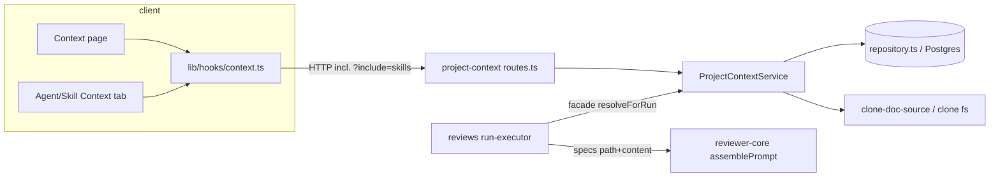

# Development Plan: SPEC-005 Project Context
Status: READY (Revision 2) · Packages: server, client, reviewer-core (+ one e2e flow) · Spec: `specs/005-project-context.md` (amended)
Execution mode: multi-agent

## Changelog
### Revision 2 (user decisions)
- **R2.1** Execution mode is **multi-agent** (the workstream table below).
- **R2.2** Recommendation 2 is accepted and now in the spec: `GET /agents/:id/context?include=skills` (AC-30 rewritten; AC-62…AC-65, EC-19, EC-20 and NFR-8 added; EC-3 and EC-4 extended).
  - S1 adds the response contract and the `include` query schema.
  - S5–S7 add the repository read, the service method and the route variant.
  - S9 and S12 replace the planned per-skill `useQueries` with exactly one request.
  - New tests T-45…T-51; T-19, T-23, T-27 and T-40 are updated.
- **R2.3** Recommendation 1 (shared path guard) and Recommendation 3 (spec edit for too-large tokens) are rejected and dropped. The doc source keeps its own guard (S5).
- **R2.4** All six non-blocking defaults are accepted. They are D1–D6 below and no longer open questions.

## Decisions taken
| # | Decision | Reason |
|---|---|---|
| D1 | A `too_large` doc is listed with `tokens: 0`. | User default; its content is never read (AC-14). |
| D2 | AC-30 K/T exactly as the amended spec: K = distinct paths across `skills[].paths` not in the agent's `paths`; T = tokens of those K that exist in the active repo; each path counted once; the line also shows when K = 0. | Spec AC-30. |
| D3 | No `Specs:` log line when the merged list is empty. The AC-46 "repo not cloned" line is logged only when ≥1 path is attached. | User default. |
| D4 | `PUT …/context` accepts paths that are too large in some repo. The client disables the checkbox of a `too_large` row. | Attachments are global and path-only. |
| D5 | `clone_path` set but the directory is missing ⇒ `status: 'no_clone'` (rescan → 409). | User default. |
| D6 | `prompt_assembly.spec_refs = null` when no doc reached the prompt. | User default; matches `specs: null` (AC-47). |
| D7 | `include` is validated by a route `querystring` schema `z.enum(['skills']).optional()`. Any other value → 422 `validation_error` from the existing handler. | AC-65; `app.ts:121-129`. |
| D8 | One repository read (enabled linked skills in `agent_skills.order`, each with its full stored list, empty entries kept) serves both `?include=skills` and the review run's merge. Duplicates are removed only by `mergeContextPaths` (run) and the client K/T helper. | AC-38, AC-62, AC-63; one source of truth. |

## Requirements check
| ID | Requirement (short) | Status | Proof | Evidence / note |
|---|---|---|---|---|
| AC-1 | Sidebar "Project Context" in WORKSPACE | GAP | test (T-29) | `vendor/ui/nav.ts:21-27` has only `pulls`. `activeKeyFor` already maps `/context` (`components/app-shell/helpers.ts:22`), and `shell.json` has `nav.context` |
| AC-2, AC-3 | list sorted by path; lazy scan on first GET | OK | test (T-9, T-31) | no route exists today |
| AC-4, AC-5, AC-60, AC-61, EC-15…EC-17 | patterns, types, priority, CLAUDE.md excluded | OK | test (T-4) | pure domain fn |
| AC-6, AC-7, AC-11 | preview, footer, "Used by" | OK | test (T-31, T-21) | |
| AC-8, AC-9, EC-7 | Rescan + hint; disabled while pending; concurrent rescans | OK | test (T-10, T-33) | single-flight per repo + transactional replace |
| AC-10 | Download `<basename>.md` | OK | test (T-34) | client-only Blob |
| AC-12, AC-13, AC-15 | no-clone, empty, vanished-file states | OK | test (T-11, T-12, T-32) | D5; `db/schema/repos.ts:16` |
| AC-14, EC-14 | too large ⇒ `too_large`, not attachable; empty ⇒ 0 tokens | OK | test (T-8, T-14, T-35) | D1, D4 |
| AC-16, AC-59, EC-9, NFR-5 | path checks; skip symlinks / outside clone | OK | test (T-5, T-7, T-13) | the guard follows `simple-git.ts:130-152` (own copy, R2.3) |
| AC-17, AC-18 | Context tabs | GAP | test (T-41) | `AgentEditor/constants.ts:11-14`, `AgentEditorView/constants.ts:2`, `SkillDetail/constants.ts:4-8` |
| AC-19…AC-28, AC-56, EC-12, EC-13, EC-18, NFR-6 | rows, header, attach/detach, reorder, filter, preview panel, missing badge | OK | test (T-35, T-37, T-38) | pattern of `SkillsTab.tsx:44-125` |
| AC-57, AC-58 | drop/arrow past attached rows clamps | OK | test (T-38) + manual (CDP drag) | dnd-kit can't run in jsdom |
| AC-29 | save fails → rollback + toast | OK | test (T-36) | the global toast already exists |
| AC-30 | "+K docs via skills · ~T tokens", from `?include=skills`, shown at K = 0 | OK | test (T-40) | D2; the rule is a pure client helper |
| AC-31 | >20 000 warning | OK | test (T-39) | the AC-20 T |
| AC-32…AC-36, EC-6 | PUT stores exact list; 422 / 404 codes | OK | test (T-16…T-19) | limits checked in the service, so each gets its own code |
| AC-37 | delete ⇒ attachments deleted | OK | test (T-20) | FK cascade |
| AC-38, EC-3, EC-4, EC-10, EC-19 | merged list agent → enabled skills, dedupe at the first position | OK | test (T-6, T-23, T-27) | D8; `run-executor.ts:206` |
| AC-39 | `spec:<path>` label | INCORRECT (code) | test (T-1) | `PromptParts.specs` is `string[]` labelled `spec-${i}` (`prompt.ts:70,125`); the type must carry the path. The label sanitiser keeps `:` and `/` (`prompt.ts:34`) |
| AC-40, AC-41 | guard; `</untrusted>` escaped | OK | test (T-1, T-23) | `prompt.ts:32,115` |
| AC-42 | same LLM call count | OK | test (T-28) | compare with vs. without context (the Intent call also counts) |
| AC-43…AC-46, EC-1, EC-2, EC-20 | log lines; skips | OK | test (T-23…T-25, T-51) | D3 |
| AC-47, EC-11 | no docs ⇒ no section, `specs: null`, `specs_read: []`, `spec_refs: null` | OK | test (T-3, T-26) | D6 |
| AC-48 | map-reduce: every call has the section | OK | test (T-2) | `run.ts:141-151,184` |
| AC-49, EC-5, NFR-4 | `specs_read`, `spec_refs`, `tokens.specs`; same tokenizer | GAP | test (T-23) | `run-executor.ts:339`; `trace.ts:63-82` |
| AC-50…AC-52 | drawer block, refs, full text, old traces | GAP | test (T-42, T-43) | `TraceBody.tsx:95-97` |
| AC-53 | "Specs read" row | OK (already built) | test (T-42) | `TraceBody.tsx:41-53` |
| AC-54 | raw HTML as text | OK (to prove) | test (T-30) | react-markdown ^9, no rehype-raw |
| AC-55 | unsafe link schemes → non-clickable | GAP | test (T-30) | `Markdown.tsx:31-35` |
| AC-62 | `include=skills` → own `paths` + `skills` per enabled linked skill, in `agent_skills.order`, empty entries kept | GAP | test (T-45) | D8; `db/schema/agents.ts:51-63`, `skills.ts:30` |
| AC-63 | each `skills[].paths` = full stored list, no dedupe | GAP | test (T-46) | D8 |
| AC-64 | without `include` → `{ paths }`, no `skills` key | GAP | test (T-47) | the service omits the key |
| AC-65 | other `include` value → 422 `validation_error` | GAP | test (T-48) | D7 |
| R-API (429 `rate_limited`) | rescan >10/min | GAP | test (T-22) | the handler sends `internal_error` for non-AppErrors (`app.ts:163-166`) |
| R-ER | 4 tables, CHECKs, cascades | GAP | verify (`pnpm db:generate`, review SQL) | |
| NFR-1…NFR-3 | latency bounds | — | manual (no perf harness) | Risks |
| NFR-7 | i18n only | OK | manual (review) | |
| NFR-8 | the agent tab sends exactly one attachment request (`?include=skills`), zero `/skills/:id/context` | OK | test (T-50) | S12 |

- **Corrections to the spec (verified):**
  - `specs_read: []` is at `run-executor.ts:339` (and `:553`).
  - The walker is at `server/src/modules/repo-intel/pipeline/walk.ts:89,112`; the 400 KB value is `MAX_FILE_SIZE` in `repo-intel/constants.ts:43`.
  - The existing `client/src/lib/hooks/context.ts` targets `SpecFile[]` and `POST …/reindex` (`:13,21`). It is rewritten.
  - `messages/en/context.json` is an obsolete design and gets rewritten.
- **Questions:** none (D1–D6).

## Recommendations
None open: R2 is accepted (now D7, D8 and S5–S7, S9, S12); R1 and R3 were rejected.

## Goal & non-goals (from the spec)
- **Goal:** list, preview, rescan and download repo markdown docs; attach them to agents and skills in order with token counts, and see the via-skills total from one request; inject them as untrusted `## Project context` with no extra LLM call; trace and live log show them.
- **Non-goals:** editing files; per-repo patterns; CI runner and MCP changes; version bumps on attach; the 78% ring; a hard token cap; reading the PR head; `CLAUDE.md`; `include` on the skill endpoint. The plan also leaves the old `SpecFile`/`IndexStatus` contracts in place (lesson scaffolding).

## Context consulted
- **INSIGHTS, server:**
  - 2026-10-09, new trace fields must be nullish → `spec_refs` is `.nullish()`, and the UI treats `undefined` as "no list".
  - 2026-10-17, `done` comes before the trace → read docs and count `spec_refs` before `completeAgentRun`; tests poll the trace.
  - 2026-10-18, a module passes the onion rules only with contract-typed ports and a container facade → `ProjectContext` facade in `types.ts`; DTO mapping in `helpers.ts`; shared shapes in `types.ts` (2026-11-05).
  - Also: the `MockLLMProvider` Intent call (2026-10-28) means T-28 compares counts.
- **INSIGHTS, client:**
  - 2026-10-17, dnd-kit can't run in jsdom → reorder is a pure helper; the real drag is checked by CDP.
  - 2026-10-28, `user-event` is not installed → tests use `fireEvent`. This rule wins over the `react-testing-library` skill.
  - 2026-10-17, global mutation toast → `onError` only rolls back.
  - Also: the kit `Modal` has no Esc handling and the caller restores focus (2026-11-03); run `next typegen` after a new `page.tsx`; route the fetch mock by URL when a tree has several queries (2026-11-03). T-50 relies on that last one.
- **INSIGHTS, reviewer-core:**
  - 2026-10-18, `INJECTION_GUARD` is exported → assert on `assemblePrompt` output.
  - 2026-10-27, typecheck covers `test/**` → the `specs` type change keeps tests compiling.
- **Rules:**
  - `server/AGENTS.md`: module = folder + one registry line; Zod route schemas; `AppError`; `*.it.test.ts`; never hand-edit migrations.
  - `reviewer-core/AGENTS.md`: pure; exports from `index.ts`; `wrapUntrusted`.
  - `client/AGENTS.md`: hooks only; i18n; `_components/<Name>/` with its test.
  - Shared barrel: new contracts go in new files (`vendor/shared/index.ts:13-15`).

## Architecture
- **reviewer-core:** `ProjectContextDoc { path; content }`. `PromptParts.specs` and `ReviewInput.specs` become `ProjectContextDoc[]`, with label `spec:${path}`.
- **server, new module `src/modules/project-context/`:**
  - `constants.ts`, `types.ts` (domain shapes + facade `ProjectContext { resolveForRun }`), `domain.ts`.
  - `ports.ts` (`ContextDocSource`, `ProjectContextStore`).
  - `infrastructure/clone-doc-source.ts` (node:fs, ring 3), `repository.ts`, `helpers.ts`.
  - `service.ts` (`ProjectContextService`), `wiring.ts`, `routes.ts`.
  - Cached container getter `projectContext`. `reviews` receives it as an explicit constructor dependency.
  - The same repository read (D8) feeds `GET /agents/:id/context?include=skills` and `resolveForRun`.
- **client:**
  - Page `app/repos/[repoId]/context/`.
  - A shared picker in `src/components/context-docs-picker/` (agent and skill tabs).
  - The agent ContextTab uses one `?include=skills` query plus the repo doc list; its K/T helper is colocated.
  - `SpecRefs` in the trace drawer; a safe-link fix in `Markdown`.

## Skill contract
| File (create/modify) | Skills | Rules the step must satisfy |
|---|---|---|
| `{server,client}/src/vendor/shared/contracts/project-context.ts` (c), `…/index.ts` (m), `…/contracts/trace.ts` (m) | zod | PascalCase, schema and type share one name, no `Schema` suffix; `skills` optional (absent, not null, AC-64); trace fields `.nullish()`; both copies identical |
| `reviewer-core/src/{prompt.ts,review/run.ts,index.ts}` (m) | onion-architecture, zod | pure engine; export the new type; untrusted content through `wrapUntrusted` |
| `server/src/db/schema/context.ts`, `db/rows.ts` (m), generated migration | drizzle-orm-patterns, postgresql-table-design | composite PKs; FK cascade + indexes on FK/path; CHECKs; `timestamptz`, `text`; `<table>_<cols>_idx`; `pnpm db:generate --name` |
| `modules/project-context/{constants,types,domain}.ts` | onion-architecture | ring 1 imports only own domain, `platform/errors`, shared |
| `…/{ports,helpers,service}.ts` | onion-architecture, zod | contract/module types in ports; no container or repository in the service; `AppError`s |
| `…/repository.ts`, `…/infrastructure/clone-doc-source.ts` | onion-architecture, drizzle-orm-patterns | implements a port, returns DTOs; transactions inside one method |
| `…/{wiring,routes}.ts`, `modules/index.ts`, `platform/container.ts`, `app.ts` (m) | fastify-best-practices, onion-architecture, zod | route `params`/`querystring`/`body`/`response` Zod schemas; one service call per handler; per-route `rateLimit`; container change only for the facade |
| `modules/reviews/{run-executor,service}.ts` (m) | onion-architecture | explicit constructor option; slow work before `completeAgentRun` |
| `client/src/lib/hooks/{context,query-keys}.ts`, `lib/routes.ts`, `vendor/ui/nav.ts` (m) | frontend-architecture, react-best-practices | only `api.ts` does HTTP; keys `["<kebab>", id]`; optimistic rollback without an extra toast |
| `vendor/ui/primitives/Markdown.tsx` (m) | react-best-practices | module-level helper |
| `app/repos/[repoId]/context/page.tsx` + `_components/{ProjectContextView,ContextDocList,ContextDocPreview}/` (c) | next-best-practices, frontend-architecture, react-best-practices | thin page with `metadata`; `"use client"` views; early-return states; no derived state in `useState` |
| `src/components/context-docs-picker/*` (c) | frontend-architecture, react-best-practices | pure helpers outside components; `key` = path; accessible names; Esc + focus return |
| `AgentEditor/_components/ContextTab/{ContextTab.tsx,helpers.ts,index.ts}`, `SkillDetail/_components/ContextTab/` (c); tab constants (m) | frontend-architecture, react-best-practices | the K/T rule in pure `helpers.ts`; one data hook call per source |
| `RunTraceDrawer/_components/{SpecRefs,TraceBody}`, `RunTraceDrawer/helpers.ts` | react-best-practices | no render factories; old traces render |
| `client/messages/en/{context,agents,skills,runs}.json` (m) | frontend-architecture | all UI strings |
| Test files (Tests table) | react-testing-library, fastify-best-practices, drizzle-orm-patterns, zod | `fireEvent`; `app.inject`; Postgres tests are `*.it.test.ts` |

## Steps
### S1: Shared contracts (both copies)
- **Files:** `server/src/vendor/shared/contracts/project-context.ts`, the same path under `client/src/vendor/shared/` (create); both `index.ts` (add `export * from './contracts/project-context.js'`); both `contracts/trace.ts` (modify).
- **Change:**
  - `ContextDocType` enum (docs, specs, insights, plans, readme).
  - `ContextDocument` {path, name, dir, type, size_bytes, tokens, too_large, used_by:{agents,skills}}.
  - `ContextListResult` {status:'ok'|'no_clone', scanned_at: string|null, truncated, total_tokens, documents}.
  - `ContextFileQuery` {path}; `ContextFileResult` {path, type, size_bytes, tokens, content}.
  - `SetContextPathsRequest` {paths: string[]} with no `.max`.
  - `ContextPathEntry` {path, order}; `ContextPathsResult` {paths: ContextPathEntry[]}.
  - `SkillContextPaths` {skill_id: string, paths: ContextPathEntry[]}.
  - `AgentContextResult = ContextPathsResult.extend({ skills: z.array(SkillContextPaths).optional() })`.
  - `AgentContextQuery` {include: z.enum(['skills']).optional()}.
  - In `trace.ts`: `SpecRef` {path, type, tokens, source: enum agent|skill, skill_id: string|null}, and `PromptAssembly.spec_refs: z.array(SpecRef).nullish()`.
- **Covers:** AC-5, AC-32, AC-49, AC-52, AC-62…AC-65 (contract). **Skills:** zod. **Depends on:** —
- **Done when:** the new files are identical in both copies; the `SpecRef` blocks are identical.
- **Verify:** `diff server/src/vendor/shared/contracts/project-context.ts client/src/vendor/shared/contracts/project-context.ts && cd server && pnpm typecheck && cd ../client && pnpm typecheck`

### S2: reviewer-core specs carry the path
- **Files:** `reviewer-core/src/prompt.ts`, `src/review/run.ts`, `src/index.ts` (modify); `server/test/prompt-structured.test.ts`, `server/test/prompt-callers.test.ts` (compile fix only).
- **Change:**
  - `export interface ProjectContextDoc { path: string; content: string }`.
  - `PromptParts.specs?: ProjectContextDoc[]` and `ReviewInput.specs?: ProjectContextDoc[]`.
  - Wrap each doc as `wrapUntrusted(\`spec:${d.path}\`, d.content)`.
  - Export the type from `index.ts`.
  - In the two server tests, replace `specs: ['…']` with `[{ path: 'specs/security-baseline.md', content: '…' }]`.
- **Covers:** AC-39, AC-41, AC-48. **Skills:** onion-architecture. **Depends on:** —
- **Done when:** no `spec-${i}` remains; the type is exported; both server tests compile.
- **Verify:** `cd reviewer-core && npm run typecheck && npm test && cd ../server && pnpm typecheck`

### S3: DB schema + migration
- **Files:** `server/src/db/schema/context.ts`, `server/src/db/rows.ts` (modify); generated migration.
- **Change:**
  - `contextDocuments`: PK (repo_id, path); repo FK cascade; `type` CHECK; size_bytes ≥ 0; tokens ≥ 0; `too_large` bool not null default false.
  - `contextScans`: repo_id PK FK cascade; `scanned_at` timestamptz not null; `truncated` bool not null default false.
  - `agentContextDocs`: PK (agent_id, path); FK cascade; `order` ≥ 0; index `agent_context_docs_path_idx`.
  - `skillContextDocs`: the same shape over skills.
  - Row types `ContextDocumentRow`, `ContextScanRow`, `AgentContextDocRow`, `SkillContextDocRow`.
  - Then run `pnpm db:generate --name add_project_context`.
- **Covers:** AC-37, R-ER. **Skills:** drizzle-orm-patterns, postgresql-table-design. **Depends on:** —
- **Done when:** `0016_add_project_context.sql` has 4 `CREATE TABLE`, the CHECKs, cascades and indexes, and no `RENAME`.
- **Verify:** `cd server && pnpm typecheck && pnpm exec vitest run --exclude '**/*.it.test.ts'`

### S4: project-context domain, types, ports, helpers
- **Files:** `server/src/modules/project-context/{constants,types,domain,ports,helpers}.ts` (create).
- **Change:**
  - Constants: `CONTEXT_PACKAGES`, `MAX_CONTEXT_DOC_BYTES = 400*1024`, `MAX_CONTEXT_DOCS = 1000`, `MAX_CONTEXT_PATHS = 100`, `MAX_CONTEXT_PATH_LEN = 512`, `RESCAN_RATE_LIMIT`.
  - Types: `SkillContextEntry { skillId; paths: {path, order}[] }`.
  - Domain:
    - `classifyContextPath(path): ContextDocType | null`.
    - `validateContextPath(path): boolean`.
    - `mergeContextPaths(agentPaths, skillEntries: SkillContextEntry[])` → ordered `{path, source, skillId}[]`, first position wins.
  - Errors (`AppError` subclasses in `domain.ts`): `InvalidContextPathError` (422), `DuplicateContextPathError` (422), `TooManyContextDocsError` (422), `ContextDocNotFoundError` (404), `ContextDocTooLargeError` (422), `RepoNotClonedError` (409 `repo_not_cloned`).
  - Ports:
    - `ContextDocSource { list(root); read(root, path) → ok | missing | too_large }`.
    - `ProjectContextStore`, with `listEnabledSkillContextForAgent(agentId): Promise<SkillContextEntry[]>` among its methods.
  - Helpers: `toContextDocumentDto`, `toSkillContextPathsDto`.
- **Covers:** AC-4, AC-5, AC-16, AC-38, AC-60, AC-61. **Depends on:** S1. **Skills:** onion-architecture.
- **Done when:** functions are exported; no ring violations.
- **Verify:** `cd server && pnpm typecheck`

### S5: infrastructure (fs source + repository)
- **Files:** `…/project-context/infrastructure/clone-doc-source.ts`, `…/repository.ts` (create).
- **Change:**
  - **Source:**
    - Walk only the pattern roots.
    - Skip symlinks, `.git` segments, and anything whose realpath leaves the root.
    - `read`: lstat (symlink → missing), check the realpath, size > limit → `too_large` without reading the bytes, else read utf8.
  - **Repository** (`ProjectContextRepository implements ProjectContextStore`):
    - `getRepo`, `getScan`, `listDocumentsForRepo` (used_by counts per workspace), `getDocument`.
    - `replaceScan` (one transaction).
    - `getAgentPaths`, `setAgentPaths`, `getSkillPaths`, `setSkillPaths`: workspace-scoped, return `undefined` when the owner is not found; the setters run in a transaction.
    - `listEnabledSkillContextForAgent(agentId)`:
      - `agent_skills` ⋈ `skills` (`enabled = true`) ⟕ `skill_context_docs`;
      - ordered by `agent_skills.order`, then `skill_context_docs.order`;
      - grouped into one entry per skill, empty entries kept, nothing deduplicated (D8).
- **Covers:** AC-11, AC-14, AC-32, AC-35, AC-59, AC-62, AC-63, EC-3, EC-9, NFR-5. **Depends on:** S3, S4. **Skills:** onion-architecture, drizzle-orm-patterns.
- **Done when:** both classes implement their ports, and no row type escapes.
- **Verify:** `cd server && pnpm typecheck`

### S6: service, wiring, container facade
- **Files:** `…/service.ts`, `…/wiring.ts` (create); `server/src/platform/container.ts` (modify).
- **Change:** `ProjectContextService(store, source, countTokens, now)` with these methods:
  - `list`: 404, `no_clone` (D5), lazy scan.
  - `rescan`: 409; single-flight `Map<repoId, Promise>`.
  - `scan`: classify, sort, cap at 1000 → `truncated`; tokens = `countTokens(content)`, 0 when too large (D1).
  - `getFile`.
  - `getAgentContext(ws, id, { includeSkills })` → `{ paths }`, plus `skills` from `listEnabledSkillContextForAgent` only when `includeSkills` (AC-62…AC-64; 404 when the agent is missing).
  - `setAgentContext`, `getSkillContext`, `setSkillContext`: check >100, then duplicates, then each path, all before writing.
  - `resolveForRun(ws, repo, agentId, log)` merges via `mergeContextPaths(agentPaths, listEnabledSkillContextForAgent)`, reads each doc, and emits the AC-43…AC-46 lines per D3. It returns `{ docs, refs }`; `refs` is `null` when no doc is left (D6).
  - `buildProjectContextService(container)` uses `container.db` and `container.tokenizer.count` (NFR-4).
  - Container: cached `get projectContext(): ProjectContext`.
- **Covers:** AC-3, AC-8, AC-12…AC-16, AC-32…AC-36, AC-38, AC-43…AC-46, AC-62…AC-64, EC-7, EC-8, NFR-4. **Depends on:** S5. **Skills:** onion-architecture.
- **Done when:** the service imports no container or repository; the getter is cached.
- **Verify:** `cd server && pnpm typecheck && pnpm exec vitest run --exclude '**/*.it.test.ts'`

### S7: routes + registry + 429 code
- **Files:** `…/project-context/routes.ts` (create); `server/src/modules/index.ts`, `server/src/app.ts` (modify).
- **Change:**
  - `GET /repos/:id/context`.
  - `POST /repos/:id/context/rescan` with `config.rateLimit: RESCAN_RATE_LIMIT`.
  - `GET /repos/:id/context/file` with `querystring: ContextFileQuery`.
  - `GET /agents/:id/context` with `querystring: AgentContextQuery` (D7) and `response: { 200: AgentContextResult }`; calls `getAgentContext(ws, id, { includeSkills: req.query.include === 'skills' })`.
  - `PUT /agents/:id/context`; `GET|PUT /skills/:id/context` (no `include`).
  - Register `projectContext` in the module registry.
  - In `app.ts`, map `statusCode === 429` → `rate_limited`.
- **Covers:** AC-3, AC-8, AC-12, AC-15, AC-16, AC-32…AC-36, AC-62…AC-65, R-API. **Depends on:** S6. **Skills:** fastify-best-practices, zod.
- **Done when:** routes are registered and each handler is one service call.
- **Verify:** `cd server && pnpm typecheck && pnpm exec vitest run --exclude '**/*.it.test.ts'`

### S8: run executor injects project context
- **Files:** `server/src/modules/reviews/run-executor.ts`, `server/src/modules/reviews/service.ts`, `server/src/app.ts`, every other `new ReviewService(` site (modify).
- **Change:**
  - Add a required `projectContext` option to ReviewService's deps (`app.ts:81-84` shape) and forward it to the `ReviewRunExecutor` constructor. Being required, tsc lists every construction site.
  - In `runOneAgent`, before `reviewPullRequest`: `resolveForRun(workspaceId, repo, agent.id, (m) => runLog.info(m))`.
  - Pass `specs` only when there are docs.
  - `promptAssembly.spec_refs = refs` (null per D6); `trace.specs_read = refs?.map(r => r.path) ?? []`.
  - All of it happens before `completeAgentRun`.
- **Covers:** AC-38…AC-49, EC-3…EC-5, EC-10, EC-19, EC-20. **Depends on:** S2, S6. **Skills:** onion-architecture.
- **Done when:** no `specs_read: []` remains on the success path; no new `this.container.x` read.
- **Verify:** `cd server && pnpm typecheck && pnpm exec vitest run --exclude '**/*.it.test.ts'`

### S9: client data layer + nav + routes
- **Files:** `client/src/lib/hooks/context.ts` (rewrite), `lib/hooks/query-keys.ts`, `lib/routes.ts`, `vendor/ui/nav.ts` (modify).
- **Change:**
  - Hooks: `useContextDocuments(repoId)`, `useRescanContext(repoId)`, `useContextFile(repoId, path)`.
  - `useAgentContextWithSkills(agentId)` → `GET /agents/:id/context?include=skills`, typed `AgentContextResult`. It is the only agent attachment query.
  - `useSetAgentContext(agentId)`: PUT; optimistically writes `paths` into the `agentContext(agentId)` cache entry and keeps `skills`; `onError` only rolls back.
  - `useSkillContext(id)`; `useSetSkillContext(id)` (optimistic; `onSettled` invalidates the `["agent-context"]` prefix).
  - Keys: `contextFiles` (kept), `contextFile(repoId, path)`, `agentContext(id?)` (prefix form like `agentSkills`), `skillContext(id)`.
  - `routes.context(repoId)`.
  - NAV item `{ key: "context", label: "Project Context", icon: "FileText", href: "/repos/:repoId/context" }`.
- **Covers:** AC-1, AC-21, AC-22, AC-29, AC-30, NFR-8. **Depends on:** S1. **Skills:** frontend-architecture, react-best-practices.
- **Done when:** no `/reindex` or `SpecFile[]` hook remains; no hook calls `/skills/:id/context` for an agent.
- **Verify:** `cd client && pnpm typecheck && pnpm test`

### S10: safe markdown links
- **Files:** `client/src/vendor/ui/primitives/Markdown.tsx` (modify).
- **Change:** a module-level `isSafeHref` (http, https, mailto, relative; empty → false). The `a` override renders `` when the href is unsafe.
- **Covers:** AC-55 (AC-54 is proven by T-30). **Depends on:** —
- **Done when:** a `javascript:` link renders no `<a>`.
- **Verify:** `cd client && pnpm typecheck && pnpm test`

### S11: Project Context page
- **Files:** `client/src/app/repos/[repoId]/context/page.tsx`; `_components/{ProjectContextView,ContextDocList,ContextDocPreview}/` (all create); `client/messages/en/context.json` (rewrite).
- **Change:**
  - Sorted list, selection, preview, Download (Blob helper in `ContextDocPreview/helpers.ts`), "Used by", footer with `format.relativeTime`.
  - Rescan button with loading state and the hint.
  - States: no clone, empty (lists the patterns), loading, error, file 404; a truncated warning.
- **Covers:** AC-2, AC-6…AC-13, AC-15, EC-8, NFR-7. **Depends on:** S9, S10. **Skills:** next-best-practices, frontend-architecture, react-best-practices.
- **Done when:** the route compiles after typegen.
- **Verify:** `cd client && pnpm exec next typegen && pnpm typecheck && pnpm test`

### S12: Context tabs + shared picker
- **Files:**
  - create: `client/src/components/context-docs-picker/{ContextDocsPicker.tsx,ContextPreviewPanel.tsx,helpers.ts,styles.ts,index.ts}`; `AgentEditor/_components/ContextTab/{ContextTab.tsx,helpers.ts,index.ts}`; `SkillDetail/_components/ContextTab/`.
  - modify: `AgentEditor/constants.ts`, `AgentEditor/AgentEditor.tsx`, `AgentEditorView/constants.ts`, `SkillDetail/constants.ts`, `SkillDetail/SkillDetail.tsx`, `messages/en/{agents,skills}.json`.
- **Change:**
  - Picker helpers: `toContextRows`, `toggleAttached`, `moveAttached` (clamps), `matchesPath`, `sumAttachedTokens`.
  - Picker UI:
    - dnd-kit only on attached rows; off while filtering.
    - Each checkbox's accessible name is its path; `title` holds the full path.
    - `too_large` rows have a disabled checkbox (D4); missing badge; "N of M"; >20 000 warning.
  - Preview panel: Esc and ×; focus returns to Preview.
  - Agent ContextTab:
    - Calls `useAgentContextWithSkills(agent.id)` once, plus `useContextDocuments(activeRepoId)`. It makes no other attachment request (NFR-8).
    - Pure `countViaSkills(agentPaths, skills, docsByPath): { k, tokens }`: K = distinct union of `skills[].paths` minus the agent's paths; T = tokens of those K present in the repo doc list.
    - Renders `agents.context.viaSkills` (ICU) even at K = 0.
  - Skill ContextTab uses `useSkillContext` and `useSetSkillContext`.
  - Add the `context` tab keys.
- **Covers:** AC-17…AC-31, AC-56…AC-58, EC-4, EC-12, EC-13, EC-18…EC-20, NFR-6, NFR-8. **Depends on:** S9, S10. **Skills:** frontend-architecture, react-best-practices.
- **Done when:** `?tab=context` works in both editors, and the agent tab sends only `?include=skills` for attachments.
- **Verify:** `cd client && pnpm typecheck && pnpm test`

### S13: Trace drawer spec refs
- **Files:** `RunTraceDrawer/_components/SpecRefs/{SpecRefs.tsx,index.ts}` (create); `TraceBody/TraceBody.tsx`, `RunTraceDrawer/helpers.ts`, `messages/en/runs.json` (modify).
- **Change:**
  - `extractSpecBlock(specs, path)`.
  - The specs block gets `tokens={pa.tokens?.specs}` and `details={pa.spec_refs ? <SpecRefs/> : undefined}`.
  - Clicking a ref opens a Modal with the full text.
- **Covers:** AC-50…AC-53. **Depends on:** S1. **Skills:** react-best-practices.
- **Done when:** a trace without `spec_refs` renders unchanged.
- **Verify:** `cd client && pnpm typecheck && pnpm test`

## Cross-cutting
- **Contracts:** new `contracts/project-context.ts`, including `AgentContextResult`, `SkillContextPaths` and `AgentContextQuery`, plus `SpecRef`/`spec_refs` in `trace.ts`, in both copies (S1).
- **DB / migrations:** 4 tables, `0016_add_project_context` (S3); `db:migrate` runs manually.
- **e2e flows:** existing flows are unaffected (flow 09 clicks "Skills" by name); new flow T-44.
- **i18n keys:** `context.json` (rewritten); `agents.editor.tabs.context`; `agents.context.*` (incl. `viaSkills`); `skills.detail.tabs.context`; `runs.trace.prompt.specRef*`.
- **Dependencies:** none.

## Tests (test-writer)
| T | Proves | Pattern → shape | Seam | Kind | File | Observable · fakes | Needs |
|---|---|---|---|---|---|---|---|
| T-1 | AC-39, AC-40, AC-41 | Ubiquitous / Unwanted | `assemblePrompt` | unit | `reviewer-core/test/prompt.test.ts` (m) | `## Project context\n<untrusted source="spec:server/AGENTS.md">` in order; content `</untrusted>` → `<\/untrusted>`; guard in system | S2 |
| T-2 | AC-48 | Optional → map-reduce vs. single | `reviewPullRequest` | unit | `reviewer-core/test/run.test.ts` (m) | each `MockLLMProvider` call has the identical section | S2 |
| T-3 | AC-47 | Unwanted | `assemblePrompt` | unit | `prompt.test.ts` | `specs: []` → no section, `assembly.specs === null` | S2 |
| T-4 | AC-4, AC-5, AC-60, AC-61, EC-15…EC-17 | Ubiquitous → table | `classifyContextPath` | unit | `server/test/project-context-domain.test.ts` (c) | `server/INSIGHTS.md`→insights, `server/AGENTS.md`→readme, `server/CLAUDE.md`→null, `server/src/x/README.md`→null, `specs/a/b.md`→specs, `docs/plans/x.md`→plans | S4 |
| T-5 | AC-16 | Unwanted | `validateContextPath` | unit | same | absolute, `..`, `.git/`, 513 chars, `foo.md`, `server/CLAUDE.md` → false | S4 |
| T-6 | AC-38, EC-4, EC-19 | Event | `mergeContextPaths` | unit | same | agent first, then skills in order; a path shared with the agent stays at the agent's position; a path shared by S1 and S2 stays at S1's position | S4 |
| T-7 | AC-59, EC-9, NFR-5 | Unwanted → real temp dir | clone-doc-source | unit (fs) | `server/test/project-context-source.test.ts` (c) | symlinks to outside and to `.git/config` not listed; `read('../x')` and read via symlink → not ok | S5 |
| T-8 | AC-14, EC-14 | Unwanted | clone-doc-source | unit | same | 401 KB → `too_large`; empty → size 0 | S5 |
| T-9 | AC-2, AC-3, AC-5 | Event | `GET /repos/:id/context` via `app.inject` | it | `server/test/project-context.it.test.ts` (c) | repo `clone_path` = temp dir; 200 `ok`, `scanned_at` set, sorted, typed | S7 |
| T-10 | AC-8, EC-7 | Event | 2× parallel rescan | it | same | both 200; one scan's count; newer `scanned_at` | S7 |
| T-11 | AC-12 | Unwanted | GET + rescan | it | same | `clone_path` null, and set to a missing dir (D5) → `no_clone`; rescan 409 `repo_not_cloned` | S7 |
| T-12 | AC-15 | Unwanted | `GET …/file` | it | same | deleted after scan → 404 `context_doc_not_found` | S7 |
| T-13 | AC-16, NFR-5 | Unwanted | `GET …/file` | it | same | `../../etc/passwd`, `.git/config`, a symlinked `.md` → 422 `invalid_context_path`; no file bytes in the body | S7 |
| T-14 | AC-14 | Unwanted | list + file | it | same | `too_large: true`, `tokens: 0` (D1); file → 422 `context_doc_too_large` | S7 |
| T-15 | EC-8 | Unwanted | GET | it | same | 1001 docs → 1000 + `truncated: true` | S7 |
| T-16 | AC-32, AC-21 | Event | `PUT/GET /agents/:id/context`, `/skills/:id/context` | it | same | 200 `{paths:[{path,order}]}` in sent order; GET equal | S7 |
| T-17 | AC-33, EC-16 | Unwanted | PUT | it | same | `server/CLAUDE.md` → 422; list unchanged | S7 |
| T-18 | AC-34, AC-36 | Unwanted | PUT | it | same | duplicate → `duplicate_context_path`; 101 paths → `too_many_context_docs` | S7 |
| T-19 | AC-35 | Unwanted | GET (with and without `include=skills`) / PUT | it | same | random uuid and another workspace's agent or skill → 404 `not_found` | S7 |
| T-20 | AC-37 | Event | `DELETE /agents/:id`, `/skills/:id` | it | same | attachment rows gone (DB select) | S3, S7 |
| T-21 | AC-11 | Ubiquitous | GET | it | same | `used_by {agents:1, skills:1}` | S7 |
| T-22 | R-API 429 | Unwanted | rescan ×11 | it | same | 11th → 429 `rate_limited`; `buildApp({config:{…, nodeEnv:'development'}})` | S7 |
| T-23 | AC-38, AC-39, AC-43, AC-49, EC-4, EC-19, NFR-4 | Event | `POST /pulls/:id/review` + poll trace | it | `server/test/reviews.it.test.ts` (m) | agent + S1 both attach `server/AGENTS.md`; S1 and S2 both attach `server/docs/auth.md` → `specs_read` has each once (agent position; S1 position); `spec_refs` source/skill_id; `tokens.specs > 0`; log `Specs: N context doc(s) attached to prompt (~T tokens)`; ref tokens equal the GET list tokens | S8 |
| T-24 | AC-44, AC-45, EC-1, EC-14 | Unwanted | run | it | same | `Specs: skipped 
 — not found in repo clone` / `— too large` / `— empty`; run `done` | S8 |
| T-25 | AC-46 | Unwanted | run | it | same | no clone + 1 attachment → the single line `Specs: repo not cloned — context skipped`; with no attachments → no `Specs:` line (D3) | S8 |
| T-26 | AC-47 | Unwanted | run | it | same | no attachments → `specs` null, `specs_read` [], `spec_refs` null (D6) | S8 |
| T-27 | EC-3 | State | run | it | same | docs of a disabled skill and of an unlinked skill absent from `specs_read` | S8 |
| T-28 | AC-42 | Ubiquitous | run | it | same | `MockLLMProvider.calls` length equal with and without context | S8 |
| T-29 | AC-1 | Ubiquitous | Sidebar | component | `client/src/vendor/ui/shell/Sidebar.test.tsx` (c) | link "Project Context" → `/repos/r1/context` under WORKSPACE | S9 |
| T-30 | AC-54, AC-55 | Unwanted | `Markdown` | component | `client/src/vendor/ui/primitives/Markdown.test.tsx` (c) | `<b>x</b>` shown as text; `javascript:` → no link role; `https:` → link | S10 |
| T-31 | AC-2, AC-6, AC-7, AC-11 | Event | ProjectContextView | component | `…/context/_components/ProjectContextView/ProjectContextView.test.tsx` (c) | fetch routed by URL; sorted list; click → path + heading; footer; "Used by 1 agents · 0 skills"; pinned `now` | S11 |
| T-32 | AC-12, AC-13, AC-15 | Unwanted | same | component | same | "Repository is not cloned yet"; empty lists the patterns; "The file no longer exists — run Rescan" | S11 |
| T-33 | AC-8, AC-9 | State | Rescan | component | same | POST `/rescan`; button disabled while pending; hint shown | S11 |
| T-34 | AC-10 | Event | Download | component | `ContextDocPreview.test.tsx` (c) | stubbed `URL.createObjectURL` gets a Blob with the content; `download="AGENTS.md"` | S11 |
| T-35 | AC-19…AC-22, AC-24, AC-25, AC-27, AC-28, AC-56, EC-12, EC-13, NFR-6, D4 | Event / State | ContextDocsPicker | component | `client/src/components/context-docs-picker/ContextDocsPicker.test.tsx` (c) | checkbox name = path; check → PUT with the path appended; attached first; missing badge; case-insensitive filter + "No documents match the filter"; handles only on attached rows, none while filtering; `too_large` checkbox disabled | S12 |
| T-36 | AC-29 | Unwanted | picker | component | same | PUT 500 → checkbox back to unchecked | S12 |
| T-37 | AC-26, NFR-6 | Event | preview panel | component | same | dialog with path + markdown; Esc closes; focus on Preview | S12 |
| T-38 | AC-23, AC-57, AC-58, EC-18 | Unwanted | `moveAttached` | unit | `context-docs-picker/helpers.test.ts` (c) | past the last → last attached; above the first → first; 0/1 items → same reference | S12 |
| T-39 | AC-31, AC-20 | Unwanted | picker | component | `ContextDocsPicker.test.tsx` | T 20 001 → the large-context warning (i18n output) | S12 |
| T-40 | AC-30, EC-4, EC-19, EC-20 | Ubiquitous → several inputs | `countViaSkills` + agent ContextTab | unit + component | `AgentEditor/_components/ContextTab/helpers.test.ts` (c), `ContextTab.test.tsx` (c) | no skills → "+0 docs via skills · ~0 tokens"; a path shared with the agent is not counted; `auth.md` (800) under S1 and S2 → K = 1, T = 800; EC-20 → "+2 docs via skills" with T = 1200 (rendered with the i18n number format) | S12 |
| T-41 | AC-17, AC-18 | Ubiquitous | editors | component | `AgentEditor.test.tsx` (m), `SkillDetail.test.tsx` (c) | tabs …Skills, Context / …Versions, Context | S12 |
| T-42 | AC-50…AC-53 | Event / Unwanted | RunTraceDrawer | component | `RunTraceDrawer.test.tsx` (m) | specs block tokens + refs (path, type, tokens); click → full-text modal; no `spec_refs` → no list, no error; "Specs read" paths | S13 |
| T-43 | AC-51 | Ubiquitous | `extractSpecBlock` | unit | `RunTraceDrawer/helpers.test.ts` (m) | exact inner text per path | S13 |
| T-44 | AC-1, AC-12 | Event | browser | e2e | `e2e/specs/10-project-context.flow.json` (c) | click "Project Context" → "Repository is not cloned yet" (seed repo has no clone) | S11 |
| T-45 | AC-62, EC-3 | Optional → on | `GET /agents/:id/context?include=skills` | it | `server/test/project-context.it.test.ts` | links in order S2 (enabled, no docs), S1 (enabled), S3 (disabled); S4 exists unlinked → `skills` = [{S2, paths: []}, {S1, …}]; S3 and S4 absent | S7 |
| T-46 | AC-63, EC-4, EC-19 | Optional → on | same | it | same | agent and S1 both have `server/AGENTS.md`; S1 and S2 both have `server/docs/auth.md` → each appears in every owner's `paths` in stored order; nothing removed | S7 |
| T-47 | AC-64 | Optional → off | `GET /agents/:id/context` | it | same | body equals `{ paths: [...] }`; `'skills' in body === false` | S7 |
| T-48 | AC-65 | Unwanted | `GET /agents/:id/context?include=foo` | it | same | 422 `error.code === 'validation_error'` | S7 |
| T-49 | AC-62 (route wiring) | Optional → on | same, via `app.inject` | it | same | `response` schema keeps `skills[].skill_id` and `paths[].order` (serialization does not strip them) | S7 |
| T-50 | NFR-8 | Ubiquitous → 0, 1, 5 skills | agent ContextTab | component | `ContextTab.test.tsx` | fetch spy: exactly 1 call matching `/agents/a1/context?include=skills`, 0 calls matching `/skills/.+/context`, for 0, 1 and 5 linked skills | S12 |
| T-51 | EC-20, AC-44 | Unwanted | run | it | `server/test/reviews.it.test.ts` (m) | skill "Security" with `security.md` present and `old-auth.md` absent → log `Specs: skipped server/docs/old-auth.md — not found in repo clone`; `specs_read = ['server/docs/security.md']` | S8 |

### Existing tests affected
| Test file | Why it breaks | Change |
|---|---|---|
| `server/test/prompt-structured.test.ts`, `server/test/prompt-callers.test.ts` | `specs` type `string[]` → `ProjectContextDoc[]` | compile (implementer, S2) |
| any test constructing `new ReviewService(` | new required `projectContext` option | compile (implementer, S8; tsc lists them) |
| `client/.../AgentEditor/AgentEditor.test.tsx` | named "exactly two tabs"; the assertion filters, so it still passes | assertion (test-writer, T-41) |

## Verification (per package)
- **server:** `pnpm typecheck` · `pnpm exec vitest run --exclude '**/*.it.test.ts'` · `pnpm exec vitest run .it.test` · S3: `pnpm db:generate --name add_project_context`, then `pnpm db:migrate` locally
- **client:** `pnpm exec next typegen && pnpm typecheck` · `pnpm test`
- **reviewer-core:** `npm run typecheck && npm test`, then `cd ../server && pnpm typecheck`
- **contracts:** `diff server/src/vendor/shared/contracts/project-context.ts client/src/vendor/shared/contracts/project-context.ts`, plus a side-by-side check of the `SpecRef` block in both `trace.ts` copies
- **e2e:** `cd e2e && npm test` (full stack)
- **Manual:**
  - NFR-1…NFR-3 on a real cloned repo;
  - AC-57 and AC-58 drag in Chrome via CDP;
  - AC-30 in the browser: Network shows one `?include=skills` request on the agent Context tab.

## Execution mode: multi-agent (user choice)
| Workstream | Agent | Steps / T rows | Package | Depends on | Parallel with |
|---|---|---|---|---|---|
| W1 | implementer | S1, S2, S3 (foundation) | shared copies, reviewer-core, server | — | — |
| W2 | implementer | S4–S8 | server | W1 | W3, W4 |
| W3 | implementer | S9–S13 | client | W1 | W2, W4 |
| W4 | test-writer | T-1…T-3 | reviewer-core | W1 | W2, W3 |
| W5 | test-writer | T-4…T-28, T-45…T-49, T-51 | server | W2 | W6, W7 |
| W6 | test-writer | T-29…T-43, T-50 | client | W3 | W5, W7 |
| W7 | test-writer | T-44 | e2e | W3 | W5, W6 |

Then the reviewers and the fix loop inside `/run-plan`. Parallel workstreams are in different packages with disjoint files.

## Handoff to reviewers
- **Architecture:**
  - module-local `infrastructure/clone-doc-source.ts` (node:fs) behind a module port;
  - the container facade `projectContext`;
  - the explicit dependency on legacy `ReviewService`/`ReviewRunExecutor`;
  - one repository read shared by `?include=skills` and the run merge (D8);
  - global 429 → `rate_limited`;
  - the `Markdown` primitive change affects every markdown view.
- **Security:**
  - path traversal, symlink and `.git` guard on `?path=` and the scan (AC-16, AC-59, NFR-5);
  - `?include=` validated by enum (AC-65);
  - untrusted `.md` content into the prompt (`wrapUntrusted`, label sanitising) and into the UI (raw HTML, `javascript:` links);
  - workspace scoping of agent/skill attachments and of the `skills` list (AC-35, AC-62);
  - rescan rate limit.

## Risks & open questions
- **Drizzle `check()`.** The schema has no `check()` usage yet. If drizzle-orm 0.38 can't express the CHECKs, the user decides; no hand-written SQL.
- **Construction sites.** `ReviewService`/`ReviewRunExecutor` sites beyond `app.ts:81` are unverified; the required option makes tsc find them.
- **Rate-limit error shape.** The `@fastify/rate-limit` error shape (`statusCode` 429) is unverified; T-22 confirms the mapping. A non-test env build reaps runs in the DB (`server/INSIGHTS` 2026-10-14), so it runs only in the it lane.
- **Raw HTML.** That react-markdown 9 shows raw HTML as text is assumed; T-30 decides. If it fails, S10 adds an html → text remark step.
- **Number format.** The spec writes "1 200" (EC-20) while the en locale formats "1,200". T-40 asserts the i18n output and the review should accept the locale separator.
- **Stale via-skills line.** After toggling a skill's `enabled` flag on another screen, the agent tab's via-skills line refreshes on remount (TanStack default `staleTime: 0`), not live.
- **Unchecked assumptions.** The `FileText` icon name is taken from `TraceBody.tsx:77`. That nothing reads `messages/en/context.json` is not grep-verified.
- **Performance.** NFR-1…NFR-3 have no harness and are checked manually on a real clone (the seed repo has no clone, `server/INSIGHTS` 2026-11-03).
