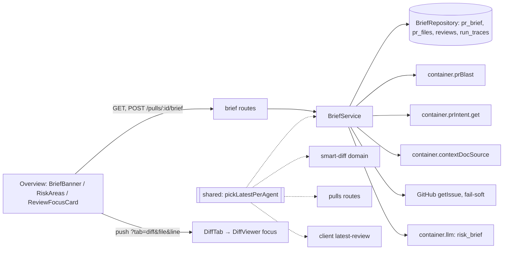

# Development Plan: PR Brief (SPEC-006)
Status: READY · Packages: server, client (+ one e2e flow, edited by test-writer) · Spec: `specs/006-pr-brief.md` (amended 2026-11-10: AC-6, AC-13, AC-29, AC-39, AC-40, AC-48, AC-61, NFR-5 reworded; AC-66, AC-67 added)
Execution mode: multi-agent

## Design references (mockups win on markup, placement and visual structure)
| Mockup (relative to `docs/plans/`) | Screen / state | ACs |
|---|---|---|
| [1-overview-brief.png](../../specs/006-pr-brief/design/1-overview-brief.png) | Overview with a brief: "PR BRIEF" label, three-zone banner, Intent card with Risk areas, Blast radius, Review focus | AC-38…AC-45, AC-50, AC-60…AC-65 |
| [2-files-changed-focus.png](../../specs/006-pr-brief/design/2-files-changed-focus.png) | Files changed after a Review focus click: target card expanded, accent border, scrolled | AC-53…AC-55 |
| [3-risk-expanded.png](../../specs/006-pr-brief/design/3-risk-expanded.png) | One risk expanded: severity outline, explanation panel under the risk list | AC-46, AC-47, AC-62 |

Precedence:
- Markup, placement, grouping and visual structure follow the mockup.
- Texts and behaviour follow the spec's ACs. Where a mockup shows a different string, the spec string wins.
- States the mockups do not show are placed by AC-30…AC-35, AC-37, AC-40, AC-49, AC-51, AC-56 and AC-57. These are: loading, empty, generating, errors, stale, "No review yet", "File not in this PR's diff", a line outside the hunks, and empty lists.
- Non-goal elements are not built: the Tree/Graph toggle, the "Back" button, "PR Leaderboard" / "More screens", and the "summary" badge / "What this does" line.

## Spec corrections applied (checked in the code)
1. The 525 px two-column rule is at `client/src/app/repos/[repoId]/pulls/[number]/_components/OverviewTab/styles.ts:4-12`, not `:38-46`. The spec's other `path:line` references match the code.
2. **AC-13 vs AC-28.** If the model output is validated with `ReviewFocusItem` (`line ≥ 1`), an item with `line: 0` makes the provider re-ask the model and then the API answers 502. That contradicts AC-28, which says such an item is dropped. Applied: the model output schema `PrBriefModelResult` accepts any integer `line`, and AC-28 drops the bad items afterwards. The stored `ReviewFocusItem` keeps `line ≥ 1`.
3. **AC-6 "exactly one model call"** means one `completeStructured` call. Inside that call the adapter re-asks the model up to 2 times when its output fails the schema (`server/src/adapters/llm/openai.ts:90-96`), which AC-13 already allows for.
4. **i18n strings change.** `brief.block.risks` is "Risks" today and becomes "Risk areas". `brief.unavailableHint` is "Run a review or open the PR to compute it." today and becomes the AC-31 text (`client/messages/en/brief.json:5,12`).
5. **New icon.** The icon set has no `Package` icon (`client/src/vendor/ui/icons.tsx:4-84`); it is added for AC-45.
6. **Cross-module access.** The blast-radius read and `extractIssueRef` live inside other modules, and modules may not import each other's internals. So:
   - the blast module gets a small public interface, `container.prBlast`;
   - the brief module keeps its own commented copy of `extractIssueRef` (R1 rejected).
7. **AC-34 vs the global toast.** Every failed mutation shows a toast (`client/src/lib/providers.tsx:41-43`). Resolved by accepted R3: the brief generation is marked silent, so its error shows only inline.

## Decisions (user, 2026-11-10)
- D1 (was Q1): Risk areas are the last block of the Intent card, after the confidence hint and the sources/model footer, behind a horizontal rule.
- D2 (Q2): with no review (AC-40), the banner's left box shows a neutral `FileText` icon in a muted box.
- D3 (Q3): AC-29 drops invented paths first, then keeps the first 6 risks and the first 8 Review focus items.
- D4 (Q4): a risk `file_refs` entry without a line opens `?tab=diff&file=<path>` with no `line`.
- D5 (Q5): a new `BriefBanner` reuses `VERDICT_META`, `CircularScore` and `countOpenCriticals`. `VerdictBanner` and the Agent runs tab stay unchanged.
- D6 (Q6): the banner always shows "N findings · M blockers", even when M is 0.
- Recommendations:
  - R2 accepted: one shared "latest review per agent" function.
  - R3 accepted: the generate mutation skips the global toast.
  - R4 accepted: `promptChars` in the NFR-5 log line.
  - R1 rejected: the brief module keeps its own commented copy of `extractIssueRef`.
- Execution mode: multi-agent.

## Requirements check
| ID | Requirement (short) | Status | Proof | Evidence / note |
|---|---|---|---|---|
| AC-1 | GET, no brief → `{brief:null, stale:false}` | OK | test (T-5) | new route |
| AC-2 | GET returns the stored brief, no model call | OK | test (T-5) | |
| AC-3 | `stale` iff head SHAs differ | OK | test (T-1, T-5) | `schema/pulls.ts:20` |
| AC-4 | 404 for an unknown or foreign PR | OK | test (T-5) | `errors.ts:19` |
| AC-5 | corrupt stored JSON → null | OK | test (T-5) | `safeParse` in `helpers.ts` |
| AC-6 | one call, `risk_brief` model | OK (correction 3) | test (T-5) | `feature-models.ts:51-57` |
| AC-7 | upsert with `head_sha` | OK | test (T-5) | `reviews.ts:67-72` |
| AC-8 | 200 `{brief, stale:false}` | OK | test (T-5) | |
| AC-9 | POST always regenerates | OK | test (T-3) | |
| AC-10 / EC-2 | concurrent POSTs share one model call | OK | test (T-3, T-4) | pattern of `intent/service.ts:54-61` |
| AC-11 | missing key → 500 `config_error`, brief unchanged | OK | test (T-5) | `container.ts:218` |
| AC-12 | failure or timeout → 502, brief unchanged; 60 s timeout | OK | test (T-3, T-5) | |
| AC-13 | invalid output → 502, nothing stored | OK (correction 2) | test (T-5) | |
| AC-14 | rate limits → 429 | OK | test (T-6) | `app.ts:164-167` |
| AC-15 / AC-16 | chosen model / default model | OK | test (T-5) | `platform.ts:58-64` |
| AC-17 | model input only from the listed sections | OK | test (T-2) | |
| AC-18 | no hunk lines in the input | OK | test (T-5) | `patch` is never selected |
| AC-19 / NFR-1 / EC-9 / EC-10 | input budget | OK | test (T-1, T-5) | |
| AC-20 | docs from `specs_read` of the latest runs | OK | test (T-1, T-5) | `run-executor.ts:353`; shared rule (R2) |
| AC-21 / EC-7 / EC-19 | missing docs skipped | OK | test (T-3) | server INSIGHTS 2026-10-09 |
| AC-22 / AC-23 | no intent / no linked issue | OK | test (T-3) | |
| AC-24 | sections wrapped as untrusted + guard | OK | test (T-2) | `reviewer-core/src/prompt.ts:16,30` |
| AC-25…AC-28 / EC-4 / EC-8 | grounding of paths | OK | test (T-1) | |
| AC-29 / EC-6 / NFR-2 | clamp counts and lengths | OK (D3) | test (T-1) | |
| AC-30…AC-33, AC-35…AC-37 | Brief block states | OK | test (T-10) | |
| AC-34 / AC-66 / EC-16 | inline error, no global toast | OK (R3) | test (T-9, T-10) | AC-66 added to the spec 2026-11-10 |
| AC-38…AC-43 / EC-17 / EC-18 | banner | OK (D2, D5, D6) | test (T-10) | |
| AC-44, AC-46…AC-49 | Risk areas | OK | test (T-11) | |
| AC-67 | ref with no line → `?tab=diff&file=<path>`, no `line` | OK (D4) | test (T-11) | AC-67 added to the spec 2026-11-10; AC-48 narrowed to refs with a line |
| AC-45 | severity order, icon by kind, colour | OK | test (T-11) + manual (mockup 1) | |
| AC-50, AC-51 | Review focus | OK | test (T-12) | |
| AC-52 | push `?tab=diff&file&line` | OK | test (T-13) | `usePrDetailUrlState.ts:21` uses `replace` today |
| AC-53…AC-56, AC-58, AC-59 / EC-12, EC-13, EC-15 | Files changed focus | OK | test (T-14) | `RoleGroup.tsx:30`, `FileCard.tsx:54` |
| AC-55 | accent border + highlighted line | OK | test (T-14) + manual (mockup 2) | |
| AC-57 / EC-11 | "File not in this PR's diff" | OK | test (T-11, T-12) | |
| AC-60, AC-61 | section order; Risk areas inside Intent | OK (D1) | test (T-15) + manual (mockup 1) | |
| AC-62…AC-65 | layout | OK | manual (screenshots vs mockups 1/3, plan-verifier) | |
| NFR-3 | GET makes no external call | OK | test (T-5) | |
| NFR-4 | plain text; in-app links only | OK | test (T-11, T-12) | |
| NFR-5 | one log line per generation | OK (R4: + `promptChars`) | test (T-3) | |
| NFR-6 | `aria-expanded`, keyboard access, `role=status` | OK | test (T-11) | |

## Recommendations
- R1: **rejected.** The brief module keeps its own commented copy of `extractIssueRef` (S5).
- R2, R3, R4: **accepted and folded in** (S2, S3, S5, S6, S7, S8; T-3, T-8, T-9, T-10).

## Goal & non-goals (from the spec)
- Goal: an Overview PR Brief block (summary, Risk areas, Review focus).
  - The server generates it with one `risk_brief` model call and caches it per head SHA.
  - Every path in the brief comes from the PR or from the Blast radius map.
  - Clicking a risk or a Review focus item opens Files changed at that file and line.
  - The layout follows the mockups.
- Non-goals:
  - automatic generation, and generating the intent;
  - the Tree/Graph toggle;
  - changes to MCP, CI or review runs;
  - mockup elements outside the brief;
  - marking the brief stale when the model changes;
  - a pixel-exact match with the mockups.
  - This plan also leaves out updating the README API map.

## Context consulted
- server INSIGHTS:
  - 2026-10-28 "PR intent is never generated on GET…". GET is read-only. The service is built once per route plugin and runs one generation at a time per `${ws}:${prId}`.
  - 2026-10-18 "a module that needs another module's function gets it through a `types.ts` facade on the container". The brief module reads `container.prBlast`, `container.prIntent.get` and `container.featureModels`.
  - 2026-10-09 "persisted run traces are never re-parsed". A trace with no `specs_read` is treated as `[]`.
  - Also used: 2026-11-06 (the 429 handler; a rate-limit test needs `nodeEnv: 'development'`); 2026-10-28 (`MockLLMProvider` `structuredBySchema`); 2026-10-17 / 2026-10-12 (latest review per agent; set `createdAt` explicitly in fixtures).
- client INSIGHTS:
  - 2026-10-28 sticky header. The scroll offset uses `var(--pr-header-h)` (AC-54).
  - 2026-10-28 `user-event` is not installed, so tests use `fireEvent`.
  - 2026-10-17 every failed mutation shows a toast. R3 adds `meta.silent` for the brief generation.
  - Also used: 2026-11-06 hidden tooltip; 2026-10-14 Next `<Link>` in vitest; 2026-11-03 route the fetch mock by URL.
- e2e INSIGHTS:
  - 2026-10-07: flow 02 needs a fresh seed, so run it hermetic.
  - 2026-10-28: `find` does not wait, so use `wait --text` only.
  - 2026-11-05: agents can't run e2e flows; the user runs `npm run e2e:hermetic`.
- Rules:
  - `server/AGENTS.md`: a new module is its folder plus one registry line; Zod route schemas; contract changes go into both copies; naming rules.
  - `client/AGENTS.md`: data only through hooks; strings in `messages/en`; each component in `_components/<Name>/` with its own test. It wins over `frontend-architecture` where they overlap.
  - onion `domain-is-pure`: a domain file may import only its own module's domain files, `platform/errors.ts` and `@devdigest/shared`. This is why the R2 shared function lives in `@devdigest/shared`.

## Architecture
**server:** new module `server/src/modules/brief/`.
- Layers: `routes.ts` (presentation) → `service.ts` (application) → `ports.ts`.
- `repository.ts` (infrastructure, Drizzle) implements `BriefStore`.
- Pure logic in `domain.ts`, `constants.ts` and `types.ts`. Mapping and prompt building in `helpers.ts` and `prompt.ts`.
- `wiring.ts` builds the service from:
  - `container.db`, `container.prBlast` and `container.prIntent`;
  - `container.github()` (fail-soft);
  - `container.contextDocSource`, `container.featureModels` and `container.llm()`.
- Changes outside the module:
  - `PrBlastRadius` in `blast/types.ts` and a `prBlast` getter on the container;
  - the R2 shared rule `pickLatestPerAgent` in `@devdigest/shared`, used by brief, smart-diff and pulls.
- No DB schema change.

**client:**
- Hooks in `src/lib/hooks/brief.ts` call `api.ts`.
- `createQueryClient()` moves from `providers.tsx` into `src/lib/query-client.ts`, with the `meta.silent` check.
- New Overview components: `BriefBanner`, `RiskAreas`, `ReviewFocusCard` and `BriefFileLink`. `IntentCard` gets a `children` slot.
- `diff-viewer` gets an optional `focus` prop; the PR URL gains `file` and `line`.
- `lib/latest-review.ts` calls the shared rule.
- `VerdictBanner` is unchanged.

## Skill contract
| File (create/modify) | Skills | Rules the step must satisfy |
|---|---|---|
| `server/src/vendor/shared/contracts/brief.ts`, `client/src/vendor/shared/contracts/brief.ts` (modify) | zod | Schema and type share one name, no `Schema` suffix. `intent` and `history` are `.nullable()`. `ReviewFocusItem.line` is `int().min(1)`. `PrBriefModelResult` has no `.min()`/`.max()`. The two copies are identical. |
| `{server,client}/src/vendor/shared/rules/latest-per-agent.ts` (create), `{server,client}/src/vendor/shared/index.ts` (modify) | zod, onion-architecture | Pure and generic; no Zod or I/O. Input is newest-first. A null or undefined key counts as one group. The two copies are identical. Add one `export *` line and one header-comment line. |
| `server/src/modules/smart-diff/domain.ts`, `server/src/modules/pulls/routes.ts` (modify) | onion-architecture, fastify-best-practices | Delegate to `pickLatestPerAgent`; keep `latestReviewIdsPerAgent`'s name and behaviour. The PR-list output does not change. Comments point to the shared function. |
| `server/src/modules/blast/types.ts`, `server/src/platform/container.ts` (modify) | onion-architecture | The interface lives only in `types.ts`. The getter is cached and built through `buildBlastService(this)`. |
| `server/src/modules/brief/{constants,types,domain}.ts` (create) | onion-architecture, zod | Domain ring: imports only `@devdigest/shared` and its own domain files. Shapes shared with `ports.ts` go in `types.ts`. |
| `server/src/modules/brief/{helpers,prompt}.ts` (create) | onion-architecture, zod | Pure. `safeParse` of the stored JSON. Every section is wrapped with `wrapUntrusted`; the system message includes `INJECTION_GUARD`. |
| `server/src/modules/brief/{ports,service}.ts` (create) | onion-architecture | Ports use contract and module types only. The service never sees the container. Errors are `AppError` subclasses. |
| `server/src/modules/brief/repository.ts` (create) | drizzle-orm-patterns, postgresql-table-design, onion-architecture | The PR lookup is workspace-scoped. Upsert with `onConflictDoUpdate` on `pr_id`. Rows are mapped through `helpers`. `pr_files.patch` is never selected. |
| `server/src/modules/brief/{wiring,routes}.ts`, `server/src/modules/index.ts` | fastify-best-practices, zod, onion-architecture | `schema: { params: IdParams, response: { 200: PrBriefView } }` and `config.rateLimit`. Each handler makes one service call. One registry entry. |
| `client/src/lib/query-client.ts` (create), `client/src/lib/providers.tsx` (modify) | react-best-practices, frontend-architecture | `createQueryClient()` keeps today's behaviour. Mutation `onError` skips the toast iff `mutation.meta?.silent === true`. |
| `client/src/lib/hooks/{brief.ts,query-keys.ts}` | react-best-practices, frontend-architecture | Query key `["pr-brief", prId]`. The generate mutation sets `meta: { silent: true }` and writes the result with `setQueryData` on success. |
| `client/src/lib/latest-review.ts` (modify) | frontend-architecture | Delegate to `pickLatestPerAgent`; keep the name and behaviour (`kind === "review"` only). |
| `…/PrDetailView/hooks/usePrDetailUrlState.ts`, `PrDetailView.tsx` — **mockup 2** | next-best-practices, react-best-practices | `router.push` only for opening a file; validate `file` and `line`; `setTab` drops both. |
| `client/src/components/diff-viewer/{annotations,index,styles}.ts`, `DiffViewer/DiffViewer.tsx`, `FileCard/FileCard.tsx`, `CodeLine/CodeLine.tsx`; `DiffTab/DiffTab.tsx`, `RoleGroup/RoleGroup.tsx`, `RoleGroup/hooks/useGroupFileOpen.ts`; `messages/en/shell.json` — **mockup 2** | frontend-architecture, react-best-practices | New props are optional. `useEffect` only for the scroll (`scrollIntoView?.()`). `scroll-margin-top` uses `var(--pr-header-h)`. No border shorthand mixed with longhands. |
| `client/src/app/repos/[repoId]/pulls/[number]/helpers.ts`, `ReviewRunAccordion/ReviewRunAccordion.tsx`, `ReviewRunAccordion/helpers.ts` (delete) | frontend-architecture | Promote `countOpenCriticals` now that it has a second consumer; no copy left behind. |
| `client/src/vendor/ui/icons.tsx`, `client/messages/en/brief.json` | frontend-architecture | Add `Package`. Strings are exactly the spec's. |
| `OverviewTab/_components/BriefBanner/*` — **mockups 1, 3 (top)** | react-best-practices, frontend-architecture | Three zones (AC-63); early returns per state; helpers outside the component; ≤ 200 lines. |
| `OverviewTab/_components/{BriefFileLink,RiskAreas}/*`, `IntentCard/{IntentCard.tsx,styles.ts}` — **mockups 1, 3** | react-best-practices, frontend-architecture | Plain text only. The chevron is a `<button aria-expanded>`. One expanded risk at a time. Stable severity sort in `helpers.ts`. |
| `OverviewTab/_components/ReviewFocusCard/*` — **mockup 1** | react-best-practices, frontend-architecture | Heading plus accent count badge; rows start with "▸"; model order. |
| `OverviewTab/{OverviewTab.tsx,styles.ts,helpers.ts}` — **mockup 1** | frontend-architecture, next-best-practices | Order per AC-60. The `briefRow` grid is unchanged (AC-65). ≤ 7 props. |
| tests `server/test/{brief-domain,brief-prompt,brief-service,latest-per-agent}.test.ts`, `brief.it.test.ts`, `contracts.test.ts` | fastify-best-practices, drizzle-orm-patterns, zod | Use `app.inject`. Tests that touch Postgres are `*.it.test.ts`. Set `createdAt` explicitly in fixtures. |
| tests `client/**/{BriefBanner,RiskAreas,ReviewFocusCard,OverviewTab,FileCard,DiffTab}.test.tsx`, `usePrDetailUrlState.test.ts`, `src/lib/query-client.test.ts` | react-testing-library | `fireEvent`; `getByRole` first; route the fetch mock by URL; mock `@/lib/toast`. The mockups are inputs for the layout assertions. |

## Steps
### S1 — Contracts in both copies
- Files:
  - `server/src/vendor/shared/contracts/brief.ts` (modify)
  - `client/src/vendor/shared/contracts/brief.ts` (modify)
  - `server/test/contracts.test.ts` (fixture only)
- Change:
  - `ReviewFocusItem {file, line: int ≥ 1, reason}`.
  - `PrBrief {intent: Intent.nullable(), blast, risks, history: PrHistory.nullable(), summary, review_focus}`.
  - `PrBriefRecord = PrBrief.extend({head_sha, generated_at, provider, model, tokens_in: int|null, tokens_out: int|null, cost_usd: number|null})`.
  - `PrBriefView {brief: PrBriefRecord.nullable(), stale}`.
  - `PrBriefModelResult {summary, risks: Risk[], review_focus: {file, line: int, reason}[]}`.
  - Add `summary: 's', review_focus: []` to the `PrBrief.parse` fixture at `contracts.test.ts:138`. No assertion changes.
- Covers: Contracts, AC-8, AC-13 · Skills: zod · Depends on: —
- Done when: the two files are identical and the new types are exported.
- Verify: `diff server/src/vendor/shared/contracts/brief.ts client/src/vendor/shared/contracts/brief.ts && cd server && pnpm typecheck && pnpm exec vitest run --exclude '**/*.it.test.ts' && cd ../client && pnpm typecheck`

### S2 — Shared "latest review per agent" rule (R2)
- Files:
  - `{server,client}/src/vendor/shared/rules/latest-per-agent.ts` (create)
  - `{server,client}/src/vendor/shared/index.ts` (modify)
- Change: `export function pickLatestPerAgent<T>(newestFirst: readonly T[], groupKey: (item: T) => string | null | undefined): T[]`. It keeps the first item per key and treats a null or undefined key as `''`. Add `export * from './rules/latest-per-agent.js'` to both index files, and a line for it in the header comment.
- Covers: AC-20 (R2) · Skills: zod, onion-architecture · Depends on: —
- Done when: both copies are identical and the function is exported from `@devdigest/shared` in both packages.
- Verify: `diff -r server/src/vendor/shared/rules client/src/vendor/shared/rules && cd server && pnpm typecheck && cd ../client && pnpm typecheck`

### S3 — Server callers use the shared rule (R2)
- Files: `server/src/modules/smart-diff/domain.ts`, `server/src/modules/pulls/routes.ts` (modify).
- Change:
  - `latestReviewIdsPerAgent(heads)` becomes `pickLatestPerAgent(heads, (h) => h.agentId).map((h) => h.id)`.
  - In `pulls/routes.ts:158-169`, the `seenAgents` loop becomes `pickLatestPerAgent(reviewRows, (rv) => \`${rv.prId}:${rv.agentId ?? ''}\`)` to fill `prByAgentLatestReview`. `latestReviewByPr` stays as it is.
  - Update the "three copies" comments to point to `@devdigest/shared`.
- Covers: AC-20 (R2) · Skills: onion-architecture, fastify-best-practices · Depends on: S2
- Done when: no hand-written per-agent dedupe loop is left in `pulls/routes.ts` or `smart-diff/domain.ts`.
- Verify: `cd server && pnpm typecheck && pnpm exec vitest run --exclude '**/*.it.test.ts'`. `smart-diff-domain.test.ts` must stay green.

### S4 — Blast interface on the container
- Files: `server/src/modules/blast/types.ts`, `server/src/platform/container.ts` (modify).
- Change:
  - `export interface PrBlastRadius { get(workspaceId, prId): Promise<{ blast: BlastRadius; source: BlastSource }> }`.
  - Cached getter `get prBlast(): PrBlastRadius { return (this._prBlast ??= buildBlastService(this)); }`.
- Covers: AC-17, AC-25 · Skills: onion-architecture · Depends on: —
- Done when: `BlastService` satisfies `PrBlastRadius`.
- Verify: `cd server && pnpm typecheck && pnpm exec vitest run --exclude '**/*.it.test.ts'`

### S5 — Brief domain, prompt, constants
- Files: `server/src/modules/brief/{constants,types,domain,helpers,prompt}.ts` (create).
- Change:
  - `constants.ts`: the NFR-1 and NFR-2 limits, plus `MAX_RISKS=6`, `MAX_FOCUS=8`, `MAX_CONTEXT_DOCS=5`, `MAX_CALLERS=50`, `MAX_STAT_FILES=100`, `MAX_INPUT_CHARS=40_000`, `BRIEF_TIMEOUT_MS=60_000`.
  - `domain.ts`:
    - `isBriefStale(brief, headSha)`.
    - `latestRunIdsPerAgent(heads)`, built on `pickLatestPerAgent`.
    - `pickContextDocPaths(specsReadNewestFirst)`: dedupe, at most 5.
    - `extractIssueRef`: a copy of intent's, with a comment naming `intent/domain.ts:67` (R1 rejected).
    - `allowedBriefPaths(files, blast)` and `parseFileRef(ref)`.
    - `groundBriefOutput(out, allowed)` → `{risks, reviewFocus, droppedRisks, droppedFocus}`. It drops invented paths first, then clamps (D3).
    - `formatDiffStats` (at most 100 files, then "+N more files"), `formatBlastSection`, `formatIntentSection`.
    - `fitInputBudget(sections, systemChars)`: shortens documents first, then callers, then the file list.
  - `helpers.ts`: `toPrBriefRecord(json: unknown): PrBriefRecord | undefined`.
  - `prompt.ts`: `buildBriefMessages(sections)`.
- Covers: AC-3, AC-5, AC-17…AC-20, AC-22…AC-29, NFR-1, NFR-2 · Skills: onion-architecture, zod · Depends on: S1, S2
- Done when: all of these are exported and pure.
- Verify: `cd server && pnpm typecheck && pnpm exec vitest run --exclude '**/*.it.test.ts'`

### S6 — Brief store, service, routes, registration
- Files: `server/src/modules/brief/{ports,repository,service,wiring,routes}.ts` (create); `server/src/modules/index.ts` (modify).
- Change:
  - `BriefRepository`:
    - `getPullSources(ws, prId)`: title, body, headSha; repo owner, name, fullName and clonePath; `pr_files` path, additions and deletions (never the patch).
    - `getBrief(prId)`.
    - `listReviewRunsForPull(prId)`: `kind='review'`, newest first, `{agentId, runId}`.
    - `listSpecsReadForRuns(runIds)`: reads `trace->'specs_read'`; missing means `[]`.
    - `upsertBrief`.
  - `BriefService.get`: 404 when the PR is not found; reads the brief and sets `stale`. No GitHub or model call.
  - `BriefService.generate`, one in-flight generation per `${ws}:${prId}`:
    - Gathers context:
      - blast radius, from `prBlast`;
      - the intent, from `prIntent.get` → `Intent | null`;
      - the linked issue, fail-soft;
      - project-context docs, through `contextDocSource.read` (only `ok` counts).
    - Builds the messages and makes one model call. An `AppError` passes through; anything else becomes an `ExternalServiceError`.
    - Grounds the output and upserts the record: `head_sha` is read before the call, `history: null`.
    - Logs once: provider, model, `tokensIn`, `tokensOut`, `costUsd`, `droppedRisks`, `droppedFocus` and **`promptChars`** (R4).
    - Returns `{brief, stale:false}`.
  - `wiring.ts`: `buildBriefService(container, log)`. It resolves `'risk_brief'` and calls `completeStructured` with `schema: PrBriefModelResult`, `schemaName: 'PrBrief'`, `timeoutMs: BRIEF_TIMEOUT_MS`.
  - Routes:
    - `GET /pulls/:id/brief`: rate limit 30/min.
    - `POST /pulls/:id/brief`: rate limit 10/min, no body schema.
    - The service is built once in the plugin.
- Covers: AC-1…AC-16, AC-18, AC-20, AC-21, AC-23, NFR-3, NFR-5 · Skills: fastify-best-practices, drizzle-orm-patterns, postgresql-table-design, onion-architecture, zod · Depends on: S4, S5
- Done when: both routes are registered, `pr_brief` is the only table the module writes, and no query selects `patch`.
- Verify: `cd server && pnpm typecheck && pnpm exec vitest run --exclude '**/*.it.test.ts'`

### S7 — Client query client and hooks (R3)
- Files:
  - `client/src/lib/query-client.ts` (create)
  - `client/src/lib/providers.tsx` (modify)
  - `client/src/lib/hooks/brief.ts` (create)
  - `client/src/lib/hooks/query-keys.ts` (modify)
- Change:
  - `createQueryClient()` moves out of `providers.tsx` unchanged, except `MutationCache.onError: (err, _v, _c, mutation) => { if (mutation.meta?.silent === true) return; notify.error(errorMessage(err)); }`.
  - `queryKeys.prBrief`.
  - `usePrBrief(prId)` (GET; enabled only when `prId` is set).
  - `useGeneratePrBrief(prId)`: POST with `meta: { silent: true }`; on success, `setQueryData`.
- Covers: AC-34, AC-36, AC-41, AC-66 · Skills: react-best-practices, frontend-architecture · Depends on: S1
- Done when: `providers.tsx` builds its client only through `createQueryClient()`; the hooks are exported.
- Verify: `cd client && pnpm typecheck && pnpm test`

### S8 — Shared client pieces
- Files:
  - `client/src/lib/latest-review.ts` (call `pickLatestPerAgent`, R2)
  - `[number]/helpers.ts` (+`countOpenCriticals`)
  - `ReviewRunAccordion/ReviewRunAccordion.tsx` (import)
  - `ReviewRunAccordion/helpers.ts` (delete)
  - `ReviewRunAccordion/helpers.test.ts` (import path only)
  - `client/src/vendor/ui/icons.tsx` (+`Package`)
  - `client/messages/en/brief.json`
- Change: `brief.json` keys:
  - `label`: "PR brief"
  - `unavailableHint`: "Generate a brief to see a summary, risk areas and review focus."
  - `generate`: "Generate brief" · `generating`: "Generating brief…" · `refresh`: "Refresh brief"
  - `stale`: "PR changed since the brief" · `noReview`: "No review yet"
  - `modelHint`: "If this keeps failing, check the Risk Brief model in Settings → Models."
  - `loadErrorTitle`: "Couldn't load the PR brief"
  - `fromLatestReview`: "From the latest review · {agent} · {date}" · `reviewInfo`: "About these counts"
  - `block.risks`: "Risk areas" · `risk.expand` / `risk.collapse`: "Show / Hide details: {title}"
  - `focus.title`: "Review focus — read these first" · `noFocus`: "No focus points." · `notInDiff`: "File not in this PR's diff"
- Covers: AC-20 (R2), AC-31, AC-33, AC-34, AC-37, AC-40, AC-43, AC-45, AC-49…AC-51, AC-57, AC-61, AC-64 · Skills: frontend-architecture · Depends on: S2
- Done when: there is no second copy of `countOpenCriticals` and no hand-written dedupe loop in `latest-review.ts`.
- Verify: `cd client && pnpm typecheck && pnpm test`. `latest-review.test.ts` must stay green.

### S9 — URL state for file/line navigation
- Files: `…/PrDetailView/hooks/usePrDetailUrlState.ts`, `PrDetailView.tsx` (modify).
- Change:
  - `focus = {path, line|null}` is read only when `tab=diff`; `line` must be an integer ≥ 1.
  - `fileHref(path, line|null)` builds `routes.pull(...)` with `tab=diff&file&line`; a `<Link>` to it pushes a new history entry.
  - `clearFocus()` uses `replace`.
  - `setTab` drops `file` and `line`.
  - `focus` and `clearFocus` are passed to `DiffTab`.
- Covers: AC-52, AC-55, AC-58 · Skills: next-best-practices, react-best-practices · Depends on: — · **Mockup:** [2-files-changed-focus.png](../../specs/006-pr-brief/design/2-files-changed-focus.png)
- Done when: links use `fileHref`, and `setTab` keeps no `file`/`line`.
- Verify: `cd client && pnpm typecheck && pnpm test`

### S10 — Diff focus: expand, scroll, highlight
- Files:
  - `client/src/components/diff-viewer/{annotations.ts,index.ts,styles.ts,DiffViewer/DiffViewer.tsx,FileCard/FileCard.tsx,CodeLine/CodeLine.tsx}`
  - `DiffTab/DiffTab.tsx`, `RoleGroup/RoleGroup.tsx`, `RoleGroup/hooks/useGroupFileOpen.ts`
  - `client/messages/en/shell.json` (modify)
- Change:
  - Export a `DiffFocus` type.
  - `DiffTab` passes `focus` on only when its path is among `files` (AC-58), in both smart and original order (AC-59).
  - The target's role group and file card start open, even when collapsed by default. They are remounted via `key` when the target changes.
  - The focused `FileCard`:
    - gets an accent border and `data-testid="diff-file-focused"`;
    - in an effect, scrolls the target line, or else the card top, into view with `scroll-margin-top: calc(var(--pr-header-h, 0px) + 8px)`;
    - when the line is outside every hunk, shows `shell.diffViewer.lineOutsideHunks` = "Line {line} is outside the diff hunks.".
  - `CodeLine` highlights the row where `newNo === line` and gives it `data-testid="diff-line-target"`.
  - Opening another file card calls `onFocusClear`.
- Covers: AC-53…AC-56, AC-58, AC-59, EC-12, EC-13, EC-15 · Skills: frontend-architecture, react-best-practices · Depends on: S9 · **Mockup:** [2-files-changed-focus.png](../../specs/006-pr-brief/design/2-files-changed-focus.png)
- Done when: existing callers compile unchanged, **and the rendered page has been compared with mockup 2** (card expanded, accent border, line visible below the header).
- Verify: `cd client && pnpm typecheck && pnpm test`

### S11 — BriefBanner
- Files: `OverviewTab/_components/BriefBanner/{BriefBanner.tsx,helpers.ts,styles.ts,index.ts}` (create; split into `_components/` if it passes 200 lines).
- Change: a `<section aria-label="PR brief">` that uses `usePrBrief`, `useGeneratePrBrief` and `usePrReviews`.
  - States:
    - loading: skeleton with `aria-busy`;
    - empty: text, hint and the "Generate brief" button;
    - load error: `ErrorState` with retry;
    - generating: both buttons disabled, labelled "Generating brief…";
    - generate error: the API message and the model hint inline only (R3), with the previous brief kept.
  - Ready state, in three zones (AC-63):
    - left: the verdict icon box (`VERDICT_META`, or the neutral box per D2);
    - middle: a title row (verdict, the "N findings · M blockers" badge per D6, an "i" button with a `role=tooltip` hidden and linked by `aria-describedby`, the stale badge) above the summary;
    - right: an icon-only refresh `Button` (aria-label "Refresh brief") and `CircularScore` with "PR SCORE" (hidden when the score is null). Below them, behind a divider, a right-aligned cost line `formatCost tokens_in→tokens_out`, hidden when all three values are null.
  - `helpers.ts`: `newestVerdictReview`, `formatTokenFlow`.
- Covers: AC-30…AC-43, AC-66, EC-16…EC-18 · Skills: react-best-practices, frontend-architecture · Depends on: S7, S8 · **Mockups:** [1-overview-brief.png](../../specs/006-pr-brief/design/1-overview-brief.png), [3-risk-expanded.png](../../specs/006-pr-brief/design/3-risk-expanded.png) (top)
- Done when: **the rendered banner has been compared with mockup 1** (zones, divider, cost line placement).
- Verify: `cd client && pnpm typecheck && pnpm test`

### S12 — Risk areas inside the Intent card
- Files:
  - `OverviewTab/helpers.ts` (create: `parseFileRef`, `isInDiff`)
  - `OverviewTab/_components/BriefFileLink/*` (create)
  - `OverviewTab/_components/RiskAreas/{RiskAreas.tsx,constants.ts,helpers.ts,styles.ts,index.ts}` (create)
  - `IntentCard/{IntentCard.tsx,styles.ts}` (modify)
- Change:
  - `IntentCard`: a `children` slot rendered last, after a horizontal rule (D1), and `aria-label="Intent"` on its section.
  - `BriefFileLink`: a `<Link href>` when the file is in the diff. Otherwise a button that looks the same and, on click, shows a `role="status"` message.
  - `RiskAreas`:
    - the heading uses the uppercase label style with an `AlertTriangle` icon;
    - risks are sorted by severity, keeping model order within a severity;
    - kind → icon map in `constants.ts`; severity colours: high `var(--crit)`, medium `var(--warn)`, low `var(--text-secondary)`;
    - each risk is a bordered box sized to its content: icon and title above the first file link, then a vertical divider and a chevron `<button aria-expanded aria-label>`;
    - one risk expanded at a time: its box gets a severity-coloured outline, and a panel under the list shows the explanation and all its file refs;
    - with no risks, it shows `noRisks`.
- Covers: AC-44…AC-49, AC-57, AC-61, AC-62, AC-67, NFR-4, NFR-6 · Skills: react-best-practices, frontend-architecture · Depends on: S8, S9 · **Mockups:** [1-overview-brief.png](../../specs/006-pr-brief/design/1-overview-brief.png), [3-risk-expanded.png](../../specs/006-pr-brief/design/3-risk-expanded.png)
- Done when: **compared with mockups 1 and 3** (stacked fit-content boxes, panel below the list).
- Verify: `cd client && pnpm typecheck && pnpm test`

### S13 — ReviewFocusCard
- Files: `OverviewTab/_components/ReviewFocusCard/{ReviewFocusCard.tsx,styles.ts,index.ts}` (create).
- Change: a `<section aria-label="Review focus — read these first">` with a `ListChecks` heading and an accent count `Badge`. Each row is "▸", a `BriefFileLink` for `file:line`, then " — reason", in model order. With no items, it shows `noFocus`.
- Covers: AC-50…AC-52, AC-57, AC-64 · Skills: react-best-practices, frontend-architecture · Depends on: S12 · **Mockup:** [1-overview-brief.png](../../specs/006-pr-brief/design/1-overview-brief.png)
- Done when: **compared with mockup 1**.
- Verify: `cd client && pnpm typecheck && pnpm test`

### S14 — Overview composition
- Files: `OverviewTab/{OverviewTab.tsx,styles.ts}`, `PrDetailView.tsx` (modify).
- Change:
  - New props `files: PrFile[]` and `fileHref`.
  - Order: `SectionLabel icon="FileText"` "PR brief" → `BriefBanner` → `briefRow` (`IntentCard` with `RiskAreas` as its children, then `BlastRadiusCard`) → `ReviewFocusCard` → Description.
  - `RiskAreas` and `ReviewFocusCard` render only when a brief exists (AC-32).
  - The `briefRow` grid is unchanged.
- Covers: AC-32, AC-60, AC-61, AC-65 · Skills: frontend-architecture, next-best-practices · Depends on: S11…S13 · **Mockup:** [1-overview-brief.png](../../specs/006-pr-brief/design/1-overview-brief.png)
- Done when: **the Overview in a running stack has been compared with mockup 1, and with a narrow window (AC-65)**, and "Recalculate" and "Limited data" still render.
- Verify: `cd client && pnpm typecheck && pnpm test`

## Cross-cutting
- Contracts: `brief.ts`, `rules/latest-per-agent.ts` and `index.ts` in both vendored copies (S1, S2). Check them with `diff`.
- DB / migrations: none (`pr_brief` already exists).
- e2e flows: `e2e/specs/02-repo-pulls-detail.flow.json`. Its existing waits stay valid; T-16 adds the waits for the empty-brief state.
- i18n: `brief.json`, `shell.json`.
- Dependencies: none.

## Tests (test-writer)
| T | Proves | Pattern → shape | Seam | Kind | File | Observable · fakes | Needs |
|---|---|---|---|---|---|---|---|
| T-1 | AC-3, AC-19, AC-20, AC-25…AC-29, EC-4, EC-6, EC-8…EC-10, NFR-1, NFR-2 | Ubiquitous / Unwanted → invariants + negative inputs | `brief/domain.ts` | unit | `server/test/brief-domain.test.ts` (create) | An invented ref is removed and a risk with no refs left is dropped. An item with `line:0` is dropped. 7 risks → 6 and 9 items → 8, counted after dropping (D3). Texts are cut to 600 / 100 / 800 / 200. Docs come newest run first, deduped, at most 5. 101 files → 100 + "+1 more files". The budget stays ≤ 40 000 and shortens documents first. | S5 |
| T-2 | AC-17, AC-24 | Ubiquitous | `buildBriefMessages` | unit | `server/test/brief-prompt.test.ts` (create) | Every section sits inside `<untrusted source=…>`. The system message contains `INJECTION_GUARD`. There is no commits or branch section. | S5 |
| T-3 | AC-9, AC-10, AC-12, AC-21…AC-23, EC-16, NFR-5 | Unwanted → stubbed port failures | `BriefService` + in-test fake ports | unit | `server/test/brief-service.test.ts` (create) | Two concurrent `generate` calls → the model fake runs once and both get the same result. A fresh (not stale) brief still regenerates. The model fake throws or times out → `ExternalServiceError` and `upsertBrief` is not called. With no intent, issue or docs, those sections are missing and `intent: null`. The log fake is called once with provider, model, tokens, cost, the dropped counts and `promptChars` (R4). | S6 |
| T-4 | AC-10 (HTTP), EC-2 | Event → parallel `inject` | `POST /pulls/:id/brief` | it | in T-5's file | Both answers are 200 with the same `generated_at`; one `completeStructured` call. | — |
| T-5 | AC-1…AC-8, AC-11, AC-13, AC-15, AC-16, AC-18…AC-20, NFR-3, EC-3, EC-14 | Event / Unwanted | routes via `app.inject` | it | `server/test/brief.it.test.ts` (create) | GET with no brief → 200 `{brief:null,stale:false}`. GET → 0 model calls and 0 `getIssue` calls (a `MockGitHubClient` subclass counts them). Unknown or other-workspace PR → 404 `not_found` on GET and POST. Corrupt `json` → `brief: null`. One `completeStructured` call with `gpt-4.1`, or with the model set in settings. The row is upserted with the PR's `head_sha`; after `head_sha` changes, `stale` is true. No API key → 500 `config_error` and the row is unchanged. A fixture that fails the schema → 502 and no row. `timeoutMs === 60000`. A marker line in `pr_files.patch` is absent from the messages. Total characters ≤ 40 000 with a huge PR body. Docs come from `run_traces.specs_read` through an in-test `contextDocSource` override, and the latest-per-agent selection uses explicit `createdAt`. | — |
| T-6 | AC-14 | Unwanted → negative | routes, `nodeEnv: 'development'` | it | in T-5's file | The 11th POST in a minute → 429 `rate_limited`; the 31st GET → 429. | — |
| T-7 | S1 contracts | Ubiquitous | Zod | unit | `server/test/contracts.test.ts` (modify) | `ReviewFocusItem` rejects `line:0`. `PrBriefModelResult` accepts it. `PrBriefRecord` parses with `intent:null, history:null`. | S1 |
| T-8 | AC-20 (R2 rule) | Ubiquitous → several inputs | `pickLatestPerAgent` | unit | `server/test/latest-per-agent.test.ts` (create) | Newest-first input gives the first item per agent. Null and undefined agents form one group. A composite key (`prId:agentId`) groups per PR. Existing `smart-diff-domain.test.ts`, `client/src/lib/latest-review.test.ts` and the PR-list cases in `reviews.it.test.ts` stay green unchanged. | S2, S3, S8 |
| T-9 | AC-34, AC-66 (R3) | Optional feature → silent on / off | `createQueryClient()` | unit | `client/src/lib/query-client.test.ts` (create) | With `vi.mock("@/lib/toast")`: a failing mutation with `meta.silent` → `notify.error` not called; a failing mutation without it → called once with the message. | S7 |
| T-10 | AC-30…AC-43, AC-66, EC-16…EC-18 | State / Event | `BriefBanner` | component | `…/BriefBanner/BriefBanner.test.tsx` (create) | Loading has `aria-busy`. Empty: "Brief not available yet.", the hint and a "Generate brief" button. While pending, both buttons are disabled and read "Generating brief…". A failed POST shows the API message and "If this keeps failing, check the Risk Brief model in Settings → Models.", keeps the old summary, and shows no toast (built with `createQueryClient()`, toast mocked). A failed GET shows a retry button. No POST on mount. Stale badge. The summary text. "Request changes", "6 findings · 2 blockers" and the score of the newest review with a verdict. With no review, "No review yet" and no score. The cost line shows, and hides when all values are null. The tooltip on focus reads "From the latest review · {agent} · {date}". The fetch mock is routed by URL. Layout input: mockup 1. | S11 |
| T-11 | AC-44…AC-49, AC-57, AC-67, NFR-4, NFR-6 | Event | `RiskAreas` | component | `…/RiskAreas/RiskAreas.test.tsx` (create) | Titles appear high → medium → low, keeping model order within a severity. The chevron's `aria-expanded` toggles and the panel shows the explanation and all refs. Expanding another risk collapses the first. A ref link's `href` contains `tab=diff&file=…&line=12`. A ref with no line (`path` only) → `href` has `tab=diff&file=…` and no `line` (AC-67). A ref not in the diff → `role=status` "File not in this PR's diff". Empty → "No notable risks flagged.". HTML in the explanation renders as text. Layout input: mockups 1 and 3. | S12 |
| T-12 | AC-50…AC-52, AC-57 | Event | `ReviewFocusCard` | component | `…/ReviewFocusCard/ReviewFocusCard.test.tsx` (create) | Count badge "4". Rows read "src/config.ts:12 — reason" in model order. `href` contains `line=12`. A file not in the diff → the status message. Empty → "No focus points.". Layout input: mockup 1. | S13 |
| T-13 | AC-52, AC-55 (tab), AC-58 (parse) | Event | `usePrDetailUrlState` (mocked `next/navigation`) | unit | `…/PrDetailView/hooks/usePrDetailUrlState.test.ts` (create) | `fileHref` builds `?tab=diff&file&line`. `setTab` uses `replace` and drops `file`/`line`. `line=0` or `line=abc` → `line: null`. | S9 |
| T-14 | AC-53…AC-56, AC-58, AC-59, EC-12, EC-13, EC-15 | Event / Unwanted | `DiffTab` (smart + original order), `FileCard` | component | `DiffTab.test.tsx`, `FileCard.test.tsx` (modify) | A file with > 200 changed lines in the docs group opens. `diff-file-focused` and `diff-line-target` are present. A stubbed `scrollIntoView` is called on the target line. A line outside the hunks → "Line 99 is outside the diff hunks.". A foreign `file` → no marker and no scroll. Results are the same in original order. Layout input: mockup 2. | S10 |
| T-15 | AC-32, AC-60, AC-61 | Ubiquitous → order invariant | `OverviewTab` | component | `…/OverviewTab/OverviewTab.test.tsx` (create) | Regions appear in document order: "PR brief", then "Intent" / "Blast radius", then "Review focus — read these first", then Description. "Risk areas" is inside the "Intent" region. With no brief, neither Risk areas nor Review focus is present. Layout input: mockup 1. | S14 |
| T-16 | AC-31 (e2e) | State | flow 02 | e2e | `e2e/specs/02-repo-pulls-detail.flow.json` (modify) | After the "Limited data" step, `wait --text "Brief not available yet."` then `wait --text "Generate brief"`. Never click it (no model call). The user runs `npm run e2e:hermetic`. | S14 |
| — | AC-45 (colour/icon), AC-55 (visual), AC-62…AC-65 | manual | plan-verifier: headless-Chrome screenshots vs **mockups 1–3** (see Design references) | manual | — | Zones, borders, panel placement, stacking below 1066 px. | — |

### Existing tests affected
| Test file | Why | Change |
|---|---|---|
| `server/test/contracts.test.ts` | the `PrBrief` fixture lacks `summary` and `review_focus` | compile/fixture (implementer, S1); new assertions in T-7 |
| `client/src/app/repos/[repoId]/pulls/[number]/_components/ReviewRunAccordion/helpers.test.ts` | `./helpers` is deleted | compile (implementer, S8: the import becomes `../../helpers`) |
| `server/test/smart-diff-domain.test.ts`, `server/test/reviews.it.test.ts` (PR list), `client/src/lib/latest-review.test.ts` | R2 refactor; names and behaviour are kept | none: they must stay green (regression guard in T-8) |

## Verification (per package)
- server: `cd server && pnpm typecheck && pnpm exec vitest run --exclude '**/*.it.test.ts' && pnpm exec vitest run .it.test`
- contracts: `diff server/src/vendor/shared/contracts/brief.ts client/src/vendor/shared/contracts/brief.ts && diff -r server/src/vendor/shared/rules client/src/vendor/shared/rules`
- client: `cd client && pnpm typecheck && pnpm test`
- e2e: `cd e2e && npm run typecheck`; the user runs `npm run e2e:hermetic`
- manual: open the three mockups (Design references) and compare screenshots of:
  - the Overview with a brief;
  - the Overview with a risk expanded;
  - Files changed after a Review focus click.

## Execution mode: multi-agent
| Workstream | Agent | Steps / T rows | Package | Depends on | Parallel with |
|---|---|---|---|---|---|
| W1 | implementer | S1, S2 (foundation: both vendored shared copies) | server + client | — | — |
| W2 | implementer | S3–S6 | server | W1 | W3 |
| W3 | implementer | S7–S14 | client | W1 | W2 |
| W4 | test-writer | T-1…T-8 | server | W2, plus W3 for T-8's client regression check | W5, W6 |
| W5 | test-writer | T-9…T-15 | client | W3 | W4, W6 |
| W6 | test-writer | T-16 | e2e | W3 | W4, W5 |

Then the reviewers and the fix loop inside `/run-plan`. Workstreams that run in parallel are in different packages and share no files. `plan-verifier` is run manually afterwards.

## Handoff to reviewers
- Architecture:
  - the new `prBlast` getter on the container;
  - the brief module reading `reviews` and `run_traces`;
  - **R2**: a pure function in the shared kernel (`@devdigest/shared/rules`), the first function there; it is used by brief, smart-diff, pulls and the client;
  - the commented `extractIssueRef` copy (R1 rejected);
  - the optional focus API on the shared `diff-viewer`;
  - **R3**: `createQueryClient()` extracted, with the `meta.silent` check;
  - `countOpenCriticals` promoted to the PR-detail helpers.
- Security:
  - Untrusted PR title, body, issue, docs and intent go into the prompt, wrapped with `wrapUntrusted` and `INJECTION_GUARD`, under size caps.
  - Model output goes to the DB and the UI: paths are checked against the allowed paths, counts and lengths are clamped, text renders as plain text, and links are built only from the PR's own files.
  - Clone docs are read through `CloneDocSource`, which never follows symlinks or leaves the clone.
  - `file` and `line` URL params are validated against the PR's files.
  - New per-route rate limits.
  - Provider keys come only from `SecretsProvider`.
  - The silent-toast flag only hides a duplicate message; the inline error is still shown.

## Risks & open questions
- AC-62…AC-65 and the AC-45 colours can only be checked by eye against the mockups (manual, plan-verifier).
- OpenAI strict JSON-schema mode has not been tried with `PrBriefModelResult`. It goes through the same `toJsonSchema` path as the existing review schema.
- `prIntent.get` also computes the intent fingerprint, which reads linked docs from the clone: extra file reads, but no model call.
- R2 puts the first function into the vendored contracts package. The header says that package is for contracts, and `reviewer-core` compiles against the server copy, so `reviewer-core` typecheck runs through the server typecheck.
- Two INSIGHTS entries that say the rule has "three copies" (server 2026-10-17, client 2026-10-17 pointer) become outdated. `engineering-insights` should append a superseding entry after the run.
- Agents can't run e2e flows: T-16 is only typechecked inside the run, and the user runs `npm run e2e:hermetic` before commit.
