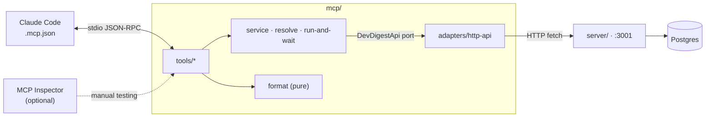

# @devdigest/mcp — `devdigest-mcp`

Local MCP server (stdio) that lets Claude Code review PRs through DevDigest. It is a **thin client of the running
HTTP API** (`server/`): the API runs the reviews, keeps the DB and streams the live log in the UI. **The API must be
running** (`./scripts/dev.sh`), otherwise every tool returns an error that says how to start it.



## Tools

Registered in this order (Claude Code shows them as `mcp__devdigest__<name>`). A PR is addressed as
`repo="owner/name"` + `pr=<number>`; the PR must already be imported (open the repo's Pull requests list in the UI).

| Tool | Args | What it does |
|---|---|---|
| `list_agents` | — | Agents (id, name, enabled, model). Call first. |
| `run_agent_on_pr` | `repo`, `pr`, `agent` | Runs one agent, waits up to ~110 s, returns verdict, score, findings. Spends LLM credits. After the timeout returns `status: "running"` + `run_id`; then call `get_findings`. A run already in flight is re-attached, not duplicated. |
| `get_findings` | `repo`, `pr`, `agent` | Latest finished review of that agent. Read-only, free. |
| `get_conventions` | `repo` | Extracted house rules with `path:a-b` evidence. Does not start a scan. |
| `get_blast_radius` | `repo`, `pr` | Impact map of the PR from the repo index: changed symbols, callers (`file:line`), endpoints and crons. Read-only, no LLM; primes the PR like the UI does. At most 20 symbols / 60 callers. When the repo is unindexed the result carries `degraded` + a `note` (Resync in the DevDigest UI). |

`agent` is an id or an exact name (case-insensitive) from `list_agents`.

A review response stays within 20 000 JSON characters (`RESPONSE_MAX`). Up to 30 findings are returned, CRITICAL
first. Rationales share whatever budget is left by severity: CRITICAL ones in full first, then WARNING, then
SUGGESTION. Within one severity the budget is split evenly: short rationales stay whole and the long ones get equal
shares. Every finding is guaranteed at least 100 characters of rationale. When anything is shortened, `note` says so.

## Environment

| Variable | Default | Meaning |
|---|---|---|
| `DEVDIGEST_API_URL` | `http://localhost:3001` | API base URL |
| `DEVDIGEST_MCP_RUN_TIMEOUT_MS` | `110000` | How long `run_agent_on_pr` waits |
| `DEVDIGEST_MCP_POLL_MS` | `3000` (min `1000`) | Run polling interval |

## Commands

```sh
npm install
npm start            # stdio server (what the root .mcp.json runs)
npm run typecheck
npm test             # API mocked; no Docker, no LLM
```

The root [`.mcp.json`](../.mcp.json) registers the server for Claude Code (project scope; Claude asks for approval).

## Testing with MCP Inspector (recommended, optional)

Inspector is a manual tool: not a dependency, not used by tests or CI.

**Quick start (web UI)** — from the repo root, with the API already up (`./scripts/dev.sh --no-client`):

```sh
./scripts/mcp-inspector.sh          # web UI on http://127.0.0.1:6274 — open the URL with the token it prints
./scripts/mcp-inspector.sh --tui    # extra flags go to Inspector as is
```

The script checks Node ≥ 22.19, runs `npm ci` in `mcp/` if deps are missing, warns when the API at
`http://localhost:3001/health` is down, then runs Inspector 2.13.0 with `inspector.json`. It starts only Inspector and
the MCP server it spawns. `./scripts/dev.sh` never starts either of them. In the UI, connect to `devdigest` and list its
tools. Ctrl-C stops both. Everything below is what the script runs, done by hand.

- Needs Node ≥ 22.19. Run from `mcp/` with the version pinned in the command (bare `npx` resolves latest):
  `npx @modelcontextprotocol/inspector@2.13.0 --config inspector.json`
- [`inspector.json`](inspector.json) is Inspector-only: it launches `node_modules/.bin/tsx src/index.ts` directly
  (no npm wrapper on stdout) and sets `requestTimeout: 150000`, longer than the 110 s `run_agent_on_pr` wait.
  `--config` opens the file read-only, so nothing is written to `~/.mcp-inspector/secrets.json`. Paths are relative
  to `mcp/`.
- Three modes:
  - web UI: `--config inspector.json` (127.0.0.1:6274, token in the launch banner);
  - TUI: `--tui --config inspector.json`;
  - CLI: `--cli --config inspector.json --server devdigest --method initialize | tools/list [--strict] | tools/call --tool-name <name> --tool-args-json '{...}'`.
- Check: `instructions`, descriptions, schemas, annotations, `tools/list` size, schema portability (`--strict`),
  forward-leading errors.
- Exit codes: 0 ok · 1 usage/unexpected · 4 unreachable · 5 tool error · 6 `--strict` failure.
- Verify the committed Claude Code entry from the repo root (this also proves `npm --silent` writes nothing to stdout):
  `npx @modelcontextprotocol/inspector@2.13.0 --cli --config .mcp.json --server devdigest --method tools/list`
  (from `mcp/` use `--config ../.mcp.json`).
- Safety: never use `DANGEROUSLY_OMIT_AUTH`, never bind `0.0.0.0`, no `--catalog`. `run_agent_on_pr` spends LLM
  credits.
