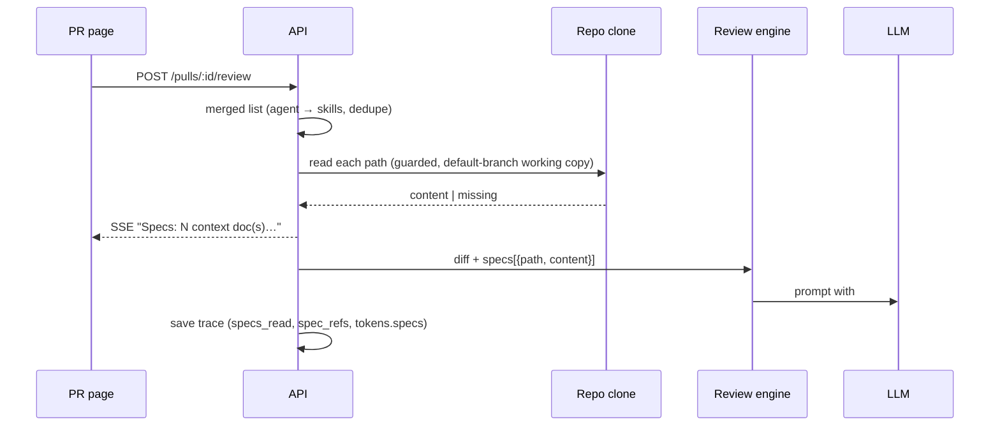
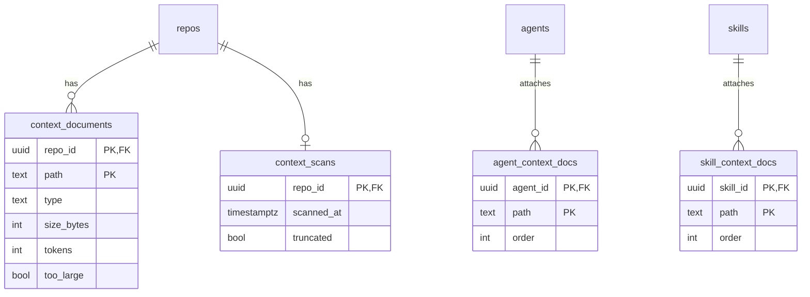

# Spec: Project Context
Spec ID: SPEC-005
Status: approved
Supersedes: none
Modules: server, client, reviewer-core

## Problem and user
A developer configures reviewer agents and skills in DevDigest. Today an agent does not see the
repository's project documentation (README, AGENTS, specs, `docs/`, `INSIGHTS.md`, plans), so a
review ignores conventions that are already written down in the repository.

The plumbing partly exists but is never filled:
- the `## Project context` prompt slot with the `<untrusted source="spec-i">` wrapper
  (`reviewer-core/src/prompt.ts:123-147`);
- the trace fields `PromptAssembly.specs`, `PromptTokens.specs` and `RunTrace.specs_read`
  (`server/src/vendor/shared/contracts/trace.ts:44,67,134`); the run executor writes
  `specs_read: []` (`server/src/modules/reviews/run-executor.ts:338`);
- a client hook for `GET /repos/:id/context` with no server route behind it
  (`client/src/lib/hooks/context.ts:10-24`).

There is no Project Context page and no Context tab (`client/src/vendor/ui/nav.ts:21-36`,
`client/src/app/agents/[id]/_components/AgentEditor/constants.ts:10-13`).

Amendment (2026-11-06): the first implementation meets the functional ACs, but its markup does not
follow the mockups:
- the page is a centred card with the Rescan button in the page header and three-line list items
  (`client/src/app/repos/[repoId]/context/_components/ProjectContextView/ProjectContextView.tsx:96-121`);
- the Context tab has a width-capped list, the filter on its own row, two-line rows and an overlay
  preview panel (`client/src/components/context-docs-picker/ContextDocsPicker.tsx:91-141`).

The spec had turned the screenshots into behaviour only. The "Design references" section and
AC-66…AC-108 capture the layout.

## Goals / Non-goals
- Goal: the user sees every markdown document of the repository that matches the patterns, and can
  preview it, rescan the list and download a file.
- Goal: the user attaches documents to an agent or a skill in a chosen order and sees how many
  tokens they add to the prompt.
- Goal: before every review run the attached documents are added to the prompt as untrusted data,
  with no separate LLM call.
- Goal: the trace and the live log show which documents reached the prompt, their size in tokens
  and their full text.
- Goal: the Project Context page and the Context tab follow the mockups of "Design references" in
  markup, placement and visual structure, while texts and behaviour stay as this spec defines them.
- Non-goal: editing, creating files or creating folders on the Project Context page (user
  decision: view-only).
- Non-goal: per-repository pattern configuration; the patterns are the same for every repository.
- Non-goal: the GitHub CI runner; project context applies to studio runs only. The MCP server needs
  no changes of its own.
- Non-goal: changing attachments does not create a new agent version, same as skill links today
  (`server/INSIGHTS.md`, 2026-10-17).
- Non-goal: the "78%" ring from the mockup is not shown.
- Non-goal: a hard cap on the total context tokens per run; only the warning of AC-31 applies.
- Non-goal: reading documents from the PR head commit; the source is the clone's working copy on
  the default branch.
- Non-goal: `CLAUDE.md`. It only references `AGENTS.md`, so `AGENTS.md` itself is the document that
  goes into the context.
- Non-goal: a pixel-exact match with the mockups. Colours other than the type colours (AC-95) come
  from the existing theme.
- Non-goal: these mockup elements are not built: the Preview|Edit toggle, the "+" (new file) and
  "new folder" buttons, the "78%" ring, and the Evals, CI and Stats tabs.
- Non-goal: the token number format does not change (`6051t` in the mockups vs `7,110t` today).

## User stories
- US-1: As a developer, I want to see and read the repository's markdown documents in DevDigest, so
  that I know what I can give to an agent. (→ AC-1…AC-16, AC-59…AC-61, AC-66…AC-86)
- US-2: As a developer, I want to attach documents to an agent or a skill in a chosen order and see
  their token count, so that I control the prompt cost. (→ AC-17…AC-37, AC-56…AC-58, AC-62…AC-65,
  AC-87…AC-108)
- US-3: As a developer, I want the review run to receive these documents as untrusted data.
  (→ AC-38…AC-48)
- US-4: As a developer, I want to see in the trace which documents reached the prompt and read
  their full text. (→ AC-49…AC-53)

## Design references
Precedence:
- **markup, placement, grouping and visual structure** follow the mockup;
- **texts and behaviour** follow the ACs of this spec; where a mockup shows a different string, the
  spec string wins;
- an element the mockups do not show is placed by the ACs listed below;
- mockup elements that are Non-goals are not built.

| Screen / state | Mockup |
|---|---|
| Project Context page, a document selected (markdown, code) | [2.png](005-project-context/design/2.png) |
| Project Context page, another document (wide table, horizontal scroll) | [3.png](005-project-context/design/3.png) |
| Agent Context tab, drag in progress, 4 attached | [4.png](005-project-context/design/4.png) |
| Agent Context tab, preview panel open (the panel spans the full height of the tab content area, AC-108) | [5.png](005-project-context/design/5.png) |
| Skill Context tab | [8.png](005-project-context/design/8.png) |
| Live log line `Specs: …` | [6.png](005-project-context/design/6.png) |
| Trace, Prompt assembly, "Project context (dynamic)" expanded | [7.png](005-project-context/design/7.png) |
| Not in the mockups: no selection, loading, empty, not cloned, `truncated`, file 404, pill with `~T tokens`, "+K docs via skills", AC-31 warning, "missing"; Rescan hint | placed by AC-80, AC-82…AC-86, AC-88, AC-90, AC-91, AC-96; Rescan hint is a tooltip (AC-8, AC-72) |

Where the mockups and the spec differ, the spec wins:

| Element | Mockup | What applies |
|---|---|---|
| Tab section title | "Project context" | "Project context to use" (AC-18) |
| Pill | "4 of 56 attached" | "N of M attached · ~T tokens" (AC-20) |
| Drag handle | on every row | attached rows only (AC-56) |
| "Used by" | "Used by 0 agents" | "Used by N agents · M skills" (AC-11) |
| Live log line | no token count | `(~T tokens)` (AC-43) |
| Wrapper label | `spec-0` | `spec:<path>` (AC-39) |
| Root-level `.md` files in the list | shown | not listed (AC-4) |

The trace drawer and the live log show no layout gap. The block order in Prompt assembly (System →
Skills → Memory → Repo skeleton → Project context → Intent → Callers → User,
`client/src/app/repos/[repoId]/pulls/[number]/_components/RunTraceDrawer/_components/TraceBody/TraceBody.tsx:79-117`)
matches 7.png, and the log line uses the existing live log.

## Acceptance criteria (EARS)

**Project Context page**
- AC-1 (Ubiquitous): The sidebar shall show a "Project Context" item in the WORKSPACE group that
  links to `/repos/:repoId/context` of the active repository.
- AC-2 (Event-driven): When the user opens the Project Context page, the page shall show in its
  sidebar the list of documents of the active repository, sorted by path.
- AC-3 (Event-driven): When `GET /repos/:id/context` is called for a cloned repository that has
  never been scanned, the API shall scan it before responding.
- AC-4 (Ubiquitous): The API shall list only files that match at least one pattern of the
  "Patterns and types" table and are not covered by its exclusions.
- AC-61 (Ubiquitous): The API shall leave `<pkg>/CLAUDE.md` out of the document list, even though
  it matches the `<pkg>/*.md` pattern.
- AC-5 (Ubiquitous): The API shall return for every document a `type` from
  `docs | specs | insights | plans | readme`, assigned by the "Patterns and types" table.
- AC-60 (Ubiquitous): When a path matches several patterns, the API shall assign the type of the
  pattern with the higher priority. For example, `<pkg>/INSIGHTS.md` gets `insights`, not `readme`,
  and appears in the list once.
- AC-6 (Event-driven): When the user selects a document, the page shall show its path and its
  content rendered as markdown.
- AC-7 (Ubiquitous): The page footer shall show
  "N documents · T tokens total · refreshed <relative time>".
- AC-8 (Event-driven): When the user clicks "Rescan", the API shall rescan the clone's working copy
  and return the list with a new `scanned_at`. The tooltip of the "Rescan" button says that Rescan
  reads the local clone and that Resync updates it from GitHub (AC-72).
- AC-9 (State-driven): While a rescan is in progress, the "Rescan" button shall be disabled and
  show a progress indicator.
- AC-10 (Event-driven): When the user clicks "Download", the browser shall save a file named
  `<basename>.md` with the same content the preview shows.
- AC-11 (Ubiquitous): The document panel shall show "Used by N agents · M skills". N and M are the
  number of agents and skills in the workspace whose attachments contain this path.
- AC-12 (Unwanted behaviour): If the repository has no clone, then the page shall show the state
  "Repository is not cloned yet" and `POST …/rescan` shall respond 409 `repo_not_cloned`.
- AC-13 (Unwanted behaviour): If the scan finds no documents, then the page shall show an empty
  state listing the patterns.
- AC-14 (Unwanted behaviour): If a file is larger than 400 KB, then the API shall return it with
  `too_large: true`, without content and not attachable.
- AC-15 (Unwanted behaviour): If a file disappeared after the scan, then `GET …/context/file` shall
  respond 404 `context_doc_not_found` and the page shall show "The file no longer exists — run
  Rescan".
- AC-16 (Unwanted behaviour): If a path in a request is invalid, then the API shall respond 422
  `invalid_context_path`. A path is invalid when it:
  - is absolute;
  - contains `..` or a `.git` segment;
  - is longer than 512 characters;
  - matches no pattern;
  - is `<pkg>/CLAUDE.md`.
- AC-59 (Ubiquitous): During a scan the API shall skip symbolic links and files that resolve
  outside the clone.

**Context tab (agent and skill)**
- AC-17 (Ubiquitous): The agent editor shall have a "Context" tab (`?tab=context`) after the
  "Skills" tab.
- AC-18 (Ubiquitous): The skill editor shall have a "Context" tab after "Versions" with the same
  "Project context to use" section.
- AC-19 (Ubiquitous): Each row of the tab shall show a checkbox, the file name, the folder, a type
  badge, the token count (`559t`) and a "Preview" button. Only attached rows have a drag handle
  (AC-56).
- AC-20 (Ubiquitous): The tab header shall show "N of M attached · ~T tokens", where:
  - N counts every attached path, including the paths shown with the "missing" badge (AC-28);
  - T is the sum of the tokens of the attached documents that exist in the active repository.
- AC-21 (Event-driven): When the user checks a checkbox, the tab shall save the path at the end of
  the attachment list, and the path shall still be in the list after a page reload.
- AC-22 (Event-driven): When the user unchecks a checkbox, the tab shall remove the path from the
  saved list.
- AC-23 (Event-driven): When the user moves an attached row to another position among the attached
  rows, with the mouse or the keyboard, the tab shall save the new order.
- AC-56 (Ubiquitous): The tab shall show a drag handle, and allow a drag to start, only on attached
  (checked) rows. An unattached row has no drag handle and cannot be dragged with the mouse or the
  keyboard.
- AC-57 (Unwanted behaviour): If the user drops a dragged row below the last attached row (among the
  unattached rows), then the tab shall place it as the last attached row and save that order.
- AC-58 (Unwanted behaviour): If, during a keyboard drag, the user presses an arrow key past the
  attached rows (above the first or below the last), then the tab shall keep the row at the
  outermost position among the attached rows.
- AC-24 (State-driven): While the filter field is not empty, the tab shall disable dragging.
- AC-25 (Event-driven): When the user types into "Filter documents…", the tab shall show only the
  rows whose path contains that text, ignoring case.
- AC-26 (Event-driven): When the user clicks "Preview", the tab shall open a side panel with the
  path and the rendered markdown. The panel closes with its × button or the Esc key.
- AC-27 (Ubiquitous): The tab shall show the attached documents first, in their saved order, and
  then the unattached documents sorted by path.
- AC-28 (Unwanted behaviour): If an attached path does not exist in the active repository, then the
  tab shall show the row with a "missing" badge, without a token count, and let the user detach it.
- AC-29 (Unwanted behaviour): If saving fails, then the tab shall restore the previous state of the
  list and show an error toast.
- AC-30 (Ubiquitous): The agent Context tab shall show "+K docs via skills · ~T tokens", also when
  K = 0 ("+0 docs via skills · ~0 tokens"). The values come from
  `GET /agents/:id/context?include=skills`:
  - K is the number of distinct paths across all `skills[].paths` that are not in the agent's own
    `paths`; a path that appears under several skills counts once.
  - T is the sum of the tokens of those K paths that exist in the active repository; each path
    counts once.
- AC-31 (Unwanted behaviour): If T exceeds 20 000 tokens, then the tab header shall show the warning
  "Large context: ~T tokens in every prompt".

**Attachment API**
- AC-32 (Event-driven): When `PUT /agents/:id/context` (or `/skills/:id/context`) is received with
  `paths`, the API shall store exactly that list in that order and respond 200 with the stored list.
- AC-33 (Unwanted behaviour): If any path fails the checks of AC-16 (including `<pkg>/CLAUDE.md`),
  then the API shall respond 422 `invalid_context_path` and leave the stored list unchanged.
- AC-34 (Unwanted behaviour): If `paths` contains duplicates, then the API shall respond 422
  `duplicate_context_path`.
- AC-35 (Unwanted behaviour): If the agent or skill does not exist or belongs to another workspace,
  then the API shall respond 404 `not_found`.
- AC-36 (Unwanted behaviour): If `paths` contains more than 100 paths, then the API shall respond 422
  `too_many_context_docs`.
- AC-37 (Event-driven): When an agent or a skill is deleted, the API shall delete its attachments.
- AC-62 (Optional feature): Where `GET /agents/:id/context` is called with `include=skills`, the API
  shall respond 200 with the agent's own `paths` and a `skills` list with one entry
  `{ skill_id, paths }` per linked skill whose `enabled` is true, in `agent_skills.order`; an entry
  is present even when its `paths` is empty.
- AC-63 (Optional feature): Where `GET /agents/:id/context` is called with `include=skills`, the API
  shall return in each `skills[].paths` that skill's full stored attachment list in its stored
  order, including paths that are also in the agent's `paths` or in another entry.
- AC-64 (Ubiquitous): The API shall respond to `GET /agents/:id/context` without `include` with
  `{ paths }` only, with no `skills` field.
- AC-65 (Unwanted behaviour): If `include` has a value other than `skills`, then the API shall
  respond 422 `validation_error`.

**Review run**
- AC-38 (Event-driven): When a review run starts for an agent, the review run shall read the
  documents of the merged list from the working copy of the PR repository's clone, that is, the
  default-branch state after the last clone or resync. The merged list is built in this order:
  1. the agent's documents in their order;
  2. the documents of each linked and enabled skill, in `agent_skills.order`.

  A repeated path is kept once, at its first position.
- AC-39 (Ubiquitous): The prompt of the review run shall contain a `## Project context` section in
  which every document, in merged order, is wrapped as
  `<untrusted source="spec:<path>">…</untrusted>`.
- AC-40 (Ubiquitous): The system message of a review run with project context shall contain the
  injection guard text (`INJECTION_GUARD`).
- AC-41 (Unwanted behaviour): If a document's content contains `</untrusted>`, then the review run
  shall replace it with `<\/untrusted>`.
- AC-42 (Ubiquitous): A review run with project context shall make the same number of LLM calls as
  the same review run without project context.
- AC-43 (Event-driven): When the documents have been read, the live log shall show
  `Specs: N context doc(s) attached to prompt (~T tokens)`.
- AC-44 (Unwanted behaviour): If a file does not exist in the clone, then the review run shall skip
  it, log `Specs: skipped <path> — not found in repo clone` and continue.
- AC-45 (Unwanted behaviour): If a file is larger than 400 KB or empty, then the review run shall
  skip it and log `Specs: skipped <path> — <too large|empty>`.
- AC-46 (Unwanted behaviour): If the PR repository has no clone, then the review run shall skip all
  documents with the single log line `Specs: repo not cloned — context skipped` and continue.
- AC-47 (Unwanted behaviour): If no document is left after selection, then the prompt shall contain
  no `## Project context` section, and the trace shall contain `specs: null` and `specs_read: []`.
- AC-48 (Optional feature): Where the agent's strategy is `map-reduce`, every LLM call of the review
  run shall contain the same `## Project context` section.

**Trace and Prompt assembly**
- AC-49 (Event-driven): When the trace is saved, it shall contain:
  - `specs_read`: the paths in prompt order;
  - `prompt_assembly.spec_refs`, where each entry's `tokens` is that document's own token count,
    equal to the Context tab count for an unchanged file (NFR-4);
  - `tokens.specs`: the token count of the whole `## Project context` slot as it appears in the
    prompt, all `<untrusted source="spec:…">` wrappers included, counted with the same tokenizer
    as the other Prompt assembly blocks; it is therefore larger than the sum of
    `prompt_assembly.spec_refs[].tokens`.
- AC-50 (Event-driven): When the user expands "Prompt assembly", the run drawer shall show the
  "Project context (dynamic)" block with its token count and the list "Project context attached
  specs" (path, type, tokens).
- AC-51 (Event-driven): When the user opens a document from that list, the run drawer shall show
  the full text of that document exactly as it was in the prompt.
- AC-52 (Unwanted behaviour): If a trace has no `spec_refs` (an older run), then the run drawer
  shall show the block without the list and without an error.
- AC-53 (Ubiquitous): The trace's "Configuration" section shall show the paths of `specs_read` in
  the "Specs read" row.

**Safe rendering**
- AC-54 (Unwanted behaviour): If a document contains raw HTML, then the preview shall show it as
  text, not as markup.
- AC-55 (Unwanted behaviour): If a link in a document has a scheme other than `http`, `https`,
  `mailto` or a relative path, then the preview shall show it as non-clickable text.

**Project Context page: layout (2.png, 3.png)**
- AC-66 (Ubiquitous): The Project Context page breadcrumb shall consist of the active repository's
  full name `owner/name` in monospace, as on the PR pages, followed by "Project Context".
- AC-67 (Ubiquitous): The page shall have a title bar with the single text "Project Context", with
  no repository name, no subtitle and no buttons, separated from the panes by a horizontal border.
- AC-68 (State-driven): While the page shows a document list, the area under the title bar shall
  consist of two panes filling the full width and height of the content area:
  - a document pane on the left with a fixed width (≈ 300 px in 2.png), which does not change with
    the selected document or the window width;
  - a preview pane on the right, taking the remaining width.
- AC-69 (State-driven): While the list or the document is taller than its pane, each pane shall
  scroll on its own. The title bar, the toolbar and the footer stay in place, and the browser window
  does not scroll.
- AC-70 (Ubiquitous): The document pane shall have a toolbar above the list with exactly two icon
  buttons in this order: "Download" (a download icon), then "Rescan" (a refresh icon).
- AC-71 (Ubiquitous): Each toolbar icon button shall have the accessible name "Download" or
  "Rescan". For "Download" the same name is also shown as its tooltip.
- AC-72 (Event-driven): When the user hovers over the "Rescan" button or moves keyboard focus to
  it, the page shall show a tooltip with the hint text of AC-8. This text is also the button's
  accessible description and appears nowhere else on the page. The button's accessible name stays
  "Rescan" (AC-71).
- AC-73 (Unwanted behaviour): If no document is selected, then the "Download" button shall be
  disabled.
- AC-74 (Ubiquitous): Each row of the page list shall take one line of text and show a file icon
  and the full relative path in monospace, with no type and no token count.
- AC-75 (Unwanted behaviour): If a path does not fit the pane width, then the row shall truncate it
  at the end with "…" and show the full path in a tooltip.
- AC-76 (State-driven): While a document is selected, its row shall have a highlight background and
  accent-coloured text, like `client/docs/ui-architecture.md` in 2.png.
- AC-77 (State-driven): While a document is selected, its row shall be marked as selected for
  assistive technology.
- AC-78 (State-driven): While a document is selected, the preview pane shall show a header row at
  its top:
  - the path in monospace on the left;
  - "Used by N agents · M skills" (AC-11) on the right of the same row;
  - no Download button.
- AC-79 (Unwanted behaviour): If the document content is wider than the preview pane, then the
  preview pane shall scroll horizontally, and the page width stays unchanged.
- AC-80 (State-driven): While no document is selected, the preview pane shall show only "Select a
  document to preview it.", with no header row.
- AC-81 (Ubiquitous): The footer of AC-7 shall be a status bar with a status dot before the text,
  pinned to the bottom of the content area across its full width, under both panes.
- AC-82 (State-driven): While the response has `truncated: true`, the warning of EC-8 shall be shown
  in the document pane between the toolbar and the list.
- AC-83 (State-driven): While the scan has found no documents (AC-13), the page shall show the empty
  state with the pattern list in the preview pane, and the toolbar with an enabled "Rescan" button
  in the document pane.
- AC-84 (State-driven): While the repository is not cloned (AC-12), the page shall show that state
  across the whole area under the title bar, with no toolbar and no footer.
- AC-85 (State-driven): While the document list is loading, the page shall show the two-pane layout
  with skeleton rows in the document pane.
- AC-86 (Unwanted behaviour): If the file has disappeared (AC-15), then the text of AC-15 shall be
  shown in the body of the preview pane under its header row.

**Context tab (agent and skill): layout (4.png, 5.png, 8.png)**
- AC-87 (State-driven): While the preview panel is closed, the section shall take the full width of
  the tab content, with no maximum width.
- AC-88 (Ubiquitous): The first row of the section shall hold, on the left, the title "Project
  context to use" directly followed by an accent pill with the full text of AC-20, and, on the right
  of the same row, the "Filter documents…" field with a search icon.
- AC-89 (Ubiquitous): Under the first row, the tab shall show the subtitle "Order matters — earlier
  docs appear earlier in the assembled `## Project context` block. Toggle to attach.", where
  `## Project context` is inline code. The subtitle is the same for agents and skills.
- AC-90 (Ubiquitous): The AC-30 line shall be placed under the subtitle, in the same font size and
  colour as the subtitle.
- AC-91 (Ubiquitous): The AC-31 warning shall be placed above the list, under the AC-30 line (on the
  skill tab, under the subtitle), with an icon and the warning colour.
- AC-92 (Ubiquitous): Each document of the tab list shall be a separate card, with a gap between
  cards.
- AC-93 (Ubiquitous): Each card shall take one line. From left to right: the handle slot, the
  checkbox, the file name (monospace, bold), the folder (monospace, secondary colour, with a trailing
  `/`). At the right edge: the type, the token count and the "Preview" button.
- AC-94 (Ubiquitous): On an unattached row, the handle slot shall stay empty with the same width, so
  that the checkboxes of all rows line up vertically.
- AC-95 (Ubiquitous): The type shall be shown as text with no background, in its own colour per
  type: docs green, insights orange, specs blue, readme grey (4.png); plans in a separate colour
  that matches none of these.
- AC-96 (Unwanted behaviour): If a path is missing (AC-28), then the "missing" badge shall take the
  place of the type, in the warning colour.
- AC-97 (Ubiquitous): The "Preview" button shall have an eye icon before its text.
- AC-98 (Event-driven): When the user opens a preview (AC-26), the tab shall show the panel inside
  the tab content, to the right of the narrowed but still visible list, separated by a vertical
  border (5.png).
- AC-99 (State-driven): While the panel is open, the top bar, the breadcrumb, the editor header,
  the tabs and the agent or skill list column shall stay fully visible.
- AC-100 (State-driven): While the panel is open, the checkboxes of the list rows shall toggle the
  same way as with the panel closed.
- AC-101 (Event-driven): When the panel is open and the user clicks "Preview" on another row, the
  panel shall show that document in place of the previous one.
- AC-102 (Ubiquitous): The panel shall have a header row with the path in monospace on the left and
  the × button on the right, and the rendered markdown under it.
- AC-103 (State-driven): While the panel is open and the list scrolls, the panel shall stay in the
  visible part of the window and scroll its own content separately.
- AC-104 (Unwanted behaviour): If the content is wider than the panel, then the panel shall scroll
  horizontally within its own width.
- AC-105 (State-driven): While a row is being dragged, the tab shall show it lifted, with an accent
  border (4.png).
- AC-106 (State-driven): While a row is being dragged, the tab shall show a dimmed placeholder at its
  original position (4.png).
- AC-107 (State-driven): While the panel is open, the first row of the section shall stay above the
  list in the list column, with the filter at the column's right edge (5.png).
- AC-108 (State-driven): While the preview panel is open, the panel shall span vertically the full
  height of the tab content area: from directly under the editor's tab row, level with the first
  row of the section (AC-107), down to the bottom edge of the window, whatever the length of the
  document (5.png).

## Workflows and contracts

**Patterns and types**
- Paths are relative to the clone root.
- `<pkg>` is one of `client`, `server`, `reviewer-core`, `mcp`, `e2e`.
- When a path matches several rows, the row with the smaller priority number wins (AC-60).
- Exclusions always apply (AC-61).

| Priority | Pattern | type |
|---|---|---|
| 1 | `<pkg>/INSIGHTS.md` | insights |
| 2 | `<pkg>/docs/**/*.md` | docs |
| 2 | `<pkg>/specs/**/*.md`, `specs/**/*.md` | specs |
| 2 | `docs/plans/**/*.md` | plans |
| 3 | `<pkg>/*.md`: every `.md` file in the package root (`README.md`, `AGENTS.md`, `TESTING.md`, …) | readme |
| exclusion | `<pkg>/CLAUDE.md`: never scanned, never attachable | — |

**API**
- `GET /repos/:id/context` → 200
  `{ status: 'ok'|'no_clone', scanned_at: string|null, truncated: bool, total_tokens: int, documents: [{ path, name, dir, type, size_bytes, tokens, too_large, used_by: { agents: int, skills: int } }] }`.
  Errors: 404 `not_found`.
- `POST /repos/:id/context/rescan` → 200 with the same body as the GET. Errors: 404,
  409 `repo_not_cloned`, 429 `rate_limited` (more than 10 requests per minute).
- `GET /repos/:id/context/file?path=` → 200 `{ path, type, size_bytes, tokens, content }`.
  Errors: 404 `context_doc_not_found`, 422 `invalid_context_path` | `context_doc_too_large`.
- `GET /agents/:id/context` and `PUT /agents/:id/context { paths: string[] }` →
  200 `{ paths: [{ path, order }] }`. `/skills/:id/context` works the same way. Errors: 404
  `not_found` (AC-35) and 422 (AC-33, AC-34, AC-36).
- `GET /agents/:id/context?include=skills` → 200
  `{ paths: [{ path, order }], skills: [{ skill_id, paths: [{ path, order }] }] }`:
  - `paths`: the agent's own attachments, the same as the plain GET;
  - `skills`: present only with `include=skills`; the linked skills with `enabled = true`, in
    `agent_skills.order` (AC-62);
  - `skills[].paths`: exactly what `GET /skills/:skill_id/context` returns for that skill, with
    nothing removed as a duplicate (AC-63);
  - the response is not a merged list: duplicates are removed only by the review run (AC-38), and
    by the client only to count K and T (AC-30);
  - errors: 404 `not_found` (AC-35), 422 `validation_error` for an unknown `include` value (AC-65);
  - `include` exists only on the agent endpoint.
- Trace:
  - new optional field `prompt_assembly.spec_refs` (nullish):
    `[{ path, type, tokens, source: 'agent'|'skill', skill_id: string|null }]`;
  - the wrapper label changes from `spec-<i>` to `spec:<path>`.

Schema constraints:
- Every foreign key is `ON DELETE CASCADE`.
- `type` has CHECK ∈ (docs, specs, insights, plans, readme).
- `order`, `size_bytes` and `tokens` are ≥ 0.
- `path` in the attachment tables has no foreign key to `context_documents`: attachments are
  global and store only the path.

## Edge cases
- EC-1: A document is renamed. The old path shows as "missing", and the review run skips it (AC-28,
  AC-44).
- EC-2: The repository has no files matching the patterns. Every attachment shows as "missing", and
  the review run skips them (AC-28, AC-44).
- EC-3: A skill is disabled or unlinked. Its documents do not reach the prompt and are not in
  `skills` (AC-38, AC-62).
- EC-4: The agent and skill S1 both attach `server/AGENTS.md`.
  - The `include=skills` response lists the path in the agent's `paths` and also in S1's `paths`
    (AC-63).
  - The path is not counted in K or T (AC-30).
  - The review run puts it in the prompt once, at the agent's position (AC-38).
- EC-5: A file changes between the scan and the run. The review run uses the current content and
  counts tokens for it in the trace (AC-49).
- EC-6: The user double-clicks or drags quickly several times. Every save sends the full list, and
  the last one wins (AC-32).
- EC-7: Two rescans run at the same time. Both respond 200, and the stored list is the result of
  one complete scan (AC-8).
- EC-8: The repository has more than 1000 documents. The API returns the first 1000 by path with
  `truncated: true`, and the page shows a warning (AC-4).
- EC-9: A symbolic link points to `~/.devdigest/secrets.json` or `.git/config`. It is not listed
  and never read (AC-16, AC-59).
- EC-10: The review run is started through MCP `run_agent_on_pr`. Behaviour is the same, because
  the same API is used (AC-38).
- EC-11: The review run is cancelled or fails. The trace has `specs: null` (AC-52).
- EC-12: A path is very long. It is truncated with "…", and the full path is shown in a tooltip
  (AC-19).
- EC-13: The filter matches nothing. The tab shows "No documents match the filter" (AC-25).
- EC-14: A file is empty. The list shows 0 tokens, and the review run skips it (AC-45).
- EC-15: `<pkg>/INSIGHTS.md` matches two patterns. It is listed once, with type `insights`
  (AC-60).
- EC-16: A `<pkg>/CLAUDE.md` exists in a package root.
  - It is not listed (AC-61).
  - An attempt to attach it through the API gets 422 `invalid_context_path`, and the stored list
    stays unchanged (AC-16, AC-33).
  - `<pkg>/AGENTS.md` is listed with type `readme`.
- EC-17: An `.md` file sits in a package subfolder outside `docs/` and `specs/` (for example
  `server/src/modules/repo-intel/README.md`). It is not listed, because `<pkg>/*.md` covers only
  the package root (AC-4).
- EC-18: Zero or one document is attached. Dragging changes nothing and saves nothing (AC-56,
  AC-57).
- EC-19: Skills S1 and S2 are linked and enabled, in that order, and both attach
  `server/docs/auth.md` (800 tokens). The agent does not attach it.
  - The `include=skills` response lists the path under S1 and under S2 (AC-63).
  - The tab counts it once in K and adds 800 to T once (AC-30).
  - The review run puts it in the prompt once, at S1's position, and `specs_read` holds it once
    (AC-38, AC-49).
- EC-20: The agent attaches nothing. Skill "Security" is linked, enabled and attaches
  `server/docs/security.md` (1 200 tokens, present in the active repository) and
  `server/docs/old-auth.md` (deleted from the repository; after a Rescan it is no longer in
  `GET /repos/:id/context`).
  - The response lists both paths under "Security" (AC-63).
  - The tab shows "+2 docs via skills · ~1 200 tokens": the deleted file counts in K but adds
    nothing to T (AC-30).
  - The review run reads `security.md`, skips `old-auth.md` with the log line
    `Specs: skipped server/docs/old-auth.md — not found in repo clone` (AC-44), and `specs_read`
    holds only `server/docs/security.md` (AC-49).
  - "Exists in the active repository" means "listed in the latest `GET /repos/:id/context`".
- EC-21: A very long path in the page list is truncated with "…", and the full path is shown in a
  tooltip (AC-75).
- EC-22: A document with a wide table or a long code line scrolls horizontally inside its pane or
  panel, and the page width stays unchanged (AC-79, AC-104).
- EC-23: With 1000 documents only the document pane scrolls; the toolbar and the footer stay
  visible all the time (AC-69, AC-81).
- EC-24: In a narrow window (1280 px) with the tab preview panel open, the name and the folder are
  truncated with "…" (EC-12), and the type, the token count and "Preview" stay visible (AC-93,
  AC-98).
- EC-25: During a rescan the refresh icon is disabled and spins (AC-9), the AC-72 tooltip stays
  available, and Download works as before (AC-70, AC-73).
- EC-26: The preview of a short document (a few lines) is opened. The panel still spans the full
  height of the tab content area down to the bottom edge of the window, with empty space below the
  text (AC-108). A long document scrolls inside the panel, and the panel height does not change
  (AC-103, AC-108).

## Non-functional requirements
- NFR-1: `GET /repos/:id/context` responds in ≤ 500 ms with 500 stored documents.
- NFR-2: A rescan of 500 `.md` files totalling 10 MB completes in ≤ 5 s.
- NFR-3: Reading 20 attached documents totalling 2 MB adds ≤ 1 s to the start of a review run.
- NFR-4: For an unchanged file, the token count in the Context tab equals that document's
  `prompt_assembly.spec_refs[].tokens` in the trace.
  Both use the same tokenizer: cl100k_base, or `ceil(chars/4)` when it is unavailable.
- NFR-5: No context endpoint returns bytes of a file outside the clone. Tests check this with
  `../`, a symbolic link and `.git/config`.
- NFR-6: Accessibility:
  - the checkbox's accessible name equals the path;
  - attached rows can be reordered with the keyboard (Space and the arrow keys);
  - focus returns to "Preview" after the panel closes.
- NFR-7: Every UI string lives in i18n messages; none is inline.
- NFR-8: To show the AC-30 line, the agent Context tab sends exactly one attachment request,
  `GET /agents/:id/context?include=skills`, and no `GET /skills/:id/context` requests, however many
  skills are linked. A component test counts the requests for 0, 1 and 5 linked skills.
- NFR-9: Layout verification of AC-66…AC-108:
  - structural ACs (presence, order, container, accessible names, disabled state) are checked by
    component tests: AC-66, AC-67, AC-70…AC-78, AC-80, AC-82…AC-86, AC-88…AC-92, AC-96, AC-97,
    AC-100…AC-102, AC-107;
  - visual ACs are checked by a headless-browser screenshot at 1920×1000, reviewed side by side
    with the mockup of "Design references": AC-68, AC-69, AC-79, AC-81, AC-87, AC-93…AC-95, AC-98,
    AC-99, AC-103…AC-106, AC-108.

  Pixel equality is not required, so this check has a qualitative threshold, not a numeric one.

## Inputs and provenance
| Source | Type | What it gave | Used in |
|---|---|---|---|
| User requirements | user text | page, patterns, tabs, token counts, untrusted `## Project context`, trace and `specs_read`, no extra LLM call | AC-1…AC-53 |
| `specs/005-project-context/design/2.png`, `3.png` | screenshot | sidebar, preview, "Used by", footer, toolbar; two-pane layout, icon toolbar, single-line list, preview header row, status bar, breadcrumb, horizontal scroll | AC-2, AC-6…AC-11, AC-66…AC-86 |
| `specs/005-project-context/design/4.png`, `5.png`, `8.png` | screenshot | rows, "N of M", filter, drag, preview panel; header row with pill and filter, subtitle, single-line cards, type colours, inline panel, drag visuals | AC-17…AC-27, AC-87…AC-108 |
| `specs/005-project-context/design/6.png` | screenshot | `Specs: …` log line; no layout gap | AC-43 |
| `specs/005-project-context/design/7.png` | screenshot | Project context block, wrappers; no layout gap (block order `TraceBody.tsx:79-117`) | AC-39, AC-50 |
| User answers 1–3 | user answer | global paths and "missing"; view-only page; merge rule | AC-28, AC-38, AC-44, Non-goals |
| Feedback on draft 2 | user answer | `readme` type and `<pkg>/*.md`; default branch; drag only attached rows | AC-5, AC-38, AC-56…AC-58, AC-60 |
| Answer to Q-7 | user answer | `<pkg>/CLAUDE.md` excluded, `AGENTS.md` included | AC-16, AC-33, AC-61, EC-16 |
| Approval | user answer | defaults for the ring, hard cap, per-repo patterns and CI runner; proposals accepted (400 KB limit, 20 000-token warning, "Used by N agents · M skills", Rescan hint, "+K docs via skills", 100 paths, rate limit 10/min, Esc and keyboard reorder, 1000-document cap) | Non-goals, AC-8, AC-11, AC-14, AC-26, AC-30, AC-31, AC-36, EC-8 |
| `reviewer-core/src/prompt.ts:16-36,123-147` | code | injection guard, `wrapUntrusted`, specs slot | AC-39…AC-41 |
| `server/src/vendor/shared/contracts/trace.ts:40-137` | code | `specs`, `tokens.specs`, `specs_read`, `skill_refs` | AC-49, AC-52 |
| `server/src/adapters/git/simple-git.ts:50-54,80-91,129-140`, `server/src/modules/repo-intel/walk.ts:89,112` | code (researcher) | path guard, 400 KB limit, symbolic links, resync vs fetch | AC-8, AC-14, AC-59 |
| `server/src/adapters/tokenizer/index.ts:17-41` | code (researcher) | tokenizer | NFR-4 |
| `client/src/app/agents/[id]/_components/AgentEditor/_components/SkillsTab/SkillsTab.tsx`, `client/src/vendor/ui/primitives/Markdown.tsx` | code (researcher) | drag and filter pattern; markdown renderer without raw HTML | AC-23, AC-24, AC-54 |
| `server/INSIGHTS.md` (2026-10-09, 2026-10-17) | code | new trace fields must be nullish; links do not bump versions | AC-52, Non-goals |
| User answer to planner recommendation | user answer | the `include=skills` variant; K = distinct skill paths not in the agent's list, T = tokens of those that exist in the active repository | AC-30, AC-62, AC-64, NFR-8, API |
| Feedback on the amendment drafts | user answer | unknown `include` → 422; empty skill entries kept; line shown when K = 0; paths shared by several skills, or by a skill and the agent, always returned, with duplicates removed only at run start; concrete EC-20; short NFR-8 (one request, test with 0, 1 and 5 skills) | AC-30, AC-62, AC-63, AC-65, EC-4, EC-19, EC-20, NFR-8 |
| Answers after plan verification (2026-11-06) | user answer | `tokens.specs` = the whole `## Project context` slot with wrappers, `spec_refs[].tokens` = each document's own count; N in the tab header counts missing paths, T does not | AC-20, AC-49, NFR-4 |
| `server/src/app.ts:119-129` | code | request-validation failures respond 422 `validation_error` | AC-65 |
| `server/src/db/schema/agents.ts:51-63`, `server/src/db/schema/skills.ts:30` | code | `agent_skills.order`; the skill's `enabled` flag | AC-62 |
| User decision on design fidelity (2026-11-06) | user answer | texts and behaviour follow the spec, markup and layout follow the mockups; existing non-goals stay | Design references, AC-66…AC-108, Non-goals |
| Screenshots of the current implementation (`page`, `page-selected`, `agent`, `agent-preview`, `skill`.png, 2026-11-06, not stored in the repo) | screenshot | the layout gaps against the mockups | Problem and user, Design references |
| `client/src/app/repos/[repoId]/context/_components/ProjectContextView/ProjectContextView.tsx:30,96-121`, `client/src/components/context-docs-picker/ContextDocsPicker.tsx:91-141`, `client/messages/en/context.json:43,53` | code | current markup, breadcrumb, hints, "Select a document to preview it." | Problem and user, AC-66, AC-80, AC-89 |
| `client/src/app/repos/[repoId]/pulls/_components/PullsListView/PullsListView.tsx:58`, `client/src/app/repos/[repoId]/pulls/[number]/_components/PrDetailView/PrDetailView.tsx:57-59` | code | breadcrumb with the repository name in monospace on the PR pages | AC-66 |
| Feedback on the plan (2026-11-06) | user answer | the tab preview panel is as tall as the tab content area, not the whole screen and not its content; no animation | AC-108, EC-26, NFR-9 |
| Answers to the amendment drafts (2026-11-06) | user answer | Rescan hint as a tooltip only (AC-8 changed); P-1…P-12 accepted (title bar, Download disabled without selection, no-selection state, placement of the `truncated`, empty and not-cloned states, full AC-20 text in the pill, mockup subtitle, placement of the AC-30 line and the AC-31 warning, `plans` colour, "missing" in the type slot, panel stays in view) | AC-8, AC-67, AC-71…AC-73, AC-80, AC-82…AC-84, AC-88…AC-91, AC-95, AC-96, AC-103 |

## Untrusted inputs
| Input | Comes from | Where it goes | Required handling |
|---|---|---|---|
| `.md` file content | repository clone | prompt, preview, download | AC-39…AC-41, AC-54, AC-55 |
| File paths and names | clone file tree | UI, `source=` label, DB | AC-59, AC-61, label sanitising (AC-39) |
| `paths`, `?path=` and `?include=` in requests | API client | DB, file reads | AC-16, AC-33…AC-36, AC-65, NFR-5 |

## Open questions
- none
