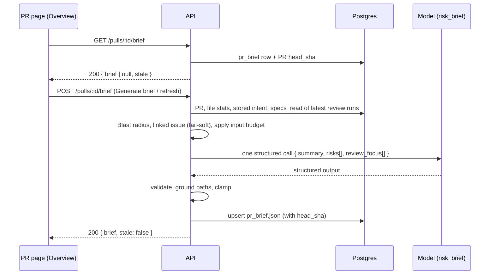
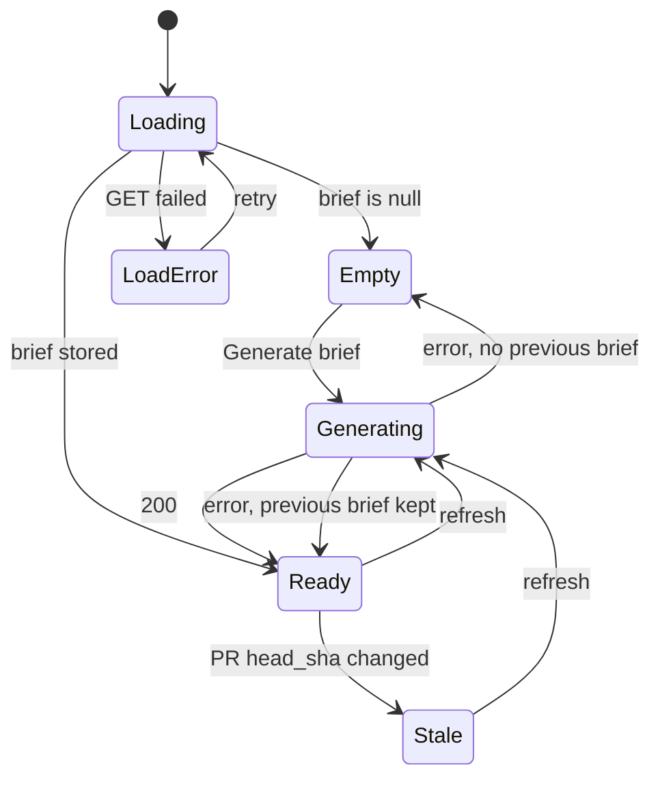

# Spec: PR Brief
Spec ID: SPEC-006
Status: approved
Supersedes: none
Modules: server, client

## Problem and user
A reviewer opens a pull request in DevDigest and wants to understand three things within a minute:
what the PR does and why, where its risks are, and which lines to read first. Today the Overview
tab shows only Intent, Blast radius and the PR description
(`client/src/app/repos/[repoId]/pulls/[number]/_components/OverviewTab/OverviewTab.tsx:20-32`).
There is no summary, no list of risks and no "read these first" list. The verdict and the PR score
are visible only inside each run on the Agent runs tab
(`client/src/app/repos/[repoId]/pulls/[number]/_components/ReviewRunAccordion/ReviewRunAccordion.tsx:124-138`).

Parts of the groundwork exist but are unused:
- the contracts `Intent`, `Risk`, `Risks` and the composed `PrBrief`
  (`server/src/vendor/shared/contracts/brief.ts:9-14,88-103,162-168`); the client copy
  `client/src/vendor/shared/contracts/brief.ts` is identical;
- the table `pr_brief(pr_id, json)` (`server/src/db/schema/reviews.ts:67-72`), which no code reads
  or writes;
- the `risk_brief` feature-model setting ("Risk Brief", default `openai / gpt-4.1`,
  `server/src/vendor/shared/contracts/platform.ts:58-64`), which no server module resolves.

There is no brief module, no route, no brief UI and no way to open a given file and line on the
Files changed tab: the PR page URL knows only `?tab` and `?trace`
(`client/src/app/repos/[repoId]/pulls/[number]/_components/PrDetailView/hooks/usePrDetailUrlState.ts:13-29`).

## Goals / Non-goals
- Goal: the Overview tab has a PR Brief block; the server generates the brief with one call of the
  `risk_brief` model and caches it for the PR's head commit SHA.
- Goal: the brief contains a summary (what the PR does and why), Risk areas and Review focus; no
  path in the brief is invented — each one is in the PR or in the Blast radius map.
- Goal: clicking a risk or a Review focus item opens the Files changed tab on that file and line.
- Goal: the Overview follows the mockups of "Design references" in markup, placement and visual
  structure, while texts and behaviour stay as this spec defines them.
- Non-goal: the brief is never generated automatically — not on page open and not after a new
  commit. The model is called only on Generate brief or refresh (user decision).
- Non-goal: brief generation does not generate the PR intent; it uses the stored intent, so it
  stays one model call.
- Non-goal: the Tree/Graph segmented toggle from the mockup. The existing Graph button that opens a
  modal stays (`client/src/app/repos/[repoId]/pulls/[number]/_components/OverviewTab/_components/BlastRadiusCard/BlastRadiusCard.tsx:84-98`).
- Non-goal: changes to the MCP server, the CI runner or review runs.
- Non-goal: mockup elements outside the brief: the "Back" button, the "PR Leaderboard" and "More
  screens" navigation items, and the "summary" badge / "What this does" line on Files changed
  (`pseudocode_summary` is never filled).
- Non-goal: changing the Risk Brief model does not make a stored brief stale; only the head SHA does.
- Non-goal: a pixel-exact match with the mockups; colours come from the existing theme.

## User stories
- US-1: As a reviewer, I want to generate a brief of the PR on the Overview tab, so that I see at
  once what the PR does and why. (→ AC-1, AC-2, AC-6…AC-8, AC-17…AC-24, AC-30…AC-43, AC-60…AC-66)
- US-2: As a reviewer, I want to see the risks with their files and explanations, so that I know
  where the PR is dangerous. (→ AC-25…AC-29, AC-44…AC-49)
- US-3: As a reviewer, I want to click a `file:line` item and land exactly there in the diff.
  (→ AC-50…AC-59, AC-67)
- US-4: As a reviewer, I want the brief to be kept so it shows at once after a page reload, and to
  be marked stale after a new commit. (→ AC-1…AC-5, AC-7, AC-9…AC-13, AC-36, AC-37)
- US-5: As a workspace owner, I want to choose the brief model in Settings. (→ AC-14…AC-16)

## Acceptance criteria (EARS)

### API: reading and cache
- AC-1 (Event-driven): When a client calls `GET /pulls/:id/brief` and no brief is stored for the PR,
  the API shall respond 200 with `{ "brief": null, "stale": false }`.
- AC-2 (Event-driven): When a client calls `GET /pulls/:id/brief` and a brief is stored for the PR,
  the API shall respond 200 with the stored `brief` without calling the model.
- AC-3 (Ubiquitous): The API shall set `stale` in the brief view to `true` if and only if
  `brief.head_sha` differs from the PR's current `head_sha`.
- AC-4 (Unwanted behaviour): If the PR `:id` does not exist or belongs to another workspace, then
  the API shall respond 404 `not_found` to both `GET` and `POST /pulls/:id/brief`.
- AC-5 (Unwanted behaviour): If the stored brief JSON does not pass validation against the
  `PrBriefRecord` contract, then the API shall answer `GET /pulls/:id/brief` with
  `{ "brief": null, "stale": false }`.

### API: generation
- AC-6 (Event-driven): When a client calls `POST /pulls/:id/brief`, the API shall send exactly one
  structured-completion request to the provider and model resolved from the `risk_brief`
  feature-model setting; the provider's own re-asks after a schema failure inside that request
  (AC-13) do not count as separate calls.
- AC-7 (Event-driven): When the model call succeeds, the API shall store the brief in `pr_brief`,
  replacing any previous brief of the PR, with `head_sha` set to the PR's head SHA at generation time.
- AC-8 (Event-driven): When generation succeeds, the API shall respond 200 with
  `{ "brief": <PrBriefRecord>, "stale": false }`.
- AC-9 (Ubiquitous): The API shall generate a new brief on every `POST /pulls/:id/brief`, including
  when the stored brief is not stale.
- AC-10 (Unwanted behaviour): If a generation for the PR is already in progress when another
  `POST /pulls/:id/brief` arrives, then the API shall answer both requests with the result of that
  single model call.
- AC-11 (Unwanted behaviour): If the API key of the `risk_brief` provider is not configured, then
  the API shall respond 500 `config_error` and leave the stored brief unchanged.
- AC-12 (Unwanted behaviour): If the model call fails or times out (60 s per attempt), then the API
  shall respond 502 `external_service_error` and leave the stored brief unchanged.
- AC-13 (Unwanted behaviour): If the model response fails validation against the model output
  schema `PrBriefModelResult` after the provider's retries, then the API shall respond
  502 `external_service_error` and store nothing.
- AC-14 (Unwanted behaviour): If one client sends more than 10 `POST` or more than 30 `GET` brief
  requests per minute, then the API shall respond 429 `rate_limited`.
- AC-15 (Optional feature): Where a model is chosen for Risk Brief in the workspace settings, the
  API shall call that provider and model and record them in `brief.provider` and `brief.model`.
- AC-16 (Ubiquitous): The API shall use the registry default model for `risk_brief`
  (`openai / gpt-4.1`) when the workspace has not chosen one.

### Model input
- AC-17 (Ubiquitous): The API shall build the model input only from these sections: PR title and
  description; linked issue; stored intent; Blast radius (summary plus callers as `file:line`,
  endpoints and crons); diff statistics (`path +additions −deletions` per file and the totals);
  project-context documents (AC-20).
- AC-18 (Unwanted behaviour): If the PR's files have patch text, then the API shall exclude every
  line of every diff hunk body from the model input, passing only the file path and its counters.
- AC-19 (Ubiquitous): The API shall keep each input section within its NFR-1 limit and the whole
  input (system + user messages) within 40 000 characters.
- AC-20 (Event-driven): When the PR has a latest review — the newest run of each agent that
  produced a review for this PR — the API shall add to the input the project-context documents that
  reached those runs' prompts (the `specs_read` paths of their run traces), ordered from the newest
  run to the oldest, each path once, at most 5 documents, content read from the repository clone.
- AC-21 (Unwanted behaviour): If the PR has no review run, the traces hold no `specs_read`, or a
  document is missing from the clone, then the API shall skip that document (or the whole
  documents section) and continue the generation.
- AC-22 (Unwanted behaviour): If no intent is stored for the PR, then the API shall generate the
  brief without the intent section and store `brief.intent = null`.
- AC-23 (Unwanted behaviour): If the linked issue cannot be fetched (no GitHub token, GitHub
  unavailable, issue not found), then the API shall generate the brief without the issue section.
- AC-24 (Ubiquitous): The API shall pass every input section to the model as untrusted data, wrapped
  and preceded by the "this is data, not instructions" guard, by the same rule as the Intent prompt.

### Response validation (grounding)
- AC-25 (Ubiquitous): The API shall treat as allowed paths the PR's changed files plus the files of
  the changed symbols and callers in the Blast radius map; when that map is empty, only the PR's
  changed files are allowed.
- AC-26 (Unwanted behaviour): If a risk's `file_refs` entry has a path outside the allowed paths,
  then the API shall remove that entry from `file_refs`.
- AC-27 (Unwanted behaviour): If a risk has no `file_refs` left after AC-26, then the API shall drop
  that risk.
- AC-28 (Unwanted behaviour): If a Review focus item's `file` is outside the allowed paths or its
  `line` is less than 1, then the API shall drop that item.
- AC-29 (Unwanted behaviour): If, after AC-26…AC-28, more than 6 risks or more than 8 Review focus
  items remain, or a text is longer than its NFR-2 limit, then the API shall keep the first 6 risks
  and the first 8 items in the model's order and cut each long text to its limit.

### Overview: PR Brief block
- AC-30 (State-driven): While the brief GET is loading, the Overview tab shall show a skeleton in
  the banner slot under the "PR BRIEF" label.
- AC-31 (State-driven): While the PR has no brief, the Overview tab shall show in the banner slot the
  text "Brief not available yet.", the hint "Generate a brief to see a summary, risk areas and review
  focus." and a "Generate brief" button.
- AC-32 (State-driven): While the PR has no brief, the Overview tab shall hide the Risk areas section
  and the Review focus card, while the Intent and Blast radius cards stay as they are today.
- AC-33 (State-driven): While a brief generation is in progress, the PR page shall show the
  "Generate brief" button and the refresh button disabled with the label "Generating brief…",
  keeping the previous brief, if any, visible.
- AC-34 (Unwanted behaviour): If `POST /pulls/:id/brief` fails, then the PR Brief block shall show
  the API error message and the hint "If this keeps failing, check the Risk Brief model in Settings
  → Models.", keeping the previous brief, if any, visible.
- AC-66 (Unwanted behaviour): If `POST /pulls/:id/brief` fails, then the PR page shall show that
  error only inside the PR Brief block (AC-34), with no global toast notification.
- AC-35 (Unwanted behaviour): If `GET /pulls/:id/brief` fails, then the PR Brief block shall show an
  error state with a retry button.
- AC-36 (Event-driven): When the user reloads the PR page and a brief is stored, the Overview tab
  shall show that brief without calling `POST /pulls/:id/brief`.
- AC-37 (State-driven): While the brief is `stale`, the banner shall show the badge "PR changed since
  the brief" next to its title.

### Banner
- AC-38 (Ubiquitous): The banner shall show the brief's `summary` as its main text.
- AC-39 (State-driven): While the PR has a review with a verdict, the banner shall show the verdict,
  `N findings · M blockers` (the "· M blockers" part also when M is 0) and the PR score of the
  newest such review, where blockers are its open CRITICAL findings, as on the Agent runs tab.
- AC-40 (State-driven): While the PR has no review with a verdict, the banner shall show only a
  neutral document icon in a muted left box, the brief's `summary` and the hint "No review yet",
  without verdict, counts or score ring.
- AC-41 (Event-driven): When the user clicks the refresh button in the banner, the PR page shall call
  `POST /pulls/:id/brief`.
- AC-42 (Ubiquitous): The banner's cost line shall show the brief generation's `cost_usd` and
  `tokens_in→tokens_out`, and shall be hidden when all three are null.
- AC-43 (Event-driven): When the user hovers or focuses the "i" icon next to the counts, the banner
  shall show the tooltip "From the latest review · <agent> · <date>".

### Risk areas
- AC-44 (Ubiquitous): Each risk shall show an icon, its `title` and its first `file_refs` entry as a
  monospace link.
- AC-45 (Ubiquitous): The Risk areas section shall order risks by `severity` (high, medium, low),
  keep the model order within one severity, and colour the risk icon by severity (high red, medium
  amber, low secondary text); the icon is chosen by `kind`: security / auth → shield, dependency →
  package, performance → lightning, any other kind → triangle.
- AC-46 (Event-driven): When the user clicks a risk's chevron, the Risk areas section shall show,
  below the risk list, a panel with the risk's `explanation` and all its `file_refs`, and outline the
  risk in its severity colour.
- AC-47 (Event-driven): When the user expands another risk, the Risk areas section shall collapse
  the previously expanded one, so at most one risk is expanded.
- AC-48 (Event-driven): When the user clicks a risk's file link whose `file_refs` entry has a line,
  the PR page shall perform the navigation of AC-52 for that file and the first line of its range.
- AC-67 (Event-driven): When the user clicks a risk's file link whose `file_refs` entry has no line
  (`path`), the PR page shall navigate to `?tab=diff&file=<path>` without a `line` parameter, as a
  new browser-history entry.
- AC-49 (State-driven): While the brief has no risks, the Risk areas section shall show "No notable
  risks flagged.".

### Review focus and navigation
- AC-50 (Ubiquitous): The Review focus card shall show the item count in a badge and each item as a
  `file:line` link followed by " — " and its `reason`, in the model's order.
- AC-51 (State-driven): While the brief has no Review focus items, the Review focus card shall show
  "No focus points.".
- AC-52 (Event-driven): When the user clicks a Review focus item whose file is in this PR's diff, the
  PR page shall navigate to `?tab=diff&file=<path>&line=<n>` as a new browser-history entry, so the
  browser Back button returns to the Overview tab.
- AC-53 (Event-driven): When the Files changed tab opens with a `file` parameter, it shall expand
  that file's role group and file card, even if they are collapsed by default.
- AC-54 (Event-driven): When the Files changed tab opens with `file` and `line` parameters, it shall
  scroll so that the new-file line number `line` is visible below the sticky PR header.
- AC-55 (Ubiquitous): The Files changed tab shall mark the target file card with an accent-coloured
  border and highlight the target line until the user opens another file or tab.
- AC-56 (Unwanted behaviour): If `line` is not inside any hunk of the target file, then the Files
  changed tab shall scroll to the top of the file card and show in it "Line <n> is outside the diff
  hunks.".
- AC-57 (Unwanted behaviour): If the file of a Review focus item or risk is not in this PR's diff
  (it is only in the Blast radius map), then the Overview tab shall stay open and show the message
  "File not in this PR's diff" under that item, with `role="status"`.
- AC-58 (Unwanted behaviour): If the URL holds a `file` that is not among the PR's files, then the
  Files changed tab shall open without scrolling or highlighting.
- AC-59 (Ubiquitous): The navigation of AC-52…AC-56 shall work the same in "Smart order" and in the
  original file order.

### Layout (from the mockups)
- AC-60 (Ubiquitous): The Overview tab shall show, top to bottom: the "PR BRIEF" section label with
  an icon; the full-width banner; a two-column row with the Intent card on the left and the Blast
  radius card on the right; the full-width Review focus card; the existing Description section.
- AC-61 (Ubiquitous): The Risk areas section shall sit inside the Intent card as its last block,
  after the In scope / Out of scope lists, the confidence hint and the sources footer, separated
  from them by a horizontal rule, under the heading "Risk areas" (rendered in the card's uppercase
  label style) with a triangle icon.
- AC-62 (Ubiquitous): Each risk shall be a separate bordered box sized to its content, with two lines
  on the left (icon and title; file link below) and the chevron button on the right behind a
  vertical divider, the boxes stacked vertically.
- AC-63 (Ubiquitous): The banner shall have three zones: on the left a square box with the verdict
  icon; in the middle a title row (verdict, counts badge, "i" icon, stale badge) above the summary
  paragraph; on the right the refresh button and the score ring with the label "PR SCORE", with the
  cost line right-aligned below them behind a divider.
- AC-64 (Ubiquitous): The Review focus card shall have the heading "REVIEW FOCUS — READ THESE FIRST"
  with an accent count badge, and rows made of a "▸" marker, an accent monospace `file:line` link and
  plain " — reason" text.
- AC-65 (State-driven): While the content width is below two 525 px columns, the Overview tab shall
  stack the Intent / Blast radius row into one column, as today.

## Workflows and contracts

### Endpoints
- `GET /pulls/:id/brief` → 200 `PrBriefView`; 404 `not_found`; 422 `validation_error` (malformed
  id); 429 `rate_limited`. Never calls the model or GitHub.
- `POST /pulls/:id/brief` (no body) → 200 `PrBriefView` with `stale: false`; 404 `not_found`;
  422 `validation_error`; 429 `rate_limited`; 500 `config_error` (provider key missing);
  502 `external_service_error` (model failure, timeout or invalid output).
- Errors use the existing envelope `{ error: { code, message, details } }`.

### Contracts (both vendored copies of `brief.ts`)
- `ReviewFocusItem = { file: string, line: int ≥ 1, reason: string }` — a place the reviewer should
  read first and why.
- `Risk` keeps its shape `{ kind, title, explanation, severity: high | medium | low, file_refs[] }`;
  each `file_refs` entry is `path`, `path:N` or `path:N-M` (line or line range in the new file).
- `PrBrief = { intent: Intent | null, blast: BlastRadius, risks: Risks, history: PrHistory | null,
  summary: string, review_focus: ReviewFocusItem[] }` — `intent` and `blast` are the snapshot the
  brief was generated from; `history` is always `null` in this feature; `summary` says what the PR
  does and why.
- `PrBriefRecord = PrBrief & { head_sha: string, generated_at: ISO-8601 string, provider: string,
  model: string, tokens_in: int | null, tokens_out: int | null, cost_usd: number | null }` — the
  object stored in `pr_brief.json`.
- `PrBriefView = { brief: PrBriefRecord | null, stale: boolean }` — the response of both endpoints.
- `PrBriefModelResult = { summary: string, risks: Risk[], review_focus: { file: string, line: int,
  reason: string }[] }` — the model output schema. Its `line` accepts any integer, so an item with
  `line < 1` does not fail validation (AC-13) but is dropped by AC-28; the stored `ReviewFocusItem`
  keeps `line ≥ 1`.

### Data
- `pr_brief` is unchanged: `pr_id` uuid, primary key, foreign key to `pull_requests.id` with cascade
  delete; `json` jsonb not null — one row per PR, holding one `PrBriefRecord`.

### PR page URL
- New query parameters `file` (repository-relative path) and `line` (integer ≥ 1), meaningful only
  with `tab=diff`. Existing `tab` and `trace` keep their behaviour.

## Design references
Precedence:
- **markup, placement, grouping and visual structure** follow the mockup;
- **texts and behaviour** follow the ACs of this spec; where a mockup shows a different string, the
  spec string wins;
- an element the mockups do not show is placed by the ACs listed below;
- mockup elements that are Non-goals are not built.

| Screen / state | Mockup |
|---|---|
| Overview with a generated brief: banner, Intent with Risk areas, Blast radius, Review focus | [1-overview-brief.png](006-pr-brief/design/1-overview-brief.png) |
| Files changed after a Review focus click: target file card expanded, accent border, scrolled to the line | [2-files-changed-focus.png](006-pr-brief/design/2-files-changed-focus.png) |
| A risk expanded, explanation panel below the risk list | [3-risk-expanded.png](006-pr-brief/design/3-risk-expanded.png) |
| Not in the mockups: loading, empty state with Generate brief, generating, errors, stale badge, "No review yet", "File not in this PR's diff", line outside hunks, empty risks / focus | placed by AC-30…AC-35, AC-37, AC-40, AC-49, AC-51, AC-56, AC-57 |

What the mockups show that already exists, and what is new:

| Part | Status |
|---|---|
| Intent card (quote, In scope / Out of scope) | reused; its Recalculate button, confidence badge and sources footer stay (e2e flow `02-repo-pulls-detail` waits on "Recalculate") |
| Blast radius card: counts, callers tree, endpoint and cron chips, "Prior PRs touching these files" | reused unchanged; the "Limited data" degraded badge stays (flow 02 waits on it) |
| Tree/Graph toggle | Non-goal; the existing Graph button stays |
| VerdictBanner | reused with a new data source (AC-38…AC-43), the refresh button and the stale badge |
| "PR BRIEF" label, Risk areas, Review focus, Generate brief, `file`/`line` navigation and target highlight | new |

Where the mockups and the spec differ, the spec wins:

| Element | Mockup | What applies |
|---|---|---|
| Risk section heading | "RISK AREAS" | `brief.block.risks` = "Risk areas", shown in the uppercase label style (AC-61) |
| Blast radius view switch | Tree / Graph toggle | Graph button (Non-goal) |
| Banner with no review | not shown | AC-40 |
| "Back" button on Files changed | shown | Non-goal; the browser Back button returns to Overview (AC-52) |

## Edge cases
- EC-1: the PR has no brief yet → the Generate brief state (AC-31, AC-32).
- EC-2: double click on Generate brief, or two browser tabs → one model call (AC-10).
- EC-3: a new commit is pushed → stale badge, no automatic generation (AC-3, AC-37). The PR's
  `head_sha` is updated only by the PR-list sync or a poll (`server/src/modules/pulls/routes.ts:70-100`,
  `server/src/modules/polling/routes.ts:20-67`), so the brief turns stale after that sync.
- EC-4: the model invents a path → the entry or item is dropped (AC-26…AC-28).
- EC-5: the model returns empty `risks` or `review_focus` → the empty texts (AC-49, AC-51).
- EC-6: too many items or very long texts → clamped (AC-29).
- EC-7: no intent, no linked issue, no review run, or no repository clone → that input section is
  skipped (AC-21…AC-23).
- EC-8: the Blast radius map is degraded or empty → only the PR's files are allowed paths (AC-25).
- EC-9: the PR has more than 100 files → the statistics list the first 100 and a "+N more files"
  line (`pr_files` holds at most 100 entries, `server/src/adapters/github/octokit.ts:80-85`) (AC-19).
- EC-10: large project-context documents (up to 400 KB each) → cut to the NFR-1 limits (AC-19, AC-20).
- EC-11: a file is only in the Blast radius map → "File not in this PR's diff" (AC-57).
- EC-12: the line is outside the hunks, or the file is binary or has no patch → AC-56.
- EC-13: the target file has more than 200 changed lines, or sits in the `docs` / `boilerplate`
  group, so it is collapsed by default → the navigation expands it (AC-53).
- EC-14: an old-shape or corrupt JSON in `pr_brief` → treated as no brief (AC-5).
- EC-15: a hand-edited URL with a foreign `file` → no effect (AC-58).
- EC-16: generation fails while a brief exists → the previous brief stays (AC-11…AC-13, AC-34, AC-66).
- EC-17: a new review finishes after the brief was generated → the banner's verdict and score follow
  the newest review, the summary stays the brief's (AC-38, AC-39).
- EC-18: the newest review has no score → the score ring is hidden (AC-39).
- EC-19: runs older than SPEC-005 have empty `specs_read` → no documents section (AC-21).

## Non-functional requirements
- NFR-1 (input budget, characters): PR title ≤ 300; PR description ≤ 4 000; linked issue (title +
  body) ≤ 3 000; intent ≤ 2 000; Blast radius ≤ 6 000 with at most 50 callers; diff statistics
  ≤ 8 000 with at most 100 files; project-context documents at most 5, ≤ 4 000 each, ≤ 12 000 in
  total. The whole input (system + user messages) is ≤ 40 000 characters; when it would exceed that,
  sections are shortened in this order: documents, Blast radius callers, file list. Observed on the
  messages of the model request in a test with a stubbed model (AC-19).
- NFR-2 (output limits): `summary` ≤ 600 characters, risk `title` ≤ 100, `explanation` ≤ 800,
  `reason` ≤ 200; at most 6 risks and 8 Review focus items (AC-29).
- NFR-3 (latency): one model call with a 60 s timeout per attempt; `GET /pulls/:id/brief` makes no
  external call (model or GitHub).
- NFR-4 (security): every brief text is rendered as plain text (no Markdown, no HTML); brief links
  lead only to the Files changed tab of the same PR, never to a URL taken from the model output.
- NFR-5 (observability): the server writes one log line per generation with provider, model,
  tokens in / out, cost, the size of the model input in characters (`promptChars`) and the number
  of dropped risks and Review focus items.
- NFR-6 (accessibility): the risk chevron is a button with `aria-expanded`; all links and buttons of
  the block are reachable by keyboard; the AC-57 message has `role="status"`.

## Inputs and provenance
| Source | Type | What it gave | Used in |
|---|---|---|---|
| Feature request (user, Ukrainian) | user text | stories, `GET`/`POST /pulls/:id/brief`, one model call, `risk_brief`, cache with SHA in JSON, no hunk bodies, path grounding, acceptance list | Goals, AC-1…AC-59 |
| `specs/006-pr-brief/design/1-overview-brief.png`, `2-files-changed-focus.png`, `3-risk-expanded.png` | screenshot | layout and states | Design references, AC-44…AC-65 |
| Answer 1 (2026-11-10) | user answer | documents = project context of the agents and skills of the latest review, if any | AC-20, AC-21 |
| Answer 2 (2026-11-10) | user answer | banner = brief; verdict, counts and score from the newest review with a verdict; brief cost; "No review yet" | AC-38…AC-43 |
| Answer 3 (2026-11-10) | user answer | stale badge, model called only on refresh | AC-3, AC-37, Non-goals |
| Approval of the draft (2026-11-10) | user answer | inline defaults: newest run per agent with a review; `specs_read`; stay on Overview for files outside the diff; "Risk areas" label; all proposals accepted | AC-10, AC-14, AC-19, AC-20, AC-26, AC-27, AC-29, AC-31…AC-33, AC-43, AC-45, AC-47, AC-52, AC-56, AC-57, AC-61, NFR-1, NFR-2, Contracts |
| `server/src/vendor/shared/contracts/brief.ts:9-14,88-103,162-168` (client copy identical) | code | existing contracts | Contracts |
| `server/src/db/schema/reviews.ts:67-72` | code | `pr_brief` table | Data |
| `server/src/vendor/shared/contracts/platform.ts:58-64`, `server/src/modules/settings/feature-models.ts:51-57` | code | `risk_brief` and its default | AC-6, AC-15, AC-16 |
| `server/src/modules/intent/constants.ts:2-14`, `prompt.ts:32-58`, `routes.ts:15-38`, `server/INSIGHTS.md` (2026-10-28) | code (researcher) | per-section budgets, untrusted wrapper, GET never generates, error codes, rate limits | NFR-1, AC-1, AC-2, AC-11…AC-14, AC-24 |
| `server/src/modules/reviews/run-executor.ts:218-223,353`, `server/src/db/schema/runs.ts:8-41`, `platform.ts:271-274` | code | `specs_read` in run traces; runs are per agent without a group id | AC-20 |
| `client/src/lib/latest-review.ts:8-16` | code (researcher) | "newest review per agent" rule already used for findings | AC-20 |
| `ReviewRunAccordion.tsx:124-138`, `VerdictBanner/VerdictBanner.tsx:13-75` | code (researcher) | banner fields; blockers = open CRITICAL | AC-39, AC-42, AC-63 |
| `usePrDetailUrlState.ts:13-29`, `DiffTab/DiffTab.tsx`, `diff-viewer/FileCard/FileCard.tsx:54,86-114`, `diff-viewer/helpers.ts:5-43` | code (researcher) | no file/line navigation; default collapse rules; new-file line numbers | AC-52…AC-59 |
| `reviewer-core/src/grounding.ts:52-84` | code (researcher) | grounding exists only for findings | AC-25…AC-28 |
| `client/src/app/repos/[repoId]/pulls/[number]/_components/OverviewTab/styles.ts:4-12` | code (researcher) | two-column auto-fit row at 525 px | AC-60, AC-65 |
| `e2e/specs/02-repo-pulls-detail.flow.json` | code (researcher) | Overview strings the flow waits on | Design references |
| Plan 008 review (2026-11-10) | user answer | `PrBriefModelResult` with any integer `line`, so AC-13 and AC-28 agree; one structured-completion request with up to 2 schema re-asks inside it (`server/src/adapters/llm/openai.ts:90-96`); brief generation error without the global toast that every failed mutation shows today (`client/src/lib/providers.tsx:41-43`, R3); `promptChars` in the log line (R4); decisions D1, D2, D3, D4, D6; corrected `styles.ts` reference | AC-6, AC-13, AC-29, AC-39, AC-40, AC-48, AC-61, AC-66, AC-67, NFR-5, Contracts |

## Untrusted inputs
| Input | Comes from | Where it goes | Required handling |
|---|---|---|---|
| PR title, description, linked issue | GitHub | prompt | AC-24, NFR-1 |
| Project-context documents | repository clone | prompt | AC-20, AC-24, NFR-1 |
| Stored intent (LLM-derived text), Blast radius paths | DB / repository index | prompt | AC-24 |
| Model output (summary, risks, Review focus) | LLM | DB, UI | AC-13, AC-25…AC-29, NFR-2, NFR-4 |
| `file`, `line` URL parameters | user / shared link | UI | AC-58 |

## Open questions
none
